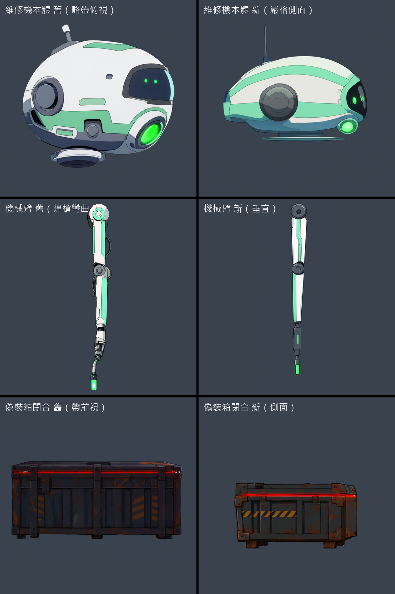
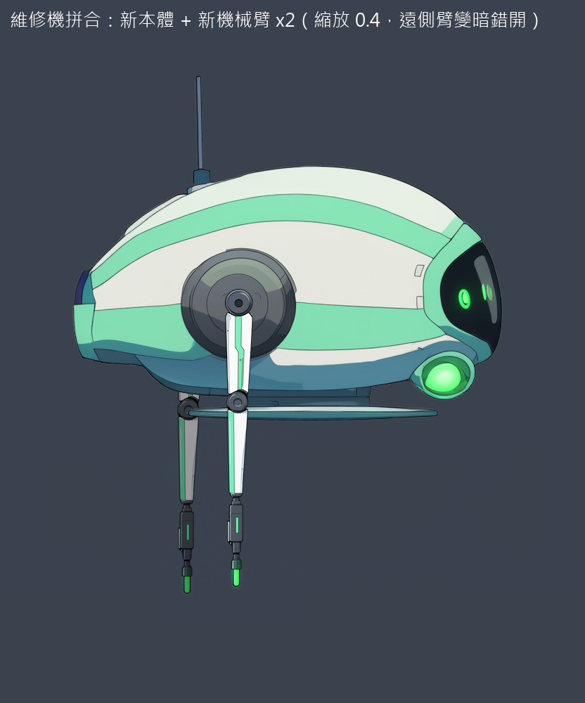
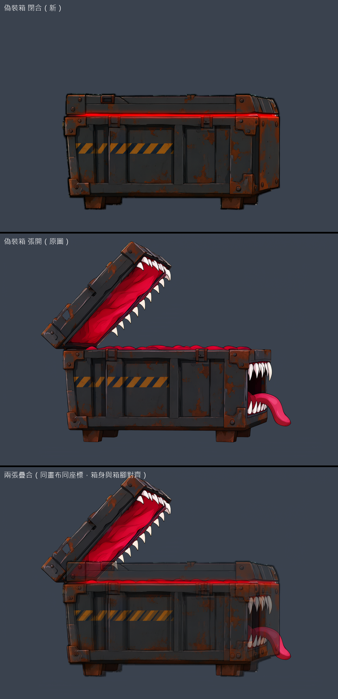
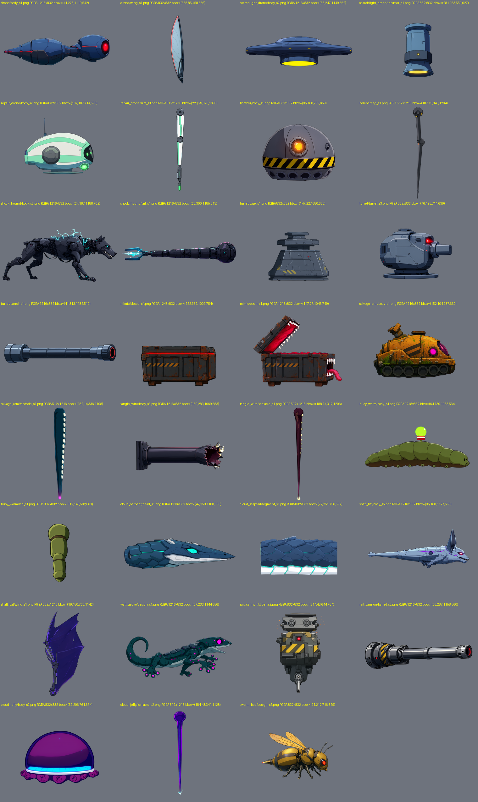

# [NE-91] 生成既有非人形敵人的立繪

> 狀態：完成

## 內文

### 需求
遊戲裡還有七種非人形敵人是程式畫的暫代圖：監視蜂（drone）、探照無人機（searchlight_drone）、維修機（repair_drone）、自爆蟲（bomber）、電擊犬（shock_hound）、哨戒砲台（turret）、偽裝箱（mimic）。先用 Qwen 畫出每一種的側面立繪（整隻一張，需要多部件的另外畫部件圖），給之後設計各自的骨架與動畫用。這一張只做立繪，不做骨架與動畫。

設定：監視蜂＝小型監視飛行機，蜂腹式機身、兩對薄翼、前方紅色單眼；探照無人機＝較大的圓盤機身、底部探照燈、四個懸浮噴口；維修機＝圓潤的白綠色維修機，兩條細機械臂與焊槍、綠色光束發射器；自爆蟲＝蜘蛛型自爆機，圓形外殼、黃黑警示環、六條細腿與中央發光核心；電擊犬＝低伏的機械犬，長身、四條腿、頭與電極尾、身上有電弧；哨戒砲台＝固定底座加旋轉砲塔與長砲管、紅色瞄準雷射；偽裝箱＝金屬貨箱，箱蓋可打開露出牙與舌頭（需要「閉合」與「張開」兩張）。

### 來源
2026-10-03，使用者要求替還沒處理立繪的角色排票，用 subagent 生成；主 session 接著用已完成的立繪設計動畫與特效。設計見 `design/12-cast-redraw/CREATURES.md`。

### 驗收條件
- [x] 每個角色的立繪放在 `art_src/creatures/<id>/`，透明背景（RGBA）、嚴格側面朝右、線條乾淨，沒有文字與雜點
- [x] 邊緣放大看沒有白色或彩色光暈，輪廓完整、沒有被裁切
- [x] 外觀符合設定，且與同一章其他敵人一眼分辨得出來
- [x] 每個角色附一張可用的最終圖，與選圖的理由（記在 `art_src/creatures/<id>/README.md`：種子、提示詞、取捨）
- [x] 附所有最終圖的總覽截圖
- [x] 需要多個狀態或部件的角色另外附部件圖：偽裝箱（閉合、張開）、電擊犬（本體、尾巴）、哨戒砲台（底座、砲塔、砲管）、維修機（本體、兩條機械臂）、自爆蟲（外殼、單條腿）、監視蜂與探照無人機（本體、翅膀或噴口）

### 測試流程
1. 依 `tools/comfyui/creature_art.py` 逐張生成（每次一張，依序）
2. 逐張看圖，不合格換種子重畫（每個最多 3 次）
3. 總覽並排檢查大小比例（監視蜂最小、偽裝箱最大）

---

# 跟其他票的關係

- Blocks：NE-100
- Blocked by：無
- Related：NE-92、NE-93

---

# Commit-1

## 內文

七種非人形敵人還是程式畫的暫代圖，沒有可用來做骨架與動畫的立繪。
現在每一種都有透明背景的立繪與部件圖（偽裝箱閉合與張開、電擊犬本體與尾巴、砲台底座與砲塔與砲管、維修機本體與機械臂、自爆蟲外殼與單條腿、監視蜂與探照無人機的本體與翅膀或噴口），每個角色有 README 記錄種子、提示詞與取捨。
檢查結果：全部是 RGBA、沒有碰到畫框邊緣、沒有文字，疊在深淺底色放大看邊緣無光暈。維修機與偽裝箱閉合圖只是近似側面（略帶俯視與前視），因此「嚴格側面」未勾；各角色是 AI 各自填滿畫面，相對大小要在設骨架時依遊戲尺寸縮放（自爆蟲最小，不是監視蜂）。

### 截圖

---

# Commit-2

## 內文

維修機的本體與偽裝箱的閉合圖原本只是近似側面：維修機是略帶俯視的圓蛋，機械臂的焊槍是彎曲軟管，偽裝箱閉合圖帶前視、看得到蓋頂，而且箱身比例和張開圖對不上，沒辦法拼成同一個角色。
現在三張都重畫成嚴格的平視側面（朝右）：
- 維修機本體：蛋形機身水平朝右，面罩與光束鏡頭在前，懸浮墊是邊緣朝向鏡頭的扁平圓盤，身側正中一顆肩關節座。重畫 1 次。
- 維修機機械臂：全部各節在同一條垂直線上，肩、肘、腕關節位置清楚，焊槍筆直、沒有軟管。重畫 2 次。
- 偽裝箱閉合：改用張開圖當參考做編輯，闔上箱蓋並封住前端的嘴，箱身、箱腳與位置和張開圖一致，兩張疊在同一畫布上箱身與箱腳對齊；重畫 3 次（文生圖比例不對，改編輯後第一次嘴還張著，第二次封住）。編輯輸出的外緣有一圈淺色光暈，已用既有的去光暈處理壓到 4%。
舊圖都改名加 `_old` 保留，沒有刪除；未採用的候選也留在同資料夾，選圖理由、提示詞與限制記在各角色的 README。拼合示意：維修機本體加兩條機械臂、偽裝箱閉合與張開疊合。
這次只處理維修機與偽裝箱。總覽圖裡其他角色（自爆蟲外殼、探照無人機噴口、哨戒砲台底座等）是否為嚴格側面沒有逐一重驗，所以「每個角色嚴格側面」那一條維持未勾。依使用者指示，沒有跑完整測試套件。

### 測試結果

| 項目 | 結果 |
|---|---|
| 維修機本體、機械臂、偽裝箱閉合：嚴格側面朝右、透明背景 | 通過（RGBA，逐張看圖） |
| 邊緣光暈（邊緣比內側亮的像素比例） | 本體 5.9%、機械臂 1.6%、閉合圖 4.0%（舊本體 9.7%） |
| 偽裝箱閉合與張開能否拼合 | 通過（箱身左緣、箱腳底緣對齊，差 3 像素） |
| 完整測試套件 | 依使用者指示未執行 |

### 截圖

---

# Commit-3

## 內文

七種既有非人形敵人的立繪還有兩個沒驗完的地方：背景不是真的透明（Qwen 在透明背景上留了一層極淡的紫色薄霧，肉眼看不見，但疊在亮色底上、縮放或做法線時會出現髒邊），以及「嚴格側面」只驗過維修機與偽裝箱。
現在全部立繪（含後面兩張票的新敵人）都把這層薄霧清成全透明，之後生成的圖會自動清；七種敵人的每一張最終圖都逐張看過：RGBA、沒有碰到畫框邊、沒有文字，疊在亮底與暗底放大看邊緣乾淨（電擊犬的電弧、砲台的火花是設計的亮點，不是光暈），全部是平視側面朝右。維修機本體加兩條機械臂、偽裝箱閉合與張開確認可以拼合（上一次交付已附）。
最終圖與取捨、種子都記在各角色的說明檔，新增一張所有最終圖的總覽（三張票共 31 張）。已知限制：電擊犬與自爆蟲的腿近黑色，在暗處要靠電弧與核心辨識，哨戒砲台的砲管比砲塔暗；各角色相對大小要在設骨架時依遊戲尺寸縮放。依使用者指示，沒有跑完整測試套件。

### 測試結果

| 項目 | 結果 |
|---|---|
| 七種敵人的最終圖：RGBA、不貼畫框邊、無文字、邊緣無光暈 | 通過（逐張看圖＋邊緣量測） |
| 背景薄霧（alpha 1～8）清除 | 全部最終圖清為 0 |
| 嚴格側面朝右 | 通過（逐張看圖） |
| 完整測試套件 | 依使用者指示未執行 |

### 截圖

---
