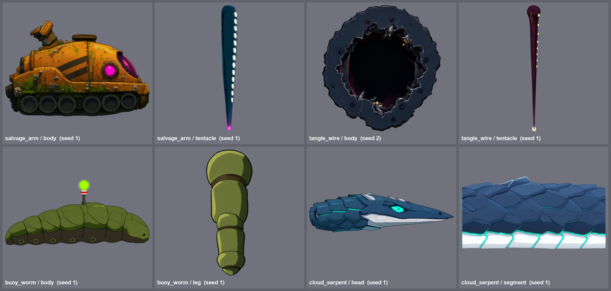
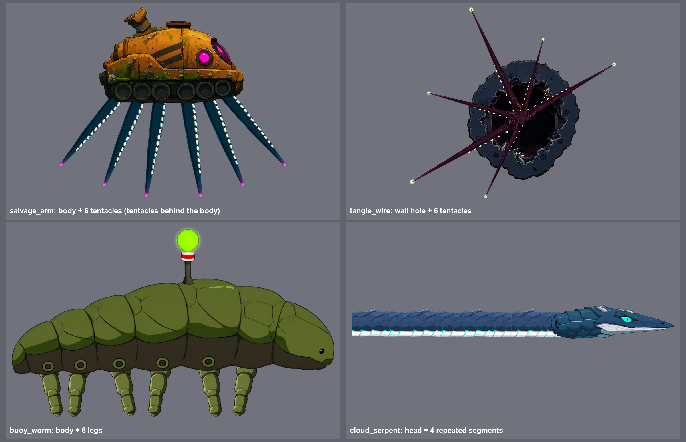
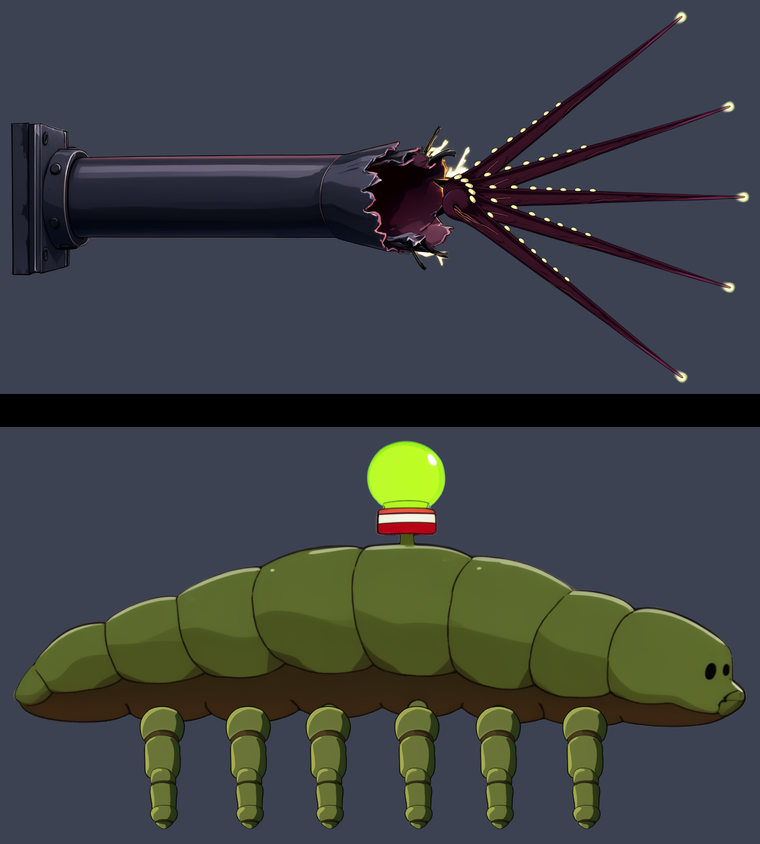

# [NE-92] 生成觸手、蠕行與多足新敵人的立繪

> 狀態：完成

## 內文

### 需求
依 `design/12-cast-redraw/CREATURES.md`，為觸手步行、蠕行與多足爬行的新敵人畫立繪。觸手與長蟲要用「重複零件」的方式畫：本體一張、單條觸手（垂直伸直、由粗到細、單側有吸盤）一張，之後由程式用網格變形裝起來，所以每張只畫一種東西、方向與比例要固定。

角色：打撈臂（第一章貨運站淹水區的迷你頭目，水下機械起重臂與觸手的混合體，本體加 6 條觸手樣式）、纏絲（第二章，藏在牆內的觸手簇，只需要觸手與牆洞口的本體）、浮標蟲（第一章淹水通道，水面爬行的蟲，圓胖身體、短腿、背上有浮標燈）、雲蛇（第三章，細長蠕行的長蟲，頭加一節身體的重複圖）。

### 來源
2026-10-03，使用者要求替還沒處理立繪的角色排票，用 subagent 生成；主 session 接著用已完成的立繪設計動畫與特效。設計見 `design/12-cast-redraw/CREATURES.md`。

### 驗收條件
- [x] 每個角色的立繪放在 `art_src/creatures/<id>/`，透明背景（RGBA）、嚴格側面朝右、線條乾淨，沒有文字與雜點
- [x] 邊緣放大看沒有白色或彩色光暈，輪廓完整、沒有被裁切
- [x] 外觀符合設定，且與同一章其他敵人一眼分辨得出來
- [x] 每個角色附一張可用的最終圖，與選圖的理由（記在 `art_src/creatures/<id>/README.md`：種子、提示詞、取捨）
- [x] 附所有最終圖的總覽截圖
- [x] 觸手類：每種有「本體」與「單條觸手」兩張圖，觸手垂直伸直（尖端朝下）、不透明邊緣乾淨，可以接在一起
- [x] 雲蛇：頭與可重複的一節身體各一張
- [x] 附把「本體加數條觸手」用簡單疊圖拼起來的示意，確認比例合理

### 測試流程
1. 依 `tools/comfyui/creature_art.py` 逐張生成（`--part body`、`--part tentacle`…）
2. 逐張看圖，不合格換種子重畫
3. 把觸手疊在本體上確認掛點與比例

---

# 跟其他票的關係

- Blocks：NE-98
- Blocked by：無
- Related：NE-91、NE-93

---

# Commit-1

## 內文

觸手、蠕行類新敵人沒有立繪，無法開始做網格變形。
現在打撈臂、纏絲、浮標蟲、雲蛇都有立繪：觸手類各有本體與單條觸手，雲蛇有頭與可重複的一節身體；拼合示意確認可以接起來、比例合理。
已知缺漏：纏絲牆洞口是正面視角（牆面本來貼在背景上）；浮標蟲本體只有 5 個腿座，不是 6 個，裝腿時補一個。

### 截圖

---

# Commit-2

## 內文

上一次交付有兩個已知缺漏：纏絲的牆洞口是正面視角（唯一不是側面的一張），浮標蟲的本體只有 5 個腿座、不是 6 個。
現在纏絲的本體改畫成嚴格側面：一根從牆上扯斷的粗導管，左端是貼牆的螺栓法蘭，右端是撕裂翻捲、冒火花的洞口，觸手從洞口向右扇形伸出；重畫 1 次就合格，舊的正面圓洞版保留供牆面貼圖用。浮標蟲本體重畫 3 次：前兩次要求「剛好 6 個」卻都被畫成 7 個，第三次改用編輯，在第二次的圖上移除尾端多的那一個，其他完全不動，得到剛好 6 個等距腿座。
兩個角色都做了新的拼合示意（纏絲 5 條觸手、浮標蟲 6 條腿），比例合理、接點對得上。打撈臂與雲蛇也一起檢查過（RGBA、側面、邊緣乾淨、背景薄霧已清），沒有要改的地方。依使用者指示，沒有跑完整測試套件。

### 測試結果

| 項目 | 結果 |
|---|---|
| 纏絲本體：嚴格側面、RGBA、邊緣乾淨 | 通過 |
| 浮標蟲本體：腿座數量 | 6 個 |
| 兩個角色的拼合示意 | 通過 |
| 打撈臂、雲蛇逐張檢查 | 通過 |
| 完整測試套件 | 依使用者指示未執行 |

### 截圖

---
