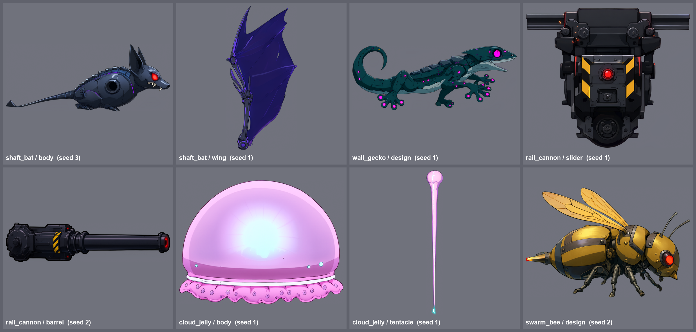
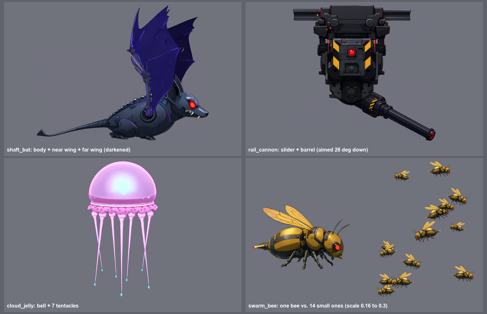

# [NE-93] 生成飛行、攀附、懸浮與軌道新敵人的立繪

> 狀態：進行中

## 內文

### 需求
依 `design/12-cast-redraw/CREATURES.md`，為其餘新敵人畫立繪：井道蝙蝠機（第二章升降井，翼式飛行機，金屬蝙蝠形，兩節翅膀與尾翼；需要本體與單側翅膀兩張，翅膀展開）、攀牆者（第二章，壁虎形攀附生物，四肢與長尾，貼附姿勢）、吊軌砲（第二章轉運站，天花板軌道上的砲，底座滑座與砲管；需要滑座與砲管兩張）、雲母（第三章，水母形懸浮機，鐘形本體與多條細觸鬚；本體與單條觸鬚兩張）、蜂群（第三章，單隻極小的蜂形小機，一張）。

### 來源
2026-10-03，使用者要求替還沒處理立繪的角色排票，用 subagent 生成；主 session 接著用已完成的立繪設計動畫與特效。設計見 `design/12-cast-redraw/CREATURES.md`。

### 驗收條件
- [x] 每個角色的立繪放在 `art_src/creatures/<id>/`，透明背景（RGBA）、嚴格側面朝右、線條乾淨，沒有文字與雜點
- [x] 邊緣放大看沒有白色或彩色光暈，輪廓完整、沒有被裁切
- [x] 外觀符合設定，且與同一章其他敵人一眼分辨得出來
- [x] 每個角色附一張可用的最終圖，與選圖的理由（記在 `art_src/creatures/<id>/README.md`：種子、提示詞、取捨）
- [x] 附所有最終圖的總覽截圖
- [x] 需要多部件的角色另外附部件圖並可拼合：蝙蝠機（本體、單側翅膀）、吊軌砲（滑座、砲管）、雲母（本體、單條觸鬚）

### 測試流程
1. 依 `tools/comfyui/creature_art.py` 逐張生成
2. 逐張看圖，不合格換種子重畫
3. 拼合示意檢查比例

---

# 跟其他票的關係

- Blocks：NE-99
- Blocked by：無
- Related：NE-91、NE-92

---

# Commit-1

## 內文

飛行、攀附、懸浮、軌道類新敵人沒有立繪。
現在井道蝙蝠機、攀牆者、吊軌砲、雲母、蜂群都有立繪：蝙蝠機本體與單側翅膀、吊軌砲滑座與砲管、雲母鐘罩與單條觸鬚；拼合示意確認可拼合。
已知限制：蝙蝠機本體只有一個肩座，遠側翅膀用同一張調暗疊在後面；雲母鐘罩偏淡粉彩，亮背景上對比低；吊軌砲與蝙蝠機本體偏暗，上遊戲後依光影再看。

### 截圖

---
