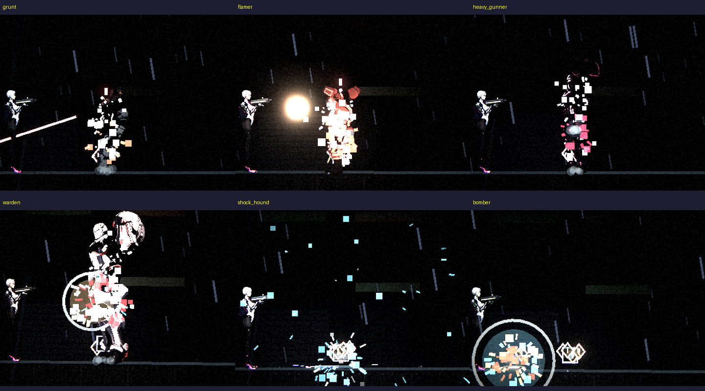

# [NE-94] 設計敵人專屬特效（腳步、受擊、死亡、招式）

> 狀態：完成

## 內文

### 需求
敵人的腳步、受擊火花、死亡演出與招式的特效原本全部共用同一套（受擊與死亡都是依敵人顏色的同一種爆散）。要讓每個敵人有自己的特效：腳步揚塵與震動（重裝機槍手與監管者走路會震動鏡頭、電擊犬與鎮暴員腳下冒火花）、受擊火花的種類（火花、電弧、煙、蒸氣）、死亡演出（各自的爆散色、閃光、鏡頭震動、頓幀，加上煙、蒸氣、電弧、餘燼、冷卻液等）、進入招式狀態時的特效（蓄力的光、衝刺的塵土、跳躍落地的震動、散熱的蒸氣）。特效全部是資料，不需要改程式。

### 來源
2026-10-03，使用者要求在主 session 為已畫好立繪的角色設計動畫、動作與特效。

### 驗收條件
- [x] 每個敵人（18 種）有自己的特效檔 `art/vfx/enemies/<id>.json`，死亡演出彼此不同（測試鎖定）
- [x] 腳步：依移動距離播放揚塵、火花與鏡頭震動，不同敵人的間隔與強度不同
- [x] 受擊：每個敵人有自己的火花顏色與種類（火花、電弧、煙、蒸氣）與閃光
- [x] 死亡：各自的爆散、閃光、鏡頭震動、頓幀與附加特效；頭目比一般敵人更大
- [x] 招式狀態：進入蓄力、衝刺、撲擊、散熱、鎖定等狀態時播放該敵人自己的特效（位置可選腳底、身體中心或槍口）
- [x] 資料缺失或格式錯誤時記錄具體位置並退回預設，不會崩潰；特效引用的狀態名稱必須存在於敵人腳本（測試鎖定）
- [x] 附遊戲內死亡演出的對照截圖

### 測試流程
1. 執行 `tools/screenshot.tscn -- --scenario=enemy_vfx --enemies=grunt,warden,...`，檢查每個敵人擊殺後 0.1 秒的畫面
2. 玩一次第一章與第二章，留意腳步與招式特效
3. 單獨執行 `EnemyVfxSuite`

---

# 跟其他票的關係

- Blocks：無
- Blocked by：無
- Related：NE-75～82、NE-89

---

# Commit-1

## 內文

敵人死亡、受擊、走路與招式的特效原本全部一樣。現在每個敵人有自己的特效資料：保全是橘色爆散加揚塵；火焰兵死時有橘色餘燼與濃煙，走路冒火星；鎮暴員衝撞時腳下揚塵並震動鏡頭、受擊濺電弧；重裝機槍手死時蒸氣與濃煙、每一步震動鏡頭，散熱時噴出蒸氣；監管者死亡是最大的演出（紅白爆散、電弧、蒸氣、頓幀 0.12 秒、強震動），跳躍落地震地；電擊犬死時電弧四散、撲出前低吼並冒電；自爆蟲死時大爆散、引信時閃黃光；維修機死時蒸氣與冷卻液；回收員瞬移前後有青色閃光、衝刺帶橘色殘光。
依使用者指示，沒有跑完整測試套件，只跑特效與各敵人相關測試（832 項、0 失敗）。還沒做的是在遊戲裡實際玩過一輪逐一調整強度。

### 截圖

---
