# [NE-95] 特效升級（VFX 2.0）：火花、煙、火球、衝擊波、電弧、燒融

> 狀態：進行中

## 內文

### 需求
原本的特效是 1～3 像素的方塊與線，看起來廉價。要換成更精細、有層次的特效：柔邊的光暈與星芒、沿速度拉長且頭部近白熱的火花、會膨脹變淡的煙、由亮黃漸成橘紅的火球、會閃爍飄升的餘燼、帶重力與自轉的金屬碎片、折射畫面的衝擊波、閃爍分岔的電弧，以及敵人死亡時零件逐塊燒掉、邊緣發出炭火光並噴餘燼的燒融。全部沿用固定容量、不產生新節點的做法，不影響效能；既有的特效呼叫（命中火花、爆散、揚塵、爆炸）自動變好。

### 來源
2026-10-03，使用者：「現在的特效好像都是直接用一些看起來很廉價的粒子效果，是不是也可以趁現在把它做的更精細一點，更細緻一些。最好是可以好到讓我驚艷。」

### 驗收條件
- [x] 粒子改用共用的柔邊貼圖圖集（程式生成），粒子有起訖大小與顏色、旋轉、自轉、閃爍、沿速度拉長；兩層（發光疊加、一般混合），仍是固定容量、零節點生成
- [x] 新增高階特效：火花、餘燼、煙、火球、碎片、星芒、衝擊波（折射）、電弧與電弧簇
- [x] 既有的命中火花、全方向爆散、揚塵、蒸汽、水花、彈殼與爆炸全部改用新特效；同一處同時的重複爆炸只畫一次
- [x] 敵人死亡可以設定燒融（零件逐塊燒掉、邊緣發光、噴餘燼，方向可由下往上、由上往下或無方向）與衝擊波、星芒；18 種敵人各有自己的設定
- [x] 玩家與敵人的槍口加上星芒與火花
- [x] 拍一組死亡演出的連續畫面對照
- [ ] 實際玩一輪調整強度與時機（爆炸的強度與時機已在真實關卡用腳本演出調過一輪，見 Commit-5；還沒有人親手玩過一輪確認手感）
- [x] 玩家的子彈飛行（彈道拖尾）、格擋與完美反彈、衝刺殘影、義體能力與重生等的特效也升級
- [x] 環境特效（雨、蒸汽、火花、霓虹閃爍）升級
- [x] 在所有光影設定下檢查不過曝、不會被泛光吃掉（26 份光影設定逐份連拍、量全白比例並逐張看過，見 Commit-5）
- [x] 特效克制：粒子數量整體減半、閃光與衝擊波減弱（`Fx` 的 `PARTICLE_SCALE`、`FLARE_SCALE`、`SHOCK_SCALE` 三個係數，要整體調整只改這三個）；電弧與閃光不過曝，只留必要的元件

### 測試流程
1. 執行 `tools/screenshot.tscn -- --scenario=enemy_vfx --enemies=... --times=0.05,0.2,0.5,...` 與 `tools/vfx_strip.py` 看死亡演出的連續畫面
2. 玩第一章與第二章，打各種敵人、引爆油桶與燃料槽
3. 單獨執行 `EnemyVfxSuite`
4. 原生 Forward+ 執行 `tools/vfx_exposure_probe.tscn -- --out=<資料夾>`，再跑 `tools/vfx_exposure_sheet.py <資料夾> --tag vfx`：每份光影設定一列（槍口、敵人死亡、油桶爆炸四個時刻、半空與青色爆炸），標題列出全白比例，超過門檻的會列出來

---

# 跟其他票的關係

- Blocks：無
- Blocked by：無
- Related：NE-94、NE-101（近戰揮砍與終結技、拾取與補給的特效、同屏多爆炸效能在 NE-101；玩家子彈、格擋、衝刺、義體、重生、環境與亮度預算在這張）、NE-117、BG-25、NE-258

---

# Commit-1

## 內文

使用者要求特效「合理且順暢就好、粒子要克制」，所以整體收斂：粒子數量減半、閃光與衝擊波減弱、爆炸只留核心閃光與少量火球、煙、火花、餘燼、碎片、電弧與閃光降低亮度避免過曝。
特效原本是幾個像素的方塊與線。現在有一套柔邊貼圖加兩層粒子場的新系統：火花是沿速度拉長、頭近白熱的亮線；爆炸有核心閃光、火球、煙、火花、餘燼、碎片與折射畫面的衝擊波；命中有星芒；機械敵人死亡會電弧四散；人形敵人死亡時身體先碎裂、再依雜訊逐塊燒掉，邊緣冒炭火光並噴餘燼，每個敵人有自己的顏色、時間與方向（保全由下往上燒、鎮暴員由上往下、重裝機槍手與電擊犬無方向）。槍口多了星芒與火花。
還沒做所以維持「進行中」：實際玩一輪調整強度，以及玩家子彈、格擋、衝刺、義體能力與環境特效的升級。依使用者指示，沒有跑完整測試套件，只跑特效、角色與各敵人、道具相關測試（2071 項、0 失敗）。

### 截圖

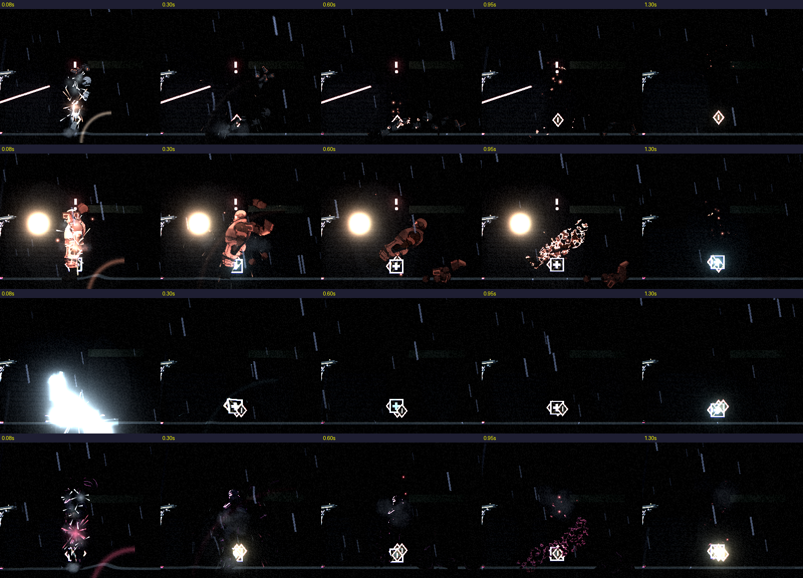

---

# Commit-2

## 內文

NE-95 剩下的項目收尾；與 NE-101 的分工：玩家與環境的特效升級與亮度預算在這張，近戰揮砍與終結技、拾取與補給、同屏多爆炸效能留給 NE-101。
- 彈道拖尾：子彈拖著一道漸細漸淡的尾巴（細長的軌道砲彈拖得最長、手槍與衝鋒槍短），榴彈與迫擊砲彈一路冒煙；拖尾長度與粗細是子彈規格的欄位。
- 格擋與完美反彈：格擋時盾面噴火花；完美反彈有星芒、折射衝擊波與沿反彈方向的火花扇，盾面中心炸出八道射線。
- 衝刺：殘影改成有頭、肩寬腰窄的軀幹與跨步腿的人形剪影，身後拉出速度線，起步時身後噴速度火花。
- 義體能力：啟動時身體中心有衝擊波與星芒；超頻中弧線前緣多一顆亮點，身上飄出火花。
- 重生：腳下光環收攏、由上往下收細的光柱、向上飄的餘燼，身體在 0.7 秒內淡入。
- 環境：雨有陣風（風速時快時慢）、近景雨滴有亮頭、落地有小漣漪；排氣孔每隔幾秒噴一陣更猛的蒸汽柱（噴發前孔口先抖一下）；霓虹偶爾連閃兩三次，重新點亮的瞬間亮一下，故障字會噴火花。
- 亮度預算：發光倍率統一夾在 3.5 以內（敵人預兆的警示光最亮到 3.5）；25 份光影設定的泛光超出量（倍率上限減門檻再乘泛光強度）最高 2.8，低於預算 3.0；程式裡寫死的倍率超過上限會讓測試失敗。
- 截圖用相容性渲染器拍（沒有泛光、粒子的加色混合也和正式畫面不同），所以強度與時機只依連續畫面與預算數字調整；真正的泛光觀感請在正式渲染器下玩一輪確認，所以「實際玩一輪調整強度與時機」維持未勾選。

### 測試結果

| 項目 | 結果 |
|---|---|
| 完整測試套件（含新增的特效升級套件 74 項） | 31342 項，新失敗 0（已知失敗 12 項與本票無關） |
| 亮度預算（25 份光影設定）與程式內寫死倍率掃描 | 通過 |
| 執行 log | 無非預期的 ERROR |

### 截圖

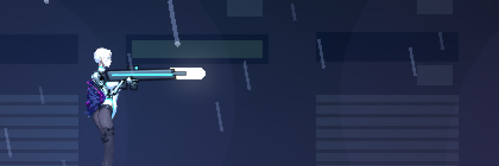
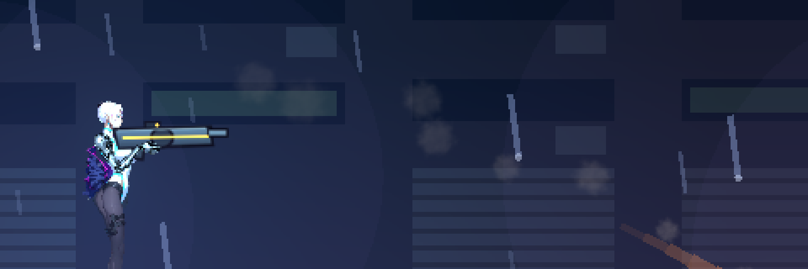
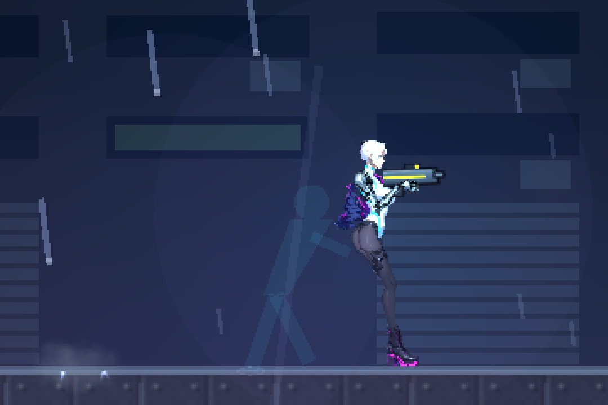
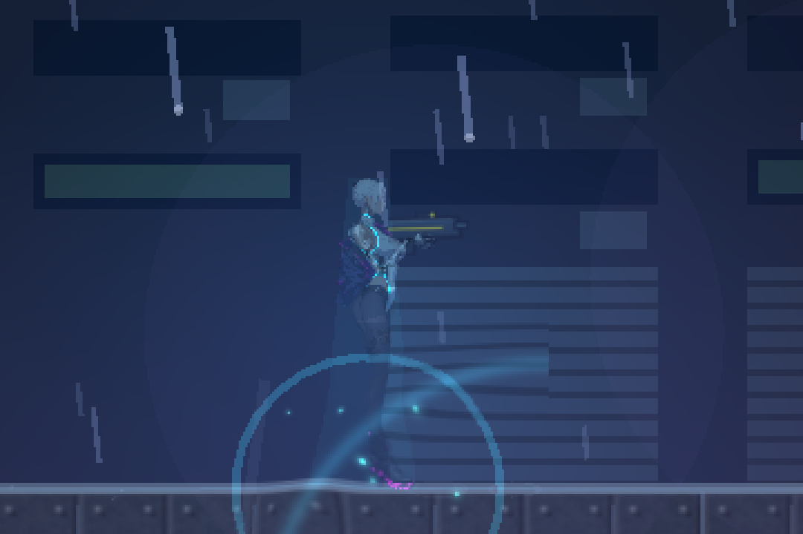
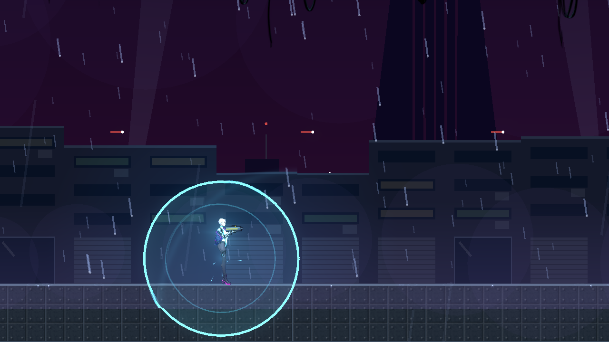
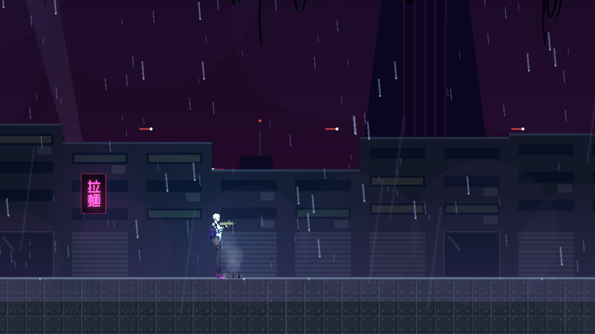

# Commit-3

## 內文

沿用既有程式生成圖集與特效系統，原生 Forward+ 審查找到實際退化：衝擊波使用 PlaceholderTexture2D，shader 在此渲染器拿到部分 UV，變成偏離接觸點的四分之一圓弧。獨立同 shader 對照重現後，只把環池共用的 carrier 換成一次建立的 2×2 ImageTexture（RGBA8 像素 payload 16 bytes，不等於專用 GPU 配置量）。環池、shader、配方、Atlas、三個克制係數及全局光影不變；play 不建立新節點／貼圖。

原生油桶另重現雙重曝光：雙陣營的兩個傷害節點都還畫舊圓盤，且粒子雖去重、flash／環境閃光／音效仍重複。本次讓傷害節點只做傷害；既有 Fx 配方單次播放全部視覺與聲音回饋，沒有重建特效系統或重產圖集。新增真實雙陣營回歸測試，確認環境閃光只一次、玩家與敵人都仍受傷。實景反彈與油桶修前／修後附圖，角色霓虹／曝亮仍由 NE-222／Session 1 處理。

### 檢查範圍

- 槍口：手槍／步槍／榴彈，取第一個實際 rendered frame，確認局部短閃可見。
- 命中：真實第一章市集的 WeaponSystem.fire、子彈、受擊與死亡循環，10 隻 grunt；不是只畫特效。
- 格擋／反彈：三檔連續圖，普通火花與反彈星芒／完整環可區分。高檔有局部白熱中心，不能把亮度預算通過當成所有場合人工不過曝。
- 死亡：grunt／warden／shock_hound，blackout、高檔、0.05／0.2／0.5／0.9 遊戲秒；慢播僅供視覺審查。
- 爆炸：真實 Breakable.hit_by_projectile 擊破油桶，沿現有延遲與雙陣營爆炸路徑，三檔 0.15／0.22／0.4／0.75 秒。市集榴彈圖沒有保證抓到峰值，不用它冒稱爆炸畫面。
- 雨／蒸汽：原生雨與已有兩章實景对照；蒸汽三檔預警／噴發。舊工具把預警拍在噴發後，本次修正取樣，assert 與 log 驗證預警時 `_burst_left=0`，噴發時 >0，沒有改遊戲內噴發時機。

`player_fx`／`enemy_vfx` 補 profile／三檔／慢播 CLI 並還原設定；`light_audit --no-capture` 加固定 seed95、真正未縮放牆鐘計時與 level/tile/quality 記錄。截圖、匯入、性能、測試逐次執行，用現有共享 GPU 鎖；無 ComfyUI 工作，沒有新增／重產粒子 Atlas。

### 性能與測試

同機 Linux、5 vCPU、Godot4.7、Forward+ llvmpipe；無實體 GPU。320×180、第一章市集115欄、10敵、seed95、每組14秒、vsync/FPS上限關閉、計時無截圖寫入、無刻意慢播／其他生成／大量測試。修前與修後同一工具、硬體、條件，原始 log 分開保存，不互比 Windows／Arc 數據，不刪除尖峰。最終數字與測試附後；[性能條件及完整原始結果](attachments/NE-95/performance.md)。

### 真實狀態與待審查

仍為「進行中」：本次交付原生腳本事件、真實受擊／爆炸與修正，不冒稱已由人實際玩完兩章、油桶／燃料槽与各類敵人；使用者實玩與實體 GPU 驗收仍待辦。25 份 profile 的亮度預算不等於在 25 份 profile 上都完成原生人工泛光檢查，因此取消過時的全部通過勾選。保持 PARTICLE_SCALE=.5、FLARE_SCALE=.7、SHOCK_SCALE=.55，沒有用全局減亮掩蓋角色曝亮。

[逐事件實玩審查與重現材料](attachments/NE-95/review.md) 列出下一發是否被遮、危險物是否可讀、爆炸退場與雨／蒸汽時機；保留人工條件給使用者，不勾選使用者確認。

### 截圖

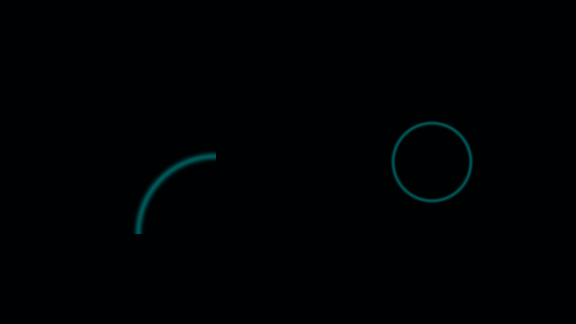
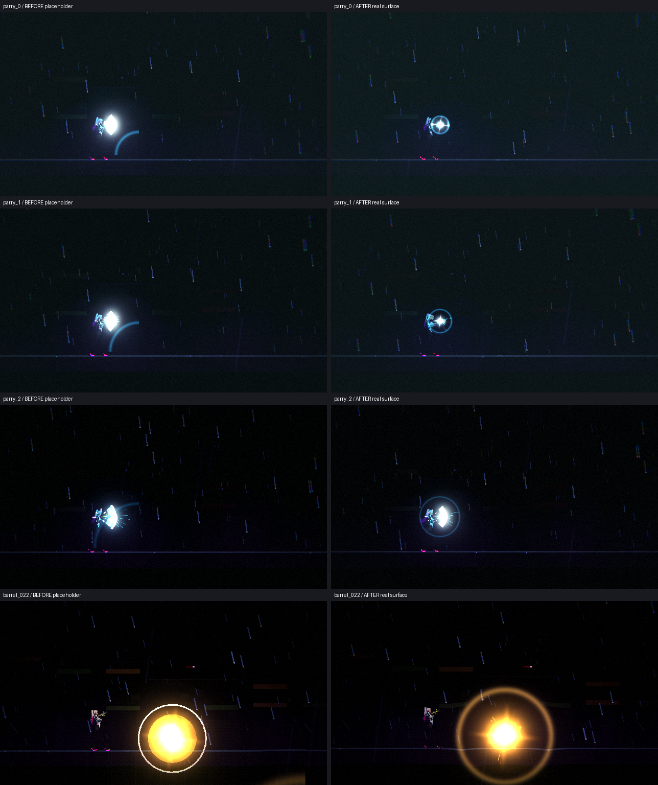
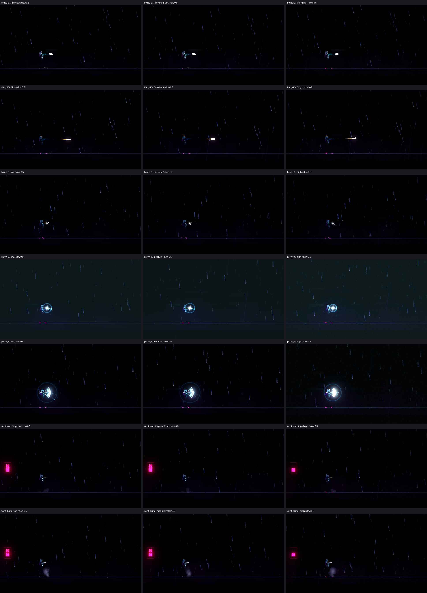
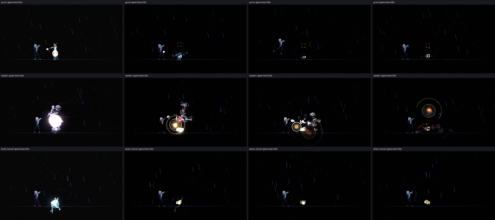
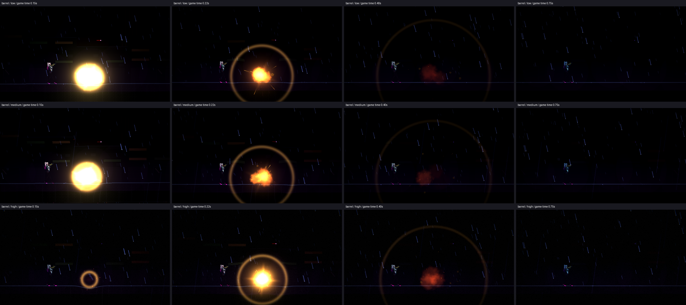
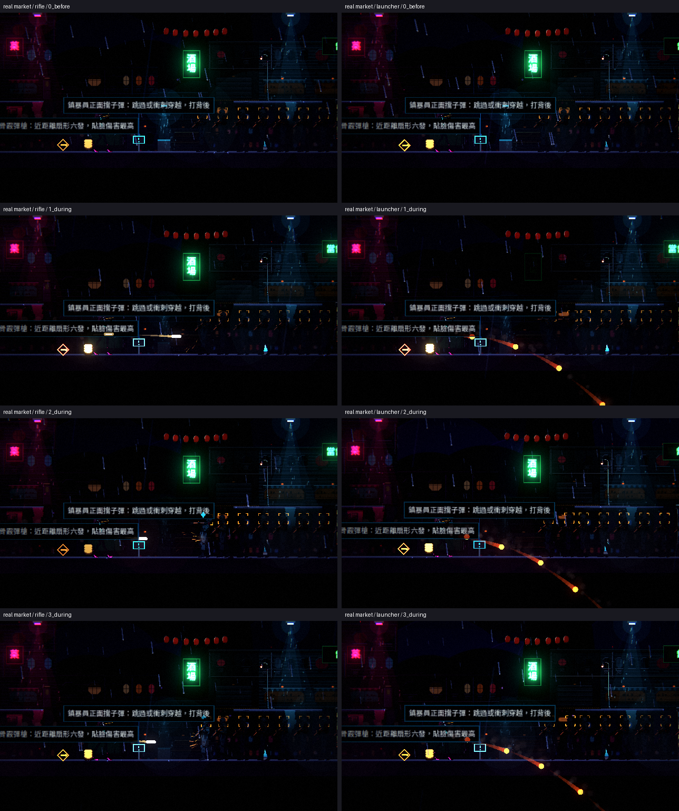

### 補充驗證歷程

新增環形貼圖回歸測試初次誤把 RefCounted 的 TestSuite 當成 Node，直接 add_child 導致解析失敗（0 checks，不當成通過）；改用既有 runner 後，FxUpgradesSuite 83 checks、零 new／known failures。初次失敗與修正後 log 均保存，未加入 known_failures。其後針對最終 core 差異，固定 ea59d91b 跑 changed 受影響測試，另單獨執行票內要求的 EnemyVfxSuite，最終結果附後。

### 最終交付驗證

`tools/run_tests_changed.sh ea59d91b`：66 組、48,042 checks、new／known failures 皆 0（159 秒）；另單獨 `EnemyVfxSuite`：258 checks、零 new／known failures。新增回歸的 `FxUpgradesSuite`：83 checks、零 new／known failures。原始 log、修前／中間／修後計時與執行條件都在 attachments/NE-95。圖像可解碼、標籤／來源對照與 diff whitespace 已檢查；沒有改 known_failures.txt。原生工具仍有 ObjectDB／resources-at-exit 清理警告，不宣稱所有 log 無 ERROR。CI API Forbidden，遠端 CI 未核對。

最終 mean（ms）低／中／高：步槍 32.87／38.21／39.08，榴彈 33.97／41.90／41.17。相對修前，低檔步槍 +5.2%、中檔榴彈 +13.3%，其他配置亦見完整表；只有一次樣本／配置，不認定整體無性能退化，也不把中間較快的試驗替代最終數據。實機、穩定重測與人工實玩仍待驗收，票保留進行中。

# Commit-4

## 內文

承接已合入的環形載體與雙重曝光修正，補前輪中檔榴彈 +13.3% 的可比性驗證。本輪主機已改為 EPYC 7763，從 19df828b 重建同機 A／B；兩邊角色、地圖、工具與其他 Session 成果一致，只向 A 恢復三個舊特效正式檔案。八次按 A1 B1 B2 A2 A3 B3 B4 A4 串行執行，保存全部資料與尖峰；無計時中截圖、匯入、生成或測試。

四次 mean 平均修前 51.9725 ms、修後 49.8775 ms（95.969%）；三組較快、一組約 +0.1%。此輪未重現 +13.3%，但不與前輪不同硬體的 ms 互比，不宣稱所有配置、實體 GPU 或 BG-17 的 105% 已通過。八次取得數據、命令退出 0；其中四次仍有 resources-at-exit ERROR，原始 log 保留，沒有說工具完整驗收全過。

量測後補目前角色版本的原生油桶修前／修後連續畫面，真實受擊沿現有雙陣營爆炸路徑；两邊使用 sRGB 擷取。審查工具可指定輸出，遇保存失敗回傳失敗，不覆寫旧交付圖。既有圖集、配方、克制係數、光影與角色資料均未更改。

### 測試與截圖

- 固定 19df828b 跑 changed 選擇：獨立審查工具沒有對應遊戲套件；實際原生工具退出 0、無腳本／保存 ERROR，不冒稱跑過完整遊戲測試。
- 額外指定本票 EnemyVfxSuite／FxUpgradesSuite：341 checks、零 new／known failures。沒有新增已知失敗豁免。
- 油桶慢播只作視覺審查，不算性能；資料、圖片與引用檢查通過。CI API Forbidden，未核對遠端 CI。

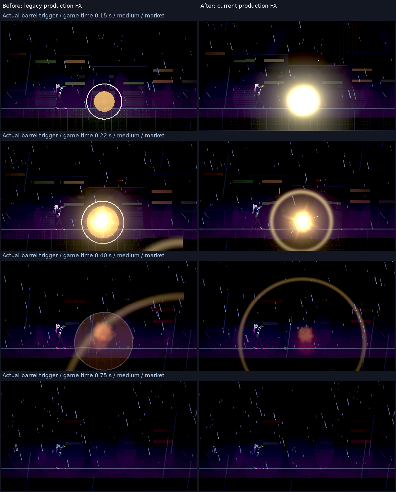
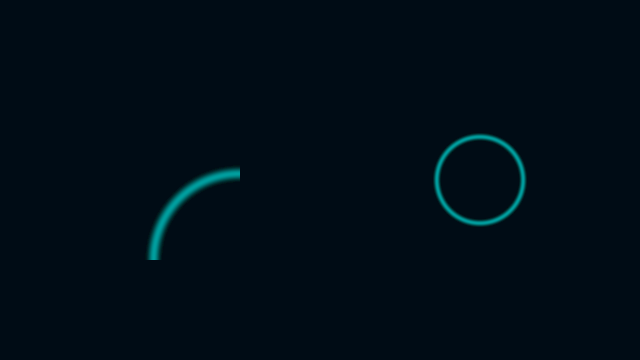

[同機條件、全部原始數據、重現腳本及限制](attachments/NE-95-followup/review.md)。仍為進行中：完整兩章人工實玩、25 profile 泛光、其他負載與實體 GPU 驗收未完成；未代勾使用者審查。

推送前 rebase 到 842dcd6c，保留 NE-224 新交接文件與證據；與本輪 19df828b 的遊戲、資料、美術、工具、測試程式 diff 為零。合併後仍固定 19df828b 核對 changed 選擇，獨立審查工具沒有關聯套件；本輪 341 checks 與原生畫面條件未變，沒有重跑或宣稱新的完整測試。

---

# Commit-5

## 內文

爆炸是幾團柔邊的光疊在一起：最亮的那一格中心糊成一片白、沒有形狀，0.1 秒後只剩一小團橘色，0.3 秒後是一抹暗紅，還會沉到地板底下；白色的面積隨光影設定差很多（占畫面 0.19%～2.52%），在白塔、夾層、供電室幾乎是一顆純白的球。照亮四周的光比火球早熄，暗的房間裡只看得到火球自己。另外，「所有光影設定下不過曝」一直只有數字預算，沒有逐份看過畫面。

爆炸改成平塗分層的火球，手法參考 Leyla In Veil 官方截圖（大塊、邊緣分明的橘黃火球，中心近白，暖光照亮房間與地面），畫法配合本作的賽璐璐美術：最裡面是一瞬的白熱心，外面是亮黃與橘色的硬邊雲團，撐開後停住再退場，退掉後露出後面往上飄的濃煙。層與層的顏色不相加，中心不會疊成白色；三層的明暗拉開，彩度被壓低的場景也看得出層次。貼地的爆炸只往上半邊炸開，並在地上留一道暖色反光；半空中的爆炸四面炸開。照亮四周的光改成跟火球一樣久，整個畫面被帶亮的幅度降低（油桶從 0.5 降到 0.32）。青色的連鎖爆炸與頭目身上的小爆炸用同一套畫法。

驗收：新做的巡檢在每一份光影設定下各演一次步槍槍口、敵人死亡、真的打破油桶後的爆炸（四個時刻）、半空中的小爆炸與青色爆炸，26 份 × 9 個時刻共 234 張，逐張量全白比例並逐份看過畫面。沒有一張超過門檻（特效 2 倍半徑以外全白 ≤ 0.5%、主角與旁觀敵人身上 ≤ 5%、爆炸 0.33 秒後整張畫面 ≤ 0.5%）；爆炸最亮那一格的全白面積收斂到 0.59%～1.27%，特效以外的全白最高 0.04%，主角身上最高 2.5%。同一套演出搬到第一章街道、第一章倉庫與第二章升降井入口，修前修後並排：火球成形、四周在火球亮著的時候都看得到。強度與時機是看這些畫面調的，不是人親手玩出來的，所以「實際玩一輪」那一條沒有打勾。低彩度的光影設定會把火球的暖色壓成灰粉色（明暗層次還在），這是全域調色的事，留給 NE-66。

### 測試結果

| 項目 | 結果 |
|---|---|
| 26 份光影設定巡檢（原生 Forward+、Arc B580，234 張） | 0 張超過門檻；修前同一套 182 張也是 0 張，但最亮那一格的全白面積 0.19%～2.52% |
| 光影品質「低」抽四份（市集、停電、白塔、晴天，36 張） | 0 張超過門檻 |
| 真實關卡（街道、倉庫、第二章升降井入口）修前修後 | 自然結束、0 錯誤；畫面見截圖 |
| 連續 72 次爆炸（每 0.25 秒同時 6 個，關垂直同步，修後—修前—修前—修後） | 每影格間隔中位數 6.63 → 6.73 ms，最慢一成 7.40 → 7.52 ms |
| 新增的自動檢查 | 通過：雲團是硬邊色塊、粒子先停住再變色、貼地的爆炸不沉到地板下也不往下炸、半空中的爆炸四面炸開、1.5 秒內全部退場 |
| 受影響測試（71 組） | 82097 項檢查；新失敗 0、已知失敗 0 |

做法與門檻見[光影設計的「爆炸改成平塗分層的火球」](../../design/08-lighting/DESIGN.md)，每張圖的原始數字與連爆計時在 [attachments/NE-95-blast](attachments/NE-95-blast/)。分支 `feature/scene-lighting`；提交見[遠端 main 上本票的提交](https://github.com/deadline314/Nest-Egg/commits/main/pm/Nest-Egg/%5BNE-95%5D%E7%89%B9%E6%95%88%E5%8D%87%E7%B4%9A.md)。

### 截圖

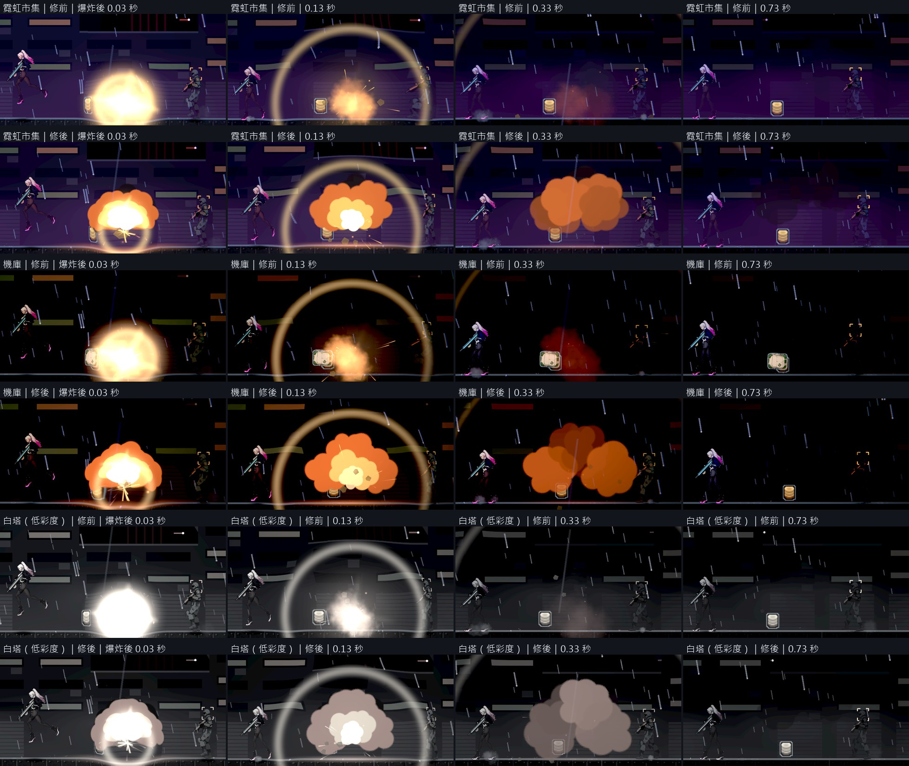

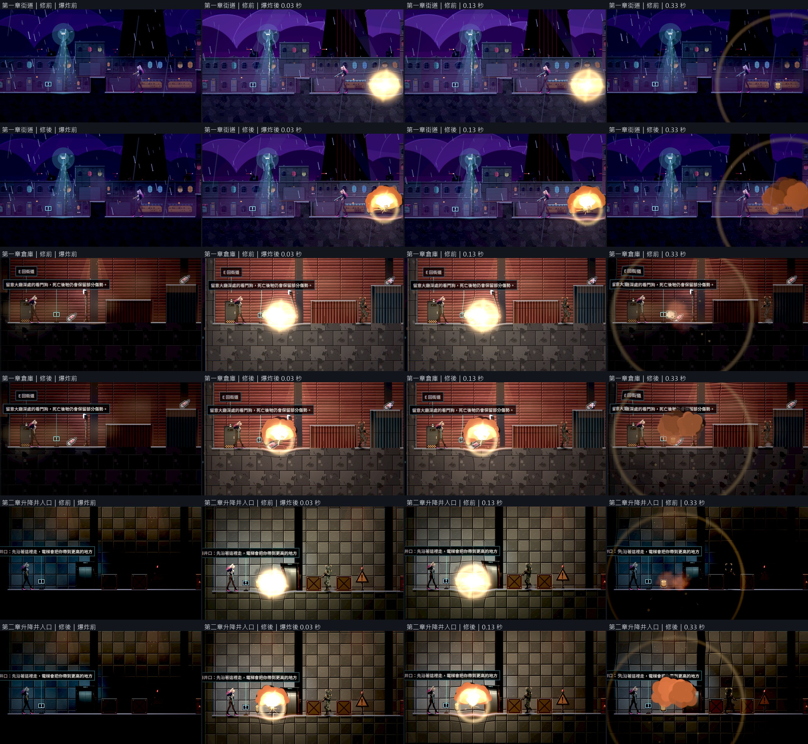

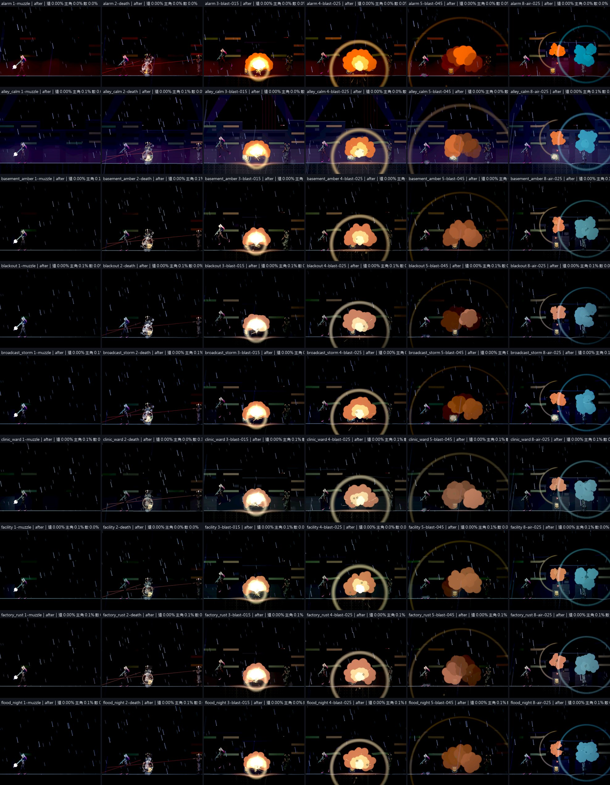

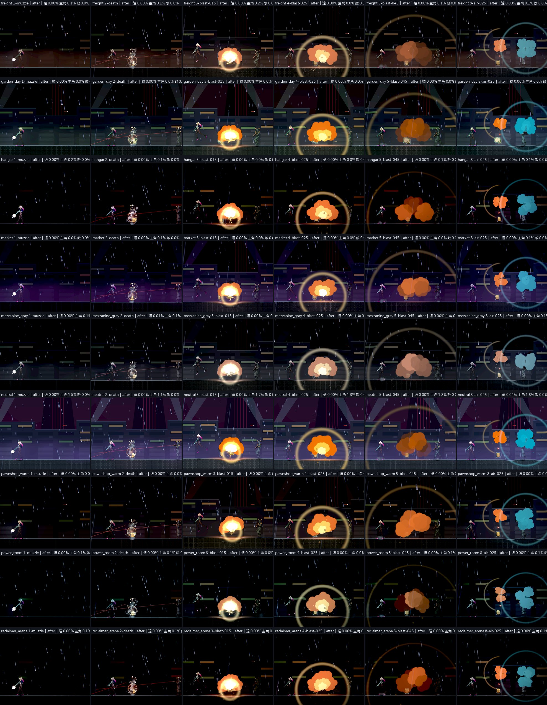

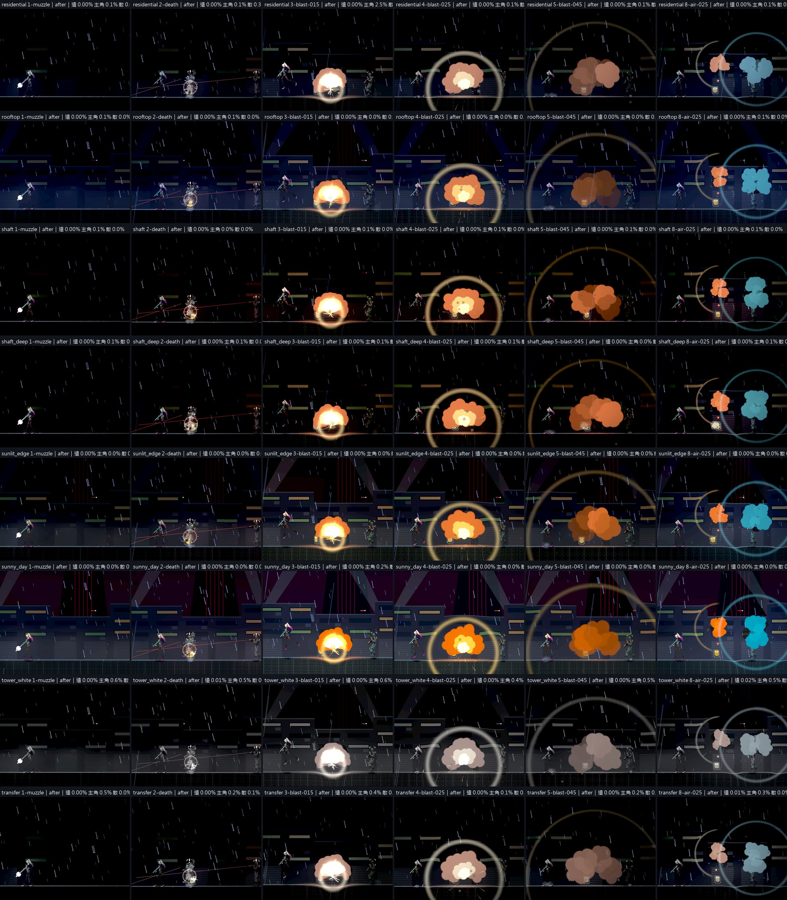
