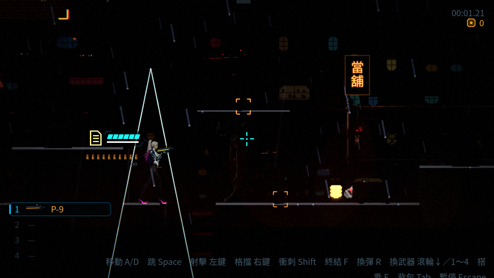
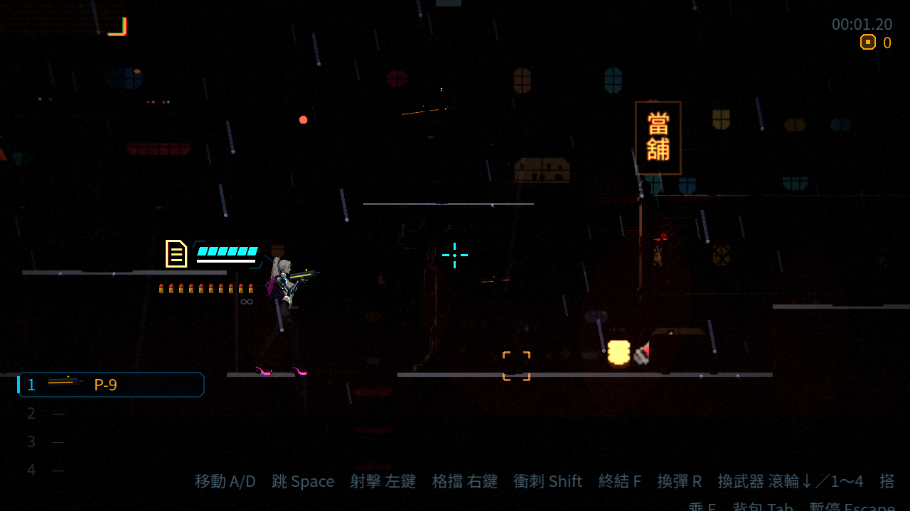
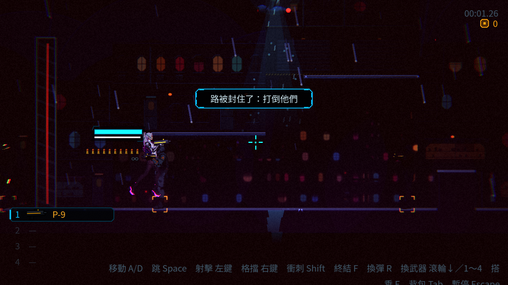
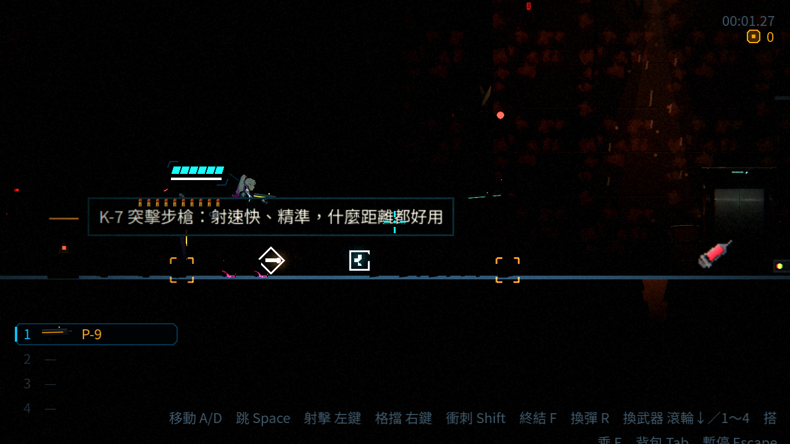
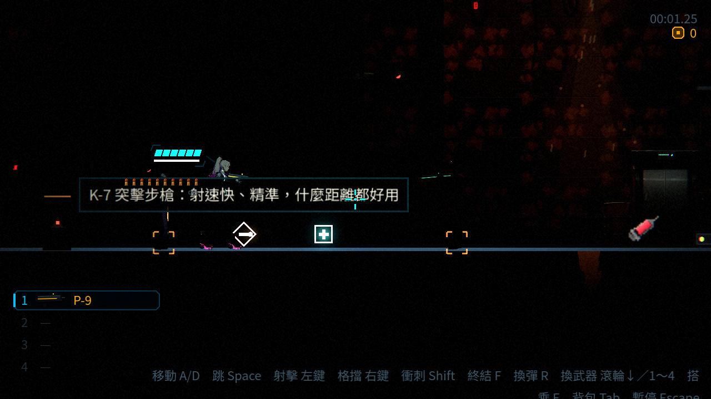
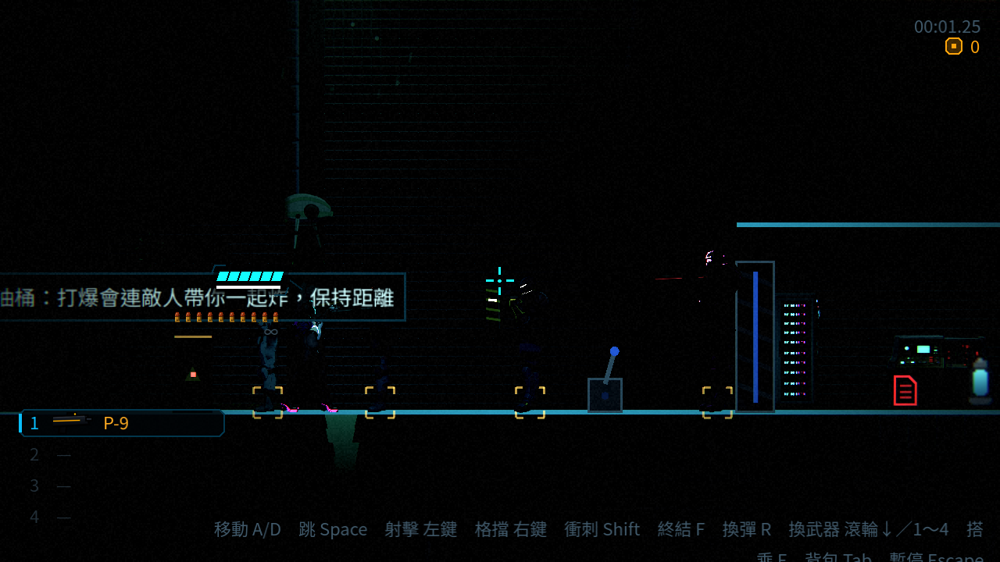
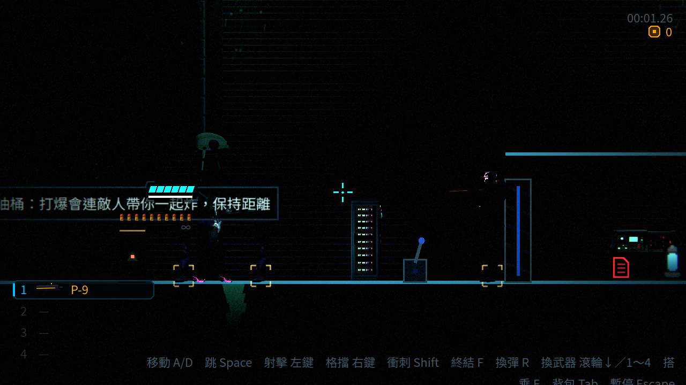
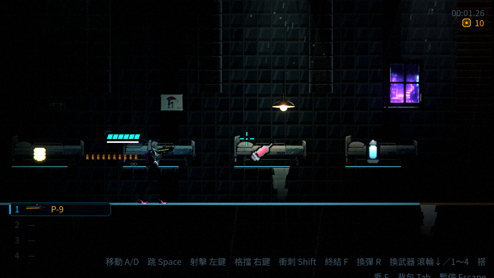

# [NE-97] 調整每章的敵人名單並重新擺放

> 狀態：進行中

## 內文

### 需求
使用者要求「每一個關卡的敵人都不重複」。目前第一章與第二章共用 8 種敵人（監視蜂、保全、偽裝箱、探照無人機、鎮暴員、電擊犬、狙擊手、哨戒砲台）。要依 `CREATURES.md` 第 1 節的名單把每種敵人只留在一章，空缺由新敵人補（先用既有敵人暫代，新敵人完成後替換），並重新擺放。注意：目前關卡的密度只是 Demo，正式劇情章節會疏很多，所以名單與擺放資料要容易整批調整，不要把現在的密度當標準。

### 來源
2026-10-03～04，使用者在敵人與 NPC 重畫的討論中提出；設計見 `design/12-cast-redraw/CREATURES.md`、`ANIMATION.md`。

### 驗收條件
- [x] 確認每章名單（`CREATURES.md` 第 1 節）後寫進設計文件，標明這是 Demo 配置
- [x] 每一種敵人只出現在一章，同一章內可以有很多隻；測試鎖定章節互斥
- [ ] 兩章的關卡擺放依新名單調整，每個區段仍可通關、預兆與難度曲線正常
- [x] 新敵人尚未完成的位置先用保留的暫代敵人，並在設計文件列出替換對照
- [x] 敗北圖鑑與攻略卡片與新名單一致
- [ ] 第一章與第二章各通關一次的遊戲內檢查

### 測試流程
1. 執行敵人配置截圖情境逐區段檢查
2. 手動玩兩章
3. 單獨執行各敵人套件與關卡配置測試

---

# 跟其他票的關係

- Blocks：無
- Blocked by：無（本 Session 使用者授權依現況決定名單）
- Related：NE-98、NE-99、NE-100、NE-178

---

# Commit-1

## 內文

依使用者授權保留最新第一章六種敵人，督察列入正式名單；舊六區 Demo 另列，不把它的密度帶回新章。第二章移除保全、鎮暴員、監視蜂、哨戒砲台、偽裝箱與電擊犬的重複配置，使用已交付的精銳保全與塔內生物。原三隻電擊犬群改為一隻蝙蝠機，避免直接換成三隻耐打敵人。舊第一章 Demo 的探照無人機／狙擊手改為監視蜂／擲彈兵。

互斥驗證涵蓋實際生成、增援與宣告名單，並核對接觸、子彈與現有攻略卡片。重新產生舊 Demo 時發現既有近戰武器與佈景重疊設定會遺失，已補回來源；兩個產生器重跑結果相同。

遊戲內流程驗證使用既有自動整合套件，會直接移動玩家與擊倒頭目；配置截圖凍結敵人以便比較。兩章人工實戰與預兆／難度體感仍未實測，相關條件保持未勾，票保持進行中。

### 測試結果

| 項目 | 結果 |
|---|---|
| 受影響範圍（明確基準 319eaf87） | 35,874 項，0 新失敗、0 已知失敗（18 組、4 程序） |
| 合併最新 main 後 | Music／第二章／第一章地圖 1,762 項全通過，保留 NE-154 頭目音樂路由與 NE-222 接合規範 |
| 配置安全間距 | 保留既有檢查；電力室吊軌砲 376/5、攀牆者 382/4，避免緊接在別種敵人後方 |
| 產生器一致性 | 兩圖重產逐位元相同；舊 Demo 除兩個敵人字元外保持既有輸出 |
| 畫面 | Godot 4.7 Forward+ llvmpipe 軟體 Vulkan，沒有 GPU 效能或人工通關宣稱 |

### 截圖

