# [NE-97] 調整每章的敵人名單並重新擺放

> 狀態：進行中

## 內文

### 需求
使用者最新要求跨章最多一至兩種重複敵人；本輪採最多兩種重複身份，同章可多次遭遇。舊配置曾讓第一章與第二章共用 8 種敵人（監視蜂、保全、偽裝箱、探照無人機、鎮暴員、電擊犬、狙擊手、哨戒砲台）。要依 `CREATURES.md` 第 1 節的名單以章節生態、戰術差異與最多兩種跨章重複規則配置敵人，空缺由新敵人補（先用既有敵人暫代，新敵人完成後替換），並重新擺放。注意：目前關卡的密度只是 Demo，正式劇情章節會疏很多，所以名單與擺放資料要容易整批調整，不要把現在的密度當標準。

### 來源
2026-10-03～04，使用者在敵人與 NPC 重畫的討論中提出；設計見 `design/12-cast-redraw/CREATURES.md`、`ANIMATION.md`。

2026-10-10需求補充：序章至第三章及後續章節需要各有特色的敵人，缺素材按具體敵人開票生成／分割／骨架／動畫與音效；詳見[整體設計](../../design/20-campaign-experience/DESIGN.md)。

### 驗收條件
- [x] 確認每章名單（`CREATURES.md` 第 1 節）後寫進設計文件，標明這是 Demo 配置
- [x] 跨章最多兩種重複身份，同章可多次遭遇；名單、增援、圖鑑與配置檢查符合最新規則，保留舊交付基線。
- [ ] 兩章的關卡擺放依新名單調整，每個區段仍可通關、預兆與難度曲線正常
- [x] 新敵人尚未完成的位置先用保留的暫代敵人，並在設計文件列出替換對照
- [x] 敗北圖鑑與攻略卡片與新名單一致
- [ ] 第一章與第二章各通關一次的遊戲內檢查

- [x] 逐章列出敵人用途、重複身份、正式素材與缺口；新版第二、三章配置與劇本、成長、場地一致。

### 測試流程
1. 執行敵人配置截圖情境逐區段檢查
2. 手動玩兩章
3. 單獨執行各敵人套件與關卡配置測試

---

# 跟其他票的關係

- Blocks：無
- Blocked by：無（本 Session 使用者授權依現況決定名單）
- Related：NE-98、NE-99、NE-100、NE-178、NE-266、NE-271、NE-272

---

# Commit-1

## 內文

依使用者授權保留最新第一章六種敵人，督察列入正式名單；舊六區 Demo 另列，不把它的密度帶回新章。第二章移除保全、鎮暴員、監視蜂、哨戒砲台、偽裝箱與電擊犬的重複配置，使用已交付的精銳保全與塔內生物。原三隻電擊犬群改為一隻蝙蝠機，避免直接換成三隻耐打敵人。舊第一章 Demo 的探照無人機／狙擊手改為監視蜂／擲彈兵。

互斥驗證涵蓋實際生成、增援與宣告名單，並核對接觸、子彈與現有攻略卡片。重新產生舊 Demo 時發現既有近戰武器與佈景重疊設定會遺失，已補回來源；兩個產生器重跑結果相同。

遊戲內流程驗證使用既有自動整合套件，會直接移動玩家與擊倒頭目；配置截圖凍結敵人以便比較。兩章人工實戰與預兆／難度體感仍未實測，相關條件保持未勾，票保持進行中。

### 測試結果

| 項目 | 結果 |
|---|---|
| 受影響範圍（明確基準 319eaf87） | 35,874 項，0 新失敗、0 已知失敗（18 組、4 程序） |
| 合併最新 main 後 | Music／第二章／第一章地圖 1,762 項全通過，保留 NE-154 頭目音樂路由與 NE-222 接合規範 |
| 配置安全間距 | 保留既有檢查；電力室吊軌砲 376/5、攀牆者 382/4，避免緊接在別種敵人後方 |
| 產生器一致性 | 兩圖重產逐位元相同；舊 Demo 除兩個敵人字元外保持既有輸出 |
| 畫面 | Godot 4.7 Forward+ llvmpipe 軟體 Vulkan，沒有 GPU 效能或人工通關宣稱 |

### 截圖

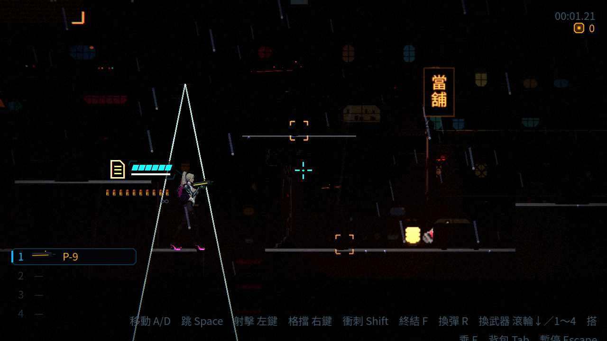
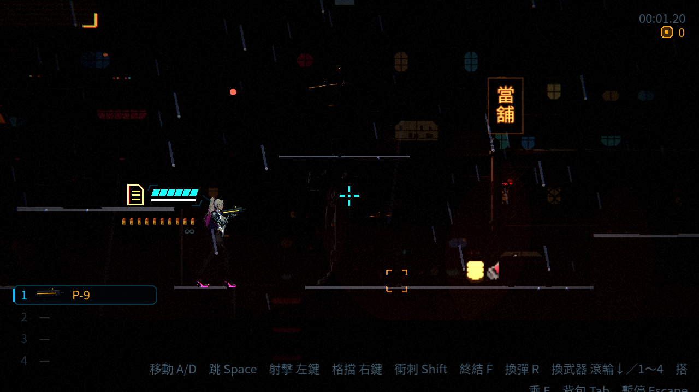
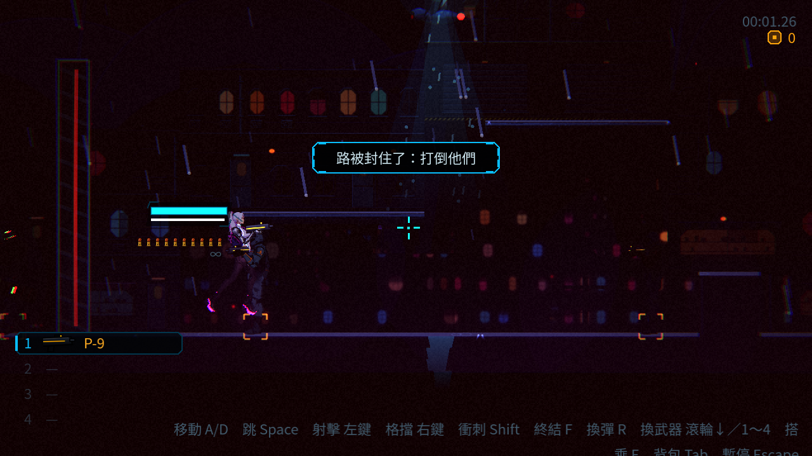
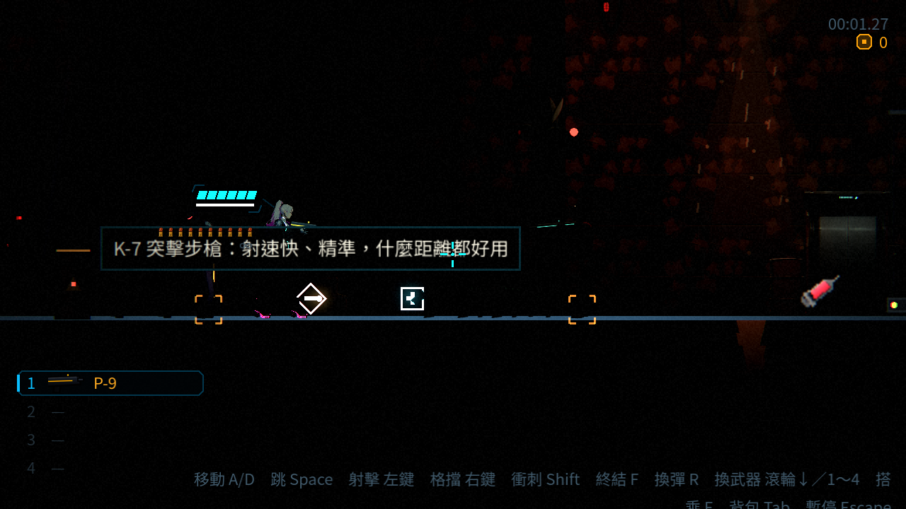
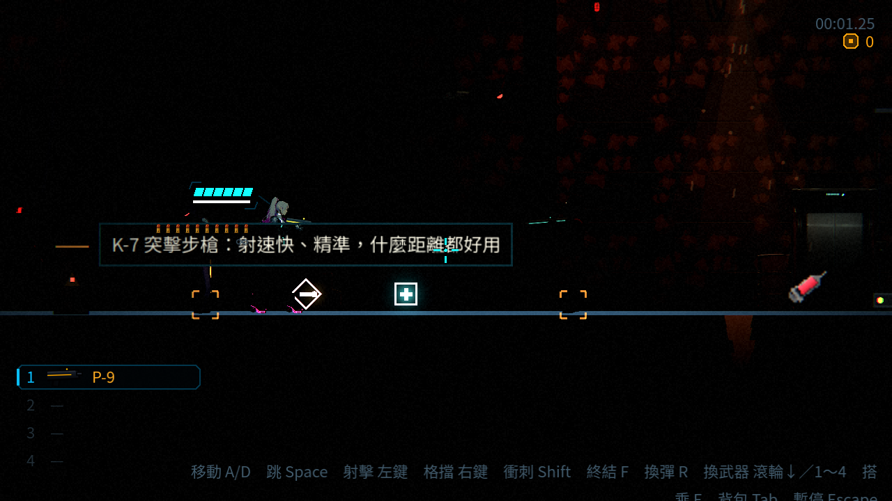
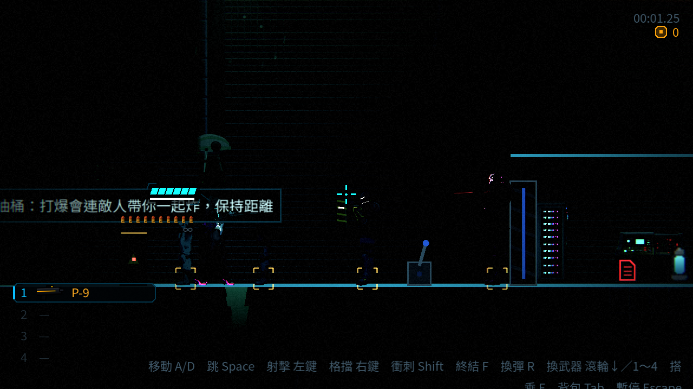
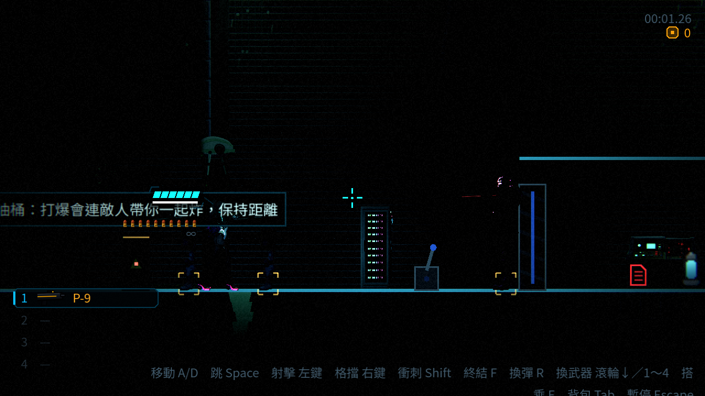
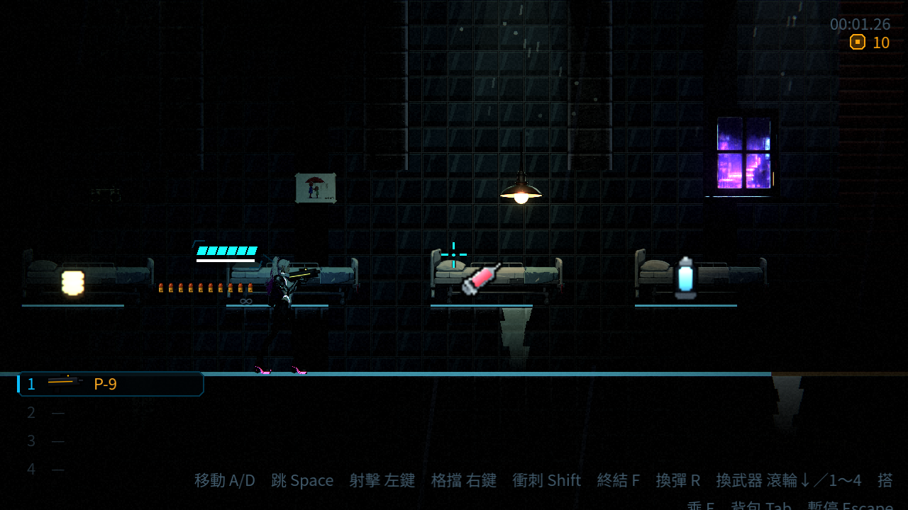

---

# Commit-2（第一章用途、擺放與缺口）

## 內文

**問題**：第一章的六種敵人已定，但沒有一份「每種敵人在哪、做什麼、素材缺什麼」的對照，也還沒跟本 Session 的看門狗重做與場地投擲物一起核對。

**改動**：只整理第一章（第二、三章等各章落地時再做）。依實際關卡資料列出每種敵人的數量、區域與欄位、用途（教什麼）、正式素材與缺口，以及街道與倉庫的難度引入順序。本 Session 的擺放改動：看門狗與狗屋移到倉庫前廳第 58 欄（左側黃黑線剛好在貨櫃右邊、離電話亭 18 格以上），倉庫與街道加入可撿取的投擲物與油桶（NE-254）。

**驗收**：自動檢查：第一章與其他章的敵人沒有重複身份；安全區沒有敵人；所有接觸與子彈死因都有攻略卡；出入口 18 格、每區 8 分鐘節奏預算、新種類間隔與第一章地圖檢查全過；看門狗戰三種難度有機器人實戰紀錄（NE-253）。尚未做：真人從正式入口完整打完第一章的遊戲內檢查（待本機原生驗收）；第二章的同樣整理不在本次範圍，相關條件維持未勾。

分支：`feature/combat`，提交：https://github.com/deadline314/Nest-Egg/commit/c42ff9c5

[第一章用途、擺放與缺口](../../design/12-cast-redraw/CHAPTER_ROSTERS.md)

---

# Commit-3（併入四足看門狗與產生器擺放後的核對）

## 內文

**問題**：第一章的對照表還寫著看門狗暫用人形骨架；投擲物原本直接改在產生器的輸出檔上；擺放改動後沒有重跑場景檢查。

**改動**：對照表更新為四足機械犬（頭、砲塔、背部判定跟著四足零件），投擲物改由第一章產生器擺放（NE-254）；敵人位置沒有再動。

**驗收**：章節互斥檢查（每種敵人只屬一章、增援也算）、敗北攻略卡、安全區無敵人、遭遇表與地圖一致全過，第一章與第二章之間重複身份為 0，低於「最多兩種」的上限；舊 Demo 基線保留，所以第一條打勾。場景檢查（敵人與物件卡牆、懸空、出入口）街道、倉庫、倉庫深處都是 0 錯誤、0 警告。新版第二、三章的地圖與劇本尚未落地（ST-18～21），兩章真人通關仍待本機原生驗收，其餘三條維持未勾。

### 測試結果

| 項目 | 結果 |
|---|---|
| 第一章地圖、第一章敵人、投擲物 | 全過（見 NE-252～254 同批的受影響範圍） |
| 場景檢查（街道、倉庫、倉庫深處） | 0 錯誤、0 警告 |

分支：`feature/combat`，提交：https://github.com/deadline314/Nest-Egg/commit/876a8ed1

---

# Commit-4（新版第二、三章的名單與第三章擺放）

## 內文

**問題**：名單只認得第一章和舊版第二關；新版第二章（十張地圖）與第三章（九張地圖）落地後，互斥檢查沒涵蓋它們，也沒有一份第二、三章的用途與缺口對照。

**改動**：名單的章節代號改用故事端的章節 id：新版第二章 `ch2_heron`、第三章 `ch3_clearwater` 各自登記全部地圖；舊版第二關仍記在原本的 `chapter_02`（舊 Demo，不從新遊戲入口到達）。第三章的擺放依劇本完成（NE-272 的兩種巡檢器、NE-271 的守門人），數量寫在第三章產生器的一張遭遇表，整批調整改表重跑。設計文件補了跨章重複身份總表（三章都是 0 種，規則上限 2 種）、新版第二章的戰鬥區用途與缺口、第三章每種敵人的數量、位置、用途、素材與缺口，以及引入順序與賞金。第二章的新身份與市集遭遇由第二章戰鬥 Session 配置（NE-265、NE-266），這次沒有動第二章的地圖。

**驗收**：互斥檢查涵蓋新版第二、三章全部地圖（第二章目前沒有敵人）；第三章敵人測試逐張地圖確認只在戰鬥區、近戰遠距各最多一、安全區為零；經濟守門通過。未勾的三條：第二章的新身份尚未配置（NE-266）、兩章真人通關待本機原生驗收、第二章的逐章對照要等配置落地才完整。

### 測試結果

| 項目 | 結果 |
|---|---|
| 受影響範圍（章節名單、可讀性取樣、第二章攻擊型敵人歸屬）＋第三章敵人、經濟 | 2,584 項 0 失敗 |

分支：`feature/awesome-wozniak-gdkpap`，提交：https://github.com/deadline314/Nest-Egg/commit/51e84d49

[逐章用途、擺放與缺口](../../design/12-cast-redraw/CHAPTER_ROSTERS.md)

### 截圖

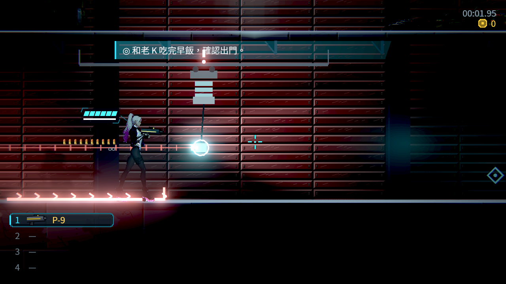
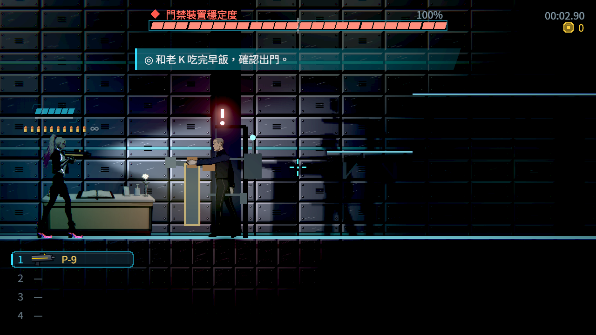

---

# Commit-5（三章目前配置與素材缺口）

## 內文

舊對照仍把新版第二章寫成沒有敵人，第一章部分外觀名稱也已過時。現在逐章列出實際三十個區域中的敵人、固定與動態增援、用途、現有外觀及專屬素材缺口；第二章入口與貨道已有四場短戰、帳房已有阿勇與兩名動態小弟，第三章守門人的通訊器增援也列入核對。

三章重複身份為零；第二章兩名普通敵人仍借用第一章打手／槍手外觀，已明確標成暫代。零種身份重複沒有被用作外觀不重複的證明。舊 Demo 與保留種類另列，固定擺放不灌入動態增援或劇情報酬。各章用途、素材與缺口對照，以及新版第二、三章的遭遇、繞道、成長和場地核對完成，因此最後一條打勾。

### 測試結果

| 項目 | 結果 |
|---|---|
| 實際三章配置與資源對帳 | 506 項、0 問題；30 區域；零跨章重複身份 |
| 從名單漏掉實際敵人的負控制 | 明確列出押運手來源，拒絕並以代碼 1 結束 |
| 名單格式損壞的負控制 | 記錄具體欄位，代碼 1；沒有腳本錯誤 |
| 第一章地圖、第二／三章敵人、經濟 | 2,545 項、0 新失敗、0 已知失敗；四個分片沒有 ERROR 或退出洩漏 |

[目前逐章對照](../../design/12-cast-redraw/CHAPTER_ROSTERS.md) · [原始報表與執行證據](attachments/NE-97-current-rosters-2026-11-11/README.md)

---

# Commit-6（在平地先讀街道通訊）

## 內文

從正式新遊戲走完序章、廚房、屋頂簡報與電話亭後，凜要連跳爬上街道才能接近第一名清掃兵。原本燈通報市集封路時，凜正跳到半空，讀完還得接回原來的攀跳。現在通訊放在電話亭巷口之後、第一段攀跳之前的平地。通訊文字、確認方式、敵人及地形維持原本配置。兩章通關與全部遭遇的驗收仍待完成。

### 測試結果

| 項目 | 結果 |
|---|---|
| 受影響範圍 | 53 套，58,903 項，0 新失敗、0 已知失敗 |
| RX 9070 XT 實機 | 同一正常難度存檔。修前接通時腳離地、垂直速度 −45 px/s，修後站在地面、垂直速度 0。兩次都用確認鍵讀完，靠原移動與跳躍走到第一場戰鬥前，均無受傷或死亡 |
| 街道實戰續走 | 兩段連續隔離存檔。用原手槍打過清掃兵、槍手、打手、監視蜂與督察，原路障波次保存通行並走進倉庫，0 死亡 |
| 地圖原始資料 | 只移動同一標記的兩個格位。敵人、路線地形、舊存檔位置對照和提示相同 |

[前後實機與重跑紀錄](attachments/NE-97-street-radio-2026-11-19/README.md)

### 截圖

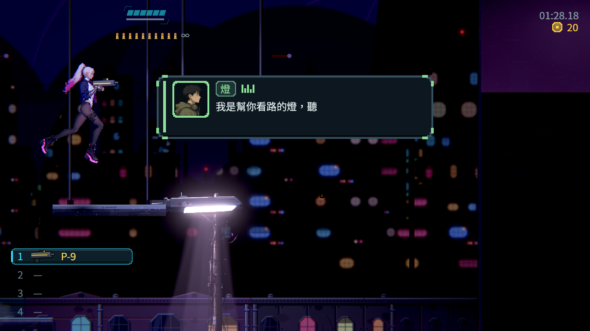

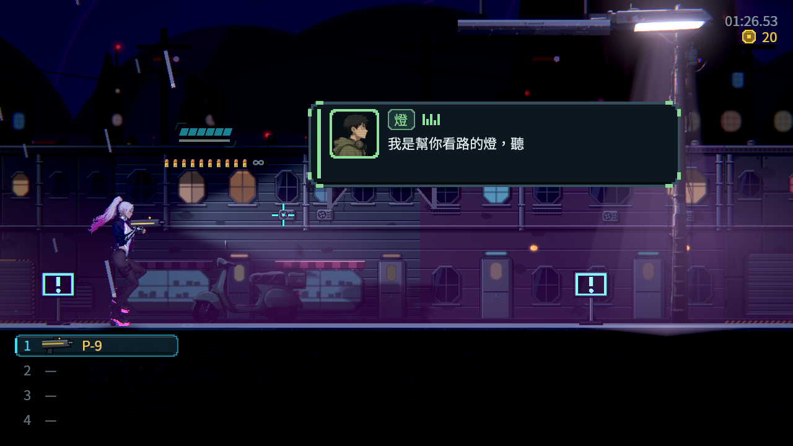

---

# Commit-7（普通難度第一章實際過關與跨章存檔）

## 內文

延續街道通關的真實存檔，在正常難度走過倉庫、浮橋、倉庫深處、館外交接櫃、復原館和麵攤。看門狗的三階段都由實際接戰觸發，隔牆隨擊倒打開。用原本的電話亭備份、操作 A 和 B、踩水坑踏板，經一次溺水觸發初次建檔。續玩時浮橋及水閘仍有效，凜跳過八層原平台進倉庫深處，拿到資料盤才取得二段跳，靠二段跳跨過 112 像素高的落差並從上層通道離開。

原交接櫃收走資料盤，回執與摘要進包。與阿梨吃完麵、從正式出口回家，播完章末後由 Main 進第二章。跨程序繼續仍保留第一章完成、實際資料盤交付、回執、摘要與一次水坑死亡。之後從第二章當舖結算並修好第一台收音機。此輪完成第一章遊戲內流程，第二章完整通關及首次遊玩體感尚待驗收，原條件維持開啟。

### 測試結果

| 項目 | 結果 |
|---|---|
| 實機主線 | Godot 4.7.2、RX 9070 XT、Forward+。普通難度，原輸入與出入口，接續實際寫出的存檔，1 次水坑死亡 |
| 看門狗 | 真實接戰 3 階段、16 次背部弱點命中、正常隔牆寫入，該戰 0 死亡 |
| 水坑與浮橋 | 兩個開關真實操作，踩踏板觸發溺水與復原，冷續玩保留水位、浮橋和閘門 |
| 章末交付 | 真實拾取和交出資料盤，正式結果寫入，第二章以同一份存檔開啟 |

[實機走查、存檔與原始紀錄](attachments/NE-97-chapter-one-route-2026-11-19/README.md)

### 截圖

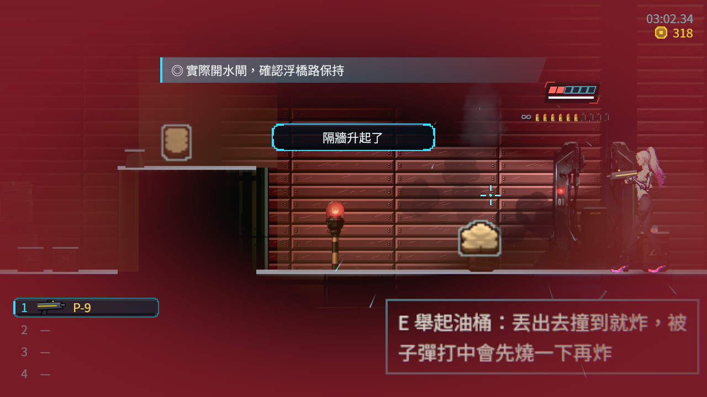

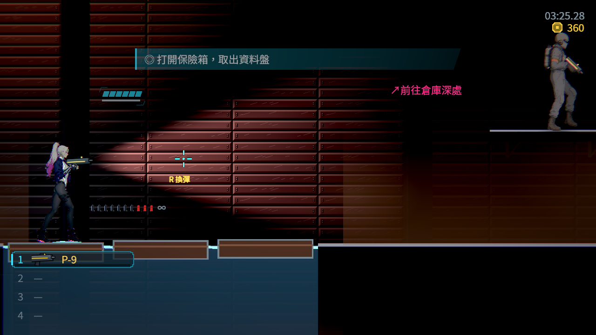

---

# Commit-8（第二章實際過關與冷續玩）

## 內文

用第一章章末正常存檔繼續，在當舖結算、修收音機和聽屋頂簡報。市集入口走地面，實際打倒押運手與票據投手並在原電話亭備份。到代收處與租攤視窗拿兩份資料，進阿梨的小廚房練洗碗，再由後窗走上雨棚，從上方繞過貨道兩場戰鬥、打開捷徑、取代收簿並完成對帳。

帳房用原手槍及六格生命打完阿勇的斷連路線。實際打出選擇、按住隔離箱、命中鎖扣三次繳械並拔下儲能匣，制伏結果正常保存。帳房領取原證據、回電話亭看鷺的第 214 次復原，再由館外終端提交帳目。屋頂道別後進第三章當舖，獨立程序冷續玩仍保留兩章完成、制伏與上傳結果。

兩章的普通難度實機流程已有原輸入、原關卡與實際存檔證據。既有流程的真人遊玩、首次難度曲線和第二章貨道的下層戰鬥路線仍待驗收，票維持進行中。

### 測試結果

| 項目 | 結果 |
|---|---|
| 市集與可選路線 | 真實擊倒 3 名押運手和 1 名票據投手；試過阿梨小廚房、上層繞道、捷徑及三份文件對帳 |
| 阿勇 | 普通難度，六格生命，原手槍，斷連並制伏。測試操作的戰鬥時間約 31.8 秒，0 受傷，0 新死亡 |
| 章末與冷續玩 | 兩章完成旗標、鷺 214 次、原制伏與上傳結果保留，實際進第三章當舖。總死亡 1 次，來自第一章水坑 |

[第二章走查、存檔和原始紀錄](attachments/NE-97-chapter-two-route-2026-11-19/README.md)

### 截圖

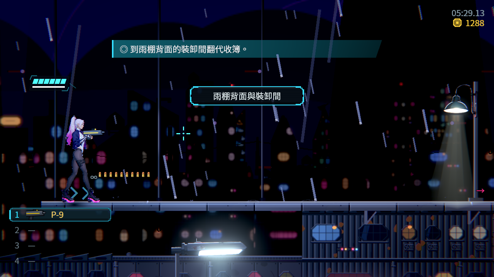

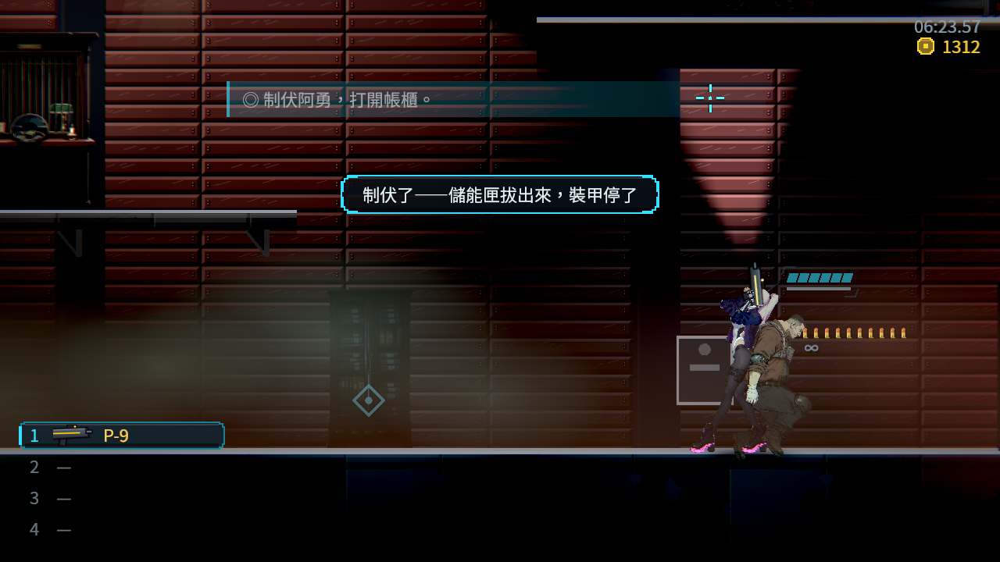

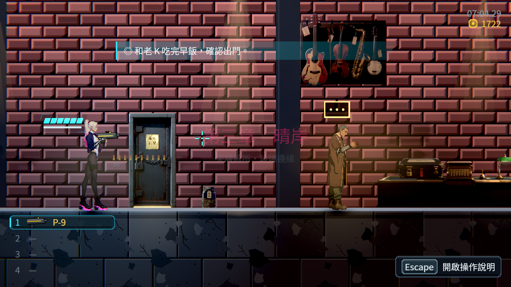
