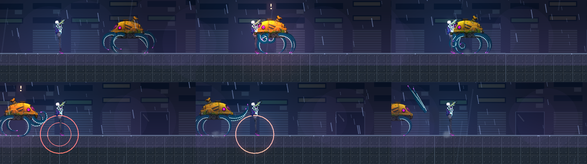
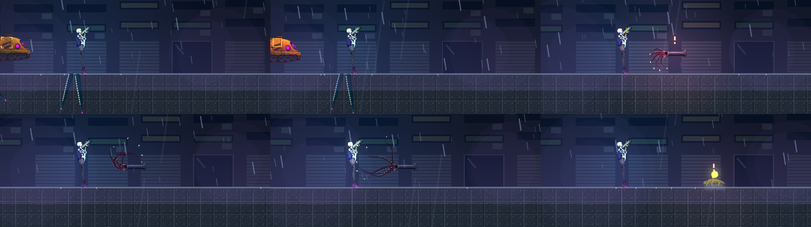
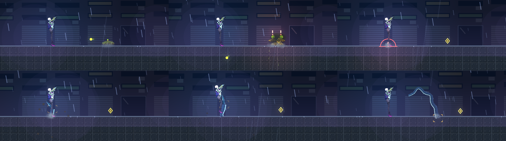
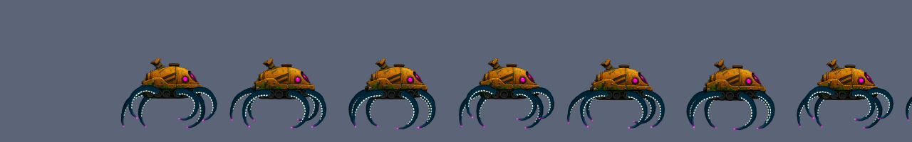
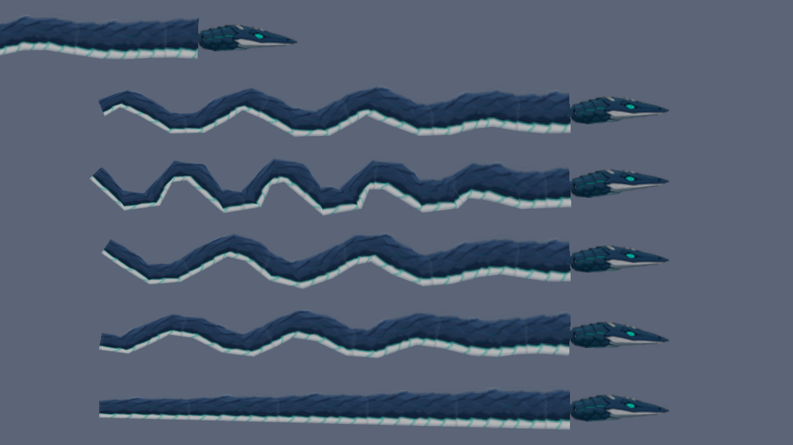

# [NE-98] 觸手與蠕行生物：網格變形、動畫器、斷肢、判定

> 狀態：完成

## 內文

### 需求
做出觸手步行與蠕行生物的技術與第一批敵人：纏絲（不走路的觸手簇）、打撈臂（觸手步行的迷你頭目）、浮標蟲與雲蛇。觸手與長蟲用一張連續貼圖貼在骨頭鏈上做網格變形，動作有行進波、收縮波與鞭擊；觸手可以被打斷（取代裝甲脫落）；傷害判定跟著骨頭。立繪由 NE-92 提供。原型（骨頭鏈、網格、波、狀態過渡、預覽工具）已完成。

### 來源
2026-10-03～04，使用者在敵人與 NPC 重畫的討論中提出；設計見 `design/12-cast-redraw/CREATURES.md`、`ANIMATION.md`。

### 驗收條件
- [x] 原型：骨頭鏈加網格變形，行進波、收縮波、鞭擊與狀態平滑過渡，資料驅動（`ChainCreature`、`art/creatures/<id>.json`、`tools/creature_preview.tscn`）
- [x] 角色流程支援網格零件：由本體與單條觸手兩張圖，依規格裝成多條觸手（掛點、鏡像、縮放、色差）
- [x] 落腳步行：觸手尖端離地時抬起、前伸，落地後釘住，多條交替；身體隨落腳高度起伏
- [x] 斷肢：每條觸手有自己的生命，打斷後整條飛出，剩下的步態改變；全部斷光露出核心
- [x] 傷害判定跟著骨頭（尖端與各節的小圓），受擊框保持簡單
- [x] 纏絲敵人完成（伏擊、預兆、縮回），再做打撈臂、浮標蟲、雲蛇；每個敵人有自己的動作資料與專屬特效
- [x] 敗北圖鑑卡片與攻略，遊戲內實際交戰檢查

### 測試流程
1. 預覽各狀態與連續畫面（`creature_preview`）
2. 進遊戲與各敵人交戰
3. 單獨執行相關測試

---

# 跟其他票的關係

- Blocks：NE-99
- Blocked by：NE-92（立繪）
- Related：NE-89、NE-97、NE-104、NE-105

---

# Commit-1

## 內文

觸手只有原型：不能走路、不能被打斷、打到觸手沒有任何反應，也沒有任何敵人用它。
現在觸手與蠕行生物是完整的一套：
- 一份資料（本體圖、單條觸手圖、掛點、鏡像、縮放、色差、生命）就能裝出一隻觸手生物，圖用工具從立繪裁切縮小；
- 有腿的生物走路時腳交替抬起、前伸、落地釘住，身體隨腳起伏、落地震一下；
- 每條觸手有自己的生命，打斷後整條飛出，剩下的步伐變慢、身體變低，全部斷光露出核心（傷害加倍、出現弱點標記）；
- 受擊框跟著觸手移動，出招的傷害判定是跟著骨頭的小圓；
- 蠕行生物是頭帶路、身體跟著頭走過的路徑，連續的鱗片貼圖沒有接縫，鑽進地面時地面以下的身體不畫。

四個新敵人上線：打撈臂（迷你頭目，六腿步行，掃地與砸地）、纏絲（不走動，火花預兆後伸出鞭打，只有伸出時打得到觸手）、浮標蟲（鼓起後噴酸液，被擊敗分裂成兩隻小的）、雲蛇（地底潛行，地面隆起預兆後躍出）。每個敵人有自己的動作資料、專屬特效、敗北圖鑑卡片與攻略。
遊戲內用情境實際交戰逐隻檢查過（走近、出招預兆、被打斷觸手、核心露出、分裂、躍出）；這四種敵人還沒擺進正式關卡，等 NE-97 的每章名單確認後再放。

### 測試結果

| 項目 | 結果 |
|---|---|
| 觸手與蠕行套件（姿勢數學、網格、步行、斷肢、四種敵人流程與擊敗） | 通過 191 / 191 |
| 受影響範圍的 41 個套件（接觸判定、敵人資料、圖鑑、音效登記） | 通過，另有 1 項介面計時檢查在負載下偶發，單獨重跑通過 |
| 資料驗證 | 0 錯誤 |
| 執行 log | 無預期外 ERROR |

### 截圖

---
