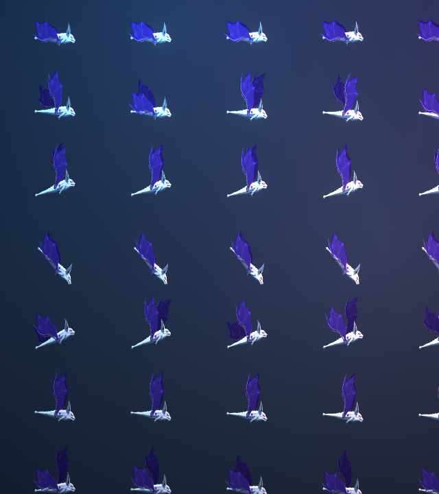
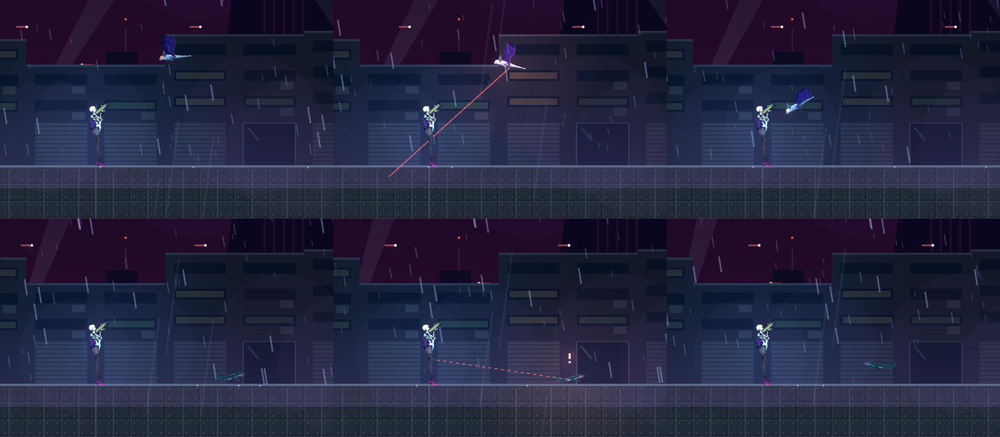
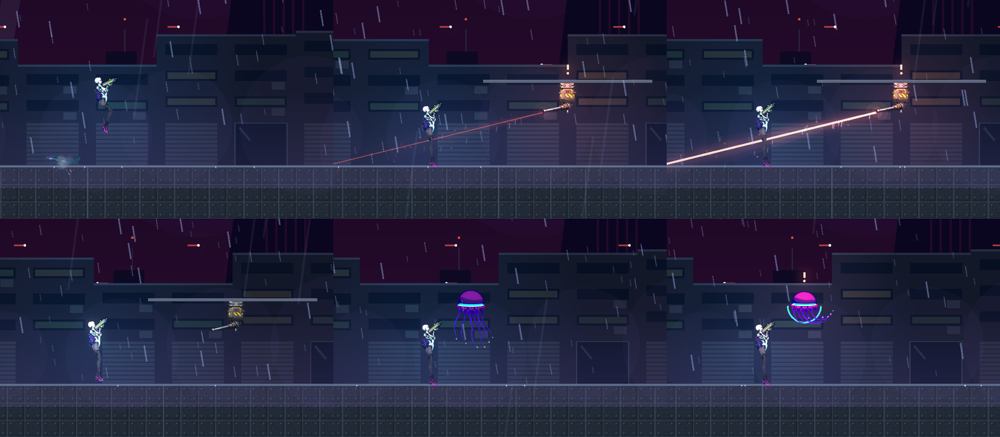
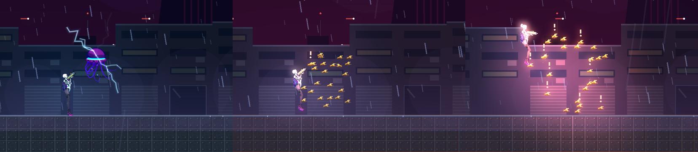

# [NE-99] 多足、攀附、翼式飛行、軌道與群體的動畫器與敵人

> 狀態：完成

## 內文

### 需求
依 `CREATURES.md` 的骨架家族，為其餘新敵人做各自的骨架、動畫器（用 NE-89 的動畫器登記表）與敵人：多足爬行（浮標蟲、自爆蟲改畫）、攀附（攀牆者，沿牆與天花板移動，需要新的移動物理）、翼式飛行（井道蝙蝠機、監視蜂改畫：拍翼隨速度變化、滑翔、墜落打轉）、懸浮（雲母）、軌道（吊軌砲）、群體（蜂群）。立繪由 NE-93 提供。

### 來源
2026-10-03～04，使用者在敵人與 NPC 重畫的討論中提出；設計見 `design/12-cast-redraw/CREATURES.md`、`ANIMATION.md`。

### 驗收條件
- [x] 多足步態動畫器：腿依相位輪流落地，身體起伏與傾斜
- [x] 攀附動畫器與沿牆、天花板移動、撲下
- [x] 翼式飛行動畫器：拍翼、滑翔、轉向、受擊抽動、墜落
- [x] 懸浮、軌道、群體各自的動畫器與敵人
- [x] 每個敵人有自己的動作資料、專屬特效、敗北圖鑑卡片與攻略
- [x] 遊戲內實際交戰檢查，效能（同屏多隻）不下降

### 測試流程
1. 預覽各動作
2. 進遊戲交戰
3. 單獨執行相關測試與效能情境

---

# 跟其他票的關係

- Blocks：無
- Blocked by：NE-93（立繪）、NE-98（共用的網格與資料機制）
- Related：NE-89、NE-97、NE-104、NE-105

---

# Commit-1

## 內文

飛行、攀附、軌道、懸浮與群體類的敵人只有立繪，沒有動作也不能上場。
現在五種新敵人都能在遊戲裡交戰，各有自己的動作資料、專屬特效、敗北圖鑑卡片與攻略：
- 井道蝙蝠機：待機倒掛、盤旋時拍翼隨飛行速度加快、轉向時近側翼收攏；預兆時雙翼張開顫動、紅眼閃爍，俯衝時翼向後收，撞牆會暈眩、翼不規則抽動，被擊落打轉墜落。
- 攀牆者：沿地面、牆面與天花板爬行，繞過牆角；發現玩家後蹲伏甩尾，撲出落在任何碰到的表面上，身體整個隨表面轉動（倒掛時上下顛倒）。
- 吊軌砲：夾在天花板軌道上，雷射追蹤、鎖定、開火後沿軌道加速滑到另一端換位，滑動中不瞄準，軌道有火花。
- 雲母：鐘罩脈動推進、六條觸鬚被動拖曳；充電時鐘罩收緊發亮，放電時觸鬚帶電鞭打；觸鬚可打斷，全斷後核心露出。
- 蜂群：每隻只有 1 點生命，一群彼此保持距離地繞著玩家，各自蓄力後衝刺螫人；24 隻的群集計算每影格約 0.2 毫秒。
多足步行沿用 NE-98 的落腳步行（浮標蟲、打撈臂）與自爆蟲原有的腿相位。攀牆者與蜂群的立繪只有整隻一張，沒有分出四肢和翅膀，所以這兩種用身體的伸縮與抖動做出爬行和拍翅；之後有分件的立繪可以直接換資料。
這五種敵人還沒擺進正式關卡，等 NE-97 的每章名單確認後再放；遊戲內用情境逐隻實際交戰檢查過。

### 測試結果

| 項目 | 結果 |
|---|---|
| 新敵人套件（資料、拍翼隨速度、貼附幾何、五種敵人流程、蜂群效能、三種難度可擊敗） | 通過 236 / 236 |
| 受影響範圍的套件 | 通過 |
| 資料驗證 | 0 錯誤 |
| 執行 log | 無預期外 ERROR |

### 截圖

---
