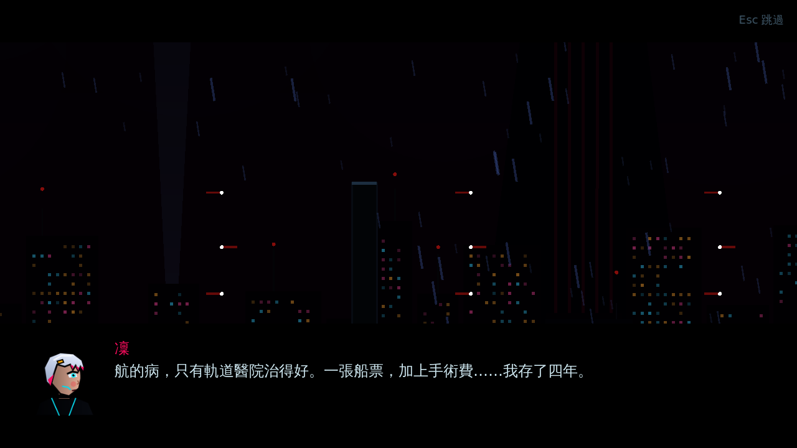
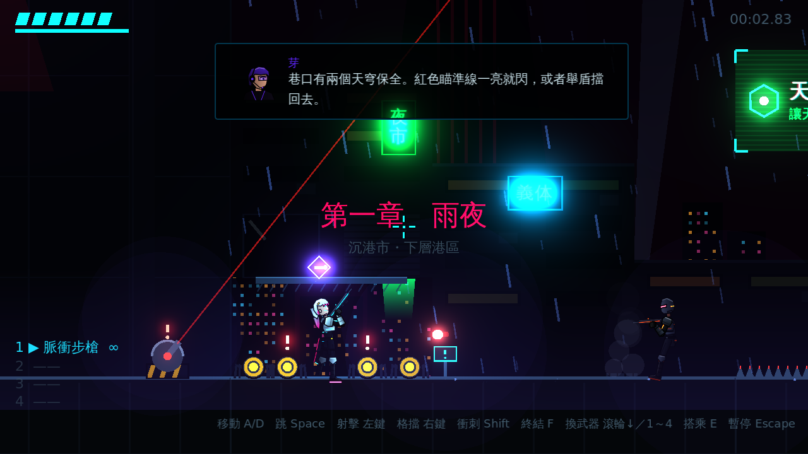
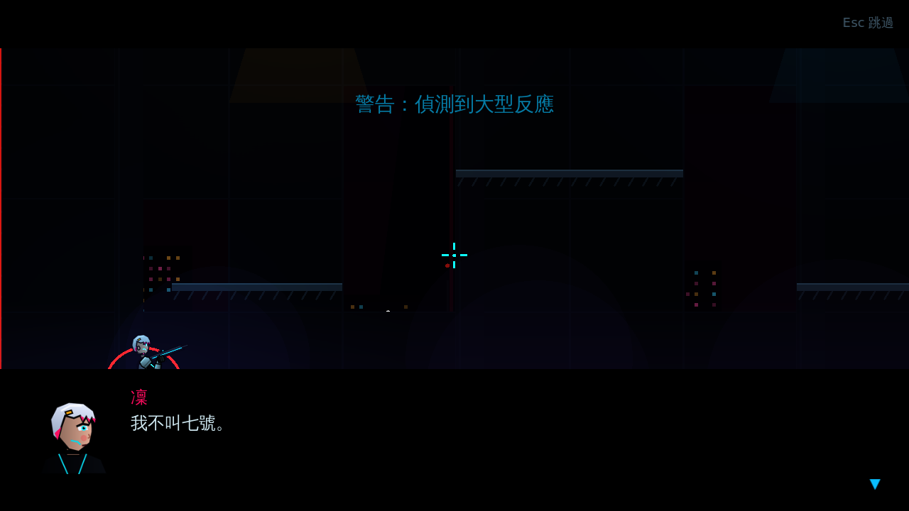
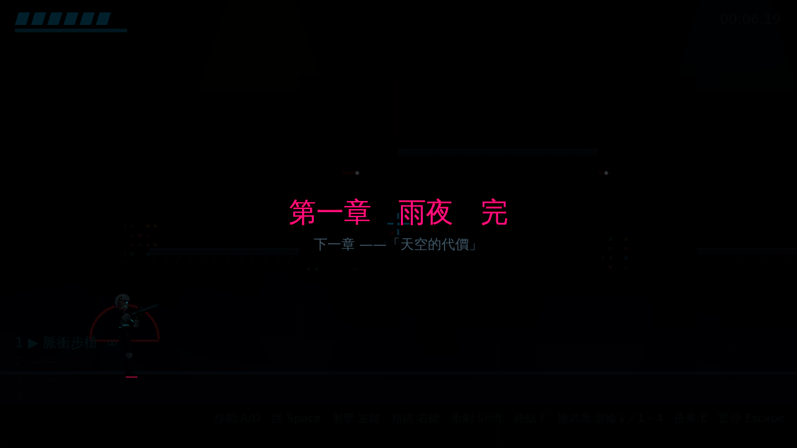

# [NE-9] 加入劇情對話與第一章劇本

> 狀態：完成

## 內文

### 需求
加入劇情系統與第一章劇本：原創世界觀、悲壯基調（參考 Cyberpunk: Edgerunners 的情緒與節奏，不使用其角色與專有名詞）。對話分為會暫停遊戲的過場，以及不打斷戰鬥的通訊。

### 來源
2026-10-02，使用者於開發對話中提出：「之後預計會做比較悲壯的劇情（參考 Cyberpunk: Edgerunners）」「整個遊戲應該要以美術風格、人物、劇情為主」。

### 驗收條件
- [x] 過場對話會暫停遊戲、顯示黑邊與角色頭像、文字逐字出現，點擊或按鍵推進，可跳過
- [x] 通訊對話顯示在畫面角落、不暫停遊戲、自動推進
- [x] 第一章有開場、關卡中途通訊、頭目登場與結尾
- [x] 結尾留下悲劇伏筆並顯示章節結束畫面
- [x] 死亡重來時已看過的劇情不會重播
- [x] 劇本以資料檔管理，修改台詞不需改程式
- [x] 有劇情文件記錄世界觀、角色與第一章大綱

### 測試流程
1. 從頭開始遊戲，確認開場過場與跳過功能
2. 推進關卡，確認通訊在戰鬥中出現且不暫停
3. 在中途死亡並重來，確認劇情不重播
4. 擊敗頭目，確認結尾過場與章節結束畫面
5. 執行完整測試套件，全部通過

---

# 跟其他票的關係

- Blocks：NE-10
- Blocked by：無
- Related：無

---

# Commit-1

## 內文

原本遊戲沒有任何劇情，關卡只是一連串的戰鬥。
現在有原創的世界觀與第一章劇本「雨夜」：沉港市的傭兵凜，為了把罹患神經退化症的弟弟航送上軌道醫院，接下竊取天穹集團資料碎片的最後一單；過程中搭檔芽發現她就是天穹 NEST 計畫的「七號」，頭目監管者認出了她，結尾碎片揭露航的「治療」其實是意識轉移，留下悲劇伏筆。
對話分兩種：過場會暫停遊戲、加上黑邊與角色頭像，文字逐字出現，點擊或按鍵推進、Esc 跳過；通訊顯示在畫面上方、不暫停戰鬥並依字數自動換句。關卡開頭播放開場並顯示章節標題，地圖上的觸發點在玩家經過時播放通訊，進入頭目戰場先播放頭目登場的過場才開始戰鬥，擊敗頭目後播放結尾，最後顯示「第一章　雨夜　完」與下一章預告，再進入結算。死亡重來時已看過的劇情不會重播。台詞、講者、頭像與觸發點全部在資料檔；另有劇情設定文件記錄世界觀、角色、主題與第一章大綱。
驗證了每位講者都有頭像、每個場景的講者與關卡引用的場景都存在、過場會暫停並在推進到最後時恢復、Esc 可跳過、看過的場景不重播、通訊不暫停、地圖觸發點與開場會播放，以及擊敗頭目後經過結尾與章節結束畫面進入結算；並實際渲染確認各畫面。

### 測試結果

| 項目 | 結果 |
|---|---|
| 完整測試套件 | 通過 422 / 422 |
| 資料驗證 | 0 錯誤 |
| 執行 log | 無非預期 ERROR |

### 截圖

