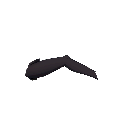

# NE-222 native pose-mesh proof bundle

This bundle records a narrow native rendering check of Rin’s source-exact front-thigh/front-calf mesh pair through the production `CharacterRig` pose-parts API. The original generated source, prompt/workflow metadata, reviewed seven-owner masks, CPU builders, formal fixture, capture scripts, logs, and native frames are included. All bundle-local runtime and builder paths resolve from the project root; there are no dependencies on `.godot` files.

## Result and scope

Godot 4.7.2 Forward+ rendered 480 samples across two facings, two zooms (1.0 and 3.4), and a 120-frame front-knee sweep. The production-API capture runner recorded 2,018 checks and zero failures. The unchanged strict alpha joint checker recorded 0/480 failures. The source-sprite baseline recorded 64/480 failures; the earlier round-44 source-underlap candidate recorded 46/480 and is retained as failed evidence. Initial JSON-index prepare checks and an initial blank native Polygon2D attempt are also preserved under `evidence/failed/`.

The successful frame and checker data establish only this front-knee geometry path under the tested hinge sweep. They do not establish full-body appearance, all seven pose-part joints, art approval, hidden damage underlayers, armor behavior, material/lighting quality, pose transitions, animation, or gameplay acceptance. The seven-part registration outputs are still source candidates. No formal pose assets or player pose selector are included.

The native proof image below is the root-reviewed frame at facing right, zoom 3.4, frame 85. The full 480-frame baseline and successful capture images are retained in their evidence directories.



## CPU suite evidence

At fixed base `c744a44f2d7b87a345a0a883cae3f1df0efe8f51`, the affected-test selector ran 60 groups (16,163 checks, zero new or known failures). After registering the new `PoseMeshSuite`, the focused five-group rerun (`PoseMeshSuite`, `RigMeshSuite`, `RigActionsSuite`, `PostureSuite`, and `CharactersSuite`) ran 3,295 checks with zero new or known failures. The command outputs and scope are in `evidence/tests/`. The prior CI job did not start because of the account spending limit, so this bundle makes no CI result claim. The raw test logs preserve their emitted diagnostic text, including temporary test-fixture paths; those paths are not required to rebuild or run the public fixture.

## Rebuild and validate

Run these commands from the repository root. The Python builders use the project’s existing CPU normal/glow helpers and require Python, NumPy, Pillow, OpenCV, and the dependencies already used by `tools/comfyui/`.

```powershell
python pm/Nest-Egg/attachments/NE-222-native-pose/rebuild_proof.py
python pm/Nest-Egg/attachments/NE-222-native-pose/validate_bundle.py
```

`rebuild_proof.py` rebuilds the seven-owner masks, source registration and native-resolution color/normal/glow parts, the 5×5 shared grid, and the formal JSON fixture twice. It compares hashes across both complete runs. The source stays 1440×736 RGBA, alpha floor stays 40, source RGB/RGBA bytes are copied exactly, and all 211,990 retained source pixels have one exclusive owner. The front thigh and calf share a 25-vertex/32-triangle UV template with complementary weights; each source owner keeps its own exact source pixels. The deterministic check excludes only the ownership builder’s self-history file `generated/ownership/reproducibility.json`.

The formal fixture uses the original canonical 20-bone skeleton and the authored kneel bind transforms. Its two common-bounds RGBA atlases are 535×331 and their matching normal maps retain the same dimensions. `CharacterRig` checks the active vertex budget against the unchanged 500-vertex limit. The fixture’s explicit pivot `[0,0]` is paired with native UV coordinates in the common-bounds atlas; the registered original per-part pivots are separately retained in `generated/registration/`.

The pinned 1440×736 RGBA source has 363,146 alpha-zero pixels, 481,772 alpha-one pixels, and 211,990 pixels at alpha ≥40. Transparent RGB in the raw source is not evidence of clean exported transparency. The seven private part outputs retain only reviewed source ownership at the existing alpha-40 floor; they are registration/proof inputs, not approved character art or publishable cutouts.

To repeat the CPU-only production-API prepare checks without rendering:

```powershell
godot --headless --path . res://pm/Nest-Egg/attachments/NE-222-native-pose/formal_pose_native.tscn -- --mode=native_bind --prepare-check
```

To repeat the Forward+ capture, write to a new absolute output directory:

```powershell
godot --path . res://pm/Nest-Egg/attachments/NE-222-native-pose/formal_pose_native.tscn -- --mode=native_bind --out=<absolute-empty-directory>
python tools/check_joint_frames.py <absolute-empty-directory>
```

The capture must run under the project’s GPU lock. It must report `viewport=true`, use Forward+, save all four 120-sample groups, restore the original canonical bone rests, and exit successfully with no script errors. The checker uses the existing unchanged threshold; a one-pixel hole or disconnected piece remains a failure.

## Bundle map

- `source/` — original source PNG and workflow, source masks, ownership rationale, guide/proposal, and the scale/skeleton context used by registration.
- `build_source_owners.py`, `build_registration.py`, and `generated/shared_mesh/build_shared_grid.py` — repeatable CPU build stages.
- `generated/registration/` — all seven source-part diffuse/normal/glow outputs, pivots, source registration report, and slot mapping.
- `generated/shared_mesh/` — the two shared-bounds source-exact diffuse/normal atlas pairs and explicit 25-vertex mesh grid.
- `formal_pose_native.gd`, `capture_shared_bind.gd`, and matching scenes — the narrow production-API native fixture.
- `evidence/` — rebuild hashes, baseline and final native reports, full captured frame sets, and clearly labeled earlier failures.
- `bundle-manifest.json` — SHA-256 for each bundled file, including evidence, excluding only the manifest itself.


## Root replay and affected tests

The public fixture was rerun under the shared GPU lock on main `951f3add` with the final runtime. CPU preparation recorded 34 checks/zero failures; native capture recorded 2,018 checks/zero failures; the unchanged joint checker recorded zero failing samples out of 480. Every replay PNG SHA-256 exactly matches the retained successful capture in `evidence/formal-native-v2/`; `evidence/public-replay/` contains the replay logs, schedule, reports and hash comparison rather than duplicating identical PNGs. Raw before/after screenshots are also in `pm/Nest-Egg/images/NE-222-native-pose/`.

Affected tests used a fixed `c744a44f` base in an isolated checkout: 16,163 checks, zero new/known failures. That first pass retained the base harness registry, so the selected but unregistered PoseMeshSuite contributed no claimed checks. The final registered harness was tested separately: 3,295 checks initially, then 3,299 after rejecting even the near-integral invalid index `0.000001`; final PoseMeshSuite has 121 checks. A separate merged-main core/rig run recorded 4,785 checks/zero failures. See `evidence/tests/scope.json` and the raw shard logs. Local full tests were not run. The prior CI job did not start because GitHub reported account billing/spending-limit restrictions; no CI success is claimed.

The bundle and deterministic rebuild hashes exclude generated Python bytecode/cache directories and Godot `.import`/`.uid` sidecars; these are machine-derived files, not source or captured evidence. The root repeated both CPU rebuild passes with the final public builders and obtained 115 identical generated outputs.

This archive preserves source/evidence bytes with a bundle-local `.gitattributes`; Git newline conversion must not invalidate recorded hashes or alter raw logs. CPU rebuild determinism was measured in the recorded Windows/Python environment.
