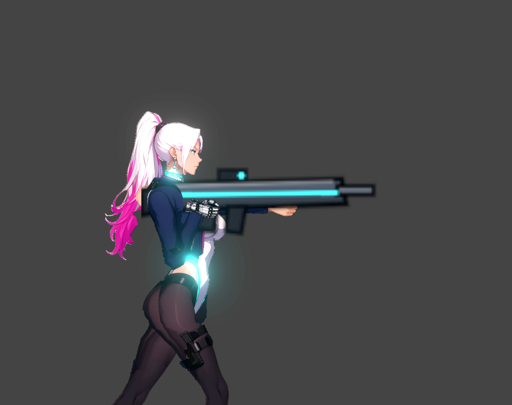
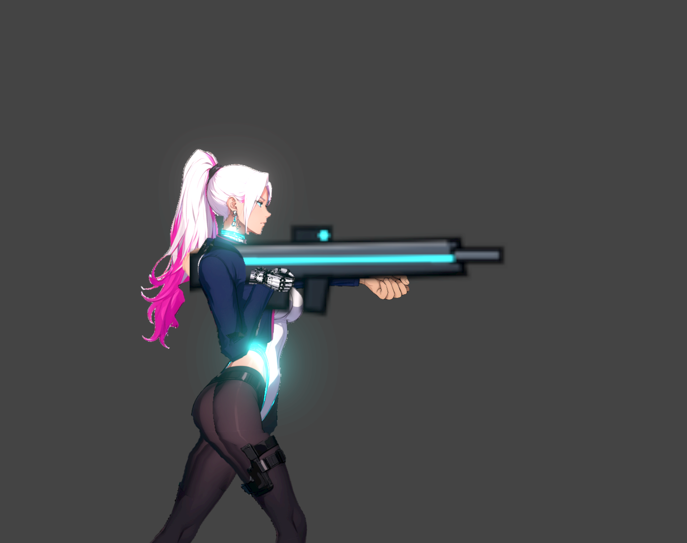
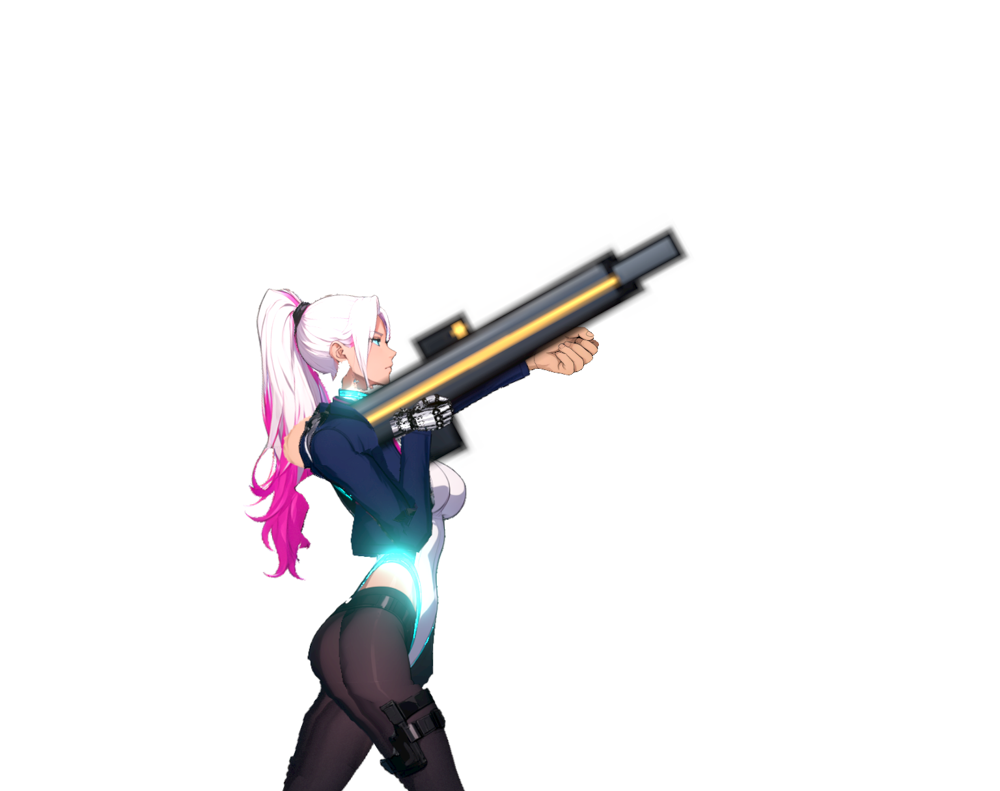
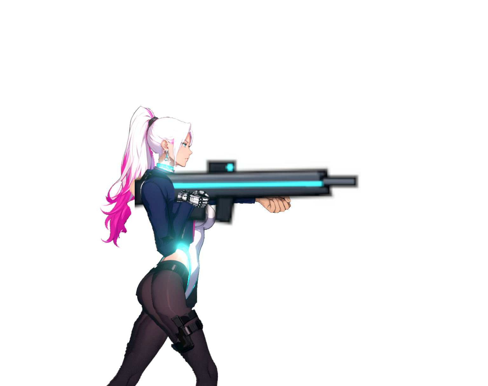

# NE-222 原生支撐手部分交付

原支撐手只有 90×70 像素，握持輪廓接近平拳。本次保留 s33 主角定稿，替換後側人類支撐手為 226×142 的原生部件，依實際腕點與槍械掛點登記自己的像素密度；沒有先縮回舊尺寸再放大。前側機械手與全身姿勢不計本輪外觀驗收。

## 來源與組合

[來源包](../../../../art_src/characters/rin_support_grip_22308/README.md)保留 Qwen 原始圖、提示詞、種子 22308、實際輸入參考、graph/job/history、SAM 3.1 點位與 mask、原生 crop、正常圖與重建程式。原生成圖雖為 RGBA，但 alpha 最低 252、沒有透明像素；本次透明背景來自明列的 SAM owner，不冒稱模型原生透明。只有 owner 範圍保留原 RGB，沒有色鍵、補色、縮放或多手拼接。

現有手骨、休止姿勢與槍械 offset 不變。原生部件使用獨立密度；離開握持、盾牌、動作或倒地狀態後還原休止手的貼圖、pivot 與 density。缺省密度沿用舊值；零、負值、非有限值、字串、bool、null 拒絕握持替換但保留原休止手。

`legacy/` 保存同一舊版角色資料與原 90×70 diffuse/normal。兩組畫面使用相同舊版 skin 的副本，candidate 只在 setup 前換入正式支撐手 record；透過真正 CharacterRig/ResourceLoader/LitTextures/animate 呼叫，不逐格改 Sprite2D 的 scale、texture 或 offset。

## 實際結果

| 檢查 | 結果與範圍 |
|---|---|
| 來源重建 | 兩次各 45 checks；原生 diffuse/normal byte-identical，1px 多／少 owner、錯 crop／pivot／density／SHA 均拒絕 |
| 實際完整切圖 | 公開 Python control 68 checks；兩次完整 export 相同，其餘 29 張部件與原握持 offset 不變，六個錯誤設定在寫出前拒絕；normal 的生成另由來源重建驗證 |
| 修前反例 | 舊 rig 配相同新測試：559 checks／16 failures，沒有 SCRIPT ERROR |
| 修後角色回歸 | 559 checks／零失敗，涵蓋有效密度、九種缺省／無效設定、兩面向及狀態還原 |
| 固定 aa51e05b 受影響範圍 | 60 個已註冊群、八個 headless 程序平行；18,979 checks、零新／已知失敗、180 秒；完整測試交 CI |
| 最新 06c44076 合併回歸 | 相同六套件以四個 headless 分片，在原生捕捉結束後跑 8,020 checks、零新／已知失敗、21 秒；原先与捕捉同時跑的三個近戰失敗另完整保留，沒有修改測試或門檻 |
| log 診斷 | 沒有 SCRIPT ERROR；受影響測試含預期的拒絕資料 ERROR 與五個離開資源診斷，保留全部 shard，沒有宣稱所有 ERROR 字串為零 |
| 公開 fixture CPU | 458 checks／零錯誤 |
| 原生 Forward+ | Godot 4.7.2、Vulkan、HDR2D、RTX4070SUPER、共享 GPU 鎖；1,274 checks／零錯誤、108 張 1536×1216 原尺寸 PNG |
| 取樣範圍 | 七種 Player weapon visual ID × 水平／上／下瞄 × 兩面向，另含一般倍率、normal off、白底、休止／盾牌／反衝／倒地控制 |
| 改動偵測限制 | 每對圖片 ≥100 changed pixels 只驗證換件確實出現在畫面；不是解剖、接縫或材質的合格門檻 |

原生 trace 與所有圖的 SHA 在 [native-capture.json](native-capture.json)。源像素覆蓋與袖口取樣不能取代全身逐格接縫檢查；当前武器 draw order 會遮住支撐手拇指。保持原本單像素內部孔洞拒收規則，不以其他身體部件遮住接縫當通過。

### 原生對照









## 重跑

在 repo 根目錄執行，Python 使用已有 numpy/Pillow/OpenCV，Godot 使用專案指定版本。輸出選新的絕對目錄；fixture 拒絕覆寫既有輸出。

```powershell
python art_src/characters/rin_support_grip_22308/rebuild.py --out <private-source-replay-dir>
python tools/comfyui/test_hand_attachments.py
python pm/Nest-Egg/attachments/NE-222-native-support-hand/test_native_grip_export.py
godot --headless --path . --audio-driver Dummy res://pm/Nest-Egg/attachments/NE-222-native-support-hand/portable_support_capture.tscn -- --cpu-only
python tools/comfyui/gpu_lock.py -- godot --path . --audio-driver Dummy res://pm/Nest-Egg/attachments/NE-222-native-support-hand/portable_support_capture.tscn -- --out-dir=<new-absolute-native-output-dir>
```

執行 Godot 前完成必要匯入；匯入也遵守共享 GPU 鎖。無 GPU 時只回報 CPU 檢查，不能把 Compatibility 畫面當 Forward+、HDR2D 或效能驗收。

此交付在 aa51e05b 的受影響本地測試及 06c44076 的最後合併回歸通過。main 上 NE-237 的 Linux CI 三個近戰新失敗另存[具體交接](ci-handoff/README.md)，沒有加入 known failures、沒有改他組 Player 核心，也沒有聲稱綠色 Windows 重現等於修復 CI。
