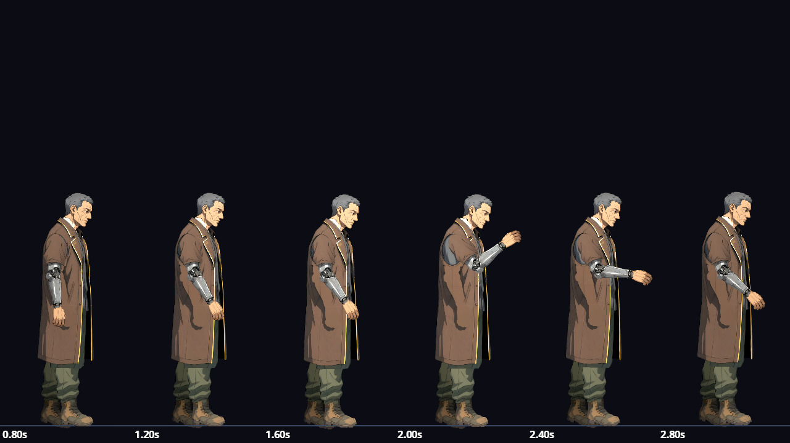
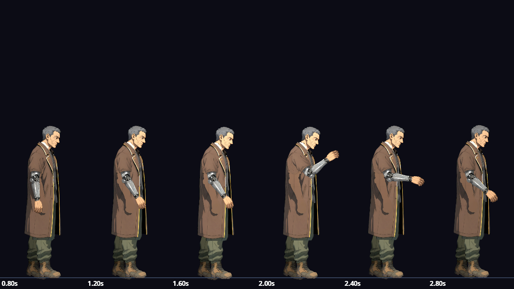
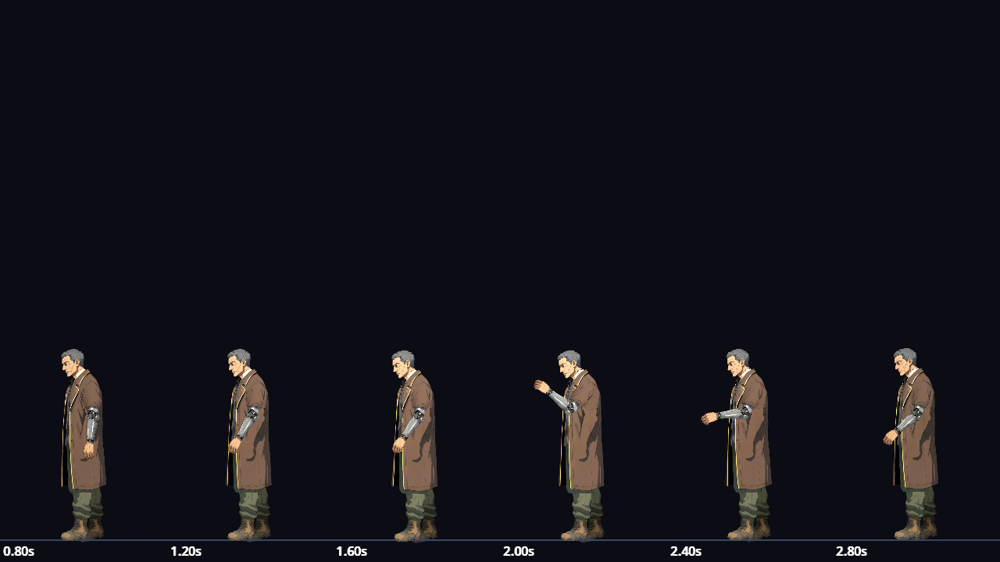
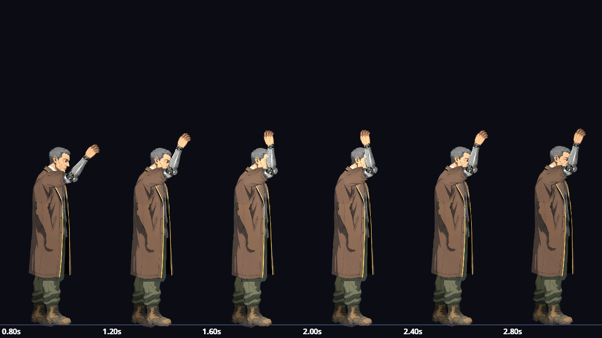
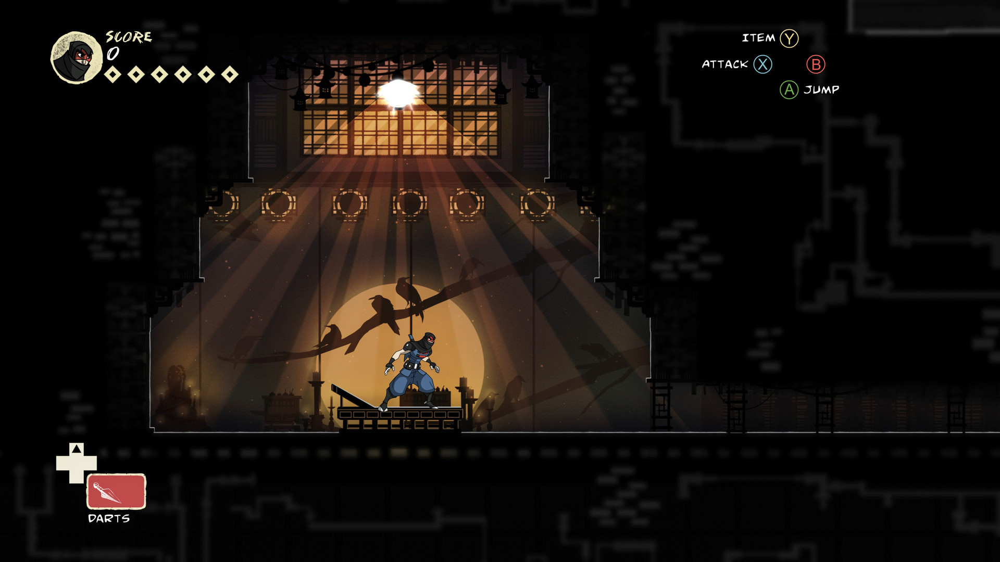

# NE-222 Commit-56：Old K 抬手時的灰色肩塊

灰色上臂殘影存在於軀幹來源，並非透明缺口。原根部固定試驗仍露出灰塊，故拒絕；正式網格、骨架與綁定均不改。只在原來源肩部遮罩內採用生成外套的 RGB，再由原切件流程匯出，重新計算一張 torso normal。

## 實際畫面

以下均是 Godot 4.7.2／Forward+／HDR 2D／llvmpipe 的原生 1280×720 圖；原工具連續六格，同角色同時間，不是手繪展示。這是 NPC 動作工具場景，並非 Main 自然流程或實體 GPU 驗收。

四份 native log／exit 原檔在本目錄，全部 exit0、無引擎錯誤／洩漏。原始對照工具不改。根部固定的控制與拒絕結果見 `old-k-root-trial-preflight.json`。

## 重建與核對

[凍結原圖、生成原稿、遮罩、SHA、提示詞與來源重建](../../../../art_src/characters/old_k_shoulder_20261024/README.md)。原參考 diffuse 及 Godot normal 可逐像素重現；CPU normal 不一致已拒絕。實際核對32份來源，僅 torso diffuse、normal、配方改變；臉、眼睛、其他零件、rig、spec及網格腳本原樣。來源選區16,441像素，其中16,431實際改變；正式貼圖14,225像素改變，alpha完全相同。glow重算相同，未改原glow。

受影響原四組：LayerOrderSuite、NpcAnimationSuite、RigActionsSuite、RigMeshSuite，6,783項／0新／0已知失敗，13秒。`old-k-changed-tests.log`、`old-k-check-parts.log`、`old-k-verification.json` 保留結果。完整逐格接點核對另列於 audit-summary.json；修前後報告完全相同：53,760筆／5,983失敗，其中2,889為邊緣缺口類；工具其餘用語不代表每筆均是玩家可見裂縫。原門檻與失敗維持，不因來源色彩修補而代勾整票。

normal 重跑：本目錄的 `old_k_normal_probe.tscn` 僅改為可在儲存庫內直接載入的路徑，原私有場景保留為 `original_private_normal_probe.tscn`。啟動參數 `--src=res://art/characters/old_k/parts/torso.png --out=<絕對路徑.png>`；使用原 NormalMapMaker.make，不修改其他part normal。不要將歷史 reference normal 基線與候選 normal 混為同一輸出。

## 補充參考（來源候選後的檢視）

- [Mark of the Ninja: Remastered 官方商店](https://store.steampowered.com/app/860950/)：相近的橫向2D動作表現。已查看下圖小尺寸角色的清楚外輪廓、少量大明暗區與背景分離；只作視覺閱讀參考，不推論其私有骨架、玩家偏好或代抄素材。
- [Spine 官方 Photoshop 腳本說明](https://github.com/EsotericSoftware/spine-scripts/tree/master/photoshop)：可輸出分層圖與定位資料；參照其來源與零件分離，沒有改用 Spine 或套用其私有數值。
- `old-k-reference-receipt.json` 保留實際HTTP、SHA及失敗；舊 Spine 路徑404，搜尋工具亦未傳回內容，未宣稱看過不存在的頁面。官方腳本README改由成功的GitHub原始檔核對。

原生重跑使用 `res://tools/npc_motion_strip.tscn -- --out=<png> --chars=old_k --script=converse --frames=6 --from=0.8 --step=0.4 --zoom=3.4 --facing=1`；反向例改 zoom2.2／facing-1；揮手例改 scriptwave。接點原工具：`res://tools/rig_joint_audit.tscn -- --out=<dir> --chars=old_k --frames=120`，再跑 `python tools/check_joint_frames.py <dir>`。原始全部接點PNG仍在本 Session 私有目錄，這裡提供metadata／report／逐檔SHA供查核，未把顏色檢視當作alpha缺口歸零。
