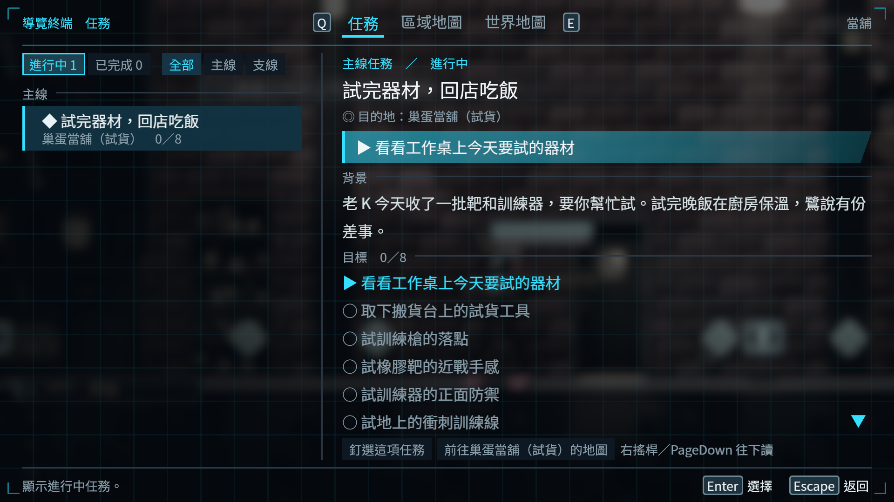

# NE-223：真正暫停的導覽診斷

2026-11-11，Godot 4.7.2、AMD Radeon RX 9070 XT、原生 Vulkan Forward+／HDR 2D。以真 PauseMenu 收到的合成鍵盤事件走任務、區域、世界地圖與返回；這是共享負載下的工具診斷，不是實體鍵鼠／手把、獨占效能或真人無停頓驗收。

## 修正與負控制

原觀察者 ALWAYS 讓 Level 也繼承 ALWAYS，世界仍在暫停選單底下執行；舊 16 輪數據保持失效資格。現在 Level 明設 PAUSABLE，逐輪比較真正玩家／鏡頭身分、位置、鏡頭中心、畫布、遊玩時間與霧時間，另核對 Level、玩家與相機能否執行。

| 原生程序 | 真正結果 |
|---|---|
| 明示 ALWAYS 負控制，1280×720 | 4 輪均偵測世界前進，exit 1；只有 4 條預期凍結 ERROR，無 SCRIPT ERROR |
| 正式修正，1280×720 | 4 輪全部狀態相同、不能執行，0 issue，exit 0，無 ERROR／退出洩漏 |
| 正式修正，1920×1080 | 同上；三張原 PNG 的實際尺寸也是 1920×1080 |
| 獨立保存驗證 | 103 項、0 失敗；8 輪正控制、4 輪負控制、原圖尺寸與全部原始位元組 |

負控制只把 Level 模式改回 ALWAYS，另將來源收據指向負控制檔本身；目前遊戲、量測門檻與正式工具沒有被暫時改回舊版。來源變體完整封存，驗證器要求正好這兩處差異，不以工具單純列出 paused=true 當作世界凍結。

## 觀察範圍

各尺寸只跑 4 輪，沒有冒稱原先 16 輪或長期記憶體驗收。返回後節點數每輪 1,072、地圖快取數 1；四輪靜態記憶體分別增加約 0.46／0.46 MiB，包含工具取樣、觀察字典及暖身，不能推論長期沒有成長。

720p／1080p 首次任務頁到下一繪製影格約 48.221／58.880 ms；暖身任務中位約 19.444／21.337 ms，世界地圖約 41.383／41.305 ms。原值全部保存，沒有把共享負載的時間當成獨占基準，也沒有以這些數字勾選「沒有可見卡頓」。合成輸入到下一 frame_post_draw 包含排程與送交繪製，不是實體螢幕延遲。

新版擷取保留暗部階調，原圖直接來自這三個新程序；未調背景、光影或材質。實體手把完整導覽及孤立效能仍在 NE-223 未勾。



## 保存與重跑

[raw.zip](raw.zip)保存 35 個原始檔案及 manifest，包括全部命令、log、三份報告、九張原 PNG、真正正／負來源及執行腳本。[receipt.json](receipt.json)記錄原始封包與被測工具 SHA；[verification.json](verification.json)是獨立結果。固定基準 21843756 的 `run_tests_changed.sh` 實際執行 exit 0、選出 0 組；本次只有觀察工具與證據，以上三個原生程序另行驗證，不用空集合代替測試。

```powershell
python pm/Nest-Egg/attachments/NE-223-frozen-diagnostic-2026-11-11/verify.py
```

要重跑原生，解出 run-diagnostic.py 到 repo 的 work/，更換全新輸出目錄再執行；它依序經共享 GPU 鎖、隔離 APPDATA，使用明示 4 輪，不覆寫既有案例。正式工具亦可用既有 `--out`、`--rounds`、`--width`、`--height` 與 `--shared-workload` 參數。正式 PNG 尺寸與實際凍結狀態都有執行斷言。
