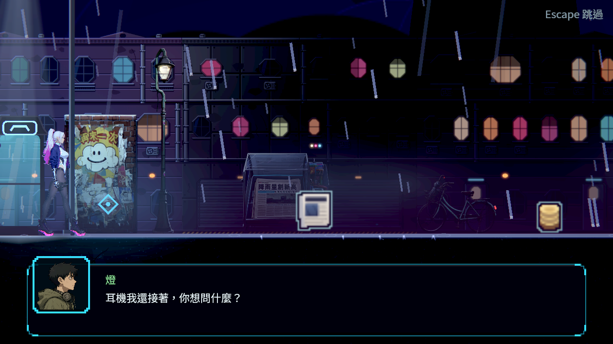
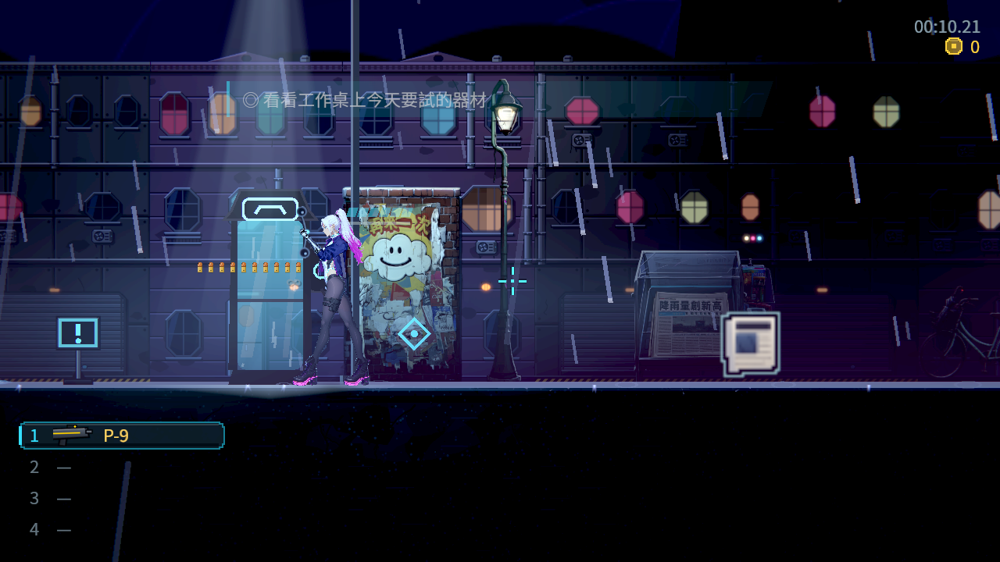
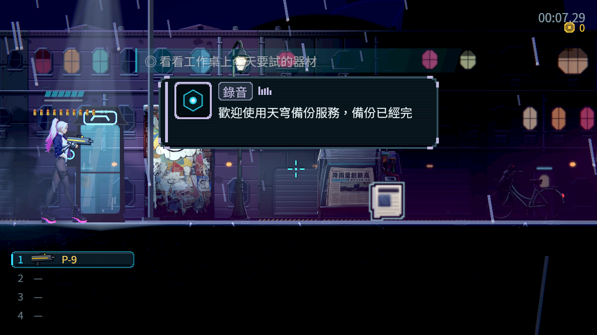
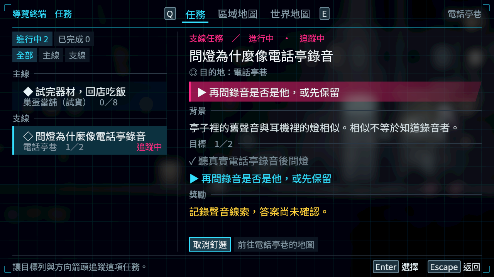
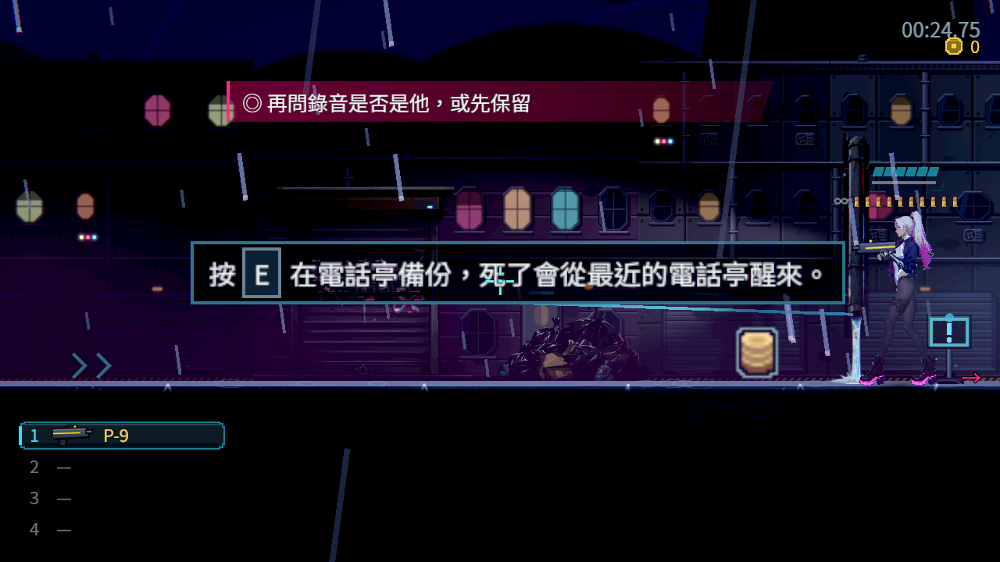
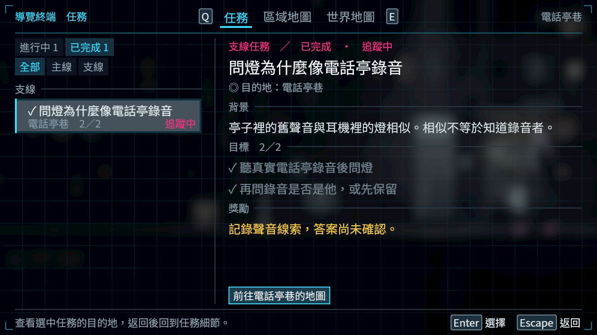
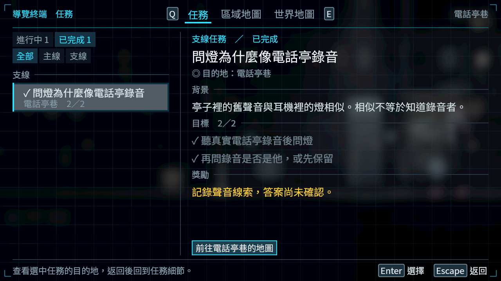
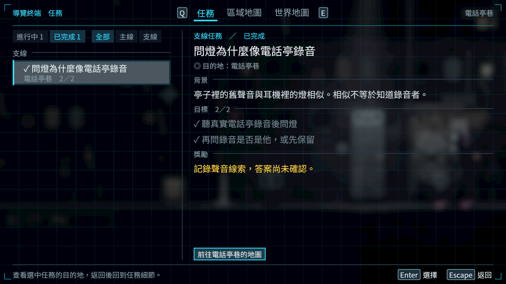

# NE-223：真正撥號與自願追問的任務進度

2026-10-22（Asia/Taipei）。電話亭與耳機互動點重疊時，靠電話亭較近卻會開追問；現在共用最近來源選擇，撥號中不能另開交談，已有遊戲鎖也不能直接撥號。任務完成後不再把保留的舊釘選標成「追蹤中」，HUD仍依原規則回未完成主線。

## 來源與研究

先依User-guide核對[五款不同團隊的實看任務／地圖原圖、來源和採用理由](../../../../design/18-quest-map-ux/QUEST_LANGUAGE.md#標籤與複核)。本包references再保存同一批四張地圖／日誌與Metroid紀錄及SHA，沒有把未看過的圖片說成已看；圖片只支撐清單、選中項與完整進度細節一致，不證明他作的輸入算法或玩家偏好。

[Godot Input官方文件](https://docs.godotengine.org/en/stable/classes/class_input.html)指出全域輪詢不受事件handled狀態影響；單純吃掉事件無法協調兩個輪詢者。[事件傳遞文件](https://docs.godotengine.org/en/stable/tutorials/inputs/inputevent.html)另列GUI與遊戲入口順序。本作沿用既有來源仲裁，不改鍵位、物件位置或故事真相。[設計及歷史錯誤](../../../../design/18-quest-map-ux/QUEST_REAL_PRODUCERS.md)。

## 真正流程與邊界

從真正Main新遊戲開始，透過Main區域路由安排進電話亭巷，安排玩家靠近正式Checkpoint與NpcActor。按真正InputEventAction互動撥號，不直接呼叫備份完成，不寫任務旗標，不直接emit頻道／劇情完成，也不直接選choice。確認及選項由真正GUI焦點＋確認輸入執行；這是合成輸入的安排情境，沒有冒稱真人整章或實體手把。

未確認錄音時heard旗標與正式完成紀錄均false；確認完整錄音後才成立。先選返回不接受支線，主動接受並答完第一輪才到1/2；選先保留仍未完成，再次主動問完第二輪才到2/2。真正任務頁能選中並釘選，HUD顯示第二問，真正完成頁不留錯誤追蹤標記。走出世界提示覆蓋區後才拍目標列，保留原PromptLayout讓位規則。此功能過程全程0死亡。

Main正常退出保存，兩個獨立程序按繼續：1280×720及1920×1080均恢復完成結果與原釘選，完成支線不覆蓋活躍主線，沒有電話／通訊凍結。writer為1280×720／120%文字；reader用各自新profile的預設文字大小，沒有把前者宣稱成後者。最終12張PNG全都實看，均為原生擷取，未放大改圖。

## 測試與反證

- 同一V2原生probe：原兩個產品檔46項／2預期失敗；修正後44項／0。原版額外走清理誤開追問的兩個choice檢查，所以總數不同；不是刪斷言。兩輪0引擎ERROR。
- 正式最終V4：writer67／0，獨立reader18／0，1080p獨立reader18／0，共103／0；三輪0引擎ERROR、無退出洩漏警告，完整來源SHA見validation。
- 原兩產品檔＋新增PhoneBoothSuite：54項／5預期失敗，沒有SCRIPT ERROR；try/finally按SHA還原。
- 再加入完成標記回歸、換回原三產品檔：393項／7預期失敗，沒有SCRIPT ERROR；三個來源均按SHA還原。兩個舊套件的原斷言均逐byte核對保留，只加入新的測試。
- 中途修正電話亭來源後的Npc／PhoneBooth焦點測試1142項全過；它在完成標記修正前，不混充最終全範圍。
- 最終固定8776dad7的原受影響選擇器、原門檻／filter／known failures保持，結果與六份raw shard見validation及raw.zip。測試中刻意缺圖／缺場景訊息完整保存，不聲稱所有歷史log都沒有ERROR。

V1誤將播放開始的was_seen當成完成，且按鍵未等NPC原冷卻，途中受控停止exit-15；只保存探索證據，不能算完整測試。V3數值通過但實圖抓到完成頁仍標追蹤及HUD為世界提示讓位，均留存；前者修正、後者改用公開走位確認原規則，沒有改產品時間或壓低視覺門檻。

## 畫面

| 相同V2輸入情境，100%文字 | 結果 |
|---|---|
| 原版 |  |
| 修正版 |  |

## 重跑

解壓raw.zip的work/ne223-route回專案同名暫存目錄。使用Godot4.7.2的Forward+ HDR原生視窗及獨立profile，執行`res://work/ne223-route/phone.tscn -- --mode=write --save-dir=<絕對存檔目錄> --out=<絕對輸出目錄>`，退出後用相同save-dir、另一profile與輸出目錄以mode=continue再執行；1080p用phone_1080.tscn的continue。包內保留實際wrapper、兩版負控制driver、所有probe版本、安排的存檔、完整log／exit／PNG及凍結來源；manifest逐entry列SHA並回讀。

本批不代替路障／看門狗／水閘的實際通關、實體手把、真人觀感或全角色接點驗收。選項後透出的備份toast已記NE-228後續範圍，沒有宣稱所有UI已完成。
