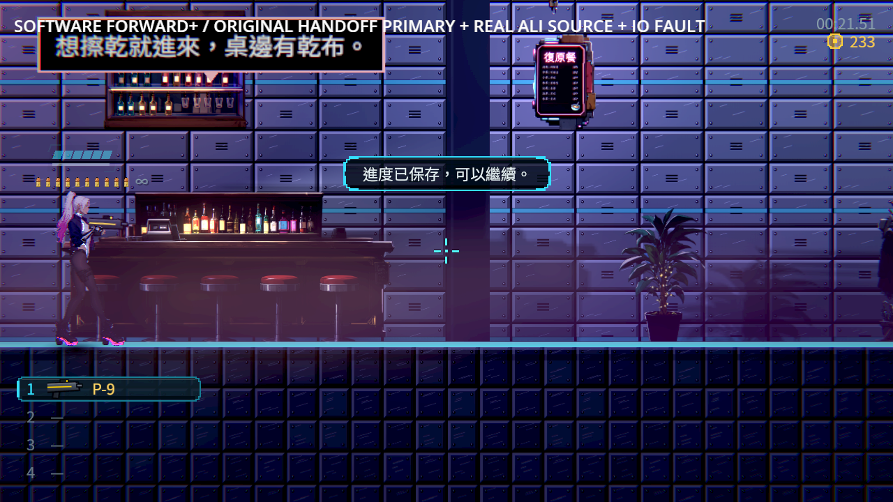
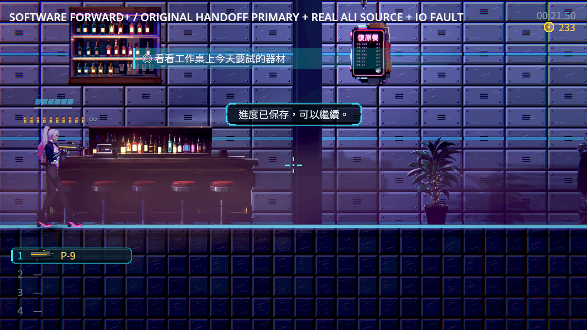

# NE-228：說話來源離場後收起原招呼氣泡

阿梨下班後人物已離場，原入場邀請卻仍留在畫面。原節點還存在，不等於角色仍在場；原氣泡只在起句時找講者，之後持有舊節點並繼續閱讀。

現在句子綁定原來源的弱在場查詢。來源宣告離場，收起同一次對話的顯示與未讀句，並取消對應原請求；不把取消當作看完、發旗標或獎勵。其他說話者、同名新請求及正在播放的電影維持原流程。取消通知中的新排入句子也會保留。

原閱讀時間、字級、淡入淡出、同屏兩句保持；電影／選單只隱藏仍在場的句子並保留閱讀時間。原沒有在場介面的普通位置錨點與已釋放錨點的最後位置閱讀也保留。阿梨下班後，原招呼條件同時停用，後來進區不會改從通訊重新邀請。

## 原圖與保存界線





[來源狀態、原始存檔與全部輸出](evidence.zip)、[逐檔SHA](manifest.json)及[驗證收據](validation.json)分別保留修前、修後與最終來源。原探針沒有修改；正式主檔起點沿用前批真正交盤的原bytes，點餐、晚間、拒寫與重試均走原NPC和原選項。

診斷用source-state.json先取狀態，後面的診斷PNG另等十格，不是同格量測。修前較晚的診斷PNG氣泡已自然淡出，真正負控制仍看上方較早的accepted原圖與當時失敗斷言；沒有把晚取的空畫面當成已修，也沒有修改原時間預算。

這是明示安排既有交盤前提的真Main情境，原磁碟與信用點前提有來源紀錄，沒有補本次下班旗標或NPC次數。軟體Vulkan Forward+／HDR2D、合成輸入與自動流程不代替真人整章、實體手把、硬體效能或畫風驗收。

## 驗證方法

同一原生探針修前52項／1失敗，修後52／0；初次失敗紀錄顯示人物已不在、交談次數2，原招呼仍有有效矩形及未結束的原請求。修後原顯示、未讀佇列及原請求均清除，沒有假造已讀。

重點檢查保留原MapBubbles及WorldPrompt斷言，新增在場／離場、暫停閱讀、同格矩形、活躍與排隊、未完成結果、較新同名請求、舊回呼、反序取消、通知內重新排入、其他說話者及原最後位置閱讀。兩組92／0；正式主檔來源的公開檢查54／0。

```sh
python tools/run_bubble_source.py --godot /path/to/repaired/godot --output /absolute/new-bubble-source-evidence
GODOT=/path/to/repaired/godot SHARDS=4 tools/run_tests_changed.sh bdd6ec1c54710f9b4fce78246bb3fc98d218f54a
```

前批阿梨版本bdd6ec1c遠端完整CI實際97,986項、0新／0已知失敗、637秒；阿梨12流程306、語音17流程615、週日133、交盤107及實際混音皆成功。[實際job收據](previous-ali-ci.json)、[原始job與metadata](previous-ali-ci.zip)，不代稱本批遠端CI。

## 參考

沿用[User-guide](../../../user_guide.md)、[人物與場景參考的實際觀察及官方原圖](../../../ST/attachments/ST-9-ali-completion/README.md#相近類型作品與保存依據)。已查看Katana ZERO、Night in the Woods、Oxenfree、Spiritfarer的官方圖片；這裡用於人物／文字層級及場景關係參考，沒有從圖片推論其內部生命週期實作或玩家偏好。原圖仍屬原權利人，沒有替換成本作遊戲素材。

## 最終驗證

| 項目 | 結果 |
|---|---|
| 同一原Main探針 | 52項／1失敗 → 52項／0失敗；原bytes與來源SHA保持 |
| 原受影響選擇器 | 67組、67,725項、0新／0已知失敗、653秒，四程序 |
| 原氣泡／提示與新增來源檢查 | 兩組92／0、15秒；舊斷言與原時間預算保持 |
| 公開正式來源檢查 | 獨立無頭程序54／0 |
| 最終軟體Forward+ | 兩程序106／0；原版探針與公開探針分開，0引擎ERROR／腳本錯誤／洩漏 |
| 原阿梨保存與續玩 | 12程序306／0 |
| 原耳機、週日及交盤 | 17程序615／0、8程序133／0、2程序107／0 |

沒有新增已知失敗或改過濾器，沒有縮短氣泡時間、改場景台詞或延後截圖等它淡掉。修前原圖、原請求與年齡保留；修後取消的是同一個未完成請求，其他交談結果與普通花費仍通過原驗證。
