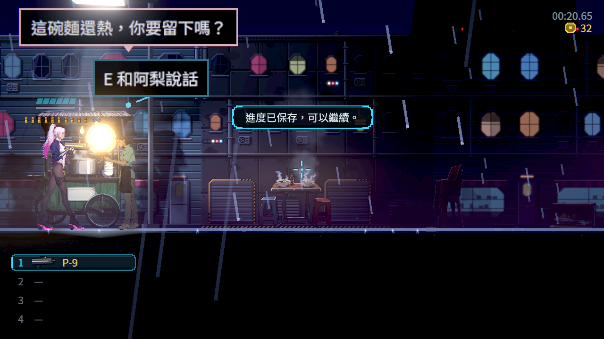
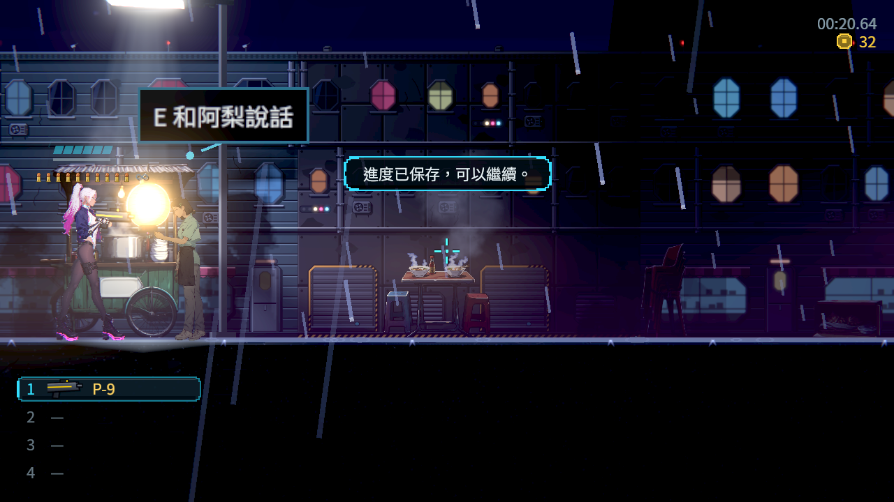
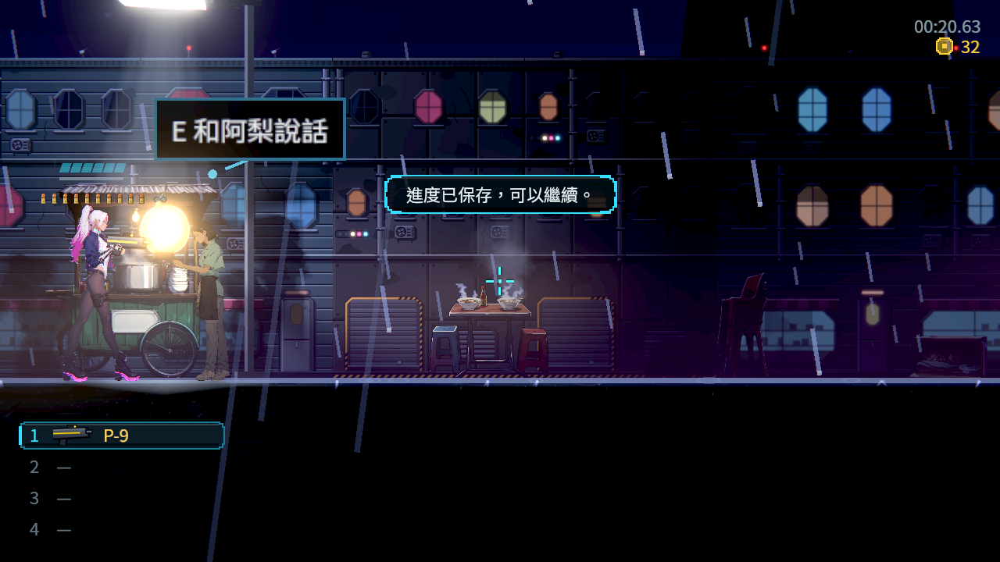

# NE-228：付款後撤下已失效的原招呼

原麵攤付款流程已保存 `ch1_supper_done`，同一位原 NPC 仍在場、交談次數為 1，但原招呼「這碗麵還熱，你要留下嗎？」繼續顯示。它的 `when` 已不成立；這與人物離場是不同原因。

這次保留原流程、原入場招呼與原付款，使用同一份已完成晚間交談的原始主檔，不補本次付款／完成旗標。原探針 SHA-256：`4a39277c3adf8a21963da63510409906f6eafbba86200d2f329c9284322e4911`。狀態與原 PNG 在同一影格內擷取，兩者之間沒有等待或改變遊戲狀態。

Story 在正式旗標、交易入帳、道具取得／交付及檢查點事件發生時，只檢查目前宿主的原請求。條件失效只撤下該次顯示與未讀句，立即釋放它的提示版面；不把取消當作讀完，不發出完成旗標，不干擾其他人或較新的同名請求。正常讀完的通知也先更新顯示資料，避免通知內狀態改變把已撤下的話放回來。

保留字級、文字、句數上限、原停留及淡出時間、暫停的閱讀時間、來源離場處理、一般錨點的最後位置閱讀，以及離場聲音原本的通訊 fallback。沒有每影格掃描整份劇本，也沒有把靜默載入變成額外事件。

## 同類作品與資料參考

沿用前一批實際查看的官方原圖。Forgotton Anne 是側視敘事冒險，可參考場景交談的視覺優先序；圖片不能證明其存檔實作，也不是玩家偏好調查。圖片只放在文件參考，不放進遊戲素材。

- [官方商店及原圖來源](research/sources.json)，權利屬原作者。
- [Ink：Running your Ink](https://github.com/inkle/ink/blob/master/Documentation/RunningYourInk.md)：故事狀態保存與遊戲包裝責任；不把它當作本作具體實作的保證。
- [Yarn Spinner：Variables and Storage](https://yarnspinner.dev/docs/godot/gdscript/05-connecting-to-your-game/04-variables-and-storage/)：遊戲事實與對話條件的接合。
- 其他已看過的側視敘事作品：[Katana ZERO](../../../ST/attachments/ST-9-ali-completion/README.md)、[Night in the Woods／Oxenfree／Spiritfarer](../../../ST/attachments/ST-9-sunday-choice/README.md)。

## 證據與範圍

[validation.json](validation.json) 記錄實際測試數字、來源雜湊及原圖雜湊；[manifest.json](manifest.json) 逐項列出 [evidence.zip](evidence.zip) 內原始輸出、故障主檔、原始圖片、探針與修前／修後來源。解壓後每個檔案已依 SHA-256 回讀核對。

這次只交付狀態失效時的原招呼撤回，不代替 NE-228 全畫面遷移、實體手把、實體顯示卡效能、母語審稿或真人整章遊玩。原票未完成條件保持未勾選。

## 最終驗證

| 項目 | 結果 |
|---|---|
| 同一原探針負控制 | 無頭及軟體 Forward+ 均 52／1 → 52／0 |
| 原受影響選擇器 | 67 組、4 程序、67,810 項、0 新／0 已知失敗、651 秒 |
| 最終軟體 Forward+ | 原探針及公開探針各 52／0，共 104／0，無引擎 ERROR／腳本錯誤／退出洩漏 |
| published | 1 程序、52 項、0 失敗 |
| source | 1 程序、54 項、0 失敗 |
| ali | 12 程序、306 項、0 失敗 |
| voice | 17 程序、615 項、0 失敗 |
| sunday | 8 程序、133 項、0 失敗 |
| handoff | 2 程序、107 項、0 失敗 |
| reception | 10 程序、244 項、0 失敗 |
| supper | 47 程序、1,253 項、0 失敗 |
| repeat | 1 程序、40 項、0 失敗 |

取消／讀完回呼、同名新請求、同名雙請求、暫停、版面同步釋放、正常完整停留／淡出、旗標、取得、交付及實際交易事件均包含在原 MapBubblesSuite 的新增行為檢查。原斷言、已知失敗清單、過濾器及冒煙流程保持。

[修前同影格狀態](before-state.json)、[修後同影格狀態](after-state.json)、[公開探針同影格狀態](published-state.json)、[逐張檢視](visual-review.json)。以上三張均為原始 viewport PNG，沒有診斷覆蓋、裁切或後製。

前一批麵攤 a8d9d195 的實際遠端完整 CI：98,074 項、0 新／0 已知失敗、675 秒，實際混音與全部保存專項成功；[原 job 收據](previous-supper-ci.json)、[原始輸出封包](previous-supper-ci.zip)。不以本批尚未執行的 CI 推算數字。

BG-51 的 run 40310426133／job 121529942541 已由原始監看紀錄確認全部成功，含完整測試與 DummyTexture 退出檢查。下載詳細輸出時 GitHub 回傳 401，因此未取得遠端完整測試數；[成功監看與存取限制](previous-bg51-ci.json)、[原始紀錄](previous-bg51-ci.zip) 如實保留。本批最終本機測試均已改用 BG-51 修復引擎；先前舊引擎出現的真實洩漏與中止記錄仍在 evidence.zip。
