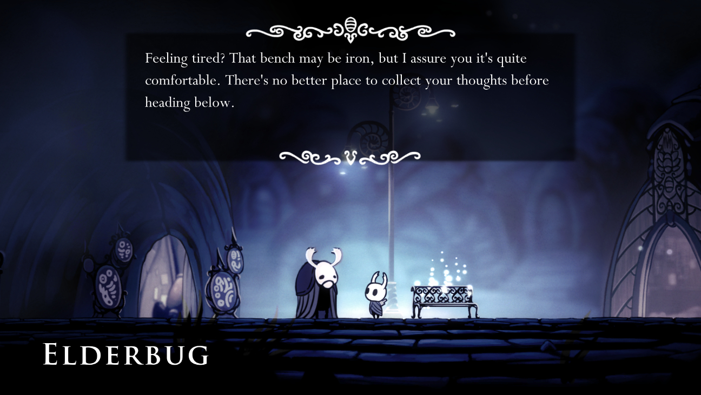

# 通訊卡保留人物與HUD閱讀空間

正式街道的通訊原本蓋住主角頭部；首輪避讓又在英文大字組遮住敵人。現在依真正主角、敵人外觀、HUD與閱讀障礙找空位，連完整滑入路徑一併核對；大字卡也搜尋上下安全邊界。正文能放但滑入路徑不能放時，保留原0.15秒淡入、原地顯示，其他可滑入情境維持0.2秒。任務目標列透過同步可見性通知收起，世界暫停時也不殘留在通訊後面，結束再恢復原文字與顯示計時。字速、閱讀時間、確認／取消與世界暫停不變。

原回歸追加23項，原斷言／輸入／等待逐位元重建相同：初版80／1→80／0；英文大字缺邊界84／1→84／0；正常與減少動態的狹窄入口90／2→90／0。擁擠HUD與敵人的正式尺寸94／1→94／0，安全區、字級、文字寬度與原讀取條件保持；目標列359／1→359／0，文字與閒置計時保持。最終使用6程序以分攤大量等待物理影格的套件，原受影響選擇器76組：checks: 92173, new failures: 0, known failures (tests/known_failures.txt): 0  (wall time 483 s)，前一輪兩程序約一分鐘主動中斷、原檔保留且不計通過；V6四程序92,166項／1新失敗為日文說明高度，原檔保留；最終含前置483.67秒。

V4原生幾何雖通過，但逐圖看到敵人頭部仍被卡片遮住，因此該輪不算視覺驗收通過；62組回歸在修改來源前主動中斷，不算通過。V5將真正敵人的外觀範圍與頭部納入避讓，人形骨架與零件式外觀建立時快取，查詢時只追蹤頭部；其他程式繪製敵人保留實體身體備援範圍；隱藏及死亡敵人不佔閱讀位置。新增探針第一次誤用Node的get_viewport_rect造成解析失敗已保留，修正後才重跑。

V5真寬螢幕21項／2失敗與同配置診斷保留；預設8單位邊距在擁擠HUD間無解時，V6再使用共用世界文字4單位邊距，仍在原安全矩形內，不改字級、卡寬或角色範圍。先驗同配置寬螢幕21／0，再跑四組。

獨立還原本票五個產品檔至b45aa58e，同環境原CollectiblesSuite為299／1，保留本票改動亦299／1；三份日文高度300／304／300，高於原中文296。只精簡市場M17、公開報表P17與看房卡的日文body，其他語言／欄位逐位元保持。保留M17本金200、利息20、待收120及附件缺失／不能當債務或已付額證明、三份同批比對材料、次晨安排；P17同批100、公開3名／3%、八編號與帳房去向；三房480,000、朝向與時段及提案不預留。初稿299／0，補足已付額限制後再見M17高度304失敗，最終精簡為299／0，原面板／字級／測試完全不改。

四組通訊的八個產品／工具來源SHA完全相同，新增三段物品body不參與該通訊來源，保留82／0及八圖證據；原全76組對最終六個產品檔重跑。物品這組只證明原詳情元件高度契約，沒有冒稱實際背包已展示這三份全文；關鍵道具的正式全文入口另需核對。無頭回歸的退出診斷另列於收據，不稱整輪零ERROR，也未推定其根因；原過濾器不改。

最終六個無頭程序共3筆resource退出ERROR、2筆RID退出ERROR及3筆ObjectDB退出警告，0SCRIPT ERROR；這些退出診斷由原有過濾器處理，原文與每個程序數量保留，沒有把它們稱為零ERROR或推定同一根因。下列原生程序則真正沒有ERROR或退出洩漏。

正式Main四個通訊程序共82／0，0引擎錯誤／退出洩漏，八張最終圖逐張檢視。三語正文、120%字、減少動態與實際1280×720／1920×1080／2560×1080，尺寸由PNG檔頭、真正Window與原生DisplayServer尺寸共同核對；在本次專用的3200×1800虛擬桌面擷取真正視窗範圍，包含寬螢幕黑邊，沒有合成或補邊。既有主角閱讀矩形保持，資料不作人物輪廓／接點驗收；通訊與保存恢復操作亦真跑。

歷史同格修前／後18／1→18／0，主角矩形與取樣格283一致；原卡(P170,82,S300,68)，修後移到不相交區。雨與敵人不是逐像素同一時間，不據此量材質差異。初稿探針重複方法及縮排造成的0checks/parser失敗保留，不算產品負控制。第一個修後18／1是在原截圖工具等待六格之前量幾何，圖卻在六格後已正確；修正探針保留原六格、等待postdraw後同格量與取圖，再重跑真正前後。另保留英文卡缺上邊界的18／1，以及日文大字卡只有靜態空位、完整滑入路徑無空位的18／1。日文初次要求1080p但實際只有1280×720，該圖只證明該實際尺寸的失敗；修正真正Window大小後重拍，未冒稱舊圖是1080p。另一次寬視窗為2560×1080，但Viewport內容只有1920×1080，被尺寸檢查拒絕；最終改為原生視窗取圖，先用獨立capture-check核對2560×1080，再跑正式Main。

最終相同大桌面、相同原生取圖工具另外跑修前負控制：20項／3失敗，還原僅UI與任務列至b45aa58e，敵人登記與無關物品譯文保留以隔離卡片讓位；測後精確還原來源並核對SHA。這組前後使用同一套配置，雨滴與敵人動畫不作逐像素比較。

原生為軟體Vulkan／Forward+HDR，非硬體GPU。工具安排公開換區、人物位置、9999耐久與略過前置演出，製造必要物品旗標／物品容器不一致以進恢復流程，沒有注入通訊目標旗標；不代表真人完整章節、手把硬體或全遊戲UI已驗收。所有失敗、來源版本與限制保留。[原檔](raw.zip)、[SHA](manifest.json)、[收據](validation.json)。

另查[Dead Cells官方29更新](https://dead-cells.com/patchnotes/29)的HUD與對話文字大小、遮疊修正，未抄用其數值。重看既有Ghost Song、Hollow Knight、Blasphemous 2來源圖：人物與正文分區、確認提示清楚；此圖不證明內部保存機制或偏好民調。來源URL／SHA附原檔，版權屬原作者。

