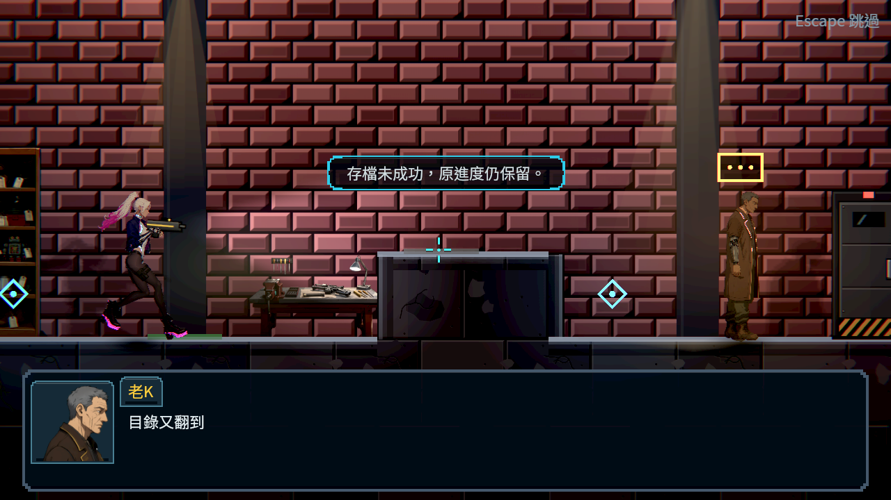
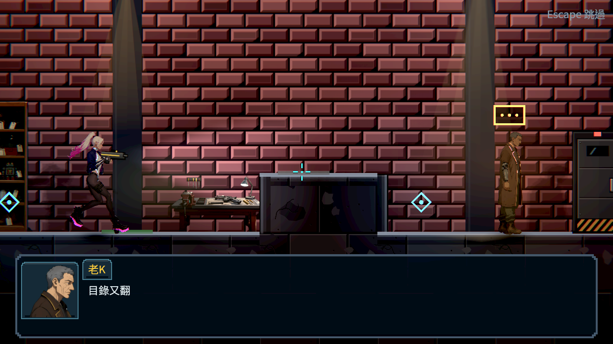

# 成功保存後撤回過期失敗提示

原Main新遊戲、真走到工作桌、真存檔拒寫兩次後重試成功。原正式存檔與器材都已成功，但先前一般自動保存留下的「存檔未成功」仍顯示；同一公開探針19項／1失敗，修後19項全過。它先確認真失敗訊息確實存在，再檢查真正成功後立即撤下，沒有靠自然淡出湊出通過。

現在只撤回相符的舊訊息，後來接手的新提示保留；原動畫停止並立即釋放版面。未成功的寫入不撤回訊息，也不額外播放成功橫幅。四個元件回歸另驗不相符訊息、後來的新訊息、撤下與原Tween不復活。驗證輸出自己的忽略檔避免副本進入引擎／Git類別掃描，不修改產品的測試選擇器。

## 重跑

```bash
python3 tools/run_training_completion.py --godot /absolute/godot --output /absolute/new/output
```

最後版69組、66,730項、0新／0已知失敗、606秒；7程序104項全過，30份來源雜湊與提交一致。介面元件91項全過。六份整合分片退出貼圖檢查0診斷。

原圖為1280×720、4.7.2、Forward+／llvmpipe軟體渲染，正式Main與原場景。修前來自922a3cb3交付原圖，修後用相同原入口與真IO重試，20項全過；只核對橫幅與對應真保存狀態，不把打字進度或整張畫面差異當成別的量測。主角仍持槍是獨立呈現問題，沒有遮掉或混稱已修。




[evidence.zip](evidence.zip)含原主檔、所有前後輸出、來源與初稿退件；[receipt.json](receipt.json)記錄範圍、原圖與來源雜湊。第一個探索探針取錯HUD欄位，已停止，未完成輸出保留且不計通過。合成輸入與軟體渲染不代稱真人或實體裝置驗收。
