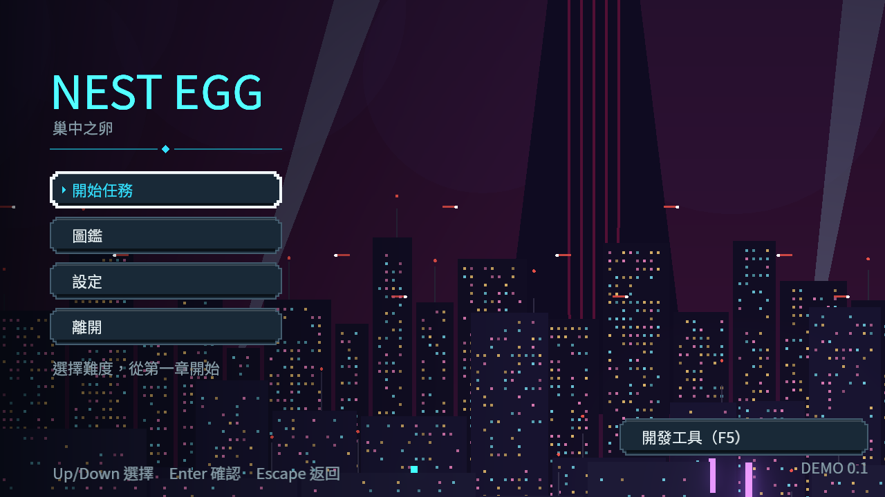

# 主選單起點提示

新遊戲實際從序章開始，舊「開始任務」的焦點說明與tooltip卻寫從第一章開始。只更正共用的一句既有說明，按鈕、版面、存檔、難度與路由不變；序章實際路線已有NE232本機新遊戲／冷續玩原件。本票整體介面仍按其餘條件驗收。

以已發布2c5cc9fc的乾淨隔離來源，只變這一檔，原始changed入口自行選出16組，6,298檢查／0新／0已知失敗、exit0，來源前後相同。四個原始shard及原篩選診斷完整保留，不宣稱冒煙log零ERROR。

原生前後均由真正Main建立MainMenu，等90個process觀察格後取同viewport HDR原float與PNG，再發出正式選單的退出訊號，由原Main完成正常清場。RX9070XT／Vulkan Forward+／HDR2D／1280×720，兩者真exit0、0引擎錯誤或退出洩漏訊息。按鈕真的聚焦，兩種版本各自的焦點說明及tooltip文字完全相同；原生圖已逐張檢視，文字完整可讀。這是程式觀察，不代稱實體手把或真人操作。

最初MovieMaker直接quit-after雖exit0，卻跳過Main正式退出流程，留下4 ObjectDB及1 resource訊息，嚴格拒收。原命令、來源、完整log及失敗收據封存，原90PNG／WAV完整保留在work/ne228-menu-native-pair-v1/before/frames，沒有把首次失敗改成成功。最後兩個原生程序改走實際退出路徑，沒有改任何產品清場碼。

original-raw.zip保存正式選測、最後原生兩程序、原始HDR／PNG、producer與首次拒收紀錄；raw-index.json逐member列SHA／長度。執行python verify.py可重驗。固定30Hz僅供畫面／時序觀察，不作即時效能數字。

