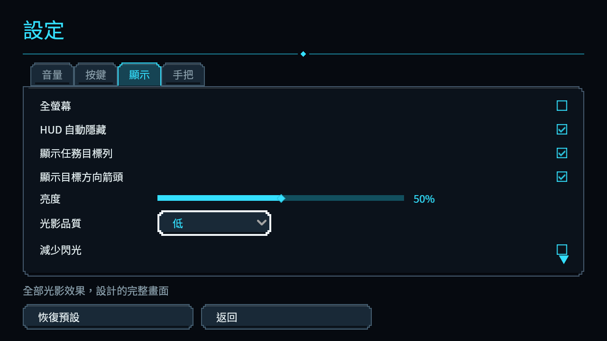
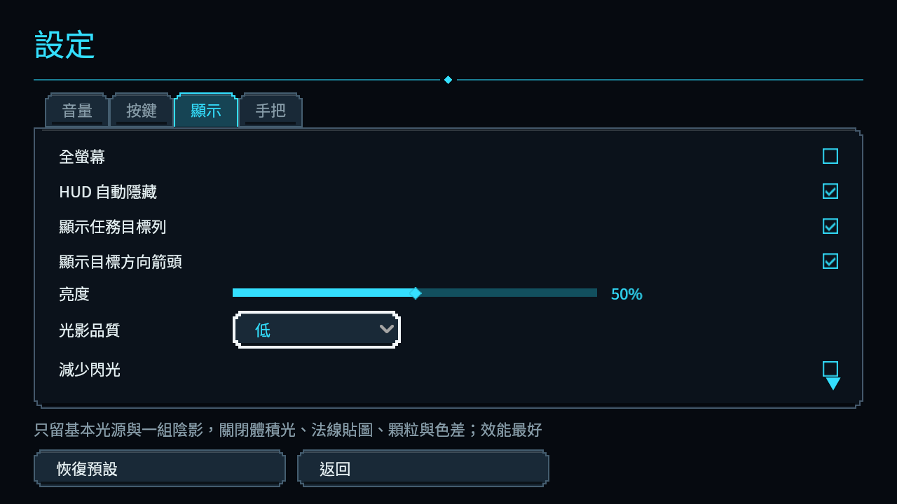
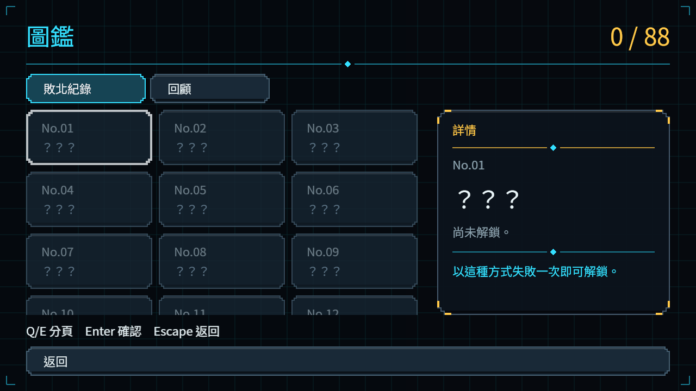
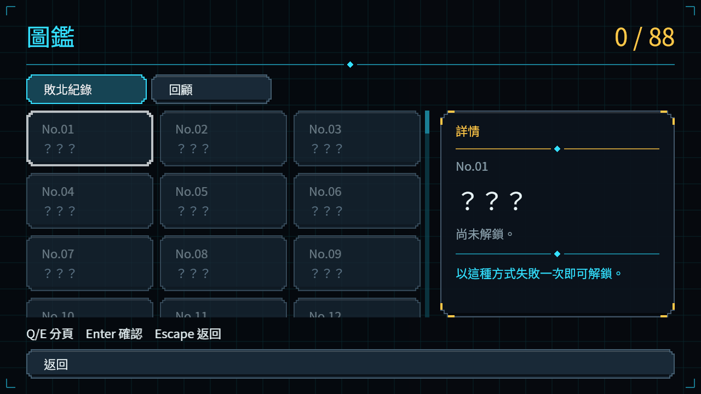
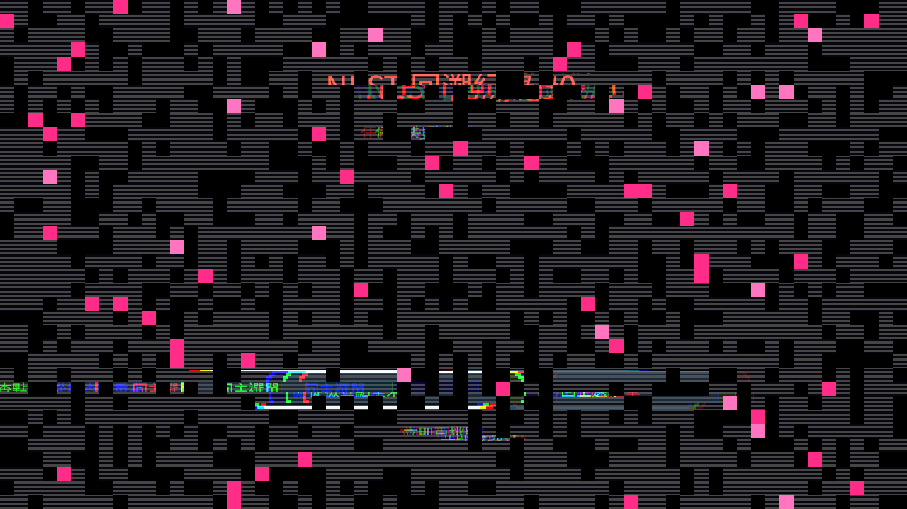
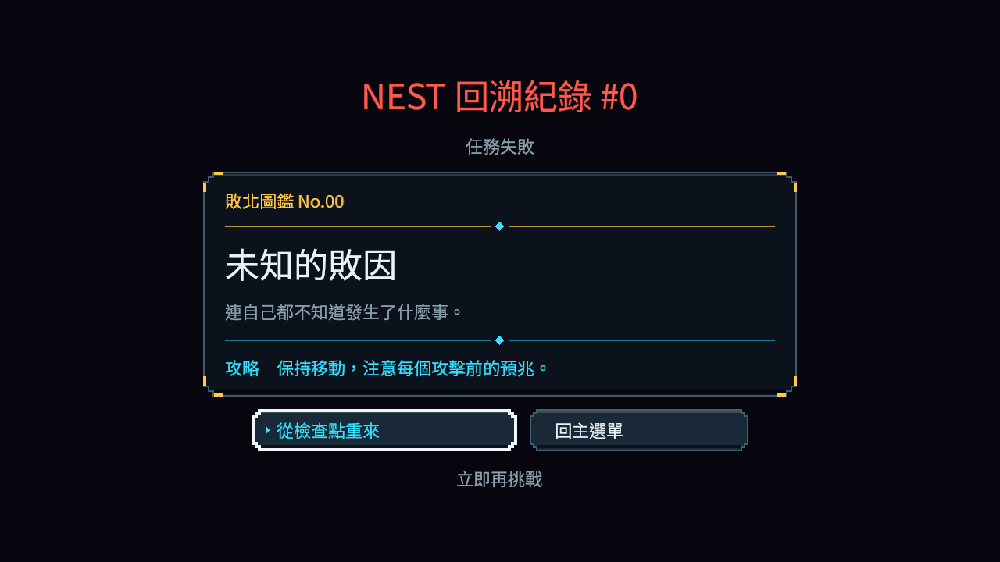

# 品質說明、捲軸與減動態的分段交付

目前正式交付品質切換／恢復預設後的當下說明、垂直／水平捲軸實際厚度，以及減少介面動態時立即完整顯示死亡卡。五份產品／永久測試來源詳見[精確來源及範圍](reviewed-controls/README.md)。圖鑑自動跟焦及已解鎖詳情重排並未包含在這五份來源。

| 同條件控制 | 修前 | 修後 |
| --- | --- | --- |
| 品質說明四條 | 4失敗 | 0失敗 |
| 真捲軸厚度兩條 | 2失敗 | 0失敗 |
| 減動態死亡卡三條 | 3失敗 | 0失敗 |

品質與死亡使用本機Godot4.7.2／RX9070XT／Forward+原生對照，原失敗exit1保留；讀取器校驗當次來源與真正輸出。六張原PNG逐byte保留、Root已逐張檢視；捲軸原圖只證外觀，水平case為明示元件fixture。

## 原受影響回歸

只採上述五源，在已發布ba37327f上，以原入口選31組：13,017項、0新／0已知、exit0、384.478秒；3943來源前後相同。raw有156條原過濾器接受的ERROR、0 SCRIPT ERROR，原件完整保留。[索引](official-reviewed-controls-v1-index.json)／[獨立校驗](verify_official_reviewed_controls_v1.py)。

先前六UI＋四收入來源的42組首輪58,212／1及真圖鑑修正後58,211／0均保持各自完整來源與scope，已於NE231進度交付公開。這次31組不是把先前紅結果改名，也不是聲稱那六來源已全部進目前主線。原最早31組13,013／1的拾取紀錄觀察錯配已由NE291獨立修正，歷史原件保留。

## 原圖

| 修前 | 修後 |
| --- | --- |
|  |  |
|  |  |
|  |  |

母票完整頁面／硬體條件不由此子交付代勾。圖鑑長詳情跟焦已另有CPU紅綠，但須其原生情境；42頁×5配置、Threat與實體流程保持各自驗收界線。
