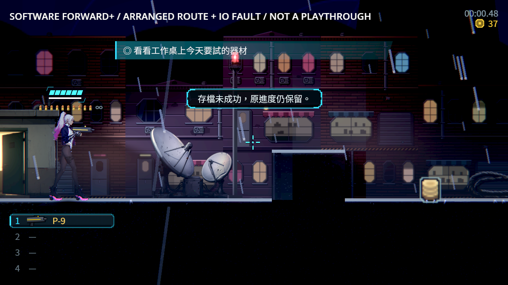
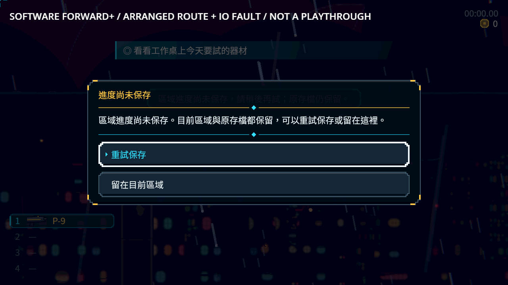
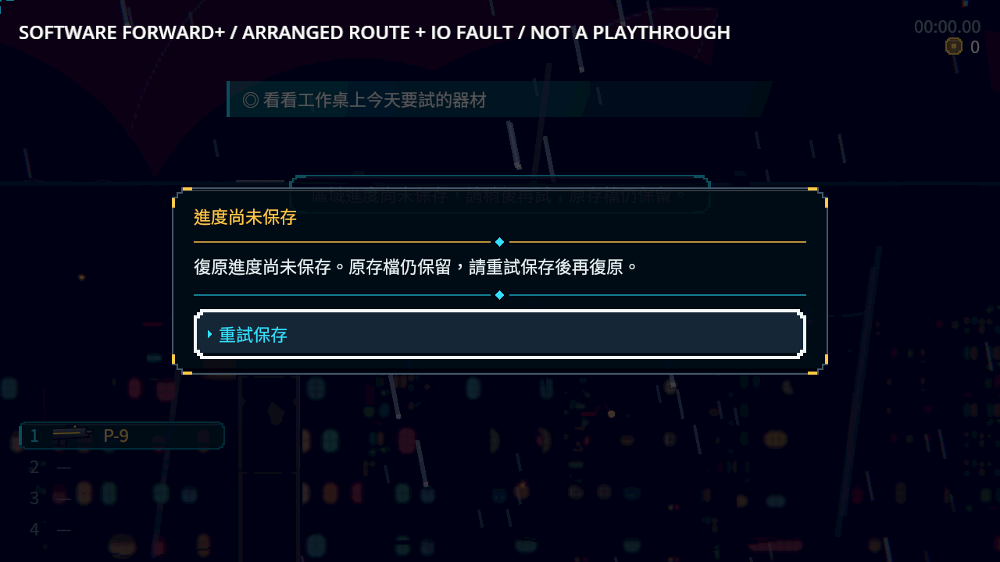
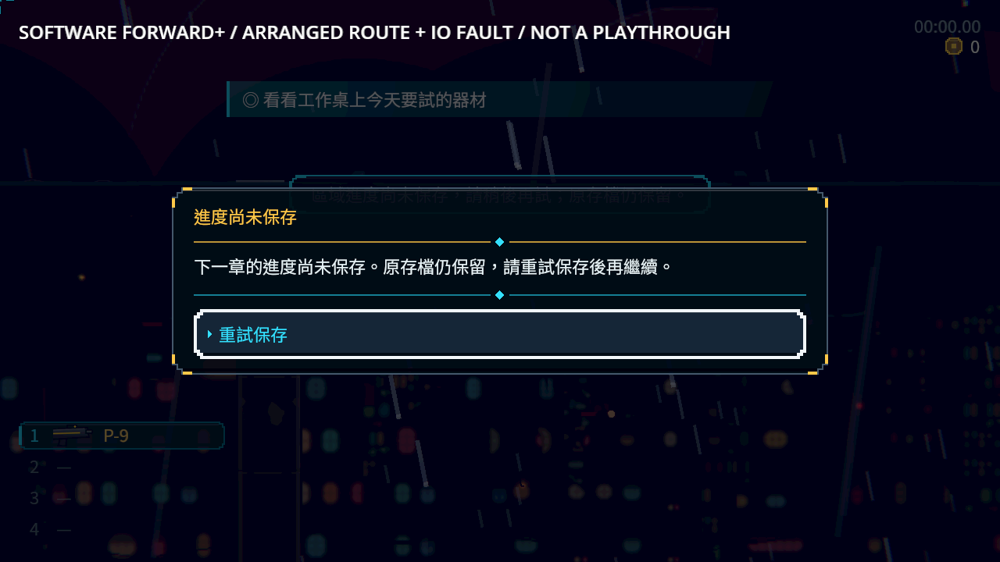
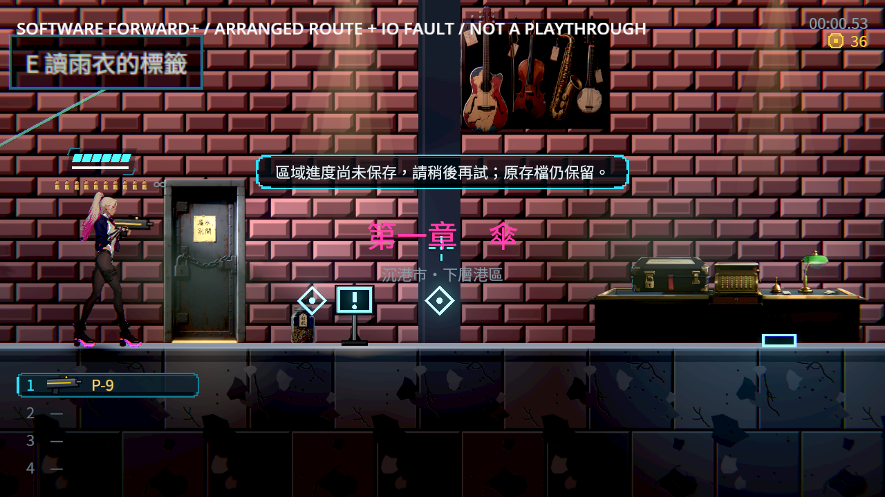
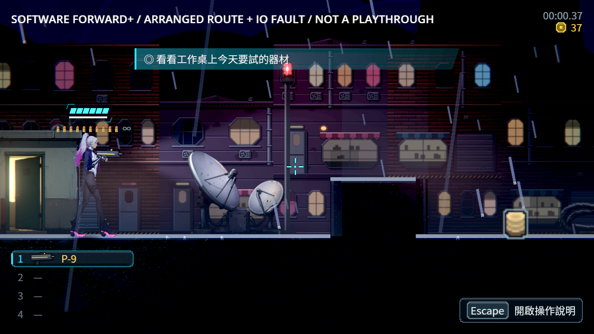
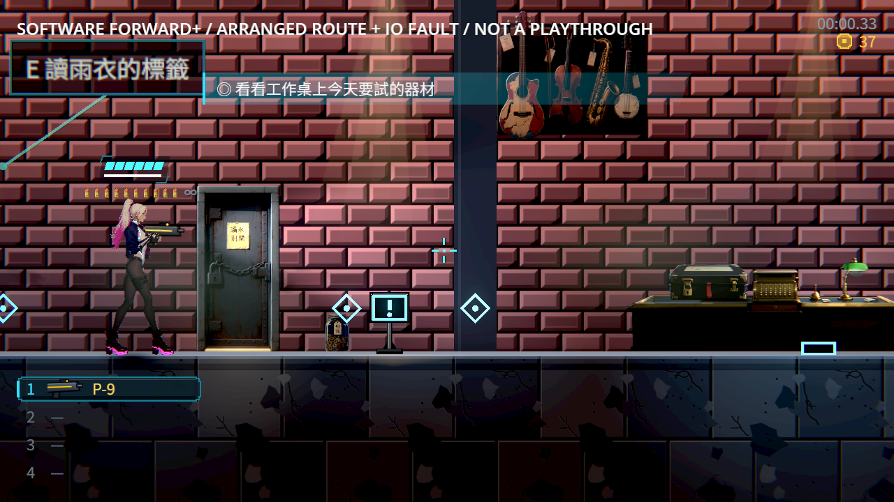
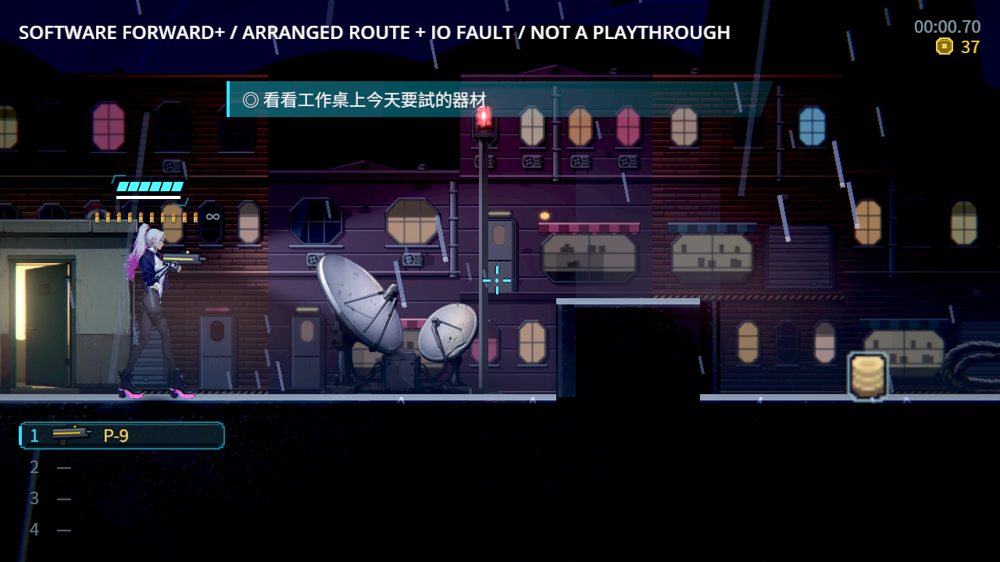

# 切區、重生與換章：保存拒絕後仍可恢復

原本目的地保存失敗仍回傳成功，現場進了新區、磁碟卻留在舊區；檢查點錢包與跨章帶入狀態也可能先被改掉。現在 Main 先建立完整候選，真正寫入成功後才改路由、裝備與檢查點，準備時不先建立 live 區域容器。

拒絕時保留原 Level、原主檔與備份，顯示可操作的保存提示。一般切區／手動重試可以重試或留在原區；自動死亡與換章只允許重試，Back 不會關掉唯一出路。再次失敗仍有提示，成功才切換。提示期間阻擋其他路由與補存；取消、重試、退出只釋放自己的暫停鎖。無效區域返回選單時不會額外蓋上恢復提示。

## 最終來源驗證

Godot 4.7.2 官方 Linux、固定 base 6c2a2e92、原 selector／runner／filter／known failures。最終原範圍：**checks: 3399, new failures: 0, known failures (tests/known_failures.txt): 0  (wall time 117 s)**。三語、120%文字、完整顯示／長文換行、焦點、Back、自有／外部暫停鎖、取消與 Main 退出皆有回歸。

四種真正 IO 拒絕的資料測試涵蓋切區、持久／非持久檢查點、跨章；每種另驗成功。舊來源正確負控制 514 檢查、12 失敗；原始首次 16 失敗內有四項陣列浮點型別誤報，只改為既有 codec 解碼後比較同一座標，舊資料保留。新介面首次 879／2 是短中文可放一行卻被要求換行，改查完整可見／高度／寬度，日英長文仍要求真的換行；沒有改產品文字來滿足測試。中間七組 3398／0 後再補選單保護，最終結果如上。所有測試修正與原失敗保留。

## 真 Main／獨立程序

| 情境 | 檢查 | 失敗 |
|---|---:|---:|
| refuse_write | 9 | 4 |
| refuse_write | 10 | 0 |
| refuse_read | 5 | 0 |
| retry_write | 15 | 0 |
| accept_read | 4 | 0 |
| stay_write | 12 | 0 |
| respawn_write | 15 | 0 |
| chapter_write | 15 | 0 |

七個修後程序共 **76 檢查、0 失敗**；修前負控制真正錯進屋頂、也沒有恢復提示。本次採用的八次軟體 Forward+／Vulkan llvmpipe 均 0 ERROR／SCRIPT ERROR。另保留最初重生 fixture 把當舖座標誤標屋頂的單次 ERROR：引擎正確回復起點，不當成乾淨通過；只改 fixture 為真正屋頂起點後重跑 respawn-v2，產品與斷言均未改。故障使用實際 `.tmp` 目錄阻擋 FileAccess；解除只刪本探針擁有的阻擋。區域走實際 Level deferred 訊號並等真正送達，之後按**實際提示按鈕**重試，先保留故障驗第二次拒絕，再移除故障驗成功；另驗留在原區、退出後全新 OS 程序讀原區或已接受目的地。自動死亡／換章是安排相同邊界的真 Main 呼叫，不冒稱完整死亡演出或完整章節通關。動畫轉場 instant 僅限探針；正式產品未改。

原七組 log 仍含刻意壞資料與既有引擎退出診斷，見 [逐條訊息](prompt-engine-errors.json)，不宣稱所有 headless raw 無 ERROR。這些診斷不取代 Windows 實機、實體控制器、真人整章、ST-9 通用交易 coordinator 或道具演出。

## 圖片與來源










開始前讀 User-guide 與 continuity-qa，實際重看 [五款相近遊戲的圖片與來源](../NE-278-references/sources.json)：Katana ZERO、Hollow Knight、Ghost Song、Blasphemous 2、Ori。採用穩定閱讀區、清楚狀態與安全動作，圖片不代表已知其保存實作。技術參照 [Godot FileAccess](https://docs.godotengine.org/en/stable/classes/class_fileaccess.html) 與 [inkle 保存整合](https://github.com/inkle/ink/blob/master/Documentation/RunningYourInk.md)。

## 重跑與原始資料

在自己的 6c2a2e92 checkout 匯入，將 [replay](replay) 的 main-after／UI／兩個 helper／兩個 suite 放回原路徑，執行原 `tools/run_tests_changed.sh 6c2a2e92`。修前資料負控制只使用 main-before 與 RunSaveSuite；原生負控制亦只跑 refuse_write。不要在其他 Session 的 main 上替換來源。

將 replay 的 probe 兩檔放 work/，以獨立絕對 save-dir／out 執行：

```sh
<Godot4.7.2> --path <checkout> --rendering-driver vulkan --rendering-method forward_plus res://work/ne230_destination_probe.tscn -- --mode=refuse_write --save-dir=<isolated-slot> --out=<absolute-output>
```

新程序同槽 `refuse_read`；另一組槽 `retry_write` 後新程序 `accept_read`；stay_write／respawn_write／chapter_write 各自新槽。獨立 XDG profile，不碰正式 user 檔。

最終 [prompt-raw.zip](prompt-raw.zip) 共 98 檔、[逐檔 SHA](prompt-manifest.json)、[版本／來源／每次結果](prompt-source.json)，含 exact 產品、測試、UID 與探針。原 [raw.zip](raw.zip)／[manifest](manifest.json)／[source](source.json) 61 檔是只有資料防護、尚未補 UI 的歷史 v1，明確保留，不能代稱最終 UI 已驗。main-guard-only 是該歷史版本，main-after 才是正式最終版。
