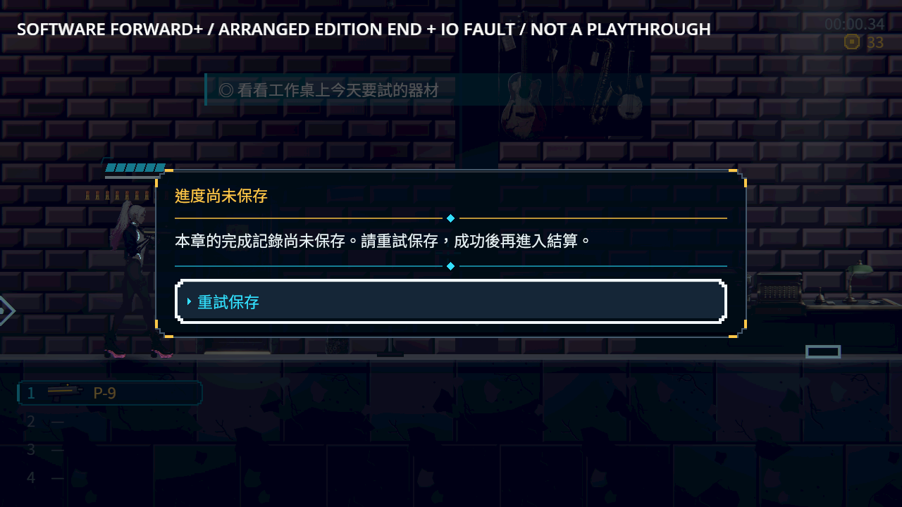
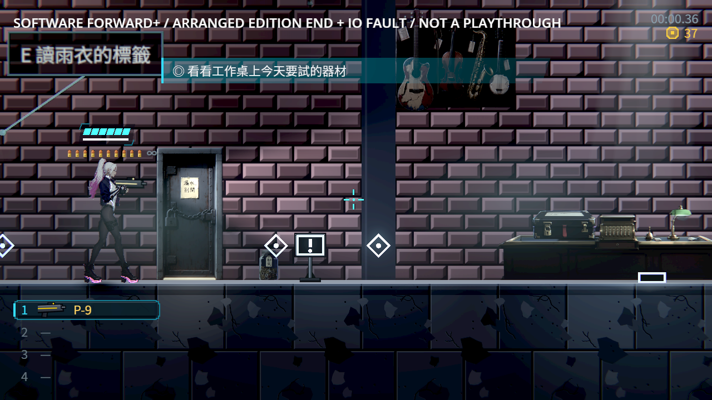
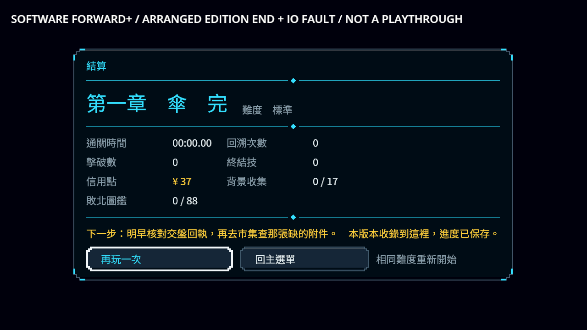

# 最後版本保存成功後才顯示結算

原本 Main 在累積版本最後一章先標記完成，呼叫不回傳結果的補存，再直接顯示「進度已保存」結算。真寫入拒絕時磁碟未完成、畫面卻說已保存，重試也會再顯示一次結算。

現在以真正當前 Level 建立完整完成候選，既有 writer 寫入成功後才改 Main 完成欄位及顯示 Victory。拒絕時原世界、資料 owner 與主檔／備份保持，專用三語提示清楚說完成記錄尚未保存，只提供重試；Back 不會關掉唯一出路。仍有下一章時維持上一批切區保護。檔案格式、writer、故事結果與獎勵政策未改。

## 驗證

- 同一 headless 測試修前 523 檢查、2 個預期失敗；修後原固定 base 91b3b9f0 選擇器：**checks: 3425, new failures: 0, known failures (tests/known_failures.txt): 0  (wall time 117 s)**。
- 只觀察最終 Victory 的測試用正式第一章末區與真正 through-ch1_kasa 版本。真 IO 阻擋時不出結算、不改完成欄位、四 owner 及主檔／備份 bytes 保持；解除後同一 Main 恰出一次結算，新 reader 讀到完成及相同錢包。
- 三語、120% 文字與 ending 專用文案沿用原焦點／Back／暫停鎖回歸。原測試選取器、filters、known failures 均 byte 不變。

| 真 Main 程序 | 檢查 | 失敗 |
|---|---:|---:|
| before (refuse_write) | 9 | 3 |
| refuse (refuse_write) | 10 | 0 |
| refuse-cold (refuse_read) | 5 | 0 |
| retry (retry_write) | 15 | 0 |
| retry-cold (accept_read) | 4 | 0 |
| presentation-v2 (refuse_write) | 10 | 0 |

修後五個程序共 44 檢查 0 失敗；六次軟體 Forward+／Vulkan llvmpipe 均 0 ERROR／SCRIPT ERROR。正式 Main、正式末區與版本範圍，真 Level deferred 完成訊號、真 FileAccess 失敗及實際提示按鈕重試；先重試一次仍拒絕，再解除本探針阻擋。原安排情境在 Level 初始化後立即凍結，較早失敗圖尚留首繪前的背景；補圖只增加故障之前的 camera／HUD 繪製等待，另起新槽拒絕仍全過，產品及斷言未改。所有舊圖與工具 SHA 保留，不把等待首繪當成等待請求完成。另有退出後全新程序：拒絕回到未完成原區，成功才恢復已保存結算與錢包，均無殘留鎖。完成訊號與結束狀態為安排的邊界，不冒稱完整通關；轉場 instant 僅在探針。

原七組 log 中刻意壞資料與既有退出診斷完整保留於 [逐條訊息](engine-errors.json)；不宣稱所有 headless raw 無 ERROR。這不取代 ST-9 尚未接好的完整段尾交易／道具 coordinator 或真人與實體裝置驗收。

## 畫面

先讀 User-guide 的安全重試、獨立程序與 UI 規則，延續 [五款同類作品實際圖片及來源](../NE-278-references/sources.json) 的清楚狀態與明確下一步，不由圖片推測其保存技術。技術核對 [Godot FileAccess 錯誤](https://docs.godotengine.org/en/stable/classes/class_fileaccess.html)，沿用本作唯一 writer。

[完整 raw 共 62 檔](raw.zip)、[逐檔 SHA](manifest.json)、[版本與凍結來源](source.json)。包含 exact 測試／產品／UID／探針及修前 Main；重跑時在自己獨立 checkout 放回原路徑，執行原 RunSaveSuite 與固定 base 原 selector。修前只替換 Main、預期 2 失敗。原生將工具放 work/，獨立 XDG／絕對 save-dir／out，執行 ne230_terminal_probe.tscn：refuse_write 後新程序 refuse_read，另一槽 retry_write 後新程序 accept_read。不要替換其他 Session 的來源或正式 user 檔。
