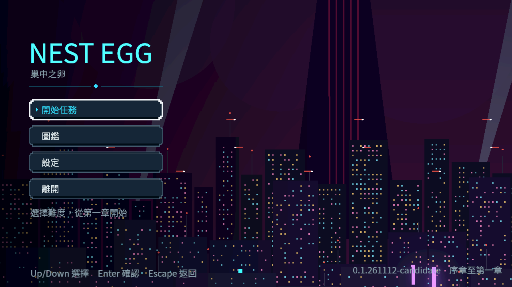
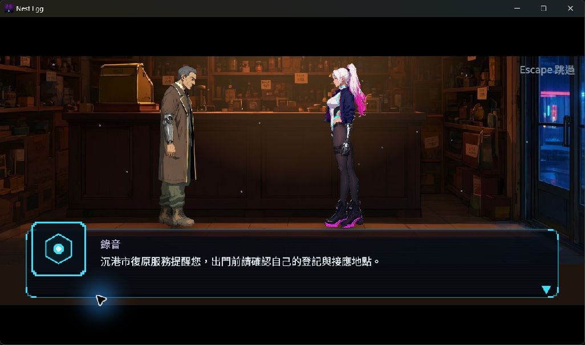
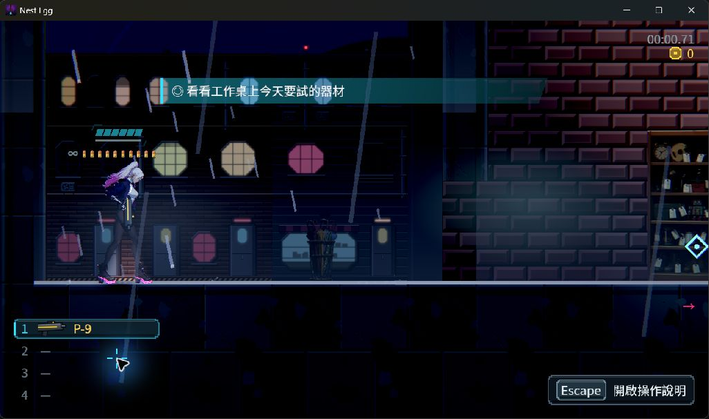
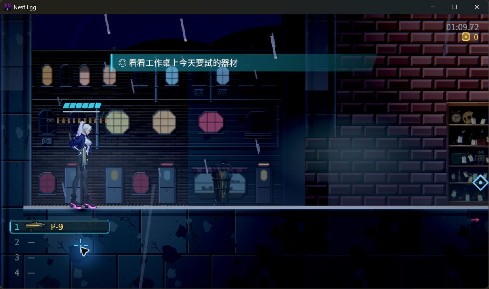

# 三份累積候選包與本機啟動

2026-11-12，以已發布 NE-286 修復後的固定提交 `99dfc03b2f2c0e2ea597fc6826d8e4ba8f3b5a8c` 建置 `0.1.261112-candidate`。三份相互獨立，不覆蓋先前 f52cb415 失敗 stage。Windows EXE 與 Linux 單檔均嵌入 PCK、全部項目校驗通過；Windows 實際無頭版號回報與有畫面主選單分開保存。Linux 在 Windows 上只驗產物 bytes，沒有執行 Linux 原生檔。

| 累積末章 | Windows bytes | Linux bytes | 固定來源檔數 |
|---|---:|---:|---:|
| ch1_kasa | 296,595,744 | 260,846,672 | 8630 |
| ch2_heron | 296,595,744 | 260,846,672 | 8630 |
| ch3_clearwater | 296,595,744 | 260,846,672 | 8630 |

執行檔留在本機 `D:/NE232/0.1.261112-candidate-through-<末章>-99dfc03b2f2c0e2ea597fc6826d8e4ba8f3b5a8c/artifacts/`。每份 `export-manifest.json` 與 `SHA256SUMS` 列出版本、來源、體積與完整 SHA-256；原 EXE／Linux 單檔不放進 Git。`candidates.json` 提供三個實際絕對路徑及同一份清單。

## 真實程序與畫面

三份 Windows 包各複製到只有一個 EXE 的空目錄，由官方 4.7.2 原生模板執行；均真 exit0、無腳本錯誤／引擎錯誤／退出洩漏。RX 9070 XT、Vulkan Forward+。每份另存 90 張 1280×720 MovieMaker 原圖與原錄音，固定 30 Hz 只供畫面證據，不算即時效能。最後一格均可讀到正確的候選版本與「序章至第一／二／三章」。

第一章最初的讀取器只查子程序 stdout，Windows GUI release 的 stdout 是空白，因此原讀取器拒收；原失敗收據保留。相同已結束程序的隔離 `godot.log` 明確列出 Forward+ 與 RX 9070 XT，獨立重讀後另加 `persisted-log-verification.json`，不覆寫原收據、不重拍或冒稱原讀取器綠。第二、三章從一開始就同時核對持久化引擎 log。

另以即時 Windows EXE、獨立 APPDATA／LOCALAPPDATA，透過作業系統選單輸入實際進入難度選擇、標準新遊戲、序章舞台，略過後到可操作序章與工作桌任務。正常關閉後，真新程序顯示「繼續遊戲」，按下後回到同一序章目標與裝備。兩程序均自然 exit0、無錯誤或洩漏，EXE 雜湊不變；七項存檔權威欄位（關卡、章末、難度、版本、故事、導航、成長）前後相同。時鐘自然前進，沒有宣稱整份存檔 bytes 不變。

桌面工具送出的 P 與 Escape 無法操作實體鍵綁定。獨立最小 Godot 原生診斷保存真 `_input`／`_unhandled_input`：兩者邏輯碼分別為 80／4194305，實體碼卻同為 4194313；P 邏輯 action 為 true、實體 P action 為 false。這證明該輸入工具的限制；沒有改遊戲綁鍵去迎合工具，也不把這段算遊戲鍵盤或實體手把完整驗收。

## 驗證與原始邊界

`candidate-build-and-native-raw.zip` 保存三份 stage 的來源清單、匯入完整性、匯出／版本回報、完整命令及 log、270 原始畫面與錄音，以及第一章實際 UI／冷續玩／輸入診斷。22693474 bytes，SHA-256 `29f4ca3b99a968ef0302aaa1a81bcf60c4e6dd7d70e742946a965eef1d25a540`，371 members。每個原件另列長度與 SHA，讀取器逐項核對。驗證命令：

```text
python verify.py
python verify.py --check-artifacts
```

含本機六個執行檔逐項雜湊的重驗為 1,127 檢查／0 失敗。既有發行工具回歸原 log 同封：90 tests、88 通過、2 個 WinError1314 真 symlink 權限案例明確 skip；真 junction 拒絕案例通過。沒有修改發行工具或遊戲來源。

正式發行與完整章節驗收欄位仍為 false。三包是固定來源候選，實際跨章接續、完整戰鬥／對話／商店／死亡／章末與實體手把驗收依 NE-233～235 的原條件完成，不能拿主選單或 CLI 版號替代。

## 原圖







