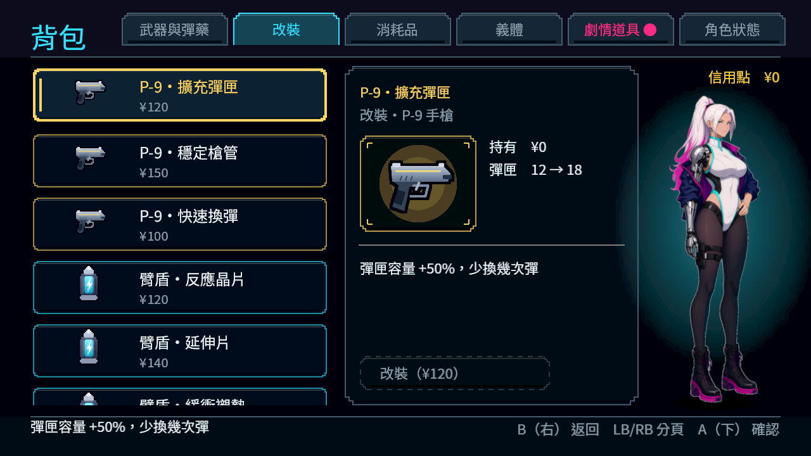
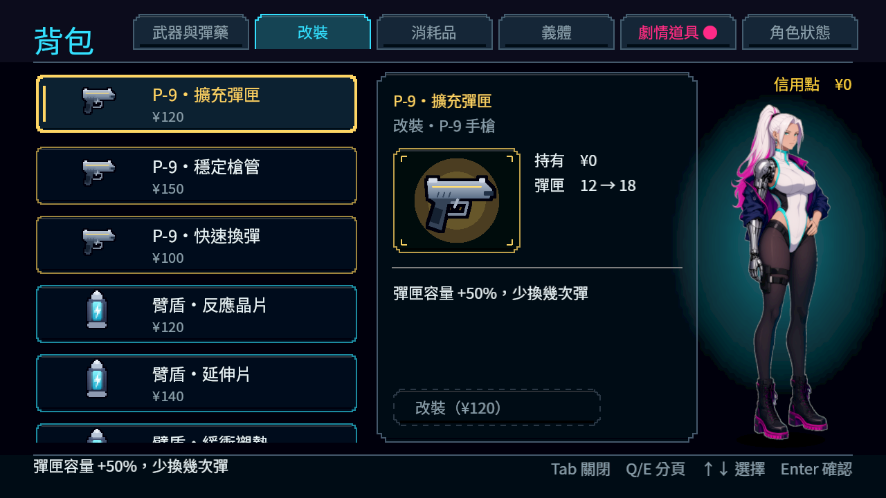
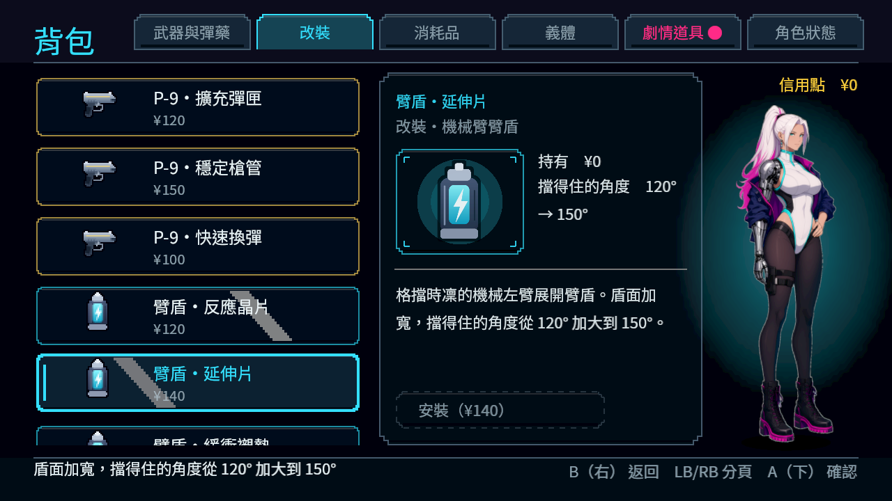

# NE-244 Commit-2：背包的裝置提示與搖桿長按

背包先消耗開啟／分頁／方向輸入，共用觀察者收不到事件，因此已按RB換頁卻仍顯示Tab／Q／E。原始搖桿壓力也直接被當作方向按鍵：稍微多推就多移一格，穩定推住卻不重複。

擁有者現在先記錄真正裝置，再處理操作；左搖桿交給既有導航，沿用原0.35秒首次延遲與0.1秒重複間隔。綁定、交易、內容、焦點、UI版面、立繪及共用導航程式不改。

## 最終對照

| 項目 | 原版 | 修正後 |
|---|---|---|
| 相同最終UI套件 | 420項／6失敗，46秒 | 420項／0失敗，46秒 |
| 相同helper於真正Main背包 | 15項／6失敗，exit1 | 15項／0失敗，exit0 |

兩份最終原生log皆無ERROR／洩漏。原UI套件除一個追加呼叫外逐位元相同；新helper另檔，原測試／門檻／等待沒有刪改。最終受影響十組（含main）6,065項／0新／0已知失敗，221秒，完整八組程序原檔保留。

## 真實畫面

最終 `native/ne244-1024-device-{before,after}-flushed/` 各五張1280×720原圖均逐張查看。以Godot4.7.2、Forward+、HDR、llvmpipe，真正Main新局再安排路由到正式第一章街道；observer保留ALWAYS、Main保留PAUSABLE。為隔離介面，位置、NPC／敵人／遭遇、故事掃描與無敵設定沿用明示fixture，背包與角色圖是正式畫面。合成鍵盤、滑鼠、手把999經真輸入綁定，不代稱實體手把或自然章節通關。

## 壓力事件與長按計時分開測

初稿等待兩個process影格後才比較壓力事件，原生會把正常長按重複算成錯誤：同版診斷重播實測等待306,457µs，Timer原只剩85,327µs，選取1→2、Timer回到0.1秒。該重播是實際新量測，沒有補造較早那次的時間戳。初稿headless420／0、原生15／1均保留。

同步讀取的第二稿又未送達緩衝事件，原版只剩420／4、原生15／4，漏掉兩個原導航缺陷，因此拒絕。最終使用官方 `Input.flush_buffered_events()` 在同一呼叫送達壓力事件後核對前後選取；長按及放開另用原真實Timer，沒有停止計時、改重複設定或放寬位置判斷。相同最終來源的原版重新抓到六項失敗，修正版全部通過。

`inventory-device-attempts.json`、各版helper、所有原始影像／log／exit／逐步裝置與legend JSON均保留，沒有用較早全綠的headless結果替代原生失敗。

## 重跑與來源

將 `source/inventory_device_probe.gd` 與 `.tscn` 放到專案 `work/batch1024/`，啟動該場景並傳 `--out=<絕對目錄>`；它繼承已提交NE-254的Main路由fixture，該基底另存於source供比對。兩種入口共用正式的 `tests/helpers/inventory_device_checks.gd`；原UI套件亦追加同一helper。

最終負控制搭配「修後測試／helper」及「修前背包程式」。原受影響指令 `GODOT=<4.7.2> SHARDS=8 tools/run_tests_changed.sh c9e8342c`。`inventory-device-source-check.json` 核對原UI套件及共用輸入、導航計時、selector、runner、known failures均未另改。

研究先讀User-guide與原票，沿用[七款介面參考](../../../../design/20-campaign-experience/INVENTORY_WORLD_CLARITY.md)，本次重新看過兩款相近2D動作遊戲：

圖片著作權屬原權利人，來源見原票interfaceingame.com研究；只比較閱讀，不推論其私有輸入實作或玩家偏好。

- [Godot官方InputEvent文件](https://github.com/godotengine/godot-docs/blob/master/tutorials/inputs/inputevent.rst)：消耗事件後不再傳遞，須核對先收到它的擁有者。
- [官方Input API](https://github.com/godotengine/godot-docs/blob/master/classes/class_input.rst)：flush_buffered_events提供精確送達時點；本次只用於新測試。

實際HTTP／SHA見 `inventory-device-reference.json`。原生／合成輸入通過不代勾原票保留的實體手把條件。
