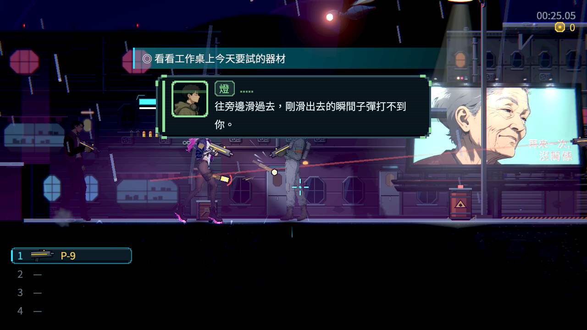
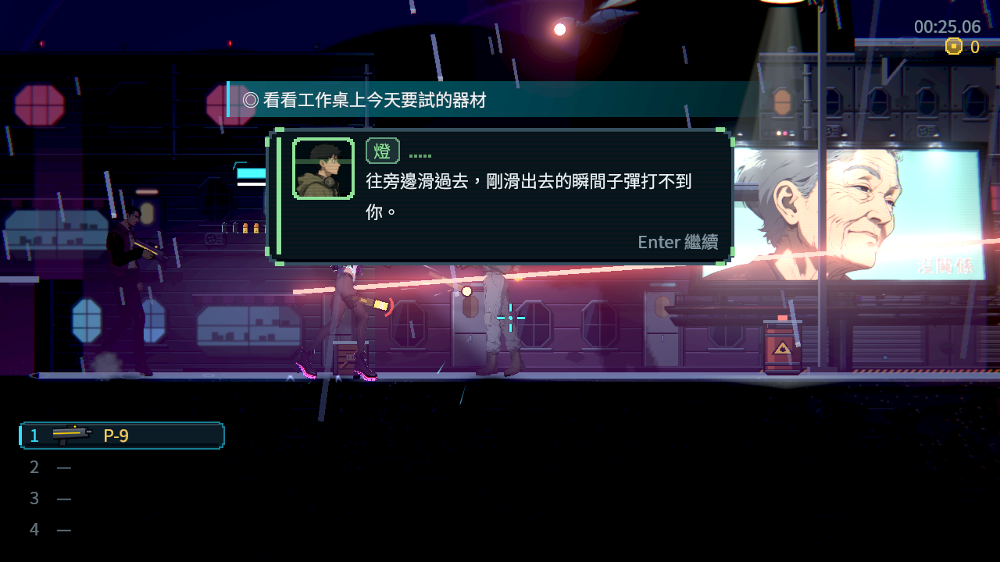
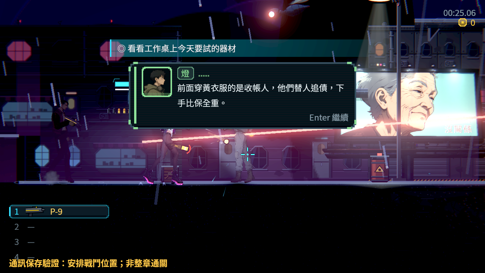
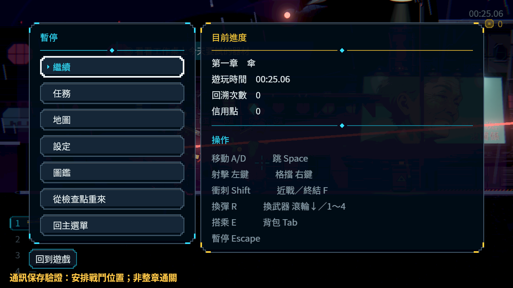
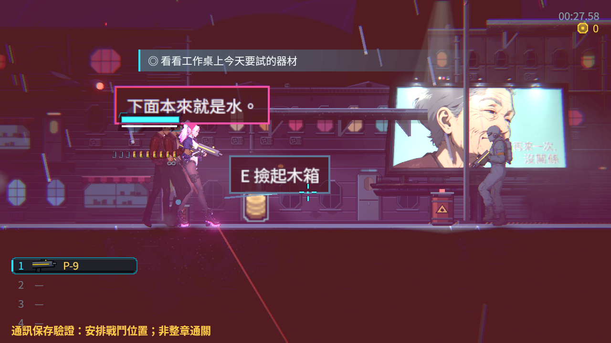

# NE-246 真戰鬥連續通訊與穩定確認提示

2026-10-20，固定基準 `fab8bdf8dcad3fde7ada5b893888264cc3d08690`。本批只改重要通訊完整顯字後的確認提示；普通氣泡、劇本、故事結果和保存規則沿用原契約。本機／實體裝置的原待驗條件不代勾，票保持進行中。

## 問題與改後

完整文字已出現，世界正在等待玩家確認，但「繼續」按鍵會閃到完全看不見。改為完整顯字後持續顯示；下一句打字時收起，仍依改鍵與目前裝置產生提示。原本的確認一次一句、保存成功才完成與恢復世界都維持。

修前／後採同一V2探針與正式場景／公開射擊及Enter規則，不冒稱隨機AI和人物位置逐像素相同。修前兩句都在一秒實際渲染觀察窗中出現隱藏幀；修後兩句觀察到的渲染幀全可見。觀察器沒有改UI時鐘或強制提示狀態，也沒有直接補滿文字。

## 真正遊戲邊界

使用真正Main開始新遊戲、進正式第一章街道、正式Player／16個原敵人與實際整輪writer。只安排玩家x=96格與9999生命，保留正式1秒受傷保護；沒有改敵人生命、位置、招式或故事旗標。公開滑鼠、射擊／換彈與真正Enter事件；兩則正式通訊由公開Story.play排入，明示為安排的連續閱讀，不冒充自然觸發整章流程。兩方都有實際傷害，之後同一顆玩家活子彈、16敵人的身份／位置／生命、玩家生命、傷害帳與時鐘在閱讀、開關暫停及兩句之間維持一致。最後確認後原子彈自然繼續飛行或碰撞，兩個完成訊號和真正磁碟觀看紀錄依序成立。

雲端官方Godot4.7.2、軟體Vulkan llvmpipe、原生Forward+／HDR，沒有改Compatibility。這是自動公開輸入與渲染證據，**不是本機硬體、實體手把、真人手感或整章通關驗收**。修前使用正式程式，不是為了製造失敗把提示改壞；原版已在截圖中觀察到缺口後才新增同條件觀察。

|程序|檢查|預期失敗|提示可見取樣|隱藏取樣|
|---|---:|---:|---:|---:|
|radio-combat-sequence-v1|17|0|None|None|
|radio-combat-hint-before-v2|19|2|4|6|
|radio-combat-hint-after-v2|19|0|4|0|

三輪原生log均0引擎／腳本ERROR；V1原17項全過，但不含新發現的穩定提示條件，不能用17/0掩蓋圖片上的缺口。V2修前19項只失敗兩個穩定提示條件，修後19/0。[獨立核對](validation.json)保留真正戰鬥、相同世界、台詞／完成順序及渲染取樣，並核對正式程式只差一個提示可見判斷及其註解。

原保存／介面／劇情三組先跑2330/0/68秒。首輪固定基準60組63040項有3個失敗（載具上車、下車、落坑復原），536秒；不當通過，也沒有改原斷言或塞known_failures。這輪與軟體原生算圖重疊；之後原版及修改版各自獨立執行原main均通過，原版／修改版收據在validation，不能據此斷言已證明CPU或時間是根因。保留全部首輪與獨立控制log。第二次完整重跑在02:28後沒有完成輸出與退出碼，02:54檢查時已無程序、原工具session也不可用；中斷原因未證實，不算通過，原件在raw。再次確認正式修改版已還原後，才在沒有原生算圖重疊時，使用同一原選擇器、同基準、同6程序完整重跑受影響範圍。正式修正後使用原選擇器、固定fab8bdf8基準的 `tools/run_tests_changed.sh`：**60組、63040檢查、0新失敗、0已知失敗、496秒**。沒有改原測試、選擇器、錯誤過濾或known_failures。負資料測試原本會刻意push_error，全部原始行保留在[diagnostics](diagnostics.json)，由未修改的正式測試流程判斷；不能把原套件有預期ERROR寫成整份log零ERROR。完整專案CI另由推送觸發，不把局部數字當全套。

## 研究圖與採用理由

開始前讀User-guide，重新看五款不同團隊的對話原圖。Katana ZERO採清楚的選項與焦點區；Hollow Knight採正文區和場景分離；Ghost Song採講者、正文與下一步符號可分辨；Blasphemous 2採讀取方向集中的字幕；Ori採高對比正文。單張圖片無法證明它們的提示是否閃爍或世界是否暫停，持續顯示的決策來自本作可重現的問題。

九日討論同時有人希望縮短對話、有人喜歡長敘事；安全略過模組也明確保留會破壞遊戲的必要段落。這些是樣本意見，沒有宣稱玩家普遍偏好，也沒有因此改掉必要的耐久結果。Godot Input文件區別action state與真正input事件，本次UI確認使用parse_input_event。來源、原圖SHA與連結在[references](references.json)；Wiki開啟失敗沒有當作已讀來源。研究圖保留原尺寸，不混作本作驗收。

## 重跑與原始資料

在隔離checkout放raw/replay的V2 gd／tscn到work，以原生Forward+執行 `res://work/radio_combat_sequence_v2.tscn -- --out=<絕對路徑> --save-dir=<全新隔離路徑>`。修前使用source裡的dialogue-before，修後使用dialogue-after；不可改別人main。凍結中擷取與逐格觀察需要實際渲染時間，不以固定影格數猜文字已打完。重播程式含環境絕對路徑，換機時只改成實際路徑。

raw.zip共369檔，原始圖、報告、save／bak、探針版本、負控制、全部原測試log及研究開啟失敗都保留；[manifest](manifest.json)逐檔bytes／SHA，[source](source.json)記錄ZIP與保護檔SHA。最終程式沒有加入任意故事跳過、背景自動完成或偽造IO成功。
