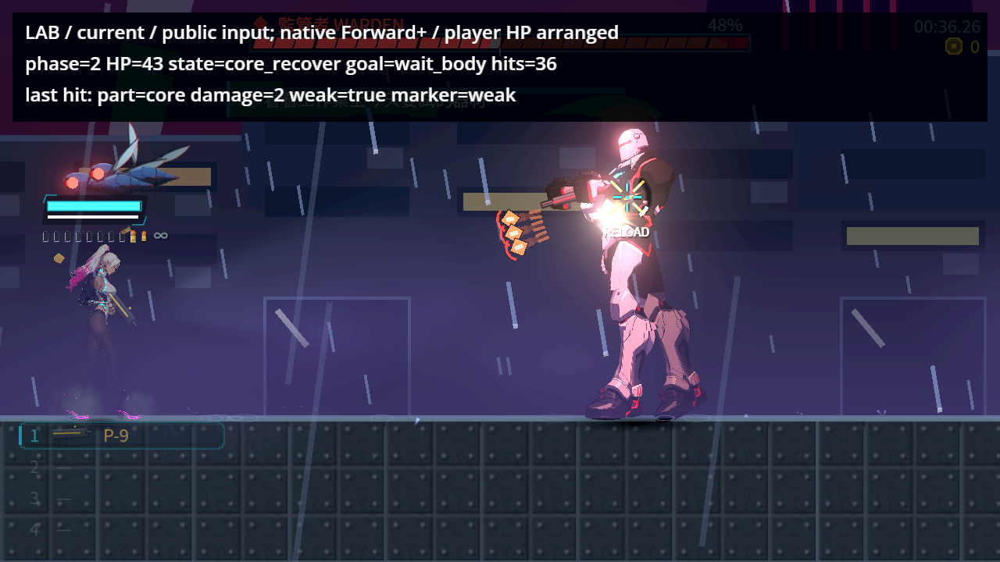
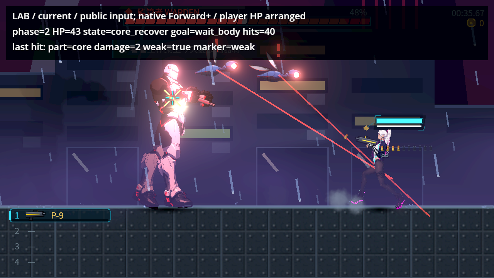

# NE-248：本機原生自然第二階段與核心

2026-11-11，Godot 4.7.2 official、AMD Radeon RX 9070 XT、Vulkan Forward+、HDR 2D，1280×720。承接[既有自然交戰 v9 與原部位選擇負控制](../NE-248-natural-core/README.md)。本次沒有修改正式遊戲、命中、敵人、武器或原測試；只修拍攝工具的公開滑鼠事件送達，並補上本機硬體畫面。

## 實際條件

正式 Level／Player／90 HP 監管者／P-9 手槍，明示空曠測試場地，正式第一章 `ch1_kasa`。只安排初始位置及玩家 999 生命；玩家受傷保護還原正式 tuning 的 1 秒並逐輪斷言。保留原手槍散布、AI 招式、敵方彈幕與召喚。敵人生命、phase、FSM、招式或核心開關沒有直接寫入。

玩家用公開 Input 行走、射擊、換彈與 InputEventMouseMotion 瞄準，從 90 生命逐發打進自然第二階段，再等 AI 自己進入 core_recover。核心比較等待全身倍率回 1，另核對部位倍率 2；身體及關閉核心比較維持 1。一次只允許一發玩家手槍在途，不移除任何子彈；命中後保持同一公開瞄準到畫面完成。

這是自動公開輸入與安排場地的本機硬體驗收，不是人類整章遊玩、實體滑鼠／手把或手感驗收。同機還有其他專案，左輪實際記到 window_focus=false 及外部 OS 游標造成的誤差；保留全部焦點與座標取樣，沒有宣稱獨占機器或測量效能。

## 最終結果

| 原生輪次 | 自然第二階段 | 真核心 | 窗口內身體 | 核心關閉 | 結果 |
|---|---|---|---|---|---|
| 初始左側、向右射擊 | 17.7167 秒，90→45；監管者核心命中時朝左 | 45→43，core／weak／2；接觸在核心內 | 42→41，空部位／hit／1 | 41→40，core／hit／1，weak=false | 17／0，exit 0 |
| 初始右側、向左射擊 | 20.6333 秒，90→45；監管者核心命中時朝右 | 45→43，core／weak／2；接觸在核心內 | 43→42，空部位／hit／1 | 42→41，core／hit／1，weak=false | 17／0，exit 0 |

關閉核心仍可以回報部位 id=core，但沒有弱點倍率；不能把「部位名稱」與「弱點有效狀態」混用。右輪另有一發原身體嘗試在窗口關閉後才到達，記為普通 wait_body 傷害 43→42；它沒有被算入曝露窗口比較。後續等下一次正式窗口才接受身體案例。完整生命帳包含這一發，沒有清掉或隱藏。

- [右輪原始報告](right/report.json)、[左輪原始報告](left/report.json)，全部傷害來源均為 player_pistol，生命從 90 逐筆對帳。
- [獨立驗證](verification.json)：234 項、0 失敗，另核對 PNG 1280×720、兩側相同來源 SHA、原生 Radeon／Forward+／HDR、真正 marker、每次公開射擊嘗試各完成一發真實手槍投射物及乾淨退出。
- [原始行為摘要](native-summary.json)：右輪 41 次輸入嘗試／41 次投射物結束／39 次頭目傷害，左輪 46／46／42。兩側嘗試間隔中位數皆約 0.267 秒；各等待原因為重疊的逐物理格取樣，不能相加當作總時間。所有 marker、投射物結束時剩餘壽命與接觸紀錄都在原報告，沒有把其他目標或地形接觸冒充頭目傷害。
- activation_observed 是觀察器於物理格看到的下限。右輪有兩發在觀察器兩次回呼間就生成並結束，故只觀察到 39 次啟用，但真實 expired 事件有 41 次；沒有將取樣數冒稱全部開槍數。
- [完整無頭相容性](headless-current-right/report.json)：17／0、exit 0，只作邏輯驗證；沒有原生畫面宣稱。同日本輪原 HeavyEnemiesSuite 293／0、121.5 秒、exit 0，見 [NE-268 原始 log](../NE-268-native-contact-2026-11-11/heavy-enemies-direct.log)；正式命中來源沒有修改。
- [按檔案挑選](selection.txt)為 0 套件，本次只有工具與證據，不以此替代實際重播或前次回歸。

## 原圖

十張原圖已逐張看過，保留正式粒子、閃光、HUD、敵方子彈與召喚。LAB 是探針資訊，不是新增的遊戲 UI；部分動作格左緣的 LAB 字受畫面位移裁切，原圖未重排或補字。這不是角色全身接點或其他 UI 票的驗收。




其餘：[右側自然 phase2](right/phase2.png)、[身體](right/body_hit.png)、[關閉核心](right/closed_hit.png)、[總結](right/summary.png)；[左側自然 phase2](left/phase2.png)、[身體](left/body_hit.png)、[關閉核心](left/closed_hit.png)、[總結](left/summary.png)。

## 輸入送達診斷與保留的失敗

1. [原 v9 送達方式的完整右輪](attempts/native-v1-right/report.json)：原 14400 物理格／240 秒用完，90→60、38 次輸入嘗試／21 次頭目命中，10 項／4 失敗，exit 1，沒有引擎 ERROR。最後一次嘗試在 178.183 秒，嘗試間隔中位數 4.217 秒、最大 14.767 秒。原 source／log／summary 均保留，不以本次成功抹除。
2. [原 window warp 短診斷](diagnostic-window-warp/report.json)與[Viewport.warp_mouse 短診斷](diagnostic-viewport-warp/report.json)：視窗 1280×720，viewport 640×360，final_transform=2，canvas 縮放約 1.92；即使 focus=true，玩家讀到的 viewport mouse 仍固定 (-38.5,539.5)，與目標差 171～512 世界單位。後者即使限制游標在可見區也未解決。這些短預算輪仍依原條件回傳失敗。
3. 依 repo 既有 yong_fight 的公共入口，將 final×canvas 轉換後的 InputEventMouseMotion 交給 Input.parse_input_event，並維持游標在視窗內；保留 OS warp 配合原生游標，沒有改 AimInput 或角色值。[無頭 20 秒診斷](diagnostic-parse-headless/report.json)自然在 17.033 秒到 45／phase2；[原生 20 秒診斷](diagnostic-parse-mouse/report.json)在 17.3 秒到 phase2 並拍到真 core／2／weak。短輪尚未完成全部條件，因此仍保留非零退出與未完成檢查。
4. [最早的無頭舊送達診斷](headless-right/outcome.txt)已主動停止，只記五個初始前提，不作通過或產品缺陷宣稱。完整正式結果只採用 right／left 兩輪原生與 headless-current-right 的完整重播。

原 240 秒上限、所有部位／傷害／weak／marker／面向／倍率判定均維持；沒有延長核心窗口或等待預算。新增嚴格斷言要求核心回饋接觸點在有效核心內。[與封存 v9 的完整差異（raw.zip 內 archived-v9-to-native.patch）](raw.zip)、[來源收據](receipt.json)可核對送達與觀察修改。

## 重跑

在 repo 根目錄，原生兩輪依序經共享 GPU 鎖：

```powershell
python tools/comfyui/gpu_lock.py -- C:/Tools/Godot/Godot_v4.7.2-stable_win64_console.exe --path C:/Users/stanl/Github/Nest-Egg --rendering-method forward_plus --rendering-driver vulkan res://tools/ne248_natural_core_probe.tscn -- --parse-mouse --side=1 --out=<絕對目錄>/right
python tools/comfyui/gpu_lock.py -- C:/Tools/Godot/Godot_v4.7.2-stable_win64_console.exe --path C:/Users/stanl/Github/Nest-Egg --rendering-method forward_plus --rendering-driver vulkan res://tools/ne248_natural_core_probe.tscn -- --parse-mouse --side=-1 --out=<絕對目錄>/left
python tools/verify_ne248_native_core.py <絕對目錄>
```

各次真正的 shell 結束碼另存為該目錄的 exit-code.txt。不要省略 --parse-mouse：沒有此旗標是保留的舊送達負控制。--diagnostic-ticks 只供明示短診斷，驗證器拒絕將其當完整驗收；--logic-only 只跳過渲染擷取。設定寫入位置隔離到各自輸出目錄，正式存檔停用。原生版與無頭版都不直接呼叫私有射擊或傷害方法。


## 2026-11-11：原始位元組與 Git 換行補證

原生事件、原 report/source SHA、234 項驗證紀錄、manifest 與既有收據均保持原樣。Git 的 text=auto/eol=lf 會把提交中的 CRLF 正規化，不能將方便閱讀的 sidecar 位元組當成原始測試位元組。

[raw.zip](raw.zip)逐位元組保存補證前的全部 53 個附件檔案，以及真正被測、含 314 個 CRLF 的 probe；共 54 entries。原始 manifest 的 52 條全部逐檔重算通過，manifest 本身亦完整保存。原 probe SHA 為 `68790ba9f1a8bdc7c4668e56fce656df63a29a1fad3b38a6172cd72f80ff91cd`，與原 report 一致。ZIP 本身由局部 .gitattributes 明示 -text 保護，未對主程式添加換行例外。[保存收據](archive-receipt.json)記錄 ZIP SHA、原 manifest SHA、檔案數與換行數。

主 probe 現在使用 LF，僅移除每組 CRLF 中的 CR，沒有更改 token、玩法、輸入策略或任何原事件。驗證器只針對這一份 probe 採取兩項明示規則：ZIP 內真正被測來源的 SHA 必須逐 byte 等於 report；目前工具必須逐 byte 等於該來源僅做 CRLF→LF 的結果。其餘 **10 個產品來源仍逐 byte 對原 SHA**，沒有換行或內容寬鬆處理。

驗證器以 ZIP 內的原始報告、log、真正退出碼與 PNG 驗證，並依原 manifest 逐檔核對。新的 [291／0 儲存驗證](archive-verification.json)是在原生命帳驗證上加上保存與換行邊界檢查，不是重跑原生，也沒有改寫原本 234 項紀錄。

[負控制](archive-negative-controls.json)透過同一完整驗證器、僅在記憶體替換待讀內容：probe 的 `var side := 1` 改為 `var side := 2` 仍被拒絕；產品 hurtbox 來源只加入一個 CRLF 也被拒絕。沒有變更任何真實產品檔案。[Git blob 讀取集驗證](archive-fresh-git-verification.json)將目前 HEAD 的 11 個來源 blob 匯出到隔離暫存目錄，配合新驗證器與 ZIP，同樣 291／0；這是驗證器所需檔案的 fresh-checkout 等價讀取集，不是完整遊戲建置或遊玩。

原 patch 的 diff context 是合法補丁空白，但不適合當作一般新增文字跑 git diff --check；它已完整收進 ZIP。展示連結指向 ZIP，本機原檔保留並由局部 .gitignore 排除重新加入 Git。

重跑儲存與原生命帳驗證（不啟動 Godot）：

```powershell
python tools/verify_ne248_native_core.py pm/Nest-Egg/attachments/NE-248-native-natural-2026-11-11
```
