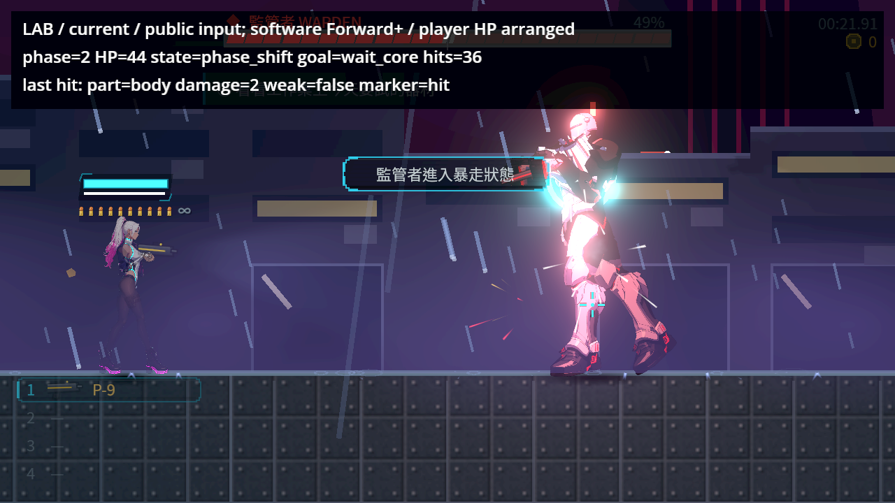
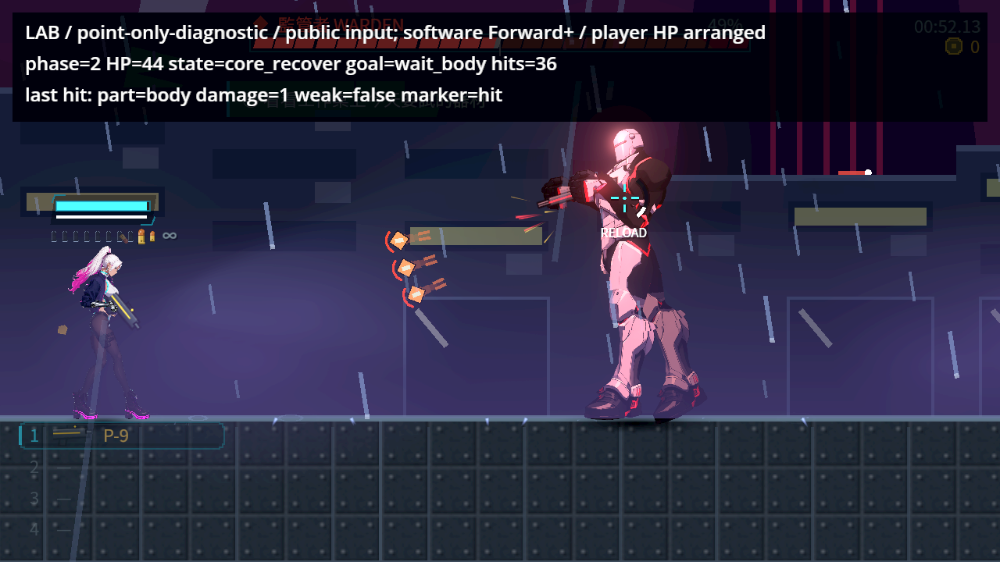
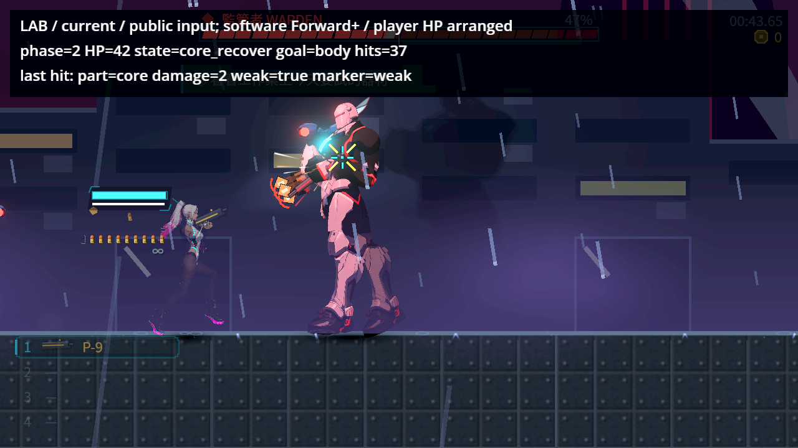
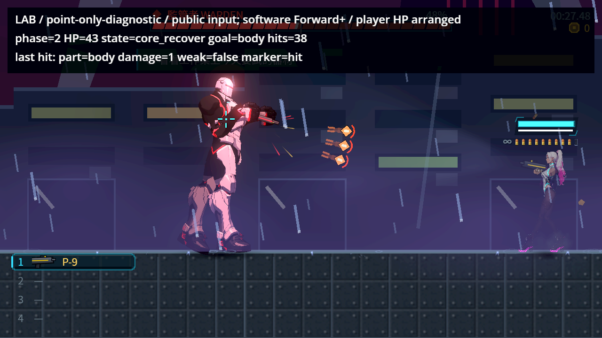
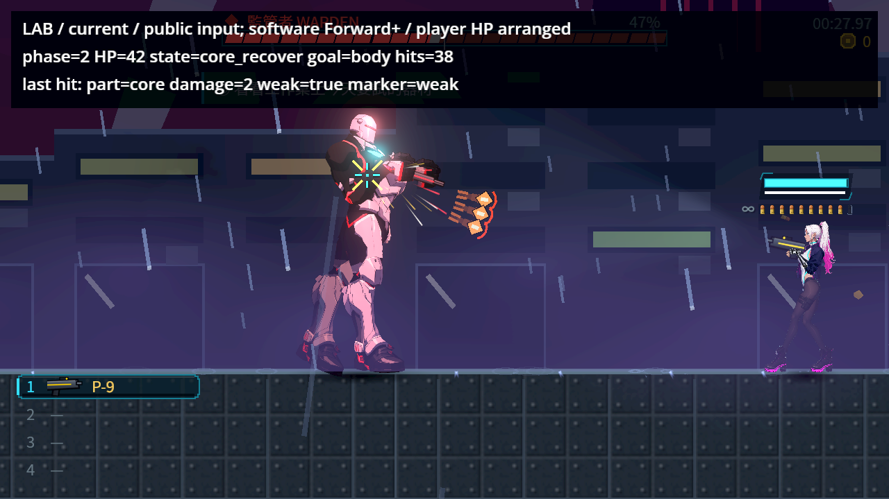
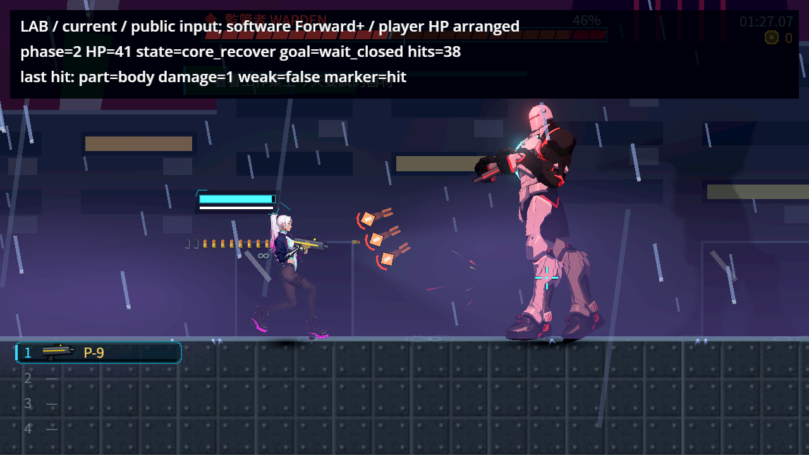
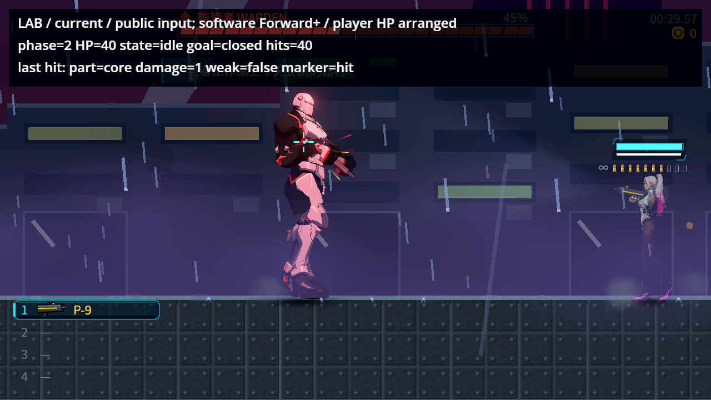

# NE-248 自然交戰與真正核心子彈

2026-10-20，實際遊戲邏輯基準 `dc80765c9a4b727f8c6e5a4e758d12728d359130`，本次未改正式命中／玩法／美術程式或原測試。原票六項命中契約已有修正；本輪補上雲端自然原生交戰驗證；本機硬體／實體操作驗收沒有代勾，狀態仍進行中。[設計與界線](../../../../design/20-campaign-experience/NATURAL_WARDEN_CORE_VERIFICATION.md)、[全部來源SHA](source.json)。

## 實際做了什麼

正式 Level／Player／90 HP監管者／P-9手槍，使用 public Input 行走、射擊、換彈與滑鼠事件。只安排空曠場地、初始玩家位置與999玩家生命；玩家受傷後保護沿用正式tuning的1秒並有額外斷言。敵人生命、階段、FSM、招式與核心開關從未直接指定。正式第一章 `ch1_kasa`，原始武器1度隨機散布保留，沒有抹掉敵人、彈幕、召喚或強迫招式。玩家只靠真實手槍命中把敵人打到45以下，自然進入第二階段後，等AI自行core_windup→core_recover，再射核心／偏離的身體／關閉核心。兩面向分別用真實移動維持，核心命中時亦核對面向。

這是明示安排的邊界與自動公開輸入重播，**不是從第一章開頭自然通關、真人試玩或實體手把驗收**。軟體 Vulkan llvmpipe、官方Godot4.7.2、Forward+含正式WorldEnvironment及HUD；沒有改Compatibility或藏掉引擎錯誤。

## 同條件控制與修後

|程序|檢查|失敗|實際頭目面向|核心前後生命|部位|marker|
|---|---:|---:|---:|---|---|---|
|warden-natural-current-right-v9|16|0|-1|44→42|core|weak|
|warden-natural-current-left-v9|16|0|1|44→42|core|weak|
|warden-natural-point-right-v9|15|2|-1|45→44|body|hit|
|warden-natural-point-left-v9|15|2|1|44→43|body|hit|

兩個正式程序共32檢查、0失敗，兩個point-only控制各只有預期的兩個核心失敗。四次採用log均0 ERROR／SCRIPT ERROR。四次用同一v9探針與相同場地／起點／武器／公開輸入規則；AI隨機招式、碰撞及實際時刻不冒稱逐格相同。控制只把一個呼叫回復成舊point-only部位選擇，patch與完整兩份程式在raw/history，**不是整個歷史main**；完成後以finally還原，原檔SHA與git基準一致。

[獨立驗證](validation.json)逐筆核對90起始生命、所有實際傷害、自然低於半血的時間、兩面向、core_recover當下的2倍與普通身體／關閉核心1倍、真正weak/hit marker，以及四份探針／保護檔只有診斷resolver呼叫不同。所有扣血均來自player_pistol，一個critical階段各一筆命中。原重裝／命中回饋／戰鬥HUD三組重跑576/0/94秒；同一正式程式完整CI [39352098924](https://github.com/deadline314/Nest-Egg/actions/runs/39352098924) 95816/0/633秒成功，含原始核心／牆／其他敵人／重疊去重／武器測試。CI只覆蓋未改的正式程式，沒有把新文件稱作新的遊戲修正。

## 本作原生畫面

LAB是探針的實際HP／部位／marker觀察，不是正式遊戲新增的框或提示。保存所有phase、core、body、closed、summary原生1280×720圖。歷史Arc B580的88/90紀錄維持原狀，不冒稱本輪已跑同一硬體矩陣或把它改寫成90/90；本次只對明列的公開輸入案例與原回歸負責。影像補充本票命中，不是NE-81／NE-222全角色解剖、接點或光影通過；一般街道診斷圖也不冒稱完整戰鬥。本輪沒有偽造整段影片或硬體驗收。

## 探針修正與所有失敗

- V1命名碰到Object保留的_set且用了錯誤FSM屬性，編譯拒絕；完整源碼及log保留，未列通過。
- V2有12項實際命中通過，V3有13項，但在舊章節測試場地退出時均非零且有渲染資源診斷；功能數字沒有冒充乾淨退出。
- V4正式章節兩側14/0乾淨；負控制右13/2，左12/4：60秒界線附近有在途子彈晚到，且不同目標間可能留前一發。這一版不當作最終完整控制。V4部分核心截圖已換到下一個body目標，準星因正常跟隨滑鼠出現在下方，並非已證實遊戲標記位置錯誤。
- V5只修探針：讀取物件池確認一次一發玩家手槍在途，不移除任何彈；等待實際瞄準，給120秒界線，命中後暫時保持公開滑鼠位置直到這張圖畫完，captured event保留真正marker的同一字典。原產品及全部原斷言／門檻未改，亦沒有修改敵人／武器數值。V5的成對數字另被獨立驗證拒絕：跳砸後的全身2倍仍在，不能把身體2點與核心2點混作同條件。V6讓公開輸入等待全身倍率恢復1才射擊，另加當場排除混用倍率的斷言，沒有指派敵人倍率或延長窗口。V6右側控制因過度要求槍口射線距目標小於5像素，未完成body／closed兩項；完整12項／4失敗保留，沒有當合格對照。V7依正式AimInput用肩部原點確認滑鼠輸入已就位，不再額外要求槍口與游標幾何重合；傷害、部位、weak、marker、全身倍率、在途唯一性與當時120秒上限不變。V7右側12/4、左側13/3，最後普通／關閉核心驗證超過兩分鐘，仍不是完整對照。V8只把相同探針預算改為四分鐘，右側15/0；檢查共用helper時發現它同時將玩家受傷保護改成0，與正式1秒不同，主動取消自己尚在跑的左側程序，不列通過，尚未開始point-only變異。V9維持有界四分鐘、還原正式tuning的1秒受傷保護並另加斷言，只提高玩家生命；敵人、武器與所有命中斷言／原測試皆不改。四分鐘是等待自然AI的重播預算，沒有延長頭目的弱點窗口或放寬傷害條件。只採用四輪v9作最終對照。
- 獨立驗證器首版誤用下一次FSM狀態變化當phase2的時間；空中跨半血時正式邏輯不立刻轉phase_shift，狀態紀錄可以晚於phase變數。改讀已保存的真正natural_phase2事件，仍維持同一時間差上限，原版與錯誤完整保留，未改產品或四輪探針斷言。

## 舊章節退出仍是獨立失敗

空白LevelData預設舊稿 `chapter_01` 的原生退出會有CanvasShaderRD／Decal Atlas錯誤，通常exit250。無頭看不出來。逐欄delta-debug保留12欄對照，最小差異只有chapter：相同場地與程式改正式 `ch1_kasa` 才乾淨。沒有宣稱這已修好舊稿路徑。

所有嘗試均保留：無頭目／不射擊、獨立Node、等待影格、AudioRelease、WorldEnvironment、主題、持久旗標、無章節卡、序列化場地、無用資料預載、cache清除、deferred quit、正式關卡及其派生、逐欄對照。正式街道與正式章節最小場地乾淨，舊稿根因仍未決。GDB在退出堆疊捕捉真正SIGSEGV，wrapper exit0不算通過；官方binary無符號，地址保留而不編造函式名。清cache的一輪雖exit0仍有大量ERROR／leak，同樣不算通過；QuestMapIndex清除也沒有解決，未寫入任何猜測性的共用修正。某個清索引診斷排在point-only控制間，源碼可能是該診斷variant，未作正式根因證據。這些舊稿失敗均在[逐條原始診斷](engine-errors.json)，不得隱藏、過濾或改稱通過。

## 同類作品與技術參考

先讀User-guide並重新逐張看五個不同開發者的橫向作品。僅借清楚的角色輪廓、攻擊預兆與命中瞬間；不從單張圖推測弱點算法、幀數或玩家共識，也不重新加回使用者否決的敵人框。參考圖和本作驗收圖分開。[來源／SHA／技術連結](references.json)。

## 重跑與完整性

乾淨暫存checkout基準，將raw/replay的warden_natural_probe_v9與tscn放work，以原正式引擎及共享gpu_lock執行 `res://work/warden_natural_probe_v9.tscn -- --side=1 --mode=current --out=<dir>`，另一面向side=-1。自動重播最多14400物理格（四分鐘遊戲時間），實際算圖可能更久；耗時受AI影響，需預留數分鐘，不改攻擊或核心時間窗。控制在自己暫存checkout換history的projectile-point-only.gd後同樣執行，應只有兩個核心失敗；最後還原current並核對SHA，不能在別人main修改。`validate-warden-proof.py`用本環境絕對路徑，其他機器改成實際路徑再驗原始報告。

raw共406檔，每檔byte數及SHA在[manifest](manifest.json)，ZIP SHA在source。所有舊失敗、資料與完整堆疊均保留。GDB與依賴只下載解壓到本Session的work目錄，沒有改系統或遊戲；來源Debian官方pool，工具wrapper與下載紀錄保留，不把除錯器wrapper的退出碼混作遊戲正常退出。
