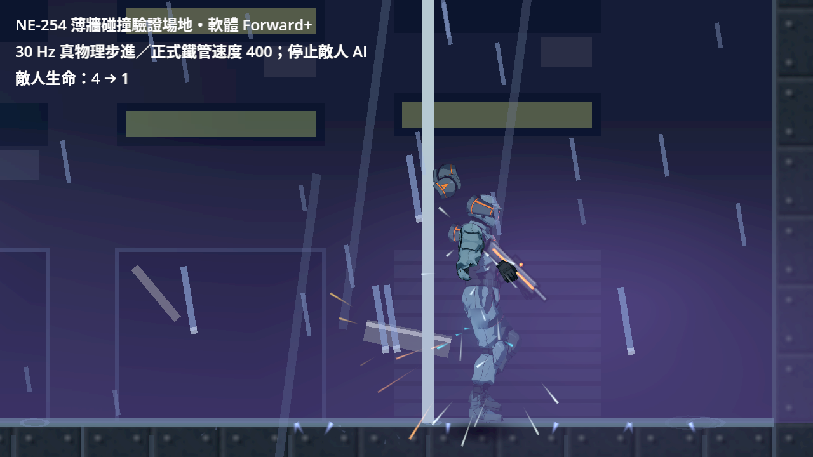
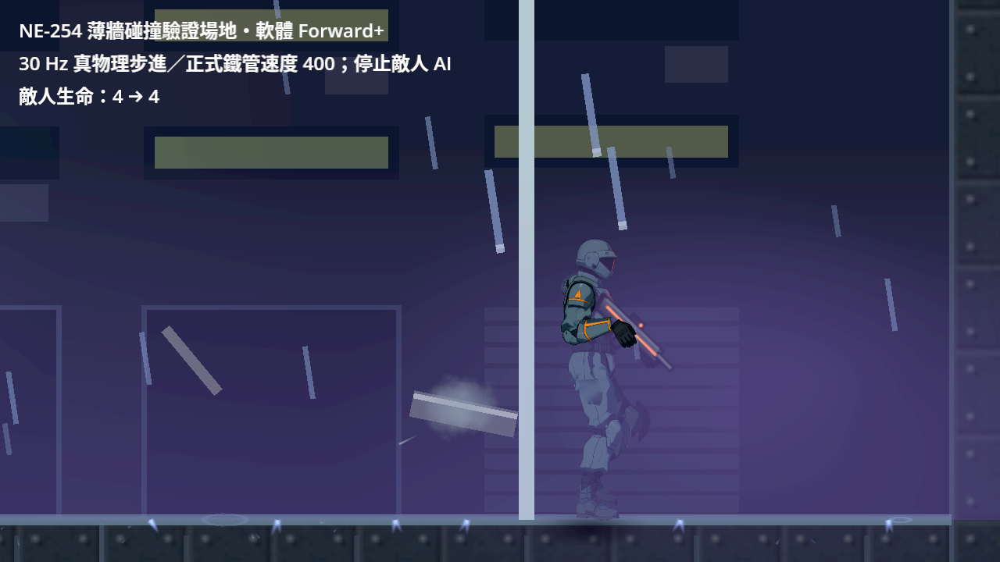
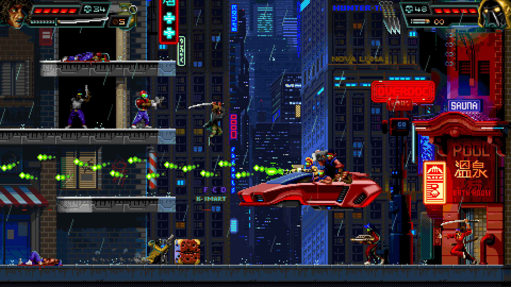

# NE-254：投擲與瞄準邊界

2026-10-22；基準 `a66794ecc8bb81398d86decd9c24f84348696837`。Godot 4.7.2 官方 Linux 引擎；原生畫面為 Forward+／llvmpipe 軟體 Vulkan，合成手把裝置 999。沒有實體手把或真人全章遊玩。

## 玩家看得到的修正

- 鐵管同一格內遇到薄牆與牆後敵人，先撞牆；敵人在牆前仍先命中。地形採本體的正式物理形狀與碰撞遮罩，保留反彈、爆炸及單向平台。
- 搖桿原始射線已對著前方可擊打油桶時，後面的敵人不再拉走方向。旁邊、牆後、敵人後方或拿在手上的油桶不搶瞄準；沒有輔助候選、關閉輔助或快速轉向時不增加物理查詢。
- 撿取提示使用真正的最近撿取目標。第二個近處物件、尚未落定物件與拿著別件物品時不再同時邀請撿取，保留原淡入淡出與改鍵文案。

## 證據怎麼讀

`validation.json` 記載最後結果，`manifest.json` 列出 raw.zip 每個檔案的 SHA-256；壓縮檔內有凍結來源、原版對照、原生探針各版、全部原始 log 與畫面。原選擇器、執行器、錯誤過濾與已知失敗檔皆未修改。

| 驗證 | 結果／範圍 |
|---|---|
| 正式速度的碰撞對照 | 原版 204 檢查、2 失敗；30 Hz 左右面向各自隔牆誤傷，60 Hz 與牆前目標亦保留 |
| 凍結三份原版產品來源，同一回歸 | 321 檢查、3 失敗：兩方向隔牆誤傷與油桶方向被搶；原版來源逐檔比對，退出後精確恢復候選 |
| 提示負控制 | 已修碰撞與瞄準、尚未修提示：217 檢查、3 失敗；近處多個提示、空中物件、持物期間仍邀請撿取 |
| 原生原版對照 | 同一探針 6 檢查、1 失敗：原始方向被拉走；本例原版子彈仍能打中油桶，沒有聲稱此畫面證明子彈必定打空 |
| 原生最終候選 | 6 檢查、0 失敗、退出 0、0 ERROR；真 Player 兩次 RT 消耗兩發並點燃地圖原有油桶 |
| 最後原範圍回歸 | 66 組、64,100 檢查、0 新／已知失敗、退出 0，557 秒；固定上述基準，原 `tools/run_tests_changed.sh` |
| 最終凍結套件的完整原版負控制 | 全新隔離目錄：326 檢查、6 個預期缺陷失敗；同一份最終測試來源與候選精確恢復的 SHA 均留存 |
| 真物理步進的原生薄牆對照 | 同一 3 檢查探針；原版 1 失敗、敵人 4→1；修後 0 失敗、敵人 4→4；皆確認完整 1/30 秒步進，無 ERROR |
| 推送後完整 CI | GitHub 該提交的 Actions；本附件不預先宣稱尚未執行的 CI 結果 |

原生場地用正式第一章街道、既有油桶、角色與光影；安排玩家站位，清除原敵人後放一名競爭瞄準的真敵人並停止其 AI，停用此驗證範圍的遭遇與故事觸發。入口已排入的通訊透過真正取消入口撤掉，另確認自有鎖已釋放。ScenarioBase 的驗證生命值為 999；鏡頭放大 2 倍供檢查。綠線為原始射線，橙線為真正輸出方向，皆為探針標記。油桶點燃後才停止其更新以留住引信畫面，沒有改傷害或消耗；引信時序與連鎖由既有回歸驗證。這不是自然通關、實體手把或硬體效能驗收。

薄牆圖為明標的驗證場地，牆寬 3 世界像素；使用正式鐵管、真敵人與引擎自然 30 Hz 步進，不直接呼叫傷害或投擲更新函式。敵人停止 AI 並固定位置。它驗證本票的單格碰撞順序，沒有當作正式地圖完整遊玩。

## 探針失敗也保留

- 最早的合成搖桿案例在完整套件順序下未等輸入佇列送達，曾讓原始零輸入方向假似通過；加入原始方向有效的斷言後確實拒絕，再以正式 flush 與送達等待修正探針。沒有改產品的輸入時間窗。
- 最早的單方法 runner 使用 queue_free 且沒有完整清場，退出有 ObjectDB／資源診斷。其負控制只用來定位，不計乾淨通過。最後使用原正式測試執行器。
- 原生 V1 遇到安排位置時排入的通訊而不能開火；V2 已取消通訊，但 RT 在真正玩家處理該物理格之前就放開。兩版都扣彈失敗，保留圖與 log。V3 讓按下涵蓋真正處理格；相同最終探針在原版仍會拒絕方向問題、候選才通過。
- 重用第一輪控制器探針的存檔目錄，會讓 Main 初始焦點落到繼續遊戲，完整控制多出 2 項測試流程失敗；該輪 294 檢查／8 失敗與合成存檔保留。全新目錄重跑恢復 326 檢查／只剩 6 項產品負控制。沒有改原控制器測試或過濾器。
- 第一版原生薄牆探針讓敵人在等待首繪時走遠，原版因距離已不在同一格路段而沒有重現；原圖、資料及 V1 工具保留。固定真敵人位置、另驗完整物理步進後，同一探針才形成有效的原版失敗與修後通過對照。
- 打包工具 V1 對 Python regex Match 使用 slice 而得到 IndexError；保留工具來源，修成明確 group 讀取後才執行壓縮檔逐項讀回校驗。
- 全幅畫面的天候、人物呼吸與碰撞移位並非固定相位；比較以每次原始方向／實際方向與來源 SHA 為準，不宣稱前後逐像素相同。新增動作或角色接點沒有在本票驗收。

## 同類遊戲的圖片參考

從官方 Steam 商店 API 取得原圖；來源與每張 SHA 在 [research/sources.json](research/sources.json)。這些是構圖觀察，不是玩家偏好調查，也沒有從圖片推定其他遊戲的碰撞或輔助瞄準演算法。

[HUNTDOWN 官方頁](https://store.steampowered.com/app/598550/) 的前景平台、掩體與子彈在繁忙霓虹背景前仍能辨認。本票採用「實際阻擋與玩家看到的前後關係一致」作檢查方向。

[The Final Station 官方頁](https://store.steampowered.com/app/435530/) 的地板與室內外分隔清楚；用於檢視世界裡的可操作層次。其物件規則不由這張靜態圖推論。

Godot 正式碰撞 API 與 Dead Cells 官方操作選項公告的核對連結及採用範圍見[實作設計](../../../../design/15-combat-feel/THROWABLE_BOUNDARIES.md)。
