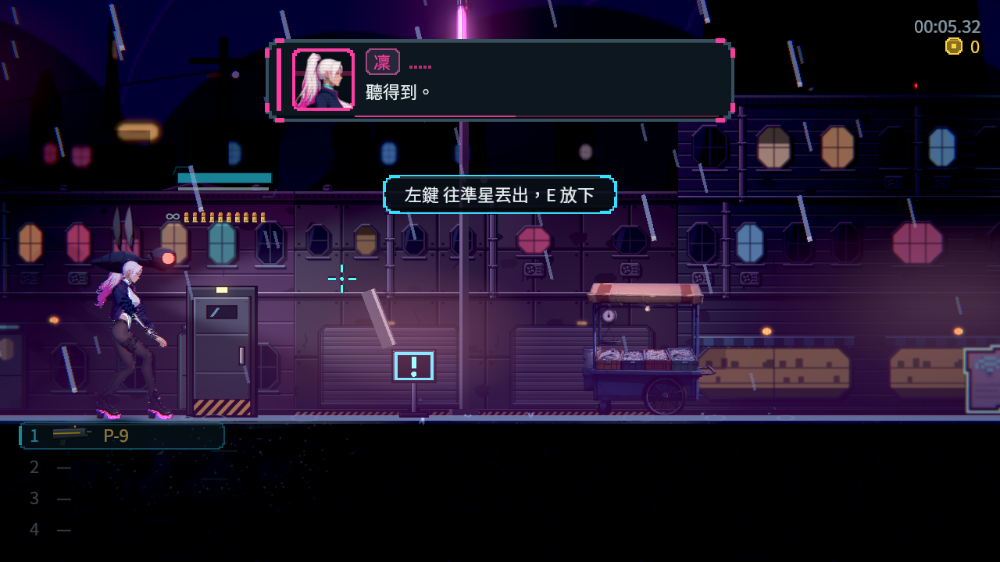
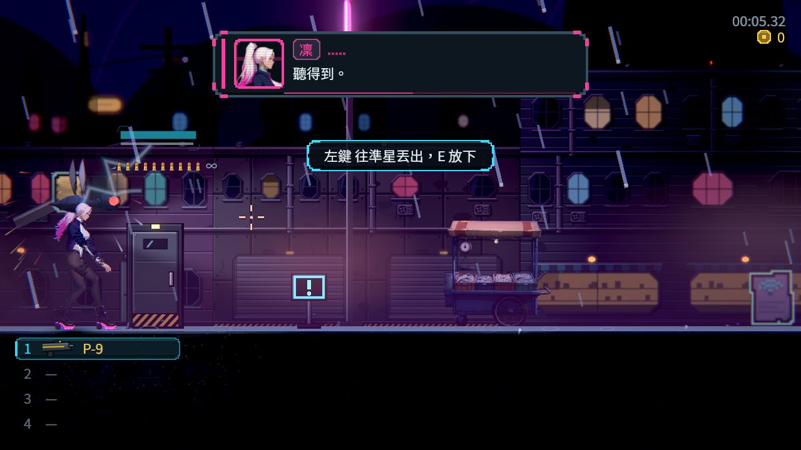

# NE-254：投出時已碰到敵人的命中

物件在投出第一步或旋轉後，已經與敵人的受擊形狀重疊時，原版會把它當成沒有接觸，從敵人身上穿過。現在先處理當前形狀的接觸，排除實心牆後的目標，再掃原本可走到的路段。鐵管打中後反彈、木箱破碎、油桶爆炸，維持每個目標一次、陣營與不可受擊的排除規則。

| 相同案例 | 原版 | 修後 |
| --- | --- | --- |
| 原始接觸缺陷，相同451項 | 原版451項／10失敗，107.1秒 | 第一候選451項／0失敗，106.4秒 |
| 起點跨牆控制，新增4項 | 第一候選4項／2失敗 | 最終4項／0失敗 |
| 最終ThrowablesSuite，包含全部追加控制 | — | 455項／0失敗，101.6秒 |
| 正式街道，公開撿取／投擲 | 8項／2失敗，退出1 | 8項／0失敗，退出0 |
| 監視蜂，鐵管命中後生命 | 3→3 | 3→0 |
| 監視蜂，木箱命中後生命 | 3→3 | 3→1 |

單元使用左右方向、鐵管／木箱／油桶、起點真正重疊／未碰到遠處目標的12組情況，另核對鐵管不重複傷害同一目標。主代理審查要求追加起點跨薄牆控制，第一候選左右遠側目標都被扣20→17，4項／2失敗；加入起點接觸的實心遮擋檢查後4項全過，近側接觸仍會命中。這不是不可能的放置假設：現有手持位置是直接更新，飛行也先改旋轉角度，形狀都可能暫時跨過薄牆；本次保留這些規則並阻止隔牆傷害。以實際形狀查詢確認fixture只看該目標，不把物件自己的受擊框誤認成敵人；既有地形與投擲斷言保持。第一次fixture查詢漏了這個區別，451項／14失敗中4項是fixture問題，完整首次log保留為unit-first-fixture.log；修訂後才重跑相同最終套件的原版與修後對照。

## 原生畫面與界線

本機 Godot 4.7.2，AMD Radeon RX 9070 XT，Vulkan／Forward+／HDR 2D，固定60fps、隔離APPDATA。直接載入正式第一章街道Level，保留原地形、燈光、雨霧、UI與通訊。移除原敵人和原投擲物，玩家移到95欄地面，生命999並給600秒保護；工具放入鐵管／木箱，使用公開interact/shoot動作及虛擬右瞄準輸入。監視蜂固定在手上物件的碰撞中心，停止其AI，明示製造近身重疊。沒有直接呼叫命中、指定敵人生命或改傷害。

兩版中心距離都為0；原版物件飛過去、蜂的生命不變，修後真正投擲接觸結算，鐵管擊殺、木箱扣2。原版與最終八張原始PNG逐張檢視，截圖與結算JSON位於native-before／native-final；另保留未含實心遮擋的第一候選四張圖與8項／0失敗結果於native-after。場景相機、天候與特效照常更新，畫面差異不用作曝光或效能比較。這是正式關卡中的排列重現，不是自然章節、真人操作或實體手把驗收。母票原未勾選條件維持。

## 來源與重跑

[Godot PhysicsDirectSpaceState2D 官方文件](https://docs.godotengine.org/en/stable/classes/class_physicsdirectspacestate2d.html#class-physicsdirectspacestate2d-method-cast-motion)明列cast_motion忽略起點已相交的形狀；intersect_shape另提供目前相交物件的查詢，這裡用它取得可受擊目標。修正以原查詢物件、原形狀、原最多4筆結果處理，不新增節點或貼圖；每個飛行物每個物理步增加一次形狀查詢，只有起點有效接觸候選再查重用的實心遮擋射線。沒有硬體效能基準的提速宣稱。

sources.json保留基準SHA與全部來源雜湊，原產品檔案逐位元核對基準。source保存原／第一候選／最終產品、451項第一候選測試與455項最終測試，以及實際探針。probe複製回work/ne254-initial-overlap-20261117後可用同一tscn重跑；參數為--rendering-method forward_plus --rendering-driver vulkan --fixed-fps 60，使用者參數--out指定獨立絕對資料夾。單元由原smoke_test.tscn的--only=ThrowablesSuite執行。所有單元與原生log保留；最終單元與原生均無SCRIPT ERROR、ERROR或退出洩漏。

受影響範圍由主代理在精準候選工作樹使用原run_tests_changed.sh驗證，結果另外補入本目錄。

## 最終受影響範圍

原 tools/run_tests_changed.sh 在只套用本票兩份產品／測試來源的 C:/NE/queue-20261117 執行；基準61229f7a，12套件、13,031項，0新失敗、0已知失敗，246秒、exit0。來源逐位元組等於最終root候選。三份完整原log與 affected-result.json保留；容錯負測試的原ERROR／警告未刪改，原腳本判定無非預期錯誤。

## 原始附件的換行保留

交付後逐項比對Git物件發現三份探針被全域LF規則轉換；本目錄改為原樣保存source與log位元組。沿用本機原件及原來源雜湊，沒有重新生成、覆寫失敗或更改測試結果；Git物件重新核對全部9份來源雜湊一致。
