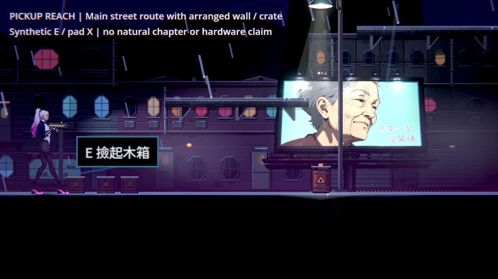
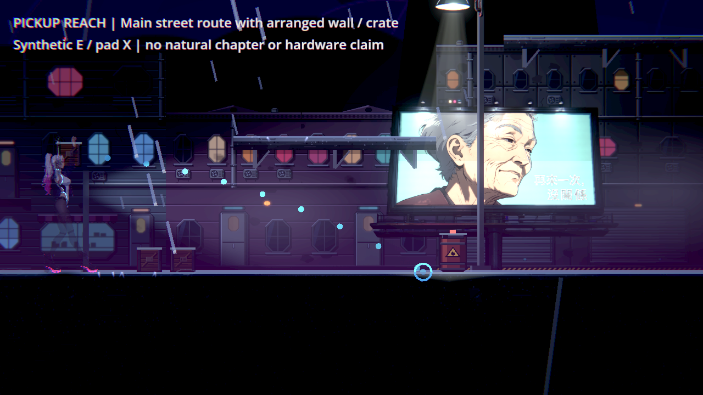
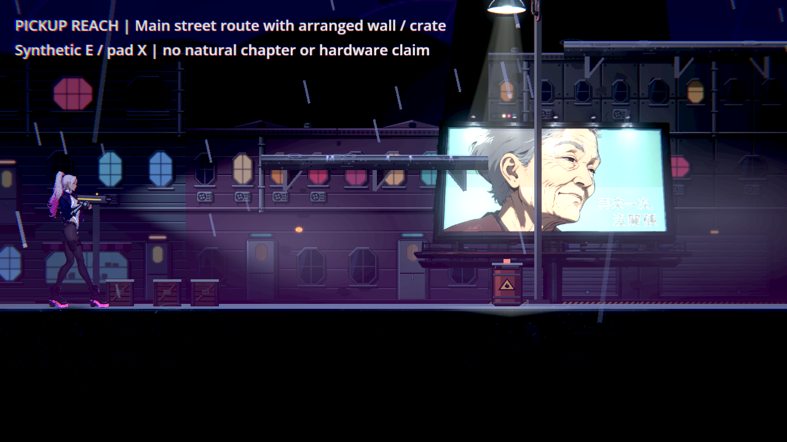
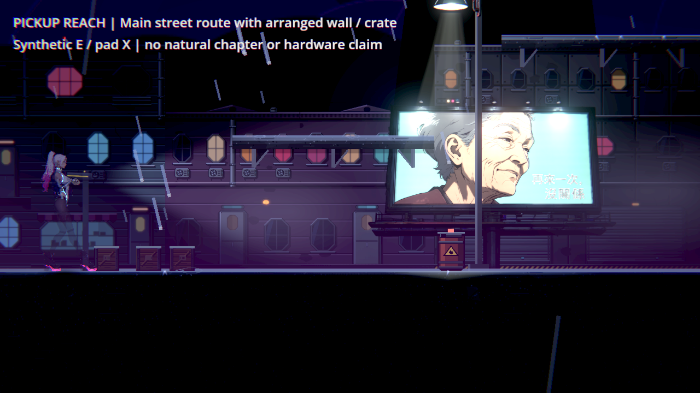

# NE-254 Commit-5：牆後物件不再邀請或允許撿取

原本只看距離，左右兩側都能隔著實心牆把木箱移到頭上。現在先排除被實心地形擋住的候選，附近較遠但可達的物件仍能被選中；移除牆後恢復撿取，低於取物連線的矮障礙不誤擋。原距離、輸入、投擲、傷害、爆炸與最近排序不變。

## 驗證結果

| 範圍 | 原版 | 修正後 |
|---|---|---|
| 相同最終投擲套件 | 235項／8失敗，33秒 | 235項／0失敗，33秒 |
| 原受影響十組 | — | 3,341項／0新／0已知失敗，96秒 |
| 正式Main原生同一探針 | 13項／6失敗，exit1 | 13項／0失敗，exit0 |

兩份最終Main原生log均無引擎ERROR／洩漏。原套件既有所有位元組、斷言、輸入、等待不改；只追加新方法及一個呼叫。左右兩方向、牆後的較近候選、可達次近候選、真正互動、矮障礙與移除牆恢復均覆蓋。

[驗證摘要](validation.json)、`pickup-*-tests.log`、完整分組原檔及 `source/` 修前後程式皆在此。負控制請搭配「修後測試來源」與「修前正式撿取來源」，不是執行尚未追加新案例的舊測試來聲稱重現。

## 原生圖與範圍

最終 `native/ne254-1024-pickup-main-{before,after}-v6/` 各六張1280×720原圖均逐張看過，含反向與移除牆的成功操作。Godot4.7.2／Forward+／HDR／llvmpipe。經真Main新遊戲再安排區域路由到正式第一章街道；使用計算出的真地面高度，位置與一牆一箱為明示fixture。為隔離撿取，移除NPC、敵人與遭遇，停止區域故事掃描，生命999、600秒無敵；畫面人物的閃爍／半透明是這個無敵設定，不是新材質修補。鍵盤E與合成手把X經真綁定；不是自然通關、戰鬥平衡、角色外觀或實體手把驗收。

重播：將 `source/pickup_reach_probe.gd` 與 `.tscn` 複製到專案 `work/batch1024/`，原生啟動該場景並傳 `--out=<絕對目錄>`。最後走正式Main退出；斷言失敗仍正確回傳非零碼。原回歸命令：`GODOT=<4.7.2> SHARDS=8 tools/run_tests_changed.sh 66c6ebc7`。每個raw版本分開目錄，不互相覆寫。

## 中途資料保留

- 最早自動案例231／12包含四項連鎖污染：原版先拿起物件，後面的無遮擋測試未清理。獨立清理後231／8；再補矮障礙的最終相同來源235／8→235／0。
- 原生v1重用事件物件發出警告；v2改用獨立事件後修正。v1、v2、v3的獨立cover測試地圖仍在退出時報CanvasShaderRD／decal錯誤，exit250；v3修後12／0不能稱引擎乾淨。
- 未改的既有 `tools/screenshot.tscn --scenario=throwables` 亦同樣退出250。這與User-guide既有的獨立舊關卡問題分開保留，沒有修好或刪除它。
- Main v4沿用測試地面的高度且未隔離無線電／NPC，結果無效；v5地面及輸入正確但仍有初始焦點ERROR。v6等待真正選單焦點完成才出發，原版13／6、候選13／0，兩者均無ERROR。

`pickup-probe-attempts.json`、各版腳本、全部原始PNG／log／exit均保留。不把新增探針問題寫成正式遊戲缺陷，也不把切換入口寫成已修好獨立工具退出錯誤。

## 參考

先核對User-guide、原票四次交付與[既有同類研究](../../../../design/15-combat-feel/THROWABLE_BOUNDARIES.md)。Godot官方ray-casting原始文件要求留意鎖定的物理空間；因此物理步刷新真目標，render提示只讀結果。文件站403沒有重試，成功取得[官方GitHub原文](https://github.com/godotengine/godot-docs/blob/master/tutorials/physics/ray-casting.rst)，HTTP與SHA見 `pickup-reference-receipt.json`。

[官方商店](https://store.steampowered.com/app/460950/)這張圖用於觀察地面、家具與角色空間的閱讀；沒有從圖片聲稱查明其撿取碰撞方式或玩家偏好。原圖URL與SHA同樣保留。
