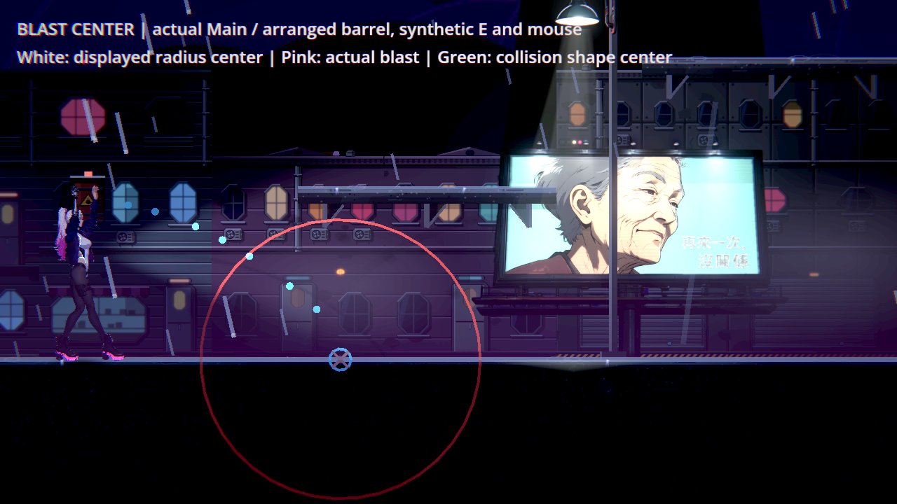
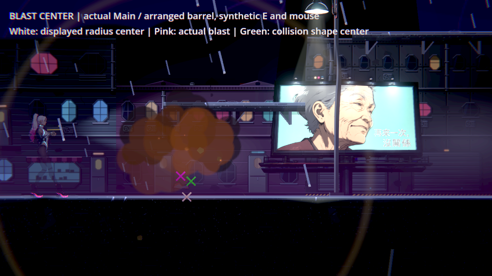
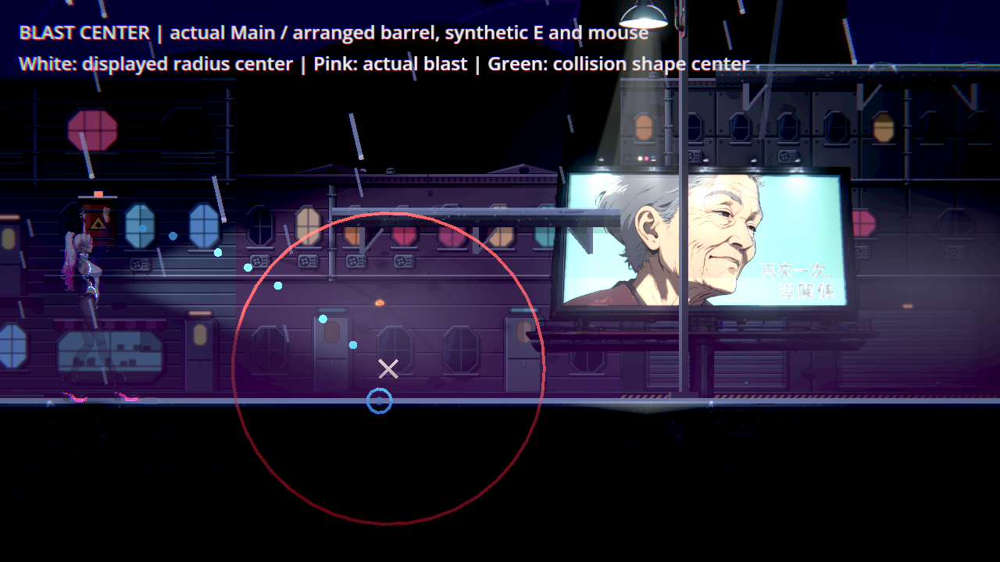
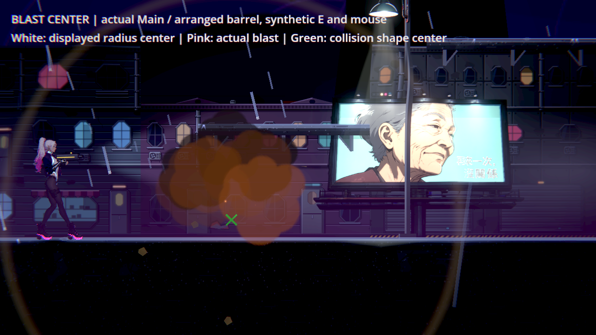

# NE-254 旋轉物件的命中與爆炸中心

物件原點在底邊，碰撞形狀中心在局部半高處；舊世界中心固定往上加半高，旋轉後與真正形狀分離。修復由一個共用局部中心轉換取得世界／預測中心，受擊框掃掠保留完整矩陣。紅色爆炸半徑預告改用預測停止姿態的中心；青色地形接觸圈保持真正接觸點。傷害、半徑、旋轉速度、重力、尺寸與敵我規則不改。

| 相同驗證 | 原版 | 最終 |
|---|---|---|
| 原ThrowablesSuite＋28項 | 405／17失敗 | 405／0，78秒 |
| 真正Main入口／街道，公開撿取與投擲 | 11／4失敗、exit1 | 11／0、exit0 |

十二組種類／角度中心直接對真正CollisionShape2D.global_position；左右命中／空處不該命中，另用實際形狀的獨立cast_motion核對fixture。單步飛行仍用原_fly、原重力，以初速抵銷該步重力，旋轉完成角度明示。新增油桶樣本記錄第一次真撞擊，分別核對物理中心、真爆炸中心與預覽；沒有只拿兩份中心公式互比。原套件僅加一個呼叫與新類別／方法，原斷言保持，SHA在source-check.json。

原受影響選擇器十組：3,553項／0新／已知失敗，95秒。全部原shard、退出碼與stdout保存，沒有更改選擇器、錯誤過濾或已知失敗。

## 原生畫面

Godot4.7.2／Forward+／HDR／llvmpipe，1280×720、隔離設定。沿正式Main選單→開始→街道；物件與位置是明示樣本，敵人／NPC／原投擲物／Encounter移除、故事掃描關閉，玩家999血／600秒無敵。這些隔離不代稱自然章節、人工體驗或實體手把／GPU。

觀察子類在真正_explode內記錄中心，然後呼叫原爆炸，並未替換爆炸或停止物件。白叉是產品顯示的紅圈中心，粉叉是真爆炸、綠叉是真碰撞形狀中心；叉號與字幕僅為探針，不加入產品。右向實際碰地面，左向先碰街道平台，均走原地形碰撞。最終預覽／爆炸／物理中心完全一致，八張最終前後原圖逐張檢視，兩輪0引擎ERROR／退出洩漏。畫面雨、霧與相機仍正常更新，不將全畫面差異當曝光或效能量測。

## 初稿與限制

第一候選漏了新預覽欄位宣告，原runner拒絕編譯，輸出206／12及SCRIPT ERROR；原生wrapper退出241。不是有效通過／負控制，完整日誌與初稿保存。補正宣告後重跑相同405項與相同原生探針，沒有刪舊斷言、放寬門檻或改錯誤過濾。此處的數字不是像素曝光或效能分數。

原生wrapper與完整套件不重疊。本機cgroup上限16GiB；大量可回收檔案快取接近上限，原memory.events無OOM／OOM kill，不能把快取用量冒稱遊戲匿名記憶體或VRAM。此變更重用既有查詢／輸出緩衝，不增節點、貼圖或物理查詢次數；沒有聲稱經硬體效能基準證實提速。

## 開始前研究與重跑

先讀User-guide、THROWABLE_BOUNDARIES與原票，再讀[Godot同版Node2D局部／全域轉換](https://github.com/godotengine/godot/blob/4.7.2-stable/doc/classes/Node2D.xml)和[形狀查詢矩陣](https://github.com/godotengine/godot/blob/4.7.2-stable/doc/classes/PhysicsShapeQueryParameters2D.xml)。重新查看Katana ZERO官方場景圖，只借物件與場景的閱讀關係，不宣稱其私有碰撞演算法或玩家共識，原圖與來源線索在research.json及既有NE-254-pickup-reach帳本。

source保存原／最終來源、實際探針；native按版本分別保存全部PNG、stdout與退出碼。將探針放回儲存庫work/batch1026，再以Godot4.7.2 Forward+執行center_probe.tscn並給--out。單元用原runner的--only=ThrowablesSuite；回歸由原run_tests_changed選取。母票實體手把／人工條件維持未勾。
