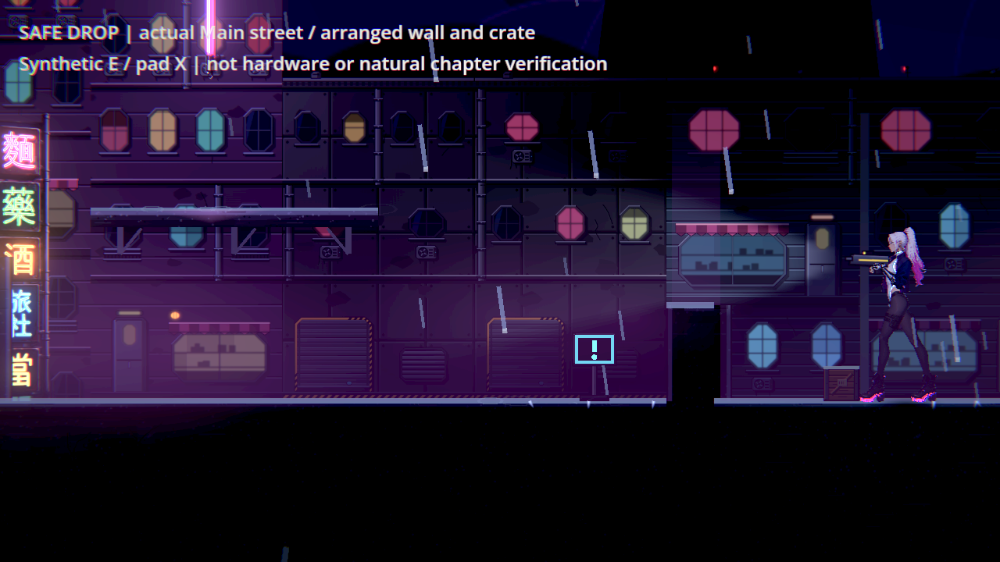
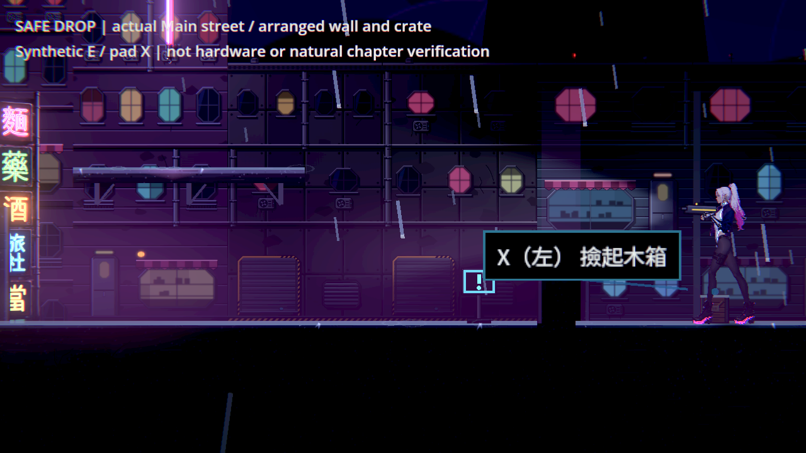

# NE-254 放下物件不能移進牆裡

原put_down直接把物件放在腳前14單位，目的地可能在牆內；物理引擎有時推回近側，有時推到另一側。改用物件原本完整形狀的move_and_collide，沿放下路徑遇地形就停，再由原重力落地。只改一行移動及註解，不新增投擲速度、傷害、爆炸或反彈；空曠處精確位置不變。

## 相同原版負控制

| 驗證 | 原版 | 修後 |
|---|---|---|
| 原ThrowablesSuite＋追加34項 | 269／14失敗 | 269／0失敗，49秒 |
| 真正Main街道，公開E／合成pad X | 9／2失敗，exit1 | 9／0失敗，exit0 |

單元追加案例：木箱／鐵管、左右、真互動與受傷落下、落地後仍在牆前，以及空曠處原精確位置。既有全部測試與判定保持，source-check逐份保存SHA，原套件除一個呼叫與追加方法外相同。第一次新測試的near_edge型別無法推導，0項／編譯錯誤不算驗證；v2直接安排面向得到269／8，v3改用原瞄準輸入確認左右，最終269／14。全部階段原檔保留，未放寬判定。

原受影響選擇器十組：3,417項／0新／已知失敗，66秒；全部八份shard與選擇器stdout保存，沒有修改runner、選擇器、門檻或已知失敗。

## 原生範圍與圖片

Godot4.7.2／Forward+／HDR／llvmpipe／1280×720／隔離設定。原工具沿Main選單、開始、街道的正式路由；物件、薄牆與位置為明示fixture，關閉自動故事、移除NPC／敵人／Encounter、999血與600秒無敵，以隔離放下問題。無敵造成角色閃爍是fixture；沒有宣稱修好角色姿勢、光影或自然章節，也不是實體手把／GPU驗收。

每輪六張，十二張全部逐張檢視。左向原版物件x1466.426，修後1481.547；原點1488，牆在1474。右向原版最後會被推回近側，保留真實通過結果，沒有宣稱原生兩向都必定穿牆。兩輪0引擎ERROR／退出洩漏；原suite其他負資料診斷不因此稱全部0ERROR。

native保存全部原圖、stdout與退出碼，source保存原／修後腳本及探針。探針保留既有REACH_CHECK前綴，彙總為DROP_RESULT；名稱不代表改變驗證意義。未聲稱覆蓋所有已經嵌入地形的初始狀態或整套拿取動畫。

## 開始前研究

先讀User-guide、本票與THROWABLE_BOUNDARIES，再讀[Godot同版本PhysicsBody2D API](https://github.com/godotengine/godot/blob/4.7.2-stable/doc/classes/PhysicsBody2D.xml)，使用原完整身體移動，避免中心射線漏掉物件寬度。重新查看Katana ZERO官方商店圖，來源／SHA在drop-reference.json；只借物件與角色、地形的閱讀關係，不從靜態圖推論私有物理算法或玩家民調。

母票實體裝置／人工條件維持未勾，既有獨立舊測試地圖退出250不因本次Main路由乾淨而算已修好。
