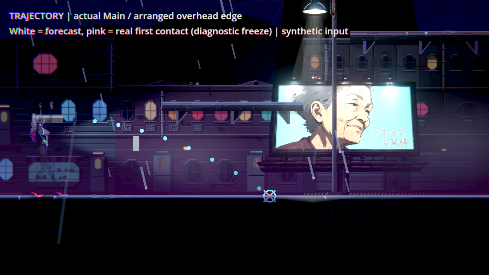
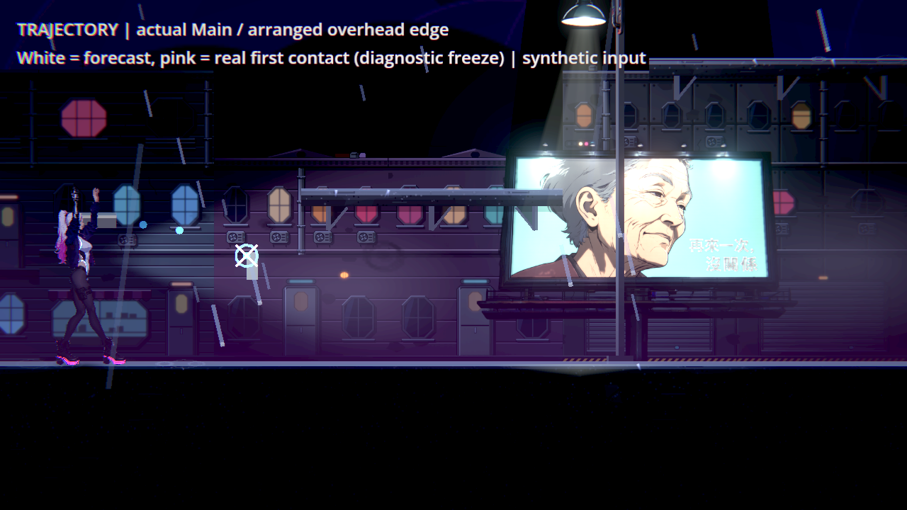
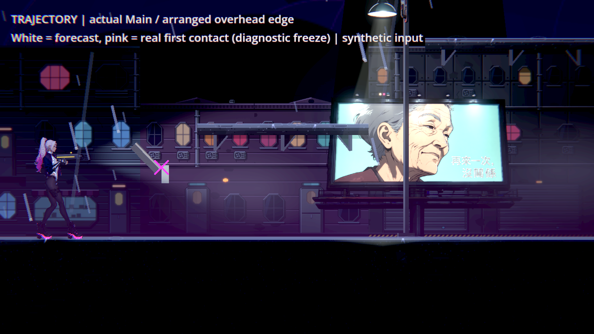

# NE-254 預覽落點對齊真正碰撞

原預覽用中心射線與0.04秒的不同重力順序；真正飛行會先更新重力、旋轉，再用整個物件碰撞。修正讓預覽用目前物理更新間隔、原物件的test_move與相同旋轉順序，取得第一個地形接觸；查詢不移動或釋放手上物件。正式飛行、傷害、速度、爆炸與反彈沒有改動。

點線仍按原0.04秒密度抽樣、最多40點／1.6秒，維持原顏色與落點圈。點沿原本上移半高的平滑參考路徑，不跟著零件旋轉繞圈；接觸圈取實際地形接觸點。本次只預測第一次地形碰撞，不保證敵人介入或反彈後的最終位置。

## 完整原生對照

Godot4.7.2／Forward+／HDR／llvmpipe／1280×720；真正Main選單→開始→第一章街道路由。安排鐵管與障礙邊緣，公開E撿起、合成滑鼠射擊；虛擬瞄準來源固定左右方向，並非實體手把。移除NPC／敵人／原有投擲物／Encounter、停故事掃描、999血與600秒無敵均為明示隔離。無敵造成角色閃爍不是本次角色修復。

原版11／2失敗、exit1；最終11／0、exit0。兩方向都先斷言真正撞到指定障礙，原版預測在更遠地面，實際先撞邊緣；修後兩點完全一致。測試子類記錄真正_bounce的接觸，呼叫原反應後才停物件供診斷拍攝，沒有改飛行／碰撞或把凍結當正常玩法。白叉是預測，粉叉是真接觸；標記與字幕只在探針，不是產品UI。

八張原圖全部逐張看過，兩輪無引擎ERROR／退出洩漏。原生是軟體渲染，並非完整自然章節、人工打擊感或硬體驗收。

## 測試階段與限制

最初333項／11失敗，但部分「上緣」排列沒真的被物件碰到；該版保留作歷史。修正排列並明確核對第一碰撞確為指定障礙，木箱／鐵管×左右×30／60Hz×平地／擦邊的相同341項原版15失敗、修後0。再補自轉3rad/s的油桶，與其他物件6rad/s分支分別驗證：最終相同377項原版23失敗／exit1，修後0失敗／exit0（75秒）。單元子類只記錄第一次碰撞，未更改_fly、旋轉或碰撞查詢；原套件其餘條件保持。

完整原生與初輪十組回歸使用341項階段的同一正式修正（3,489／0、78秒）；之後只追加油桶組合，正式來源不變，再跑最終原選擇器十組3,525／0新／已知失敗、91秒。所有原版、測試版本、日誌、退出碼與守護還原收據分開保存，沒有放寬2場景單位（邏輯像素，並非窗口實體像素）的誤差、原選擇器或已知失敗。

## 耗時與研究

兩個原生排列各3輪×50次同步更新，中位原版10.90μs、修後9.47μs；原版追到更遠地面、修後在近障礙提早停止，不能據此宣稱通用提速或最壞情況成本。六筆個別數值在preview-performance.json。保持原點數上限；60Hz最多模擬96步，不新增網格或每步建立碰撞物件。

先讀User-guide與本票設計，再讀[Godot同版本PhysicsBody2D API](https://github.com/godotengine/godot/blob/4.7.2-stable/doc/classes/PhysicsBody2D.xml)及[Epic官方預測參數](https://dev.epicgames.com/documentation/unreal-engine/BlueprintAPI/Utilities/Struct/MakePredictProjectilePathParams?lang=en-US)。官方資料區分物件大小與模擬步長；不照搬其他引擎建議頻率，本作需與真實飛行同一步長。既有Katana ZERO官方圖只作場景／互動物可讀性參考，不當成其預覽演算法或玩家民調。來源收據在preview-reference.json。
