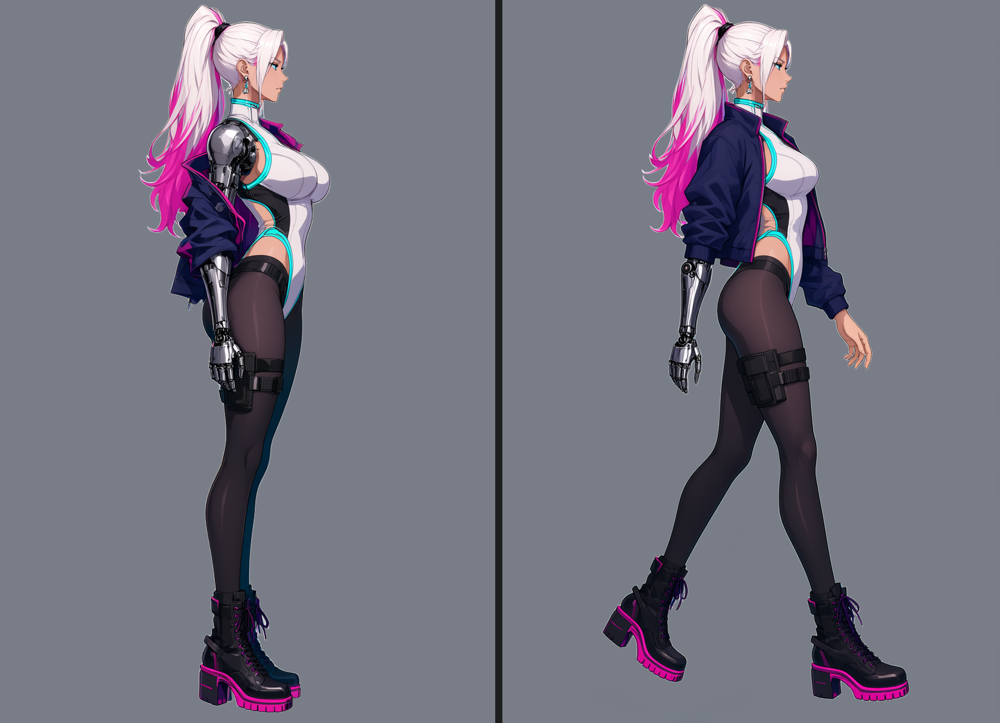
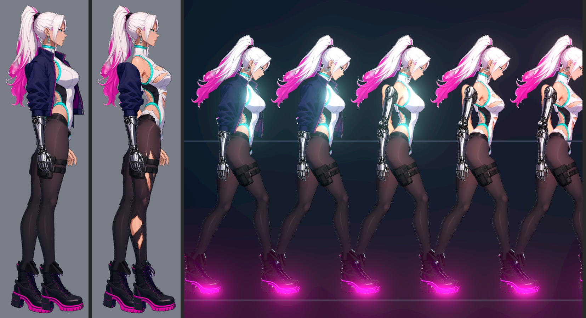
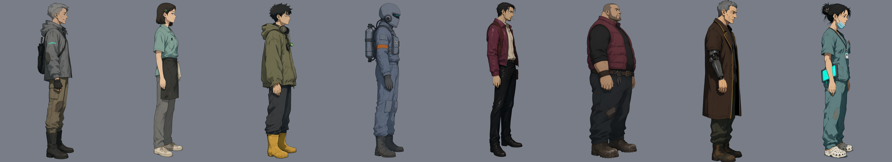
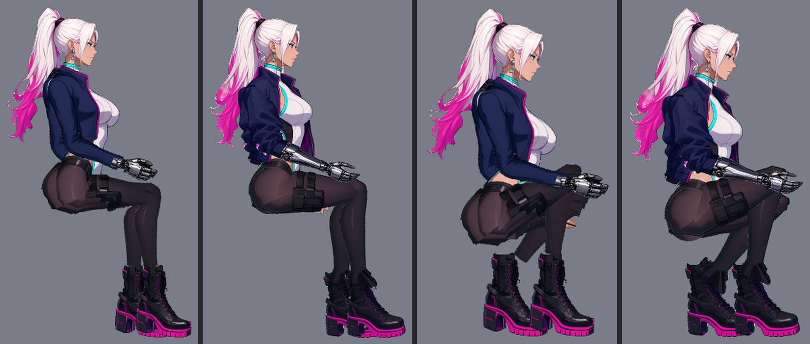
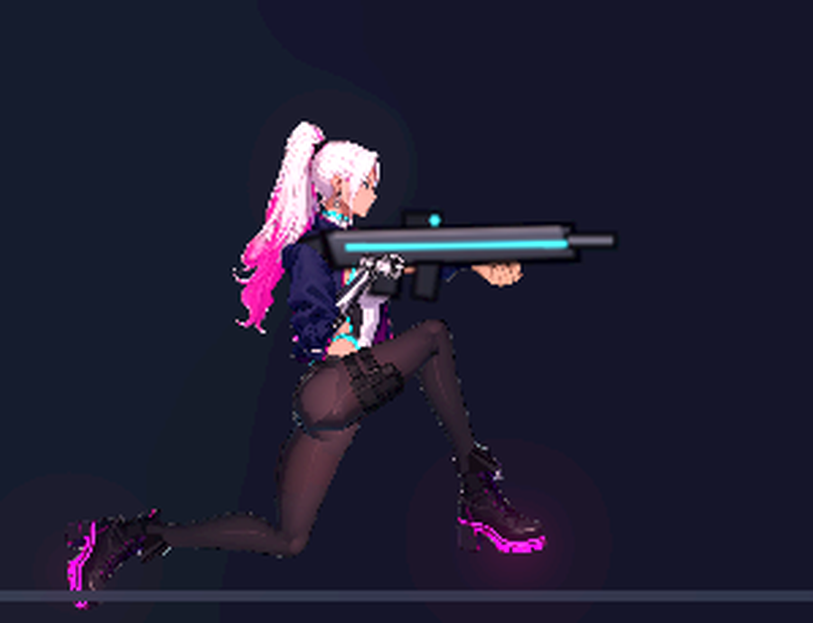
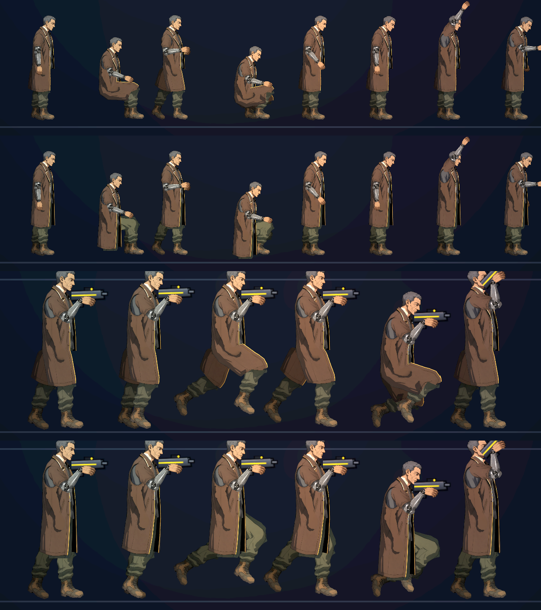
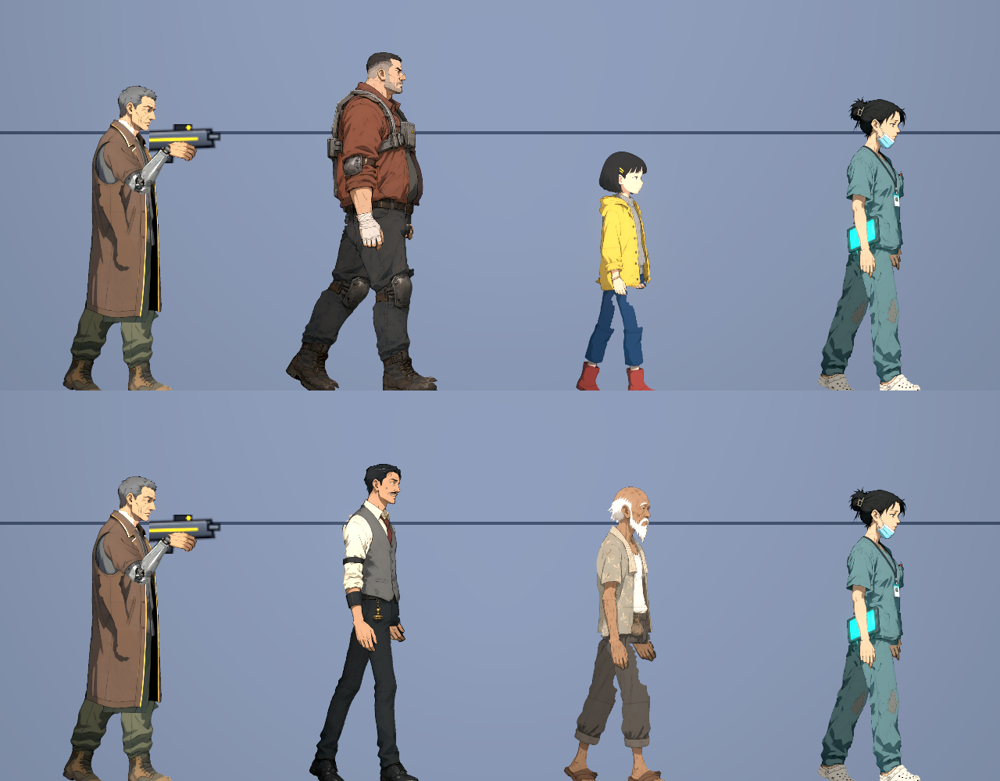
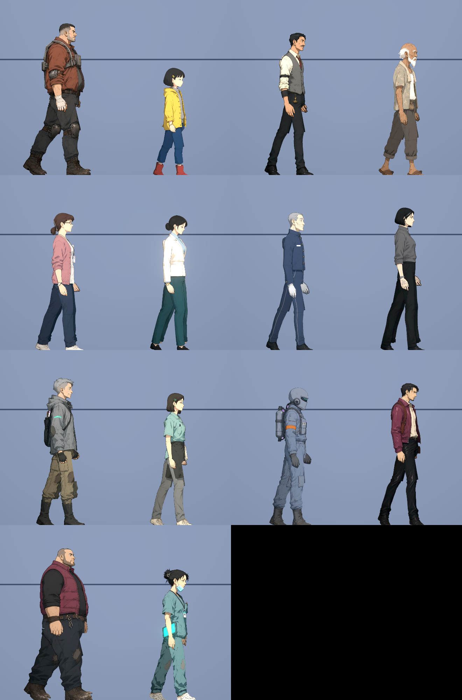
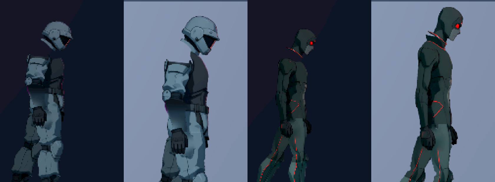
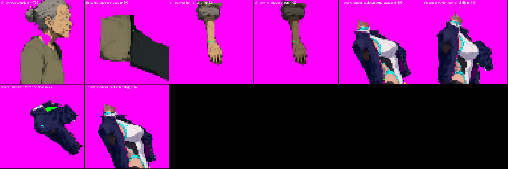

# NE-255 累積筆記：從立繪到 Godot 的三類問題

每修好一類問題就補一段，最後整理成 Skill。每一條都來自實際做過、看過畫面的案例（凜的功能姿勢外觀，NE-222，2026-10-11），不是推測。

格式固定四句：**成因**、**怎麼提早發現**、**修法**、**不能用的掩蓋做法**。

## 一、立繪上出現奇怪的東西

### 1. 姿勢本身不適合遊戲（挺胸、披肩外套）

- 成因：定稿的提示詞寫「narrow waist and wide hips」「jacket hanging off her shoulders」「standing relaxed」，出來的是展示用站姿：腰椎前凸、臀部後翹、外套掛在手肘。這張圖切成零件後，跑步一前傾就像鴕鳥，外套永遠像披肩。骨架量出來的脊椎其實是直的，問題全在輪廓，所以調骨頭角度救不了。
- 提早發現：出圖前把提示詞逐句對照「這個角色在遊戲裡要做的動作」；出圖後先把圖縮到遊戲內的大小看剪影，不要只看原尺寸的漂亮程度。
- 修法：保留定稿當身份參照，用 Qwen 參考編輯另外生一張「功能姿勢來源」（自然走姿、脊椎中立、外套穿好、四肢彼此分開），固定 seed，腳本與提示詞存在來源資料夾（`art_src/characters/rin_field/01_design/`）。定稿留給頭像與展示。
- 不能用：把挺胸的軀幹貼圖往前轉、壓扁胸腹、把頭往前伸；只改提示詞加強「自然」卻不看剪影。

### 2. 走姿比立正更適合當分件來源

- 成因：立正側面圖兩條腿、兩隻手臂互相重疊，SAM 文字提示分不開，只好用點提示加大量補畫，補出來的隱藏層常常對不上。
- 提早發現：看來源圖時數一下「每一段肢體是不是都有一段完全露在外面」。
- 修法：來源姿勢選四肢分開的中步幅走姿。同一批提示詞（`black stockings leg`、`leg`、`boot`、`chrome robotic arm`、`robot hand`、`hand`、`jacket sleeve`）一次就把近腿、遠腿、近靴、機械臂、機械手、自然手、近袖各自分開。骨架只取骨長，來源是不是站直不影響。
- 不能用：拿最近像素歸屬把分不開的肢體硬塞給鄰件。

### 3. 背景霧與不滿的主體 alpha

- 成因：Qwen RGBA 輸出的背景大片是 alpha 1～3，不是 0；另一個生圖工具的主體是 alpha 253，不是 255。
- 提早發現：每張來源圖先印 alpha 直方圖（最多的前五個值），再分別合成在黑、灰、白底看。
- 修法：流程裡的 `alpha_floor`（預設 40）清掉霧；額外來源（手臂、補畫件）進流程前也要套同一個門檻。
- 不能用：整張硬二值化（髮絲與邊緣會變鋸齒）。

### 4. 階段圖把別的零件畫進來

- 成因：「去掉近側手臂」的階段圖只拿掉機械前臂，袖子還留在外套上。外套身片因此烤進一條袖子，手臂一抬就多一條不會動的袖子（第三隻手）。
- 提早發現：每張階段圖生完就並排看一次，確認「要拿掉的東西真的不見了」再往下切。
- 修法：分兩步。先生「只拿掉袖子、露出整條機械臂、外套變成無袖背心」，再從那張生「拿掉機械臂」。提示詞要寫出拿掉之後那裡應該是什麼（側片、袖窿縫線、羅紋下襬）。
- 不能用：靠袖子零件蓋住；用橡皮擦在零件圖上亂擦。

### 5. 補全把屬於別的零件的東西畫上來

- 成因：頭上的耳環在脖子上留下一個洞，補洞時從階段圖把耳環又填回脖子，頭一動就會看到兩個耳環。外套的袖窿內側被畫成一塊深色，袖子一轉就露出黑塊。
- 提早發現：把每個零件單獨放在洋紅底上看一次（零件總覽圖）；跑「原位重組」對照原圖。
- 修法：精修步驟 `inpaint`：指定零件與多邊形，用周圍的顏色重畫，透明度不變。脖子上的耳環、袖窿的深色都這樣處理。
- 不能用：把那塊擦成透明（會變成真的洞）。

## 二、零件組合後邊緣稜稜角角

### 6. 直線切口加剛體旋轉

- 成因：骨盆在某一列被水平切斷，大腿從那裡開始。站著看不出來；一坐下大腿轉 90 度，骨盆那條直線下緣就露出來，變成有角的方塊和「球狀臀部」，還帶一條長直線。
- 提早發現：做完就看坐、蹲、跪三個姿勢的放大圖，不要只看站姿。
- 修法：零件規格的 `caps`。同一個關節的兩個零件都多留一個以支點為圓心的圓盤。畫在上面的那件（大腿）圓盤較大、邊緣柔化；壓在下面的那件（骨盆）圓盤較小、硬邊，半徑要小於「支點到上層零件輪廓的最短距離」，這樣不管轉到哪裡都被上層蓋住。骨盆的水平切口往上收到支點以上。
- 不能用：加大接縫重疊量、用暗色或陰影蓋、把稽核的面積門檻放寬。

### 7. 別的材質跟著圓盤一起轉

- 成因：大腿的圓盤把旁邊一小片白色連身衣也包進去，坐下時那片白色跟著大腿轉到腰帶旁邊。
- 提早發現：零件總覽圖上看每個圓盤裡有沒有不是這個零件的顏色。
- 修法：`caps` 的 `sam`，只留指定材質（例如 `black stockings leg`）的像素。
- 不能用：事後在遊戲貼圖上手動擦。

### 8. 支點沒落在圖的轉動中心

- 成因：姿勢模型給的肩點在機械肩球的上緣，不是球心；手一擺肩球就從袖子裡甩出來。手腕點落在手零件外面 3 像素，手腕中心沒有東西蓋。
- 提早發現：把關節點畫在圖上放大看；零件總覽圖上畫出每個零件的支點，支點不該在零件外面。
- 修法：肩點放在肩球球心；肘點放在袖子皺摺與機械關節所在的位置；腕點放在手零件裡面一點，前臂再往手底下延伸。
- 不能用：照單全收模型預測的關節。

## 三、破圖

### 9. 不同群組的零件只是「碰在一起」

- 成因：小腿與靴子、前臂與手、脖子與頭分屬不同群組，邊界剛好相接、沒有重疊。兩邊的柔邊各 50%，疊起來就是一條透光的細縫，關節一轉縫更大。
- 提早發現：逐格接點稽核（`tools/rig_joint_audit.tscn` 加 `tools/check_joint_frames.py`）；看「連通塊數量大於 1」與「中心沒蓋到」。
- 修法：精修步驟 `underlap`：讓零件往鄰件底下長一段（只長在鄰件蓋得住的地方），顏色取自己最近的像素。脖子長到頭底下、小腿長進靴筒、前臂長到手底下、軀幹長到肩球底下。
- 不能用：把兩件往彼此推近（會改到比例）；放寬稽核。

### 10. 去邊步驟把輪廓線吃掉

- 成因：補全時為了去掉前景物留下的黑邊，會把零件邊緣削掉 3 像素再從階段圖補回來；階段圖邊緣是半透明的，補不回來，結果外輪廓線斷成一段一段。
- 提早發現：「原位重組」檢查（`tools/comfyui/check_reassembly.py`）：把精修後的零件疊回原位，和原圖比，列出沒蓋到的像素。第一次跑抓到 2,200 多個。
- 修法：補全設定 `edge_trim: 1` 加 `keep_rim: true`（削掉又補不回來的像素補回去）。之後只剩預期中的遠側腿與幾個 7 像素以下的點。
- 補回去的像素顏色要取階段圖（它的柔邊仍是正確的材質），沒有才取最近的已保留像素。第一版直接用原圖的像素，結果袖子肩部多一條白線：那裡原本是白頭髮壓在深藍袖子上的混色邊。這條線在零件總覽與原位重組都看不出來，是坐姿近拍才看到的。
- 不能用：看整體沒洞就放行；把檢查的門檻調高到看不見。

### 11. 比一個螢幕像素還細的東西

- 成因：靴帶尖端、扣帶末端在來源圖上只有 3～4 像素寬，縮到遊戲裡不到一像素，變成零件旁邊的游離小點；手指之間的細縫在縮小後變成封閉的小洞。
- 提早發現：逐格稽核在 1 倍與 3.4 倍都會報「孔洞 1 像素」「連通塊 2」，放大看位置都在靴帶、指縫。
- 修法：精修步驟 `trim_spikes`（切掉比 2N 像素還細的突出）與 `close_fill`（補上窄縫）。
- 不能用：加粗描邊；把那些格從稽核排除。

## 固定順序

1. 來源：提示詞對照動作、alpha 直方圖、黑灰白底、數手腳與手指。
2. 關節：姿勢模型只是起點，支點逐一放大核對。
3. 分群：先看 SAM 遮罩總覽，再決定群組順序；遠側用不到的肢體也要有群組認領。
4. 階段圖：一張一張看，確認拿掉的東西真的拿掉。
5. 零件：零件總覽圖（洋紅底、畫支點）→ 原位重組檢查。
6. 進引擎：站、跑、瞄準、蹲、跳、坐、跪的放大圖，先看剪影。
7. 逐格接點稽核，剩下的每一類都放大看過、歸類。
8. 受影響測試、實機畫面。

上一關沒過就回到出問題的那一關修，不往下堆。

## 第二個角色驗證過的事（鷺，NE-218）

同一套做法用在全新角色上，從第一張設計圖到能在引擎裡站坐走蹲大約二十分鐘的機器時間（設計一張、底層兩張、眨眼兩張）。新學到的：

- 文生圖時把「走姿、四肢分開、外套穿好」寫進共用的風格前綴，角色描述只寫身份與服裝；第一張就能用。
- 角色的性別、年齡要寫得很白（「unmistakably female」加上具體的臉與身形描述），否則中年傭兵這類設定會被畫成男性。
- 「去外套」的底層圖會把先前拿掉的手臂又畫回來；提示詞要明寫「近側不畫手臂，肩膀收在無袖的袖窿」。
- 高筒靴不要自成一個群組：把靴子併進身體群組，小腿與腳在踝部用同一個群組切開，兩邊才有重疊與圓蓋。
- 外套要自成一個群組並分成「上身（跟胸）」與「下襬（跟骨盆）」，底下的身體另外從去外套的底層圖補全；否則坐下時大腿上端會露出沒畫的地方。
- 眨眼圖層用 `tools/comfyui/make_eye_states.py`：自動裁頭部、生半閉與全閉、找出眼睛的範圍、合成並把雜湊寫進規格；一定要看它輸出的三格對照圖。
- 外觀的 id 用故事資料裡既有的說話者 id（鷺是 `egret`），接上去才不用改故事檔的其他地方。

## 第三個角色補充（阿梨，NE-218）

- 風格會跟著角色描述漂移：只寫「溫柔、柔和」的平民角色，出來是淡彩軟線條，和其他角色擺在一起像另一部作品。在描述最後補一句粗黑描邊、硬邊兩階陰影、不要粉彩，第二張就回到同一個畫風。
- 垂在腿前的衣物（圍裙、長下襬）不要整片掛在骨盆上：坐下時它會直直垂進椅子裡。分成腰帶（跟骨盆）與裙片（跟前側大腿、支點在髖），坐、蹲時自然蓋在腿上。
- 無袖底層圖的袖窿會露出一塊皮膚色；手臂往前擺時像衣服破洞。用 `inpaint` 把軀幹上那一塊重畫成衣服的顏色，範圍要量過，蓋滿整個橢圓。
- 沒有被文字提示分到的肢體（近側手臂被長褲與上衣的遮罩切開）可以用 `outline` 多邊形直接指定群組，比調提示詞快。

## 一次做三個敵人學到的（清掃兵、收帳人兩種，NE-218）

- **身體周圍多出細線**（立繪出現奇怪的東西）。成因：遠側手腳用點提示分出去之後，遮罩離肢體的黑色描邊還差幾個像素，那圈描邊被「剩下的都是身體」收走，掛在身體外面變成懸空的細線。提早發現：引擎內站姿近拍一眼就看得到，零件總覽上身體零件旁邊有細絲。修法：身體取「剩下的」時先避開已被拿走的區域外圍 6 像素（`rest_gap`），那圈描邊會回到它原本的肢體。不能用：加大去碎屑門檻（會連鑰匙、牙籤一起刪掉）。
- **大腿後面多一塊**。成因：遠側腿的點提示只點了小腿與腳，遠側大腿留在身體裡，跟著近側大腿一起轉。修法：遠側大腿也放一個點。
- **點提示抓不到的手臂**：穿護甲、有臂章的手臂，點提示常只選到一小塊。改用文字提示「arm」反而一次就對。兩種都試，先看遮罩總覽再決定。
- **點提示的負點不要放在髖部**：垂下的手常常就在髖部前面，負點會落在手上，整個請求被拒絕。
- **Godot 步驟會被不相干的錯誤擋住**：新加的頭像還沒匯入時，建置的法線步驟會因為故事資料找不到頭像而失敗。新增圖片後先跑一次匯入。
- **每多一種外觀，預載的貼圖就多一批**。四種敵人各自外觀後，一個區域要預載的貼圖超過原本的單次上限。新增外觀後要跑到地圖與預載相關的測試，並順手檢查貼圖密度：NPC 與敵人用每世界像素 20 像素就夠，只有主角保留來源密度。
- 規格不用手寫：`tools/comfyui/field_spec.py` 依姿勢關鍵點產生關節、地面高度、點提示群組、圓蓋半徑、袖窿重畫與底層重疊；有分層衣物（外套、圍裙、背上的東西）的角色再從產生的規格往下拆。

## 非人形角色（看門狗，NE-218）

四足與其他非人形用零件式生物（`art/creatures/<id>.json`），不走人形骨架。同樣的三關：來源、單件、原位組合，再看各狀態。

- **設計圖要四條腿都看得到**，站姿、四個腳掌在同一條地面線上，遠側腿稍微錯開。
- **底層圖一次拿掉所有會動的肢體**（「拿掉四條腿，補出被擋住的船身」），身體整片取自底層圖，頭、尾、砲塔、腿取設計圖的原像素。底層圖出來先和設計圖疊著看位置有沒有跑掉。
- **腿依關節折線分段**：每個像素歸給最近的那一段，每段在自己的兩個關節各多留一個圓盤。這和人形的圓蓋是同一個道理。
- **遠側肢體可以沿用近側貼圖**：壓暗、根部往前錯開、步態相位相反，就不用另外補畫被擋住的遠側腿。
- **白色與米白色的大面積要先壓亮部**：零件式生物沒有角色用的受光上限，場景燈一照整片變純白、分片線全部消失。在切件時把亮度 150 以上的部分減半。提早發現：預覽一定要開一次正常場景燈，不要只看亮場景。
- **放大預覽時身體變窄**不是素材的問題：生物每格把自己的水平縮放設成面向，直接縮放生物只剩垂直方向被放大。放大倍率要放在外層節點。看到比例怪先懷疑工具。
- **動作測試會擋「一格移動太多」**：體型大的生物腿長，同樣的擺動角度腳掌移動量是小生物的好幾倍。步頻放慢（一個週期走的距離拉長），下段關節的相位差不要太大，起步第一格才不會跳。
- **換外觀不等於換判定框**：人形換成四足後，判定框、槍口位置、部位判定都還是舊的。槍口可以由外觀提供（砲塔），判定框屬於戰鬥，要寫清楚交給對應的票，不要順手改。

## 使用者退件後的更正（2026-10-11）：來源姿勢、兩隻手、AI 感

前面第 2 條「走姿比立正更適合當分件來源」要更正。走姿確實好分件，但它把走路的姿態帶進所有姿勢：

- **站著挺胸、兩隻手並排在身後**。成因：走姿立繪的肩膀往後轉、手臂從軀幹後緣垂下；骨架站直後胸口就顯得前挺，近側與遠側手臂又用同一個角度垂著，並排掛在同一側。提早發現：做完一定要看「空手站著不動」的近拍，不能只看拿槍與走路。修法：來源改成直立站姿（脊椎垂直、胸不前挺、近側手垂在大腿旁、只有遠側的腳往前半步讓遠側小腿與鞋露出來）；空手時兩隻手臂的垂放角度分開，站著不擺。不能用：把軀幹貼圖轉一個角度、把手藏到身體後面。
- **底層圖沒把手拿掉**。成因：「拿掉手臂」的底層圖只拿掉袖子，手還留在大腿上，被切進身體零件；站著時被真正的手蓋住，手一移開就多一隻。提早發現：建置時比對底層圖與原圖在手的位置是否幾乎相同（`check_removed`），相同就停下來。修法：提示詞明寫「手與所有手指都拿掉，髖與大腿前面不留任何手」，換種子重畫那一張；手臂周圍一圈也改取底層圖。不能用：靠手零件蓋住。
- **AI 感太重、和既有角色不像同一部作品**。成因：角色描述寫了太多裝飾（羽毛內裡、算盤徽章、黃銅指節）、鮮豔的霓虹、乾淨的衣服；又用較大的畫布，線條變細變乾淨。查到的依據：Qwen-Image 官方說明自己把「畫面具有 AI 感」「過度光滑」列為要避開的特徵（<https://github.com/QwenLM/Qwen-Image>，已讀）；其餘做法（限制用色、線條粗細有變化、寫出磨損與不對稱、不用品質加強詞）來自搜尋摘要與自己的推論，沒有逐頁查證。這個流程沒有負面提示詞，所以要用正面的話寫。修法：
  - 畫風與站姿的文字全體共用一段（`tools/comfyui/field_design.py`），角色只寫「是誰、幾歲、體型、臉上不對稱的地方、每件衣服與它的磨損」。
  - 結尾固定寫：線條粗細不一的手繪線稿、布料彎折處有皺褶與髒污、略不對稱、霧面不反光、不是噴槍、不要完美的臉、少數幾個大色塊、沒有多餘裝飾、陰天的平光。
  - 不寫「高細節、傑作、4K」這類詞；「霓虹」「發光」最多留一小處。
  - 衣服寫港區會有的實用衣物，對照世界觀文件（泡水的碼頭、雨、債務）。
  - 畫布用和既有角色一樣的 832×1216。
  - 畫完和老 K、護理師並排看一次再往下做。
  不能用：只在提示詞加「自然一點」；事後加雜訊或模糊。

固定順序因此改成：先用 `field_design.py` 畫立繪並和既有角色並排看 → `field_spec.py` 產生規格 → 建置（底層圖檢查會擋） → 站、坐、蹲近拍 → 逐格接點稽核並逐類放大看。
- **兩隻手臂掛在同一個肩膀位置**（同日再退件）。成因：骨架把遠側手臂的肩膀放在近側肩膀旁邊；來源如果是肩膀往後轉的走姿，這個位置就在軀幹的後緣，遠側手臂整條露在背後、貼著近側手臂，只分開垂放角度還不夠。提早發現：衣物脫落後的各階段都要放大看，不能只看穿著外套的樣子。修法：把遠側肩膀（規格 bones 裡 `arm_back_upper` 的 `dx`）移到軀幹中間，上臂被身體擋住，前臂與手從前側露出來。量軀幹在腰部的前後邊界來決定位置。

## 接點稽核的數字怎麼讀（NE-90，2026-10-11）

- 失敗分三種，檢查工具會報：輪廓邊緣的單像素凹口（兩個輪廓在摺痕、衣領、袖口交會）、檢查範圍把彎曲的肢體切成兩塊、真正的缺口（封閉的洞、游離碎片、關節中心沒蓋到）。先修真正的缺口。判定標準不因為分類而放寬。
- 我一開始只看放大圖就說「剩下的都是輪廓凹口」，加上分類後才發現大約一半是真的封閉小洞。看圖歸類之前先讓工具數一次。
- 關節中心沒蓋到：支點落在零件邊緣或外面。`field_spec.py` 在遮罩產生後再跑一次，手肘與手腕會移到手臂中線。
- 比一個螢幕像素還細的東西（牙籤、鞋帶尖、扣帶末端）畫出來會斷成游離小點：`trim_spikes` 切掉，或一開始就不要畫。
- 把肢體的掛點移走之後（例如遠側袖子移到外套後面），原本「袖子接外套」那一類稽核的前提就變了，數字會暴增但畫面沒有問題。這種要回頭看實際畫面，並在票上寫明。

## 過腰的長下襬（老 K 的大衣、阿婆的圍裙，NE-221）

- **樣子**：坐下時下襬跟著大腿橫出去；跑步時整片跟著腿甩，像硬板。
- **成因**：下襬的像素烤在大腿零件上，只能跟大腿一起轉。
- **提早發現**：第 5 關一定要看「坐」和「跑」。站姿看不出來。
- **修法**：下襬獨立成零件，掛在兩節衣襬骨頭上（`coat_1`、`coat_2` 加 `springs`）。大腿要另外畫一張「衣服只到腰、露出褲子」的底層圖，腿的遮罩與顏色都取自這張（`near_leg` 的 `stage` 加 `stage_color`，`stage_until` 設在腳踝，膝蓋才不會斷成兩截）。近側大腿的層級放在衣服上身的後面，坐下時腿從衣服底下伸出來，髖端的直角不會露在外面。
- **不能用的做法**：只疊一片下襬、大腿貼圖不動。站著看起來一樣，坐下與跑步時會出現兩層衣服。
- **大腿邊緣的圓形缺口**：遮罩沿著陰影邊界抖動，小半徑的閉合運算會留下一個個圓弧。把 `near_leg.close` 加大到 20 左右，尖刺用 `trim_spikes`。
- **還沒解決**：坐下時下襬直直垂到地面。姿勢資料可以替衣襬骨頭設每個姿勢的角度，但那份資料是所有 NPC 共用的。

## 實機整合驗收學到的事（NE-224，2026-10-11）

- **衣襬會不會動要用量的**：彈簧骨接上、測試也過了，走路時實際只擺 1.6 度，畫面上看不出來。在場景裡連續播放並記錄彈簧角度的最大值；走路 4～5 度、跑步 10 度左右才看得出來又不誇張。
- **前後效能對照要用兩邊都有的條件**：開工前的版本沒有新的光影設定檔，第一次對照等於一邊有光影、一邊沒有。對照用的光影、角色清單都要是兩個版本共有的，並各自再跑一次「不放角色」，才分得出角色的成本和別人改動的成本。
- **對照用的舊版本開在另一個工作目錄**，不要在正在用的目錄裡換檔案；量完就移除。
- **裝甲脫落的預覽倍率要依體型調**：高大的敵人用預設倍率會超出畫面，頭被切掉就等於沒看。

## 接點數字很大時先分清楚是哪一種（NE-90，2026-10-11 第二次）

- **支點落在別的衣物上**：接點檢查只畫相鄰的兩個零件。支點如果落在圍裙肩帶、背帶這類第三個零件上，檢查會整段判「中心沒蓋到」。把支點移到兩個零件本身蓋得到的地方（量那一列的遮罩範圍，取中間）。
- **原圖有、但沒有零件認領的像素**：兩個遮罩之間的皮膚（下巴與衣領之間）誰都沒拿，遊戲裡直接透出背景。精修步驟 `claim` 把多邊形內沒有人認領的原圖像素補給指定零件。頭部有眨眼圖鎖定雜湊的角色，補給軀幹，不要動頭。
- **零件的掛點移動之後，檢查要畫的相鄰零件也要跟著改**：這是把檢查對回實際的組合方式，不是放寬；判定標準不動，並在票上寫明改了哪一個接點、為什麼。
- **重建舊角色會順便重切頭像**：支點移動後頭像的取景會跟著移幾個像素，提交前看一眼。

## 第二章四個新角色學到的事（NE-242，2026-10-11）

- **衣服只畫到腰**：角色描述裡寫「長到臀部」的外套，畫出來常到大腿，坐下時下襬跟著大腿橫出去。會坐下的角色直接寫「只到腰帶、離大腿很遠」，一開始就不要有過腰的下襬；非要長衣不可才走衣襬骨頭那一套。
- **袖窿補色不能取透明處的顏色**：底層圖把手臂拿掉後，袖窿用周圍的顏色補。多邊形碰到輪廓時，補色會把透明像素底下殘留的顏色抹進來，背後出現一塊藍灰色。現在補色不取透明處，新角色一律平塗（`inpaint` 的 `flat`）。提早發現：每個新角色都把 `07_refined/torso.png` 放在洋紅底上看一次。
- **抬頭時頸後的「封閉小洞」多半不是裂縫**：短髮髮尾或後腦和衣領之間本來就有空隙，頭往後仰時被圍成封閉區域，接點檢查會算成洞。放大確認位置在髮尾與衣領之間、站姿時那裡本來就是鏤空的，就照實歸類，不為了數字去改輪廓。
- **設定沒寫長相時**：先查故事資料裡既有的 id 與道具名稱（例如場景道具已經用了 `yong`、`xiaowei`），素材 id 跟著用；外觀自己補，但要寫回設計文件，讓故事那邊看得到、改得了。
- **還沒有故事資料的章節**：素材可以先做到「進引擎、姿勢與接點看過」，掛載與專屬演出等資料出來再做；票上寫清楚哪些沒做，不勾那一條。

## 第三章四個新角色學到的事（NE-242，2026-10-11）

- **兩腿同色、併攏站的角色，遠側腿切不出來**：建置停在「points_leg_far … point … has mask value」。把提示點畫在來源圖上看：遠側腳踝的點如果落在近側褲管上，就用 `field_spec.py --far-foot-only`，只切遠側的鞋。提早避免：角色描述可以讓兩腿顏色或鞋子有差別，但不要為了好切去改設定。
- **手旁邊的髖部缺口**：當時只用加大補洞範圍蓋過去，成因沒查清。後來查到了，見下面「髖部缺口的真正成因」；那個補洞的做法已經拿掉。
- **淺色衣服先在實際光影下看一次**：亮場景預覽放大時米白外套周圍有光暈，換到正式場地的光影就正常。判斷過不過曝要看正式光影，不是檢視用的亮場景。
- **手背上的字**：生成得出「幾行筆跡」，但內容不可控，遊戲比例下也讀不到。劇情需要讀字的地方要另外做特寫或用介面文字。
- **畫出來的衣長常比描述長**：寫「只到腰帶」實際多半到髖部。對坐姿影響不大，但要長到大腿的就重畫。

## 髖部缺口的真正成因（NE-218，2026-10-11，使用者指出走路時上下半身之間有殘缺）

- **樣子**：兩腿前後分開（走路、戰鬥待機的近拍）時，外套下緣到大腿頂端之間缺一塊；站著併腿時看不出來。
- **成因有三個，都在分件工具**：
  1. 遠側腿的遮罩從髖部下方一點開始切，把近側大腿前緣整條挖掉，而且切口上方還留著一小段沒切，形成一個台階。
  2. 「遠側手」群組：文字遮罩抓到的手臂與手，扣掉近側手臂後剩下的部分會從身體挖掉。來源圖的遠側手藏在身後，剩下的其實是近側手的邊緣（指尖、袖口、手錶），於是在手的位置咬掉一塊，而且那塊不會用「拿掉手臂的底層圖」補回來。
  3. 骨盆只切到髖點上方、大腿從髖點下方開始，中間靠兩個圓蓋補；身體較寬的角色，前緣超出圓蓋的那一小塊沒有任何零件認領。
- **為什麼前兩次沒修好**：身體群組補全後的圖有快取，我改了規格卻沒有重算，以為修法無效，就改用加大補洞範圍蓋過去。現在快取會跟著規格的群組設定失效。
- **試過、不能用的做法**：把遠側腿改成「膝蓋以下才切」而大腿不另外處理。缺口是沒了，但大腿零件變成兩條大腿黏在一起，走路時前面那條像一片垂下來的布。
- **現在的做法**：遠側腿的遮罩只切膝蓋以下；大腿的前緣改用一條直線切（從近側膝蓋前緣沿著骨頭往上，髖部略寬）；預設不產生遠側手群組；骨盆與大腿之間沒人認領的像素歸骨盆。
- **提早發現**：第 4 關看骨盆與大腿的單件圖；第 5 關一定要看兩腿前後分開的近拍（`--closeup`）和走路一個週期（`--gait`），不能只看併腿站、坐、蹲。
- **教訓**：修了沒變化時先確認「改動有沒有真的生效」（快取、是不是跑到同一份檔案），再判斷修法對不對；不要在不知道成因的情況下用補洞蓋過去。

## 有裝甲的角色要看「裝甲全掉」的樣子（NE-90，2026-10-11）

- **樣子**：保全與狙擊手的裝甲被打光之後，頭浮在身體上方，沒有脖子與肩膀。
- **成因**：底層軀幹是用「拿掉裝甲的底層圖」補全的，但補全只認底層圖上文字遮罩抓到的「軀幹」範圍，衣領與肩線不在裡面，就沒被帶進來。裝甲還在時被胸甲的領子蓋住，看不出來。
- **提早發現**：有 `armor_order` 的角色，第 5 關一定要拍 `--damage --bare`（空手、七個階段），看最後一格。接點稽核只畫兩個相接的零件，數字再大也分不出「被裝甲蓋住」和「真的斷開」，要靠這張圖判斷。
- **修法**：`refine.claim` 加 `"stage"` 與 `"ignore"`，把底層圖上多邊形內、其他零件沒佔走的像素補給軀幹（忽略會脫落的胸甲）。
- **稽核數字的讀法**：一類失敗如果是「每一格都失敗」，先查同一根骨頭上有沒有稽核沒畫出來的零件（袖子、護腕、領子），再去看裝甲脫落後的畫面；不要直接當成破圖，也不要直接當成沒事。

## 三類問題的前後對照圖（彙整，2026-10-11）

每一類的成因、提早發現、修法與不能用的做法寫在上面各節；這裡把實際的前後圖集中起來，不用再回頭翻票。

### 立繪上有奇怪的東西

| 問題 | 前後圖 | 寫在哪一節 |
|---|---|---|
| 來源是走路姿勢，站著像挺胸、手擺在身後 |  | 一、立繪上出現奇怪的東西 |
| 外套脫掉後像兩隻手並排 |  | 使用者退件後的更正（2026-10-11） |
| 新角色畫風不一致、AI 感重，重畫成直立站姿與同一套畫風 |  | 使用者退件後的更正（2026-10-11） |

### 組合後稜稜角角

| 問題 | 前後圖 | 寫在哪一節 |
|---|---|---|
| 坐、蹲時骨盆露出直線下緣與球狀凸塊 |  | 二、零件組合後邊緣稜稜角角 |
| 持槍蹲姿改成單膝跪 |  | 二、零件組合後邊緣稜稜角角 |
| 長下襬跟著大腿橫出去（老 K 的大衣） |  | 過腰的長下襬（老 K 的大衣、阿婆的圍裙） |

### 破圖

| 問題 | 前後圖 | 寫在哪一節 |
|---|---|---|
| 走路時髖部前面缺一塊（修正前） |  | 髖部缺口的真正成因 |
| 同上（修正後） |  | 髖部缺口的真正成因 |
| 裝甲全掉後頭浮在身體上方 |  | 有裝甲的角色要看「裝甲全掉」的樣子 |
| 接點上的小洞與游離碎片（放大） |  | 三、破圖；接點稽核的數字怎麼讀 |

## 上下半身接合處凸一塊，以及怎麼在建置當下就抓到（NE-218、NE-90，2026-10-11）

- **樣子**：兩腿分開時，上衣下緣底下、大腿頂端旁邊多出一塊（新流程是圓弧的一塊，舊流程是方塊）。
- **成因**：骨盆零件在髖點以下的寬度是「兩條大腿加起來」，大腿零件只有近側那一條。新流程是骨盆的圓蓋帶著遠側大腿那一條；舊流程是骨盆在髖點下方一刀平切。
- **修法**：骨盆在髖點以下和大腿用同一條前緣線切（規格裡骨盆也寫 `front_line`）。舊流程的角色在精修時把骨盆超出近側大腿的部分擦掉。
- **為什麼人眼會漏**：縮圖裡那一塊只有兩三個螢幕像素；併腿站、坐、蹲時它被大腿蓋住。我連續兩次交付後才被使用者指出來。
- **現在的防線**：`tools/comfyui/check_seams.py`，每次精修後自動跑。三項：骨盆比大腿寬出去多少、肢體輪廓有沒有突然的凹凸、同一肢體兩節在相接處的寬度差。報出來的每一項都要放大看；是畫本身的形狀才登記進規格的 `seam_checks.allow`，並寫理由。
- **原則**：使用者指出一個問題，不只修那一個角色——先想「這是哪一類」，把它變成全部角色都會跑的檢查，再用檢查把同類的全找出來。沒有放大看過的東西，票上不寫「沒有發現問題」。
- **重建舊角色會遇到的事**：貼圖尺寸因為工具後來的改動而差幾個像素，固定尺寸的覆蓋圖（護理師的平板發光）會對不上，要把覆蓋圖補到新尺寸；有雜湊鎖定的零件（斬擊者的大腿）不能改，要連同它的修補流程一起處理。

## 零件沒有接到自己的關節（NE-222、NE-90，2026-10-11）

- **樣子**：手臂抬起時，前臂或手浮在空中，和身體之間空一截；腿轉動時髖部開口。垂著、站著時被身體擋住，看不出來。
- **成因**：零件的像素從離關節很遠的地方才開始（遠側前臂只畫了袖口；上臂頂端被肩甲遮罩切掉；舊流程的大腿從髖點下方幾十個像素才開始）。
- **提早發現**：`check_seams.py` 的 `detached` 與 `hip_gap` 兩項。另外，每個角色都要看一張手臂高舉的畫面（NPC 的揮手、近戰），不能只看手垂著的姿勢。
- **修法**：`refine.extend` 把零件沿著骨頭延伸到關節、末端收圓；`refine.cap_from` 替平切的骨盆在髖點補一塊圓蓋。兩者都用零件自己的顏色，是補「被擋住所以沒畫到」的部分。
- **不適用的情況**：零件本來就是護甲底下的細條（精銳保全的大腿）時，延伸出來會是一根斜出去的細條，改登記例外並寫理由。

## 姿勢「看起來對」要用量的確認（NE-222 單膝跪，2026-10-11）

- **樣子**：單膝跪時後膝與前腳懸空幾個像素。縮圖看不出來，我當時在票上寫了「後膝著地、前腳掌平放」。
- **成因**：貼地修正是以「最低的腳踝回到站立時的腳踝高度」計算的；跪姿的後腳踝本來就比站立低，整個身體因此被抬高。
- **提早發現**：寫「著地」「貼地」之前，把關節高度印出來看（膝蓋、腳踝相對地面的數字），或把那一格放大到看得到地面線。
- **修法**：調姿勢資料讓後腳踝回到站立高度、腳尖點地，修正量自然是 0；不必改程式。

## 被手臂擋住的身體不要用漸層補（NE-90，2026-10-11）

- **樣子**：軀幹上一塊方形的深色色帶、背心下緣一條直線、骨盆中間一團糊掉的顏色。
- **成因**：底層圖只拿掉裝甲、手臂還在，被手臂擋住的身體沒有圖可用，用上下顏色拉漸層填（規格裡的 `fill_behind`）。
- **修法**：多畫一張「連近側手臂一起拿掉」的底層圖（從拿掉裝甲的那張接著改），身體群組改用它，拿掉 `fill_behind`。
- **殘留檢查的誤判**：黑手套疊黑衣、同色袖子疊同色上衣時，顏色比對會說「手還在」。先看圖；確認手不在了才把該角色的門檻調高，並在規格裡寫明看過。不要一開始就調門檻。
- **重切舊角色**：規格加 `"pinned_masks": true`，沿用磁碟上審過的遮罩，只補新的底層圖的遮罩；否則全部遮罩會用現在的設定重算，舊的提示點可能對不上。
- **預覽工具朝左**：`rig_preview` 加 `--left`。朝左也要看一輪，尤其是圖層前後與單膝跪。

## 凸一塊的第三次修正：切掉的前緣被接縫長回去、骨盆留著遠側的髖（NE-218、NE-90，2026-10-11）

前兩次修完，使用者仍看到「組合上下半身的地方都會凸一塊」；請一位沒看過這個專案的人照 Skill 從頭做一個新角色，同一個凸塊也出現，而 `check_seams` 報 0。

- **樣子**：兩腿分開時，大腿前面多一條到膝蓋的垂片，膝蓋處有一個尖角；站著時腰帶底下、大腿前面有一塊方塊。
- **成因一（垂片與尖角）**：大腿前緣照 `front_line` 切好之後，「每個零件往鄰居長 10 px 接縫」的步驟把切掉的那一條又長回來。大腿在膝蓋比小腿寬 10 多像素，膝蓋一彎就翻出來。
- **成因二（方塊）**：骨盆在髖點高度以上保留了兩個髖的全寬。前面那一塊其實是遠側的髖，遠側腿只要不在它正下方，它就留在原地。
- **成因三（膝蓋前的小台階）**：小腿的前緣跟著遮罩走，大腿的前緣跟著直線走，兩條線在膝蓋差幾個像素。
- **怎麼找到的**：預覽工具加 `--paint`，每個零件塗一個平色，一眼看出垂片是大腿、方塊是骨盆；再把 `07_refined` 的骨盆、大腿、小腿疊色放在來源圖旁邊，逐列量前緣的 x。之前試過「遠側腿的髖點前移去填那一塊」「骨盆下緣改成繞遠側髖的圓」，站姿都還是鼓一包，放棄。
- **修法**：接縫不准長回自己切掉的範圍，也不准長進同群組被切掉的範圍；大腿在髖點以上也不留線以前的圓蓋耳朵；骨盆前緣從腰帶下的全寬以 S 形收進髖點高度的那條線；小腿在膝蓋以下每兩列最多離開那條線 1 px。舊流程的角色用 `refine.taper_front` 做同一件事。
- **提早發現**：`check_seams` 加兩項——`block`（髖點正上方骨盆凸在大腿前面多少）、`front`（膝蓋上下 12 px 大腿與小腿前緣差多少）。一加上去，全體 34 個角色報出 33 條，新舊流程都有。
- **不能用的掩蓋做法**：加大 `close_fill` 把台階抹平、把遠側腿挪去擋、把檢查的門檻調到剛好不報。
- **還沒解決**：擲彈兵與精銳保全的骨盆仍是一個平底方塊。他們的大腿零件比髖部細很多（大腿護甲是另外的零件），用 `taper_front` 骨盆會被削成楔形，試過後還原；警告留著不登記例外。
- **原則**：一個檢查報 0，只代表它認得的那幾種形狀沒有出現。使用者說還有，就先相信使用者，把他看到的樣子變成檢查會報的東西，再修。
- **順帶踩到的**：兩個建置同時跑，後一個的匯入步驟撞上前一個正在寫的貼圖，把別的角色（芷姐）的法線貼圖匯入設定寫成 `valid=false`，測試才抓到。建置一次只跑一個；提交前搜尋 `art/` 底下有沒有 `valid=false`。

## 凸一塊修過頭變成少一塊：每條腿要有自己的髖點（NE-218，2026-10-11，第四次）

第三次把骨盆前緣收進近側大腿的線之後，使用者說：「大家的下半身都少一塊，然後站姿都好奇怪。」

- **為什麼少一塊**：原立繪的站姿是遠側的腳往前半步，髖部的輪廓本來就包含遠側的髖。我把它當成「多出來的」削掉了；近側大腿又切得太細（髖部只有膝蓋的 1.15 倍寬）。
- **為什麼站姿怪**：我給使用者看的是「戰鬥待機」（兩腿前後分開、上身略後傾）。NPC 在遊戲裡站著不是這個姿勢。拿錯姿勢給人驗收，是我的錯。
- **業界怎麼做**（Godot 剪紙動畫教學、Toon Boom 論壇、一般綁定教學）：髖是骨架的根；每條腿是髖底下各自獨立的一條鏈、各有自己的支點；大腿的圖往上多畫一段藏進骨盆、骨盆往下蓋住髖窩；遠側腿完整畫出來，放在骨盆與軀幹的後面，近側腿在前面。
- **當時改成（後來放棄）**：遠側腿的髖點前移到原立繪上的位置、骨盆保留兩個髖。站姿對了，但一條腿往後時兩腿交叉成 X，坐、蹲時髖下多一顆球。最後的做法見下一節。
- **驗收的基準**：站姿和原立繪並排，輪廓一樣——不多一塊，也不少一塊。「凸」與「缺」都是偏離原圖，只盯著其中一邊修就會修過頭。
- **流程上的教訓**：使用者要求不確定時去查別人怎麼做。前三次我都在自己的框架裡改切法，沒有先查標準做法；第四次查了才發現問題在骨架（兩條腿共用一個髖點），不在切法。
- **重跑稽核抓到的副作用**：切線的延伸一路到腳踝，讓腳與小腿的接縫變窄（改成只延伸半節肢體長）；「小腿不准超出大腿前緣」把阿勇的護膝與鷺的寬褲管削掉一塊（改成只修 12 像素以內的遮罩偏差，更大的當作畫本身的形狀）。每改一次切法就要重跑稽核，和前一次逐關節比。

## 最後定案的髖部做法，以及同一輪找到的另外四類問題（NE-218、NE-90，2026-10-12）

使用者看了上一版又指出：坐著時髖下有一顆球、走路時兩腿交叉、鷺膝蓋旁有一片布、阿梨的圍裙裂開，並說「我給的截圖只是 sample，事實上幾乎所有角色都有問題」「是不是都多長出了很多手」「是不是把右腳的部件也拿去給左腳用了」。三句都說中了。

- **髖部**：大腿在髖部和整個髖一樣寬、往膝蓋收窄；髖關節移到腿的正中間；骨盆與大腿共用一個繞髖關節的圓。前四次的錯都在「髖關節不在大腿頂端的中心」——關節偏一邊，轉起來另一邊就凸出或缺一塊。
- **多一隻手**：空手垂著的遠側手臂原本固定「略往前」，手從髖前緣探出來、前臂被身體擋住，只看到一隻手。我在試做報告裡看過這一條，判成「正常」寫進文件——錯的。改成依每副骨架量角度，把遠側的手藏在身體後面，擺動也不探出去。
- **兩條腿共用貼圖**：遠側腿是近側腿的複本。圍裙烤在近側大腿上，遠側腿上也有一塊圍裙。蓋住大腿的衣物必須是獨立零件，大腿用沒穿它的底層圖。
- **膝旁的布片**：遠側腿的褲管沒被遮罩分出去，黏在近側小腿上。小腿改成沿大腿的前緣線切（`front_ramp`）。
- **靴子的尖刺**：小腿在腳踝是一刀平切，帶著一小片靴面；腳踝一轉就翻出來。小腿在腳踝只留圓、靴面歸腳（`end_disc`）。
- **為什麼我一直略過**：我只修使用者圈出來的那一處，修完看那一處沒事就交。沒有把「每個角色、每個姿勢」排成一張表逐格看；看到「遠側的手」「坐下的球」這類不在當下修的範圍裡的東西，就當成既有狀況帶過。之後每次交付前，全部角色的站、八個姿勢、走路都要出圖逐張看，看到的每一項不是修掉就是寫在票上。
- **還沒解決，照實列出**：小薇的長雨衣坐下時下襬像一袋垂在座位下；阿婆坐下時大腿底下露出一塊深色的硬邊；老 K 的大衣坐、蹲時直直垂到地上；擲彈兵與精銳保全兩腿分開時腰帶下的方塊；舊流程角色的髖部沒有改成共用圓（它們的近側腿是另一種切法）。輪廓檢查全體仍報 19 條，多數是外套或圍裙蓋住髖部的 `block`，沒有逐條登記例外。

## 舊流程角色也要圓髖；坐下才看得到的幾類問題（NE-90、NE-218，2026-10-12）

使用者指著阿婆坐、蹲的圖說「這個也直接出問題」：腿上有一塊帶白色亮邊的深色硬塊。上一次我把它列在「還沒修」裡就交了。

- **白色亮條**：圍裙背後的綁帶留在圍裙零件上。圍裙搭到腿上時綁帶跟著轉過去，綁帶圈裡沒去乾淨的淺色像素被打亮。用「每個零件塗一個平色」的畫面才看出亮條屬於圍裙，不是大腿。
- **深色硬塊**：舊流程的骨盆與大腿各是一刀平切，大腿一轉 90 度，平切的頂端與骨盆的平底都露出來。新流程的角色上一輪已經改成圓髖，舊流程的沒有跟著改。
- **修法**：`center_hip.py` 把同一套圓髖做到舊流程角色上，不重切零件。做了 8 個舊 NPC 與 7 個敵人。接點稽核的髖部失敗：NPC 4,394 → 10，腰 1,959 → 270。
- **過程中又錯了兩次**：第一版把大腿圓蓋塗成褲子的顏色，蓋到居民的帽 T 下襬上面（大腿畫在骨盆前面）；改成「有下襬的地方顯示下襬的像素」之後，沒有除掉兩個零件各自的亮度倍率，圓蓋比旁邊亮一塊。每改一版都出圖看才抓到。
- **擲彈兵、精銳保全**：大腿零件只有半條寬——兩條腿同色又前後重疊，遠側腿的遮罩把近側大腿吃掉一半。之前我寫「大腿護甲是另外的零件所以大腿比較細」，那是沒有對照原圖就下的結論，錯的。
- **小薇的雨衣**：和阿梨的圍裙同一類，下襬拆成獨立零件、底下補牛仔褲。拆完坐下時腿上凸出一根黃色的條，是雨衣另一側的門襟，移除。
- **還留著的**：渡坐下時髖部有一個比外套淺的圓（大腿圓蓋帶著外套下襬的像素轉了 90 度）；老 K 坐下時大衣整片蓋在腿上，像一條毯子。
- **原則**：列在「還沒修」不等於處理了。坐、蹲是最容易露出零件切口的姿勢，每個角色都要看；看不出凸出來的東西是哪個零件時，先用平色畫面確認再動手。

## 零件上垂著的細邊，以及接點數字怎麼逐類看（NE-222，2026-10-12）

凜站著時外套下方有一根細黑線，倒地與硬直時外套旁邊有兩三個游離小點。接點稽核一直把它算在「游離碎片」裡，但沒有人放大看是哪個零件。

- **成因**：遠側那片外套用一個多邊形外框切，外框的直邊把隔壁袖口的一條邊（5 像素寬、65 像素長）留在這片下襬底下。畫面上不到一個像素寬。
- **怎麼提早發現**：`check_seams.py` 多了 `spur`——零件上比 7 像素細、比 30 像素長的垂條會報出來（頭髮與頭不查）。34 個角色跑過，沒有誤報；凜修之前的那一片會被抓到。
- **修法**：`refine.erase` 一個只框住垂條的多邊形，重跑 `--from parts --to refine` 與 `--from textures --to import`。只有那一片零件的像素改變。
- **不能用的掩蓋做法**：把整片外套拿去跑 `trim_spikes`（會連衣領尖一起削掉）、把游離小點歸成「衣物開口」。
- **稽核數字要逐類看**：`joint_audit_both.py --sheet=<png>` 每一類失敗各出一張放大圖。凜的 28 類裡，真正要修的只有這一類；其餘是敞開外套與身體之間的空隙、手臂與腰之間的空隙、頸後短髮與衣領之間的空隙（原圖就有）、摺痕上的單像素凹口。沒有逐類放大之前，615 這個數字看不出該修哪裡。
- **眨眼工具會換掉審過的眼睛**：凜與另外 9 個角色的半閉、閉眼圖是另外登記的。對這些角色跑 `make_eye_states.py` 會重新生成一組並改寫規格。現在工具遇到這種角色會停下、什麼都不改。
- **試過又退回的改動要清乾淨**：我試了把大腿的髖部圓蓋從 92 收到 66（坐姿輪廓幾乎沒變，退回）。退回規格之後 `06_parts` 還是 66 的版本，下一次精修就把它帶回來；要重跑 `--from parts`。用 git 還原貼圖之後也要 `--only import`。

## 坐、蹲的臀部圓球：要另外畫這個姿勢的臀腿（NE-222，2026-10-12）

使用者四次指出坐、蹲、跪的臀部像一顆球、上面有折線。之前試過改圓蓋半徑、改支點、補底層，都沒有解決。

- **成因**：坐下時看到的整顆圓，是大腿零件在髖部的圓蓋跟著大腿轉了 90 度；折線是原圖的絲襪側縫與大腿後側陰影一起轉過來。站姿的大腿不可能同時是坐姿的臀。
- **試過沒用的**：把大腿圓蓋從 92 收到 66，輪廓幾乎沒變。
- **修法**：用 Qwen 以採用中的來源圖當參考生一張坐姿側面圖（種子 22501，一張就可用），切出臀與大腿，轉回大腿的站姿方向並縮放到同樣的髖膝距離，登記成「坐」這個姿勢的專屬零件；蹲沿用同一塊。NPC 換姿勢過半時自動換上。
- **對位時踩到的**：坐姿圖的人物比站姿來源大三成、大腿更長，所以沿大腿與垂直大腿用不同的縮放（0.686 與 0.8）；髖點取太前面，臀部會往後凸一大塊；調色用「加一個差值」會把黑描邊洗淡、用「拉開對比」會把平塗的暗部變成顆粒，改成每個色版乘一個倍率。
- **工具的坑**：姿勢參考圖工具把每個零件都強制顯示，連沒被選用的姿勢零件也畫出來，蹲姿的參考圖因此是錯的；已改成只畫遊戲實際選用的那一件。兩組測試假設「正式的凜沒有姿勢零件」，改成先拿掉正式那一組再注入測試用的。
- **還沒做**：持槍單膝跪（玩家的蹲）還是用站姿大腿；絲襪被打破之後坐下，破口是從站姿那一層搬過來的，位置大致在大腿中段。
