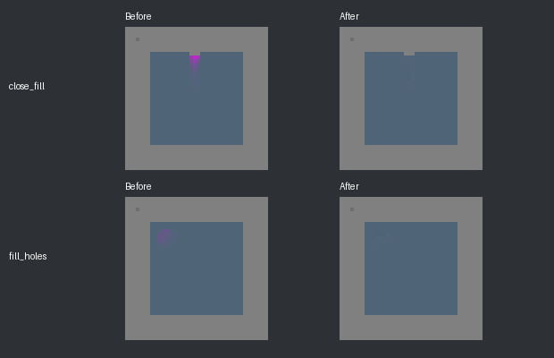

# NE-255：補色不採用透明背景RGB

保留來源透明度的角色在補洞時會把透明背景的洋紅色帶入衣物。現在只從實際可見材料補色，保留原填補區及後續流程；缺省／false模式沿用原輸出。

| 核對 | 結果 |
|---|---|
| 同一最終CPU回歸 | 原版3測試／5失敗子案例，修後3／0 |
| 相同alpha、可見RGB，只改透明RGB | close_fill／fill_holes修後可見結果相同，原版各自污染 |
| 舊模式相容 | 固定樣本default／false的PNG原bytes相同；實際9件＋ownership相同 |
| 相同角色來源 | 相對原流程全部alpha相同，指定區域色相污染28→0 |
| 相關回歸 | underlap3、source-alpha11、mask-delivery全過 |
| 隔離工作目錄 | 新3項全過；原影響挑選無遊戲套件 |

「填補區外RGBA不變」指隔離操作測試；完整refine下游原defringe可能隨修正色彩更新邊緣，不能把它寫成整條流程逐像素不變。本次不更動輪廓alpha或替代角色接點驗收。



上圖使用相同最終測試的40×40固定輸入，四份before／after PNG原尺寸亦保留。真角色28→0是明確區域的診斷：832×1216 RGBA，x∈[306,337)、y∈[385,490)，OpenCV uint8 HSV的130≤H≤175、S>45、alpha>127；不限制V。這是該角色的檢視判準，不是通用畫風或透明度容差。原程式、28筆座標、相依版本與完整SHA在封存內recompute_pollution.py及actual-pollution-recomputed.json，可獨立重算。

## 原件與重跑

originals.tar.xz保存130個原始member：最終同測試的紅綠log、Windows未設UTF8的初次拒絕、來源、固定樣本、完整四組實際來源／輸出及逐件對照。archive.json逐member保存SHA，並核對整份封存SHA；重新串流讀取全部member均一致。沒有提交__pycache__。

```powershell
$env:PYTHONUTF8='1'
python tools/comfyui/test_refine_fill.py
```

解開到新的暫存目錄（不要覆蓋原件），以現有tools/comfyui作PYTHONPATH，再執行封存內的recompute_pollution.py可核對真角色區域；舊、新refine與相同spec/06_parts/base均在封存內。模型、GPU與生成服務不參與這些CPU回歸。最初實際來源讀取器把RGB ownership當RGBA的IndexError原log已保留，修正後才計算最終逐件結果。

## 美術CI執行預算

[原CI執行](https://github.com/deadline314/Nest-Egg/actions/runs/43945569059)在五分鐘工作上限時仍處於checkout（約77%），沒有跑到Python。保留原工作流程記錄與checkout log；本次把原執行預算改15分鐘，CPU斷言與像素／角色門檻不變。新CI結果另依實際執行判斷。
