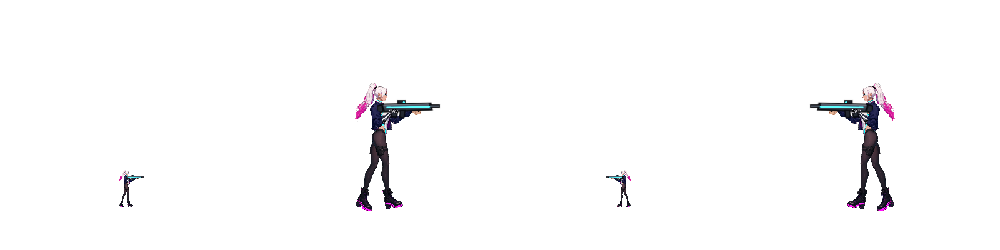
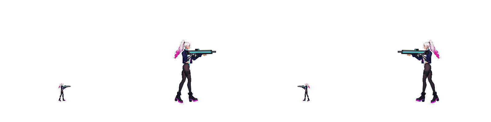
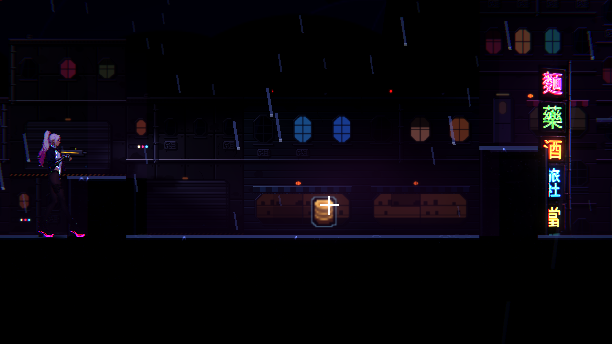
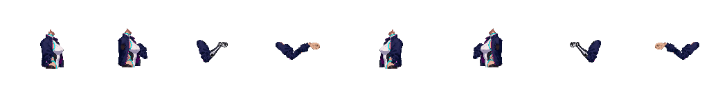

# NE-257 凜的實際下襬跟隨

2026-10-20，基準 `8a273640825a52fb9e5523091b8218cc14f25c83`。本票保持進行中、八項整體條件維持未勾。

## 玩家可見的改動

兩個空轉的外套彈簧接到真正的近遠下襬；肩領及袖片的原綁定保留。凜的衣髮不再持續受微風驅動，靜止時收束。原始 coat_1/2 key 保留，兼容 NPC authored-pose。只改凜專用骨架 JSON；其他角色、全部原圖／法線／發光、共用 shader、網格、碰撞、命中與操作程式均未改。[設計](../../../../design/12-cast-redraw/RIN_CLOTH_FOLLOW.md)、[完整30件帳本](part-ledger.json)、[版本與保護檔](source.json)。

衣身圖單看有袖窿，完整帳本另有獨立近遠上、下袖片，不是無袖定稿。本輪沒有改袖口或胸口動態，也沒有把裸露金屬前臂當布料。

## 同一回歸的負控制與修後

| 範圍 | 檢查 | 新失敗 | 秒 |
|---|---:|---:|---:|
| 原資料＋同一新增回歸 | 5438 | 8 | 9 |
| 最終原始 affected selector，固定基準4組 | 6574 | 0 | 17 |
| 額外 AnimAudit／ProtagonistMotion／Locomotion 3組 | 3022 | 0 | 17 |

負控制抓到沒有實際衣料綁定及持續微風。修後 30/60Hz 下實際 render node 收到模擬角度、可見衣料會動、靜止四秒沒有漂移、落地與急停兩秒內收束、兩更新率峰值相近。原有生命週期、翻面、瞬移測試仍執行。7組共9596項、0新／已知失敗、0 SCRIPT ERROR。raw 保留既有刻意無效 NPC pose/loop 的 ERROR，不冒稱所有 headless log 完全無 ERROR，見[逐條診斷](engine-errors.json)。基準完整 CI 95628/0/480秒成功，僅證明基準，沒有冒充本次改動的完整 CI。

首輪套件名稱誤寫 `RigActions`，跑0項；完整保留，不計通過。正確 `RigActionsSuite` 才是5438/8負控制。試作一度把 coat_1/2 key 改名，觸發既有 NPC 回歸的 SCRIPT ERROR 並污染後續該程序的測試暫存；回復相容 key 後原測試不改、重新執行6574/0。試作原資料與所有失敗原文都在 raw。

## 原生與像素證據

軟體 Vulkan llvmpipe／Godot4.7.2／Forward+，沒有實體GPU或手把。採用的連續圖為 `native/rin-cloth-uncropped-before` 與 `...-after`：八種序列、每種八個時刻、每圖同列兩面向與1×/3.4×，共128張。整段按60Hz模擬，輸出八個時間樣本，**不是每影格全部存圖／全人工逐格驗收**；按 CharacterRig 真輸入模擬，並非整段真人遊玩。原native尺寸1600×400，透明背景，四個完整角色與武器未裁切。抽看起停、跳落、倒地同條件原生圖及隔離極值；192張舊1280寬圖的倒地遠端可能裁切，因此保留為歷史，未作完整角色驗收。最初兩版產品／probe來源、全輸出均保存。

直接取真實綁定 Sprite2D，重新掛入1:1來源像素視窗做 isolation，維持同一pose，控制角0與跑動／兩個極值比：兩側固定區改變像素均0，活動區六次均有2255～7722個改變像素。這證明固定肩領與實際下襬變形，不證明接點外觀。見[pixel-audit](pixel-audit.json)。

街道正式 Level 輸入重播350格（跑、跳、射、衝刺、格擋、近戰、反向），五張原圖由既有 exposure_play 的最白候選選出，均在近戰段；只補實際 Player／場景整合，不代表已看到每項動作，也不採用其曝光框統計作光影驗收。這個工具未產生全動作影片。本次採用的原生 capture 與關卡執行 log 均0 ERROR／SCRIPT ERROR。

## 接點仍失敗，不能當通過

原工具要求 `coat_hem` 的不存在 `jacket_hem` 部件，首輪明確 ERROR退出1並保留，沒有刪除此錯誤。對實際存在的前後肩袖、袖口，以**原工具未修改**各120格、8姿勢、2面向、2倍率：原版／修改版各15360取樣，均1039失敗，其中714為工具分類的邊緣缺口，仍全部算失敗；其餘包含一像素孔洞、中心覆蓋等。對齊 `(pose,zoom,frame,joint,facing)`，新增0、消失0。沒有放寬任何門檻，沒有宣稱修好既有NE-222部件缺口。[逐項比較](joint-comparison.json)，完整失敗JSON及3840張原生取樣均在raw。

## 效能與資源

原 `rig_perf_probe` 同機10人／600格、順序交替3對；最後安靜一輪六次才採用。mesh腳本每人每格中位數原版291.79μs、修改版286.11μs，差-5.68μs；數值受排程雜訊影響，不宣稱提速。兩者423邏輯網格頂點，新增0。[原始每次數字](script-performance.json)。不代表GPU shader繪製耗時。首次單跑與第一組成對量測另保留；第一組可能與像素checker重疊，未採用。

## 參考圖與採用理由

先讀User-guide並重新逐張看五個不同開發者的同類作品，原圖／URL／SHA見[references](references.json)。借肩頸穩定、短衣與長披風不同的輪廓；不從單張圖推測動畫算法、精確阻尼或玩家共識。Spine官方區分慣性、回復、阻尼、風與重設，本作保留現有子步長，角度均為專案調校。

## 重跑與完整性

從本基準的乾淨暫存checkout匯入，解壓raw，replay下兩個probe與tscn放`work/`。同一test_rig_actions放回原tests位置。before／after分別使用history的原／最終humanoid_tall資料；對照原資料5438/8。執行 `GODOT=<4.7.2> tools/run_tests_changed.sh 8a273640825a52fb9e5523091b8218cc14f25c83`，額外原動畫三組。原生使用既有gpu_lock、Forward+與獨立user profile：`res://work/rin_cloth_probe.tscn -- --out=<dir>`、region probe同理。接點用原 `rig_joint_audit.tscn -- --chars=rin --joints=coat_shoulder_front,coat_shoulder_back,coat_cuff_front,coat_cuff_back --frames=120 --out=<dir>`，原checker仍應回報1039失敗。只在自己的暫存checkout切換資料，最後恢復after。perf重跑腳本中的絕對環境路徑須換成本機真實路徑。

raw共4271檔，每檔byte數及SHA在[manifest](manifest.json)；tar.xz SHA在source.json；原始每檔不變，以跨檔無損壓縮減少儲存量。所有首輪錯誤／裁切／試作與修後均保留。仍有NE-222接點、美術、完整自然動態及硬體驗收，故不勾整票條件。
