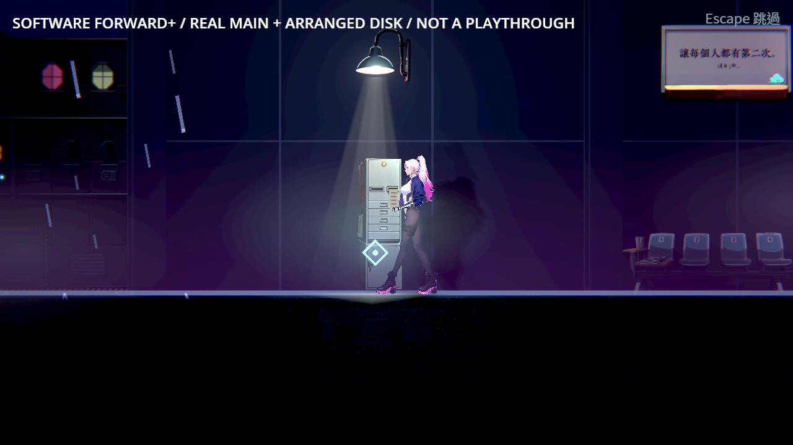

# NE-280：混音資料生命週期

2026-10-26，調查中。ST-10受影響回歸在八程序負載兩次出現音訊執行緒SIGSEGV；原圖演出與單程序通過不代表此問題已解決。

[原始輸出與官方MIT原始碼](initial-evidence.zip)、[逐檔SHA](manifest-initial.json)、[來源與判讀界線](research.json)。Godot官方來源保留原授權標頭；上游議題僅連結與轉述，不重刊全文。

第一輪中止前78.45秒已發生真崩潰；第二輪完整選了83組，因一支崩潰缺結果，只有60,551項結算且另有1項續玩時序斷言失敗，整輪失敗。該時序斷言與音訊問題分開追蹤。原main與最終候選的相同11組單程序都是8,709／0（353／350秒），不能當成重現修復或崩潰已解決。

上游[124217](https://github.com/godotengine/godot/issues/124217)描述同一4.7.2版本的AudioStreamPlaybackBusDetails生命週期競態。實際fault位於StringName複製，其呼叫者的常數指出AudioServer::_mix_step；不是完整符號化堆疊。修補與負載驗證完成後在本附件追加，不改原篩選器、known failures或音效開關。

## 修補與本機驗證

退休資料先取得與混音相同的 driver 鎖，確認正在讀取舊指標的混音已完成；後續混音只會讀到已替換的新指標，然後才執行延後回收。保留所有聲音與空間音效。固定官方原始碼及精確patch，不以增加等待影格或降低負載代替同步。

原完整88組／八程序，97,885項、0新／0已知失敗、527秒；八個獨立混音程序均通過音量／左右聲道／非零取樣／實際播放進度及清理；正式Main Forward+ 15／0。

[實際完整回歸、音訊結果與引擎收據](validation.json)、[逐檔SHA](manifest-validation.json)、[原始日誌／退出碼／來源與操作圖](validation-evidence.zip)。收據記錄原始碼、SDK、patch、編譯命令、編譯器、二進位及功能。重建與已驗平台見[建置指引](../../../../tools/godot_audio/README.md)。保留Wayland、X11、螢幕閱讀、Vulkan與OpenGL，沒有改原選擇器、錯誤篩選或已知失敗。

官方引擎同83組八程序對照為97,492／0、520秒，沒有再現；原單程序對照與獨立音訊v3／v4亦未再現，不能稱為固定重現的負控制。v1獨立探針33筆退出洩漏來自太早退出；v2呼叫錯取樣方法而解析失敗，退出／逾時原檔都保留，均非引擎崩潰。最終探針先核對中央平衡、-12 dB振幅約0.25及左右聲道，32音源移動／音量變化使用有上限配置；退出以真正混音進度確認清理。

原圖為正式Main與ST-10候選內容，使用軟體Vulkan／Forward+／HDR2D與Dummy混音；不是實體聲卡／硬體GPU／人類整章實玩。完整測試原本刻意損毀fixture的日誌保留，只有音訊探針與原生操作宣稱0 ERROR／洩漏。其他平台目前只有來源建置指引，沒有代稱已建置或裝置驗收。

CI配置會從固定來源重建、先驗證再重用完成快取、執行實際混音檢查及原完整測試；遠端實際執行結果另追加，尚未以本機成功代稱CI完成。

## 遠端CI完成

遠端CI實際完成固定來源建置／收據核對、八程序混音檢查與原完整回歸：97,896項、0新／0已知失敗、509秒。[實際run](https://github.com/deadline314/Nest-Egg/actions/runs/40256346564)、[原job日誌與metadata](ci-evidence.zip)、[收據與SHA](ci.json)。來源、patch與修後音訊檔雜湊與本機一致；各主機的編譯器及二進位收據分別記錄，不要求不同工具鏈產出相同二進位。上述本機階段的CI待驗描述為歷史紀錄，本段為最終結果。
