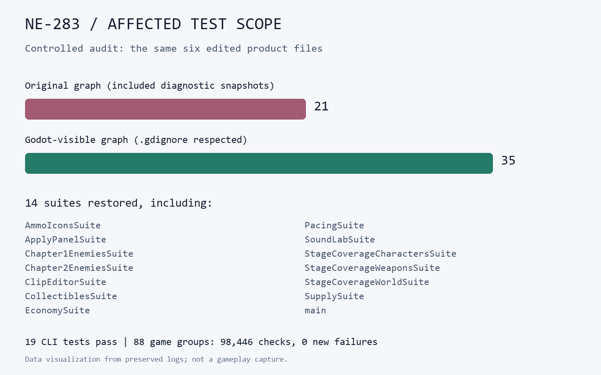

# NE-283 測試選擇範圍交付

2026-11-11。`python verify.py` 會逐 byte 核對 [raw.zip](raw.zip)、五個原工具負控制、十九項新工具測試與完整遊戲回歸；目前 **100 項、0 失敗**。[receipt.json](receipt.json) 保存壓縮檔 SHA 與基準。

| 證據 | 結果 |
|---|---|
| 真實工作目錄的隔離觀察 | 同六份近戰修改，只有掃描候選是否遵守忽略目錄的差別：21 組 → 35 組，補回 14 組；完整 JSON 保存原始列表與各核心的相依者數量 |
| 舊工具五個負控制 | 間接相依被大量診斷副本截斷、忽略目錄內同名副本、正式同名類別、忽略邊界新增與刪除；每案新程序執行同一測試，全部真實失敗 |
| 修後完整 CLI 測試 | 19 項全過；涵蓋中文路徑、cp950、Git 失敗、無效基準、錯誤傳遞、文件變更、新正式程式與新增的負控制 |
| 正式變更測試入口 | 在獨立工作目錄執行 `run_tests_changed.sh`，因修改測試選擇器，依原規則選 **ALL** |
| 完整回歸 | 88 組、4 程序，**98,446 項、0 新失敗、0 已知失敗**；正式入口 exit 0，遊戲執行 wall time 1,147 秒 |
| 來源固定 | 15 份候選原始 byte 與 Git index 一致；執行前後 SHA 完全相同 |

## 完整回歸的精確範圍

基準 `be43e4f55efc7bbe4ab97ab81fe84eb41cbfa819`，獨立工作目錄 `D:/NestEggVerification/ticket-batch-20261111`，只有本票兩份測試工具、BG-55 六份局部光影產品、NE-277 當時六份產品及近戰測試，合計十五份。每份實際測試來源、SHA、命令、退出收據、四份原始分片與冷匯入日誌均在 ZIP。

此批不含 NE-267 尚在製作的故事／角色，也不含稍後才修正的共用步態交接。NE-277 的當時候選仍使用降低踏步幅度的診斷版本；不能把這次完整回歸寫成後續最終步態修正已通過。BG-55 六份產品的來源固定，其原生圖證另由該票驗證。

**不能稱為所有日誌零 ERROR。** 四個分片均沒有 SCRIPT ERROR／Parse Error，但分片 0、2、3 保留原有測試相容規則允許的退出 RID／ObjectDB／資源診斷；完整原文未刪除。既有錯誤過濾器、已知失敗清單、搜尋深度與核心截斷門檻未修改。

## 證據與歷史

`controls/before/` 用修後相同測試在舊工具上逐案重現；每案獨立程序，避免舊版全域檔案集合快取跨臨時專案污染。舊版本、修後版本與測試來源全部保留。

`controls/history/` 另存最初 13 項測試的五個真實失敗，以及第一次完整測試在 Windows 臨時殼層 fixture 產生 CRLF shebang 的失敗。後者以 fixture 明確寫 LF 修正，不是修改正式殼層、忽略錯誤或降低驗收。

下圖為保留的工具輸出所繪製的資料圖，**不是遊戲畫面**；完整路徑與列表以 ZIP 內原始 JSON／log 為準。

