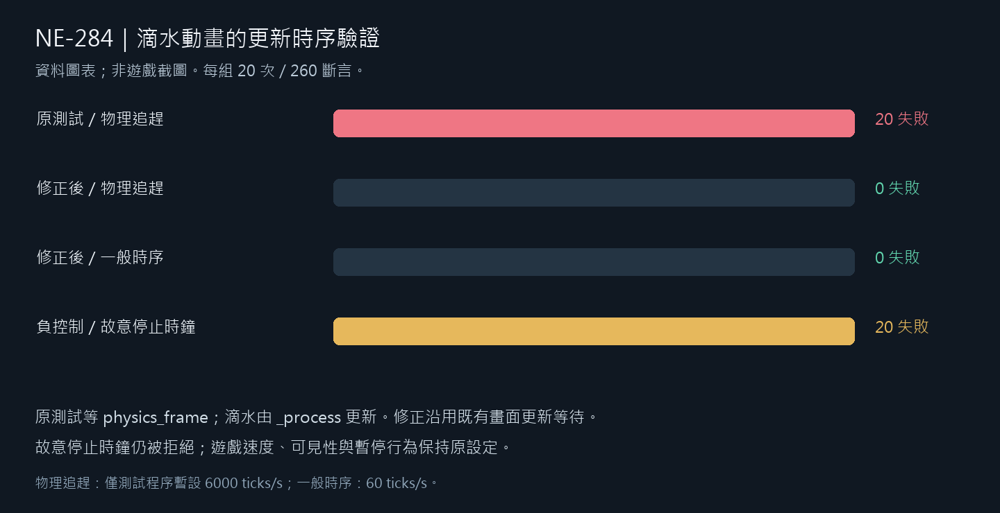

# 滴水更新時序驗證

本票只修正測試等待，不改滴水動畫、速度、畫面可見判斷或暫停規則。EnvironmentSuite 原本的 `frames(3)` 經共用 runner 等待三次 `physics_frame`，LocalDrip 時鐘卻由 `_process` 推進。物理追趕期間，三個 physics ticks 不保證其中有畫面更新。改為同套件已存在的 `_motion_process_frames(3)`，三項原斷言文字與判斷全部保留。

## 原失敗與受控重現

原受影響 70 套件是固定的 NE-277 最終動作候選、BG-55 六項局部資料及相關測試之聯合集合，71,186 checks／1 new failure／0 known failures、真 exit1。四個分片、命令、候選來源與退出碼保留在 `diagnostic-and-red-raw.zip` 的 `affected-red/`。候選列入的 19 檔執行前後 SHA 相同；這是明列的候選範圍，不宣稱封存整個遊戲或所有素材。原時序失敗不得冒稱產品退步已經定位，也沒有加進 known failures。

獨立探針重用同一 `_test_local_drip()`。僅在自有測試程序暫設物理頻率 6000 ticks/s，創造同一 idle 期間多個 physics ticks；退出前恢復原值。一般時序另用 60 ticks/s。這不是遊戲設定或性能比較。每組重複 20 次、260 個原斷言：

| 測試來源／條件 | 新失敗 | 引擎退出 |
| --- | ---: | ---: |
| 原測試／物理追趕 | 20，全部是畫面內滴水沒有推進 | 1 |
| 修正後／物理追趕 | 0 | 0 |
| 修正後／一般時序 | 0 | 0 |
| 修正後／故意停止滴水時鐘 | 20，全部抓到停止更新 | 1 |

原時序 trial 記錄多次完全沒有 `_process` callback，就已經檢查時鐘；新時序則實際給予畫面更新。負控制只在隔離副本把時鐘增量乘零，保留可見性、訊號、暫停與所有其他程式；結束即逐 byte 還原，未修改交付產品。每組保留實際探針、被測試來源、滴水來源、log 與真正 subprocess 退出碼。預期的無效資料測試有原本 warning，四組沒有 SCRIPT ERROR／ERROR 或洩漏診斷。

最早一次 PowerShell 操作在 Godot 結束後又執行 Get-Content，工具外層的 exit0 是最後命令結果，不能代稱 Godot exit0。正式紅輪另以 Python subprocess 收錄真 exit1，原讀取操作不列為第五個獨立案例。



## 原位元組與重驗

每包附 `manifest.json`，逐成員保存 byte 長度與 SHA256；外部 JSON 另記 ZIP 自身大小與 SHA。封包採 `-text`，不經換行轉換。`verify.py` 只讀封包，逐檔核驗、重新判讀四組 log、確認故意停止的唯一程式差異與正式候選來源。

```powershell
python pm/Nest-Egg/attachments/NE-284-process-phase-2026-11-11/verify.py
```

要重跑原始時序診斷，使用獨立 checkout：把封包中對應 test source 放在 `tests/suite/test_environment.gd`，探針放在已忽略的 `work/ne284-diagnostic/replay.gd` 並附同名 Node 場景，執行 `Godot --headless --path <checkout> res://work/ne284-diagnostic/replay.tscn`。正式命令、場景與來源另在收據中保存；不得在其他人的工作區或正在捕獲的 native checkout 切換負控制來源。

## 正式受影響結果

修正後依原 `run_tests_changed.sh` 與未改動的篩選／已知失敗清單，選出 70 組並以四個程序執行：71,186 checks／0 new failures／0 known failures，真 exit0，約 943 秒。固定候選共有 20 檔（NE-277 最終動作／命中修正、BG-55 六產品檔與本票測試），執行前後 SHA 完全相同；不含尚未交付的 NE-267。未使用較早的 88 組結果替代本輪新 Animator。

原始四個 shard、命令、wrapper、候選與前後 SHA、20 個候選 byte、既有 selector／runner／known failures 已封存 `affected-green-raw.zip`，逐欄摘要在 `affected-green.json`。原 runner 允許的故意錯誤資料診斷與部分退出資源診斷仍存在，原文全保留；本輪沒有 SCRIPT ERROR，不宣稱全部 log 零 ERROR 或零洩漏。這不修改正式錯誤篩選政策。
