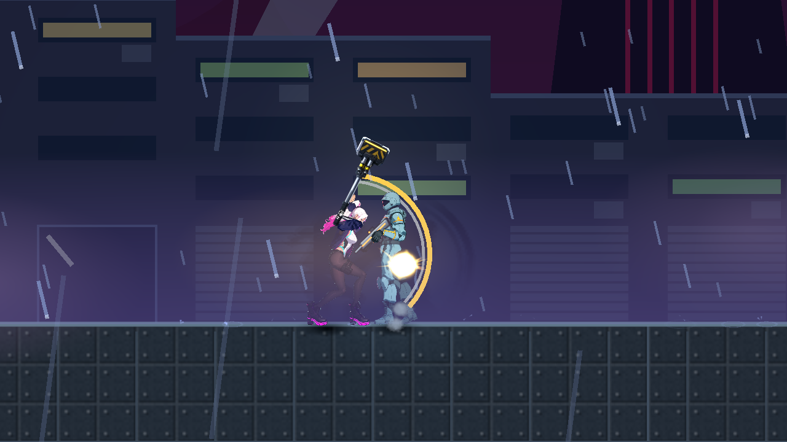

# NE-285：頓幀保留碰撞空間

本包只驗共用頓幀的碰撞空間。正式錘招首傷時武器仍高於目標，屬 NE-277 可見命中幾何未通過；本包不把該圖當作近戰時序通過，也不改 damage、range、hit window、Animator 或武器資料。

## 固定來源與修正

`final-source.json` 列出唯一三份候選：頓幀框架、既有 Feel 套件入口及新 physics 回歸 helper。保留正在處理的實體及實際子受擊區原 disable mode，以父子可重疊的所有權維持有效空間；最後一份持有釋放才恢復原值。已停用物件不被喚醒。延長同一暫停不重寫原狀態；離場、queue_free 與正常清除均回收紀錄。正常死亡仍依正式敵人邏輯停用 layer／hurtbox／contact，解凍不重啟。

原正式紅的產品基線為 c78d7cb0；後續開票文件不改產品。正式回歸在隔離 D CPU 樹執行，只納入本票三份候選及 root 已固定的診斷工具；完整 affected 收據在本包 official-affected-raw.zip：71 組、93,799／0 新／0 已知失敗，exit0，861.795 秒；12 候選來源前後固定，本票三份與主目錄逐 byte 相同。不包含後續 NE-277 新幾何。原生 C 場地使用正式 Player、grunt 與原 maul 資料，完整 runtime 來源及所列資料前後 hash 存在原始 receipt，不把其他票的資料宣稱驗收。

## 可獨立驗證的結果

| 證據 | 結果 |
|---|---|
| 原正式命中，CPU | 傷害回呼前四 RID 同一有效 space；回呼內 player／enemy body 及 hurtbox 全變 0，解凍後恢復；16 項讀取檢查 |
| 最終正式命中，CPU | 同一原招式與站位；動作停住且四 RID 留在原 space，解凍恢復；16 項檢查 |
| 最終正式命中，原生 | 真 Forward+／RX 9070 XT，1280×720、17.942 秒程序；傷害回呼、延後回呼、physics／process／真 frame_post_draw 都保存；停頓呈現格兩個真 hurtbox point query 均可找到，動畫時計不前進；21 項檢查 |
| 正式受影響範圍 | 71 組、93,799 checks／0 new／0 known，exit0；12 候選固定，包含本票三份來源 |
| 省略空間保留的負控制 | 相同 helper／FeelSuite，只有保留函式換成 pass；829 checks／7 new failures、exit1 |
| 還原候選 | 原三份綠 SHA 恢復後，同 FeelSuite 829／0 new／0 known、exit0，28.462 秒 |
| Reader | 原 ZIP SHA／CRC、每個封存 runtime 檔案與 receipt SHA、紅／綠／原生 ledger、兩控制三份來源逐一重算，共 1,051 checks／0 failures |
| Reader 破壞控制 | 3 個測試方法，含 8 種獨立缺失／變造子案例，全部拒絕 |

FeelSuite 專項有 4 個既有、故意觸發且由正式 filter 允許的缺資料 ERROR；該專項沒有 SCRIPT ERROR 或退出資源診斷。完整 71 組的四 shard ERROR headers 分別 84／66／27／25，皆由封存的原 filter 允許，沒有 SCRIPT ERROR；退出診斷為 shard0：1 AreaRID／4 ObjectDB／2 resources，shard1：9 ObjectDB／5 resources，shard2：6 AreaRID／16 ObjectDB／8 resources，shard3 無退出診斷。不寫成全範圍零 ERROR／零洩漏。兩個正式 CPU／原生探針採嚴格紀錄，均無 ERROR／SCRIPT ERROR／退出洩漏。秒數僅是程序收據，沒有全機空閒、模組效能、實體手把或人工試聽結論。原生原始 master WAV 隨 raw 封存，只為保留原輸出，不是新增音訊驗收。

## 原始資料

`archive-index.json` 保存所有 ZIP 的 SHA256 與大小；ZIP 內原始 bytes 不轉換行尾。`.gitattributes` 使 ZIP／PNG 保持二進位；本包新作者文字採 LF。

- `formal-contact-red.zip`：原來的正式首擊 space=0、前／中／後 ledger、完整收據及當次 runtime source。
- `formal-contact-headless-green.zip`：最終框架 CPU 對照，含最終 Fx SHA 93994b41…259f99f。
- `formal-contact-native-green.zip`：正式原生原圖、ledger、輸出、source、收據及原錄音。工具附記原 hit window／range 與武器 transform；此例是原錘招。附記 transform 的 y basis 後續查到 orthogonal 符號與正式 draw 相反，該欄不作任何幾何通過證據；space／query／停頓驗證沒有使用它，原始 bytes 保留。
- `feel-controls.zip`：原始負控／綠 log、wrapper 收據、命令、原 filter 與兩種已測三檔 byte。負控 source 由同一綠 source 以原單一刪除規則重建，逐檔與當時 receipt SHA 完全相同。
- `official-affected-raw.zip`：原 full.log／四 shard、candidate／command／exit、12 份來源、原測試程式／selector／filter／known-failures；executed-stdin-copy.py 是完成後從真實工具呼叫逐字轉存的執行文字，stdin-provenance.json 明記沒有事前 runner 檔案／SHA，不冒稱當時存在磁碟 runner。
- `diagnostic-history.zip`：最初 helper 型別推斷 parse 失敗、較小 helper 綠輪、較早 Fx 簽名的正式綠輪；均不替代最終候選。最初 parse 失敗只有 log／SHA 收據，當時完整 helper 未另行 snapshot。

Reader 初版曾以 `physics_tick < thaw_tick` 截斷停頓紀錄，錯誤漏掉「同一 physics tick 早期仍凍結、稍後 process 才解凍」的真觀察；現在以 ledger 的單調 `order` 截斷，保留該案例的獨立回歸，未修改產品與原紀錄。

執行：

```powershell
python -X utf8 pm/Nest-Egg/attachments/NE-285-collision-space-2026-11-11/verify.py pm/Nest-Egg/attachments/NE-285-collision-space-2026-11-11
python -X utf8 pm/Nest-Egg/attachments/NE-285-collision-space-2026-11-11/test_verify.py
```


