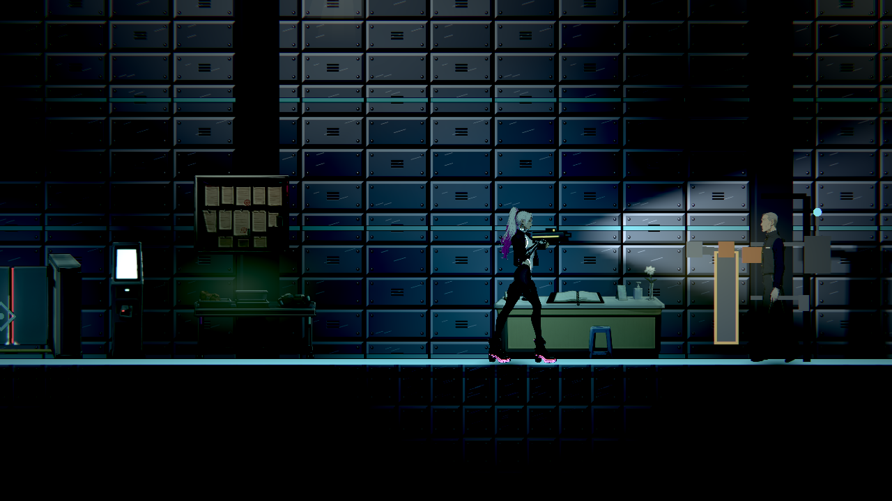

# NE-286 跨章頭目設定與乾淨退出

原始候選包在 Windows 11／Godot 4.7.2 的實際程序中，正確回報版本後仍留下 505 ObjectDB／306 resources、texture/font RID 與 VariantPools 診斷。匯出工具正確拒收；兩個原產物留在 `D:/NE232/0.1.20261111-candidate-through-ch1_kasa-f52cb415c2df72f644bf59ba397ef106cd672b46`，不提交二進位、不覆蓋舊包。原始建置清單、匯出失敗、官方模板來源與雜湊均封存在 `original-failed-candidate-build-raw.zip`。

## 原因與修正邊界

隔離固定 `f52cb415c2df72f644bf59ba397ef106cd672b46`，22 輪資源縮減找到第二章帳房與第三章門禁大廳的組合；直接保持阿勇→JANUS 的行為腳本亦重現，反序或單獨載入乾淨。延後退出、清其他快取、移除排序或型別、類別命名和 `@static_unload` 均未解決。這些失敗控制保留在 `diagnostics-and-native-leaf-cases-raw.zip`，沒有採入產品。

只將 JANUS 的設定快取從 Enemy 衍生腳本移到純資料 RefCounted 類別，保留原預設、讀檔／容錯、重用快取及原入口；沒有改招式、傷害、旗標或報告順序。沒有 Enemy／Node／頭目型別回指，不用每場重讀檔案掩蓋問題。完整版本回報的 14 欄與原失敗逐欄相同，修後實際退出為 0、無錯誤或洩漏。

正式 leaf 案例保存每次執行前的 Main 與設定來源及 SHA：行為腳本雙順序、敵人資料雙順序、重用快取共五個正控制皆乾淨；刻意關掉快取的負控制真 exit1，沒有引擎錯誤。永久戰鬥回歸另涵蓋預兆、護盾、掃描、增援、弱點、停機、重試狀態與正式門禁大廳。

早期 `main_timing_probe.gd` 是逐步擴充的探索工具，最終檔案不代表每筆早期試驗的同一版本；不對那些探索宣稱執行前來源完全封存。22 輪縮減及最後六個 leaf 案例各自保留實際來源；正式測試 runner 與來源在執行前記錄雜湊。

## 原始失敗與回歸來源

`combined-55-red-receipts-raw.zip`：原始選測 55 組、62,909 檢查、3 新失敗、0 已知失敗，真 exit1。三條都是鄭老闆站立時與椅子重疊的實際舞台失敗，沒有忽略或加入已知失敗。315 個固定輸入及 7 個生成 UID 共 322 源前後不變，完整來源在兩個 `combined-55-red-inputs-…` ZIP。

第二輪使用 NE-267 固定 v3 的 314 源、NE-286 六源及原裁切工具樣本，另保留七個生成 UID，共 328 源；沒有帶入未交付的 NE-277 幾何修改。原選擇器擴為 64 組，68,842 檢查／1 新失敗／0 已知失敗，真 exit1：正式廚房最後放壺未對準耐熱墊。原先三項椅子失敗已消除；接觸更新排程問題由 NE-287 另修。兩份 v3 red ZIP 保存完整收據及相對原 322 源的十二項真實差異，重疊即可還原全部 328 源。

第三輪加入 NE-287 接觸修正、NE-277 精確 26 源及 NE-288 閱讀前提，原選擇器選 77 組。96,434 檢查／1 新失敗／0 已知失敗、真 exit1，360 源不變：唯一失敗為 QuestMapSuite 的提示位置驗收，另由 NE-289 追查。接觸、閱讀、近戰與頭目套件都完成；整批仍是失敗。v4 red 收據及三十四項差異相對 v3 疊加可重建完整 360 源，沒有重複存放四十多 MB 未變素材。

以上皆為明標的固定跨票工作樹組合，不冒稱同一個歷史提交。NE-267 人物／步態、NE-277 全部打擊感與性能仍依各票判定；不把它們計作本票完成。

## 本票與 NE-287／288 的隔離驗證

隔離副本改以固定 `1549787c470d4a6cf4a51e21bac9b460b71870bd`，只套三票實際提案的十三份來源，另記錄七個生成 UID，共二十源。NE-287 播放器保留該基準的移動程式，與其原生對照使用的完整三源相同；NE-267、NE-277、BG-56 未交付產品均未混入。

原 `tools/run_tests_changed.sh` 自動選出 52 組，原始 64,668 檢查有一項環境失敗：先前隔離人物拷貝留下兩個自有空目錄，DirAccess 將空的 guest_zheng 目錄列為角色，要求不存在於該基準的 motion。這不是程式修復成功，原 exit1 和完整日誌繼續保留。

核對該目錄沒有任何基準提交檔案、兩個目錄皆空且屬本次副本後，僅移除空的 parts 及 guest_zheng，沒有刪除素材或變動二十源。使用原 `tools/run_tests_parallel.sh --only=RigActionsSuite` 完整重跑唯一失敗套件：5,835 檢查／0 新失敗／0 已知失敗、真 exit0；二十源逐 byte 相同。原其餘 51 組已通過，因而完成全部 52 組受影響範圍驗證；**不宣稱一次完整原選測 exit0**。收據中的 `acceptance.json` 明列這個兩次執行的邊界，驗證器獨立核對原失敗、空目錄清理、來源一致及完整失敗套件重跑。

完整收據在 `root-tickets-v5-verified-receipts-raw.zip`；二十份實際固定輸入在 `root-tickets-v5-inputs-raw.zip`。測試日誌包含刻意壞資料的容錯診斷及既有測試清理診斷，四個 shard 無腳本錯誤，沒有將整批稱為 0 ERROR。單獨的載入／版號／原生畫面程序則各自無 ERROR／洩漏。

## 原生畫面範圍

正式門禁大廳、真 Player 與 JANUS、同時保持兩個行為腳本。RX 9070 XT／Vulkan Forward+／HDR 2D，1280×720。測試明示安排玩家在頭目前方、生命 999、虛擬方向向右並隱藏 HUD，只證明此配置正常載入／退出和可見畫面，不是自然交戰或真人通關。

v1 雖乾淨退出，直接保存線性 HDR 的 PNG 偏暗，實際滑鼠方向也使頭目移出畫面；原圖作診斷保留。v2 使用專案原有的浮點 linear→sRGB 轉換並固定測試瞄準。保留原 RGBH（Image format14、每像素三個 float16）與 PNG；獨立 NumPy 重算後，只有 5 個色版相差一階，最大差 1/255。舊驗證器誤認 RGBH 為 RGBAH 的原始版本亦保留，沒有把該失敗稱通過。

## 重算與重跑

安裝 NumPy／Pillow 後，在任意目錄執行本資料夾 `verify.py`。逐 ZIP、逐成員串流校驗原始 bytes／SHA，再核對 leaf 案例來源、負控制、前後版號回報、原失敗、正式測試固定來源及原生 RGBH→PNG。ZIP 用 `-text`，不經換行轉換；成功不代表人工／實體手把驗收。

三票提案重跑：隔離 checkout 固定 `1549787c470d4a6cf4a51e21bac9b460b71870bd`，把 `root-tickets-v5-inputs-raw.zip` 的 `source/` 展開於專案，確認未留下其他人物資料夾，再跑原 `tools/run_tests_changed.sh 1549787c470d4a6cf4a51e21bac9b460b71870bd`。`GODOT` 指向 4.7.2、`SHARDS=4`，Windows 用 Git Bash。原 runner、命令、隔離環境和每份來源 SHA 在 receipts ZIP；不改選擇器、原斷言、門檻或已知失敗清單。

前兩份跨票 red 來源由原 322 源再疊 v3／v4 差異還原，基準仍是 `2189222d22eeb2200f7f15438c890694564107e1`；不要將它們與後來的十三源提案混稱。

詳細架構與發行後續見 [RELEASE_PIPELINE](../../../../design/20-campaign-experience/RELEASE_PIPELINE.md)。NE-232 必須從修正後的新固定提交另建候選包；本票的資料回報與畫面配置不代稱單檔已重建或章節已驗收。
