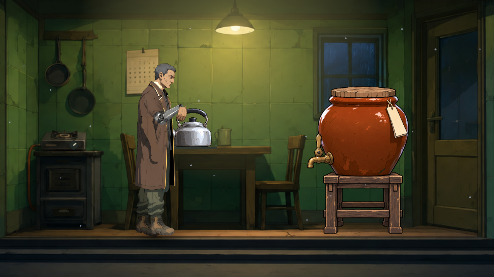

# NE-287 等待實際接觸後交接道具

原回歸在廚房演出最後放壺時失敗。固定 0.4 秒的等待已返回，手部更新卻只累積到 0.329166 秒；隨即釋放道具，壺留在耐熱墊旁 2.913101 舞台像素。相同控制不呼叫移動，新舊移動程式都失敗，不能將它歸因於 NE-267 的離椅改動。

現在等待演員真正消耗接觸要求、完成 IK 後才返回。接觸與收手共用原有狀態，不重做動畫、不搬動道具到預設座標，也不增加固定延遲。零秒仍不混合，但須先發布真實姿態；不等待的要求繼續立即返回。失效／被取代、死亡、停用或離樹的演員會取消演出，不接續結果。移動與接觸共用同一個存活檢查。

## 控制與原生對照

| 項目 | 原始結果 |
|---|---|
| 正式廚房 helper，新／舊播放器各一般與 15 FPS | 四程序均通過；這不構成排程缺陷已修的證據 |
| 完整 CutsceneSuite 單獨重播 | exit0／83.163 秒；原始大批失敗仍保留 |
| 延後發起的真接觸控制 | process_priority100、引擎 fixed-fps6；新舊原程式均真 exit1、0 ERROR；2.913101 像素偏離 |
| 修後同一控制 | 真 exit0、0 ERROR；實際接觸完整 0.4 秒，偏離 0 |
| 永久回歸 | 44 檢查／0 失敗，真 exit0／無 ERROR 或洩漏 |
| 原生修前／修後 | RX 9070 XT、Vulkan Forward+、HDR 2D、1280×720；預期 exit1→exit0、兩者皆無引擎錯誤／洩漏 |

這是實體舞台與正式角色／道具的機械配置：安排初始手部與壺位置後，以真實指令及握持功能重現。不是完整故事路線或人工操作；fixed-fps 是受控模擬時鐘，程序耗時不是效能量測。

修前：

修後：

兩張均為未改動的原 PNG；RGBH format14 原始浮點資料亦保留。`verify.py` 用 NumPy 獨立轉 sRGB，和 PNG 每色版最大差一階，並重算壺與墊的實際距離。碰撞／接點門檻仍為原 0.08 舞台像素。

## 固定來源與重算

`controls-native-and-sources-raw.zip` 保留 142 個原始成員與逐項 bytes／SHA-256。包含各輪來源、命令、退出碼、日誌、實際 PNG／RGBH、永久回歸及導入記錄；ZIP 設為 `-text`。執行 `python verify.py`，需 NumPy／Pillow；只讀原件，核對全部內容與原生正／負控制，不代稱完整章節驗收。

原生舊版三個舞台腳本取自固定 `1549787c470d4a6cf4a51e21bac9b460b71870bd`。修後使用本票的三個獨立腳本：播放器保留原移動程式，只有本票的接觸修正；與共用工作樹中 NE-267 的移動內容分開。這三份完整來源保存在 `native-v4/new/source/`，可對照實際提交。程序使用原 f52 發行診斷副本，其他上下文明標，不將它冒稱同一個完整歷史提交。

永久回歸另外保存完整五源。一般／零秒接觸、收手、不等待、讀取完成狀態不推進動畫，以及取消、跳過、死亡、釋放、替換、移除、停止更新、失去骨架和播放器釋放都實際驗證；結果尾端只在真正正常完成時執行。

工具失敗全部保留：第一個延後控制漏寫 prop_release 的 do 被正式驗證拒絕；原生 v1 在啟動前發現發行副本沒有開發用截圖 helper；v2 仍引用被排除的測試 helper，解析失敗的自有視窗被停止（exit4294967295）；v3 的 script-only 檢查未初始化專案 autoload，編譯拒絕。最後 v4 改用明示 work 截圖依賴與真具名墊面，先以正常 scene 入口檢查，再原生執行。每輪 finally 都核對／還原診斷副本三源；前三輪不列為通過。

原 64 組水壺失敗與後續 77 組另一項提示框失敗，均在 [NE-286 共用回歸原件](../NE-286-boss-cache-2026-11-11/README.md) 保留。它們仍是 exit1；各票以真實提案來源的隔離原選測另外驗證，不能把大批失敗重新命名成通過。
