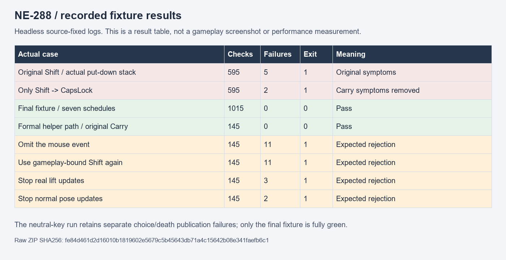

# NE-288：驗收前置輸入與呈現發布

本票只改閱讀搬運驗收前提，不改正式搬運、衝刺、近戰或閱讀產品規則。最終 helper 的 SHA-256 為 `f45c5a9e3f41288d6013991b4dd21281309cbf23bf0332f2f1414826d4da7449`。正式受影響測試另行封存與記錄；本受控封包不代表該批測試已通過。

`controlled-raw.zip` 保存十個回合的原始命令、執行程式、來源副本、來源前後雜湊、完整 log 及退出收據。ZIP SHA-256：`fe84d461d2d16010b1819602e5679c5b45643db71a4c15642b08e341faefb6c1`。全部原始 bytes 保持；ZIP 內的 NE-277 候選產品是重現所需的來源背景，並非本票的產品修改。使用獨立 APPDATA；機器快取未收進附件。

| 回合 | 結果 | 可證明的內容 |
| --- | --- | --- |
| 原 helper、RAM 堆疊觀察 | 595 檢查／5 失敗，exit1 | 原兩項搬運紅；另兩項選擇完成及一項死亡準星時鐘紅 |
| 只替換 Shift 為 CapsLock | 595／2，exit1 | 檔案只改一個鍵碼；兩項搬運紅消失，選擇與死亡各一紅保留 |
| 錯誤 ready 提案 | 10,017／7，exit1 | 讀前誤查僅閱讀時建立的輸入；七個期限守門全拒絕，未當成產品故障 |
| 正確 ready 提案 | 10,017／0，exit0 | 正常輸入、物件與支撐姿勢真正發布後才讀取；大多數計數是重複逐 InputMap 檢查，不是上萬種情境 |
| 最終精簡 helper | 1,015／0，exit0 | 七排程；合併 InputMap 守門，三類事件實際 dispatch、首閱讀兩手真接點與凍結守門 |
| 正式路徑、真原 Carry | 145／0，exit0 | 從正式 helper 路徑載入，沒有替換搬運節點 |
| 完全省略滑鼠事件 | 145／11，exit1 | 十一次裝置切換的事件 witness 全拒絕 |
| 重新使用衝刺鍵 | 145／11，exit1 | 十一次未綁定守門全拒絕 |
| 停止正常舉物更新 | 145／3，exit1 | 真 ready、第一個閱讀狀態及原凍結契約拒絕 |
| 停止正常姿勢更新 | 145／2，exit1 | 真 ready 與第一個閱讀的兩手實際接點跳動拒絕 |

七排程使用最高呈現頻率 6、8、10、12、15、30、60 FPS，最多八個物理追趕步。這是時序負載控制，程序時間不代表產品效能。各回合來源前後相同、沒有 SCRIPT ERROR、引擎 ERROR 或退出洩漏訊息。

## 實際原因與修正邊界

原紅的 10 FPS 回合中，Shift 事件的觀察點位於 physics 1001／process 142、世界未暫停。physics 1002／同一 process 142，箱子剛被舉起，衝刺為 `[pressed=false, just_pressed=true]`；其他搬運相關操作均為 false。真正堆疊為 `Player._physics_process` → `_process_normal` → `PlayerCarry.handle_input` → `put_down`，該步從 LIFTING／持有變成 NONE／未持有。不能僅憑這些記錄推定事件注入後被延後送達；原 helper 沒有注入前及 choose 返回的直接時間戳。

修正使用未對應任何 InputMap 動作的中性鍵，明確發布注入事件、觀察手把／鍵盤／滑鼠三種事件，跨 process 邊界後確認操作邊緣已清除。選擇真正結束、世界解除暫停，再等待搬運 HOLDING、正常視覺輸入、隱藏武器及物件支撐位置都發布。所有等待有三秒實際時間期限，條件不成立會留下失敗。

閱讀開始的同步呼叫後立刻檢查支撐狀態、物件位置、搬運時計與武器可見性，並確認兩個真實手部接點各自移動小於 0.001 px。原本暫停期間與結束後的兩項斷言保留，沒有額外等待姿勢修正後才宣稱第一個閱讀畫面正確。

## 獨立讀取

執行 `python verify.py` 重新核對 ZIP、每份原檔、前後來源、執行程式雜湊、真實衝刺呼叫堆疊及來源路徑、同一步狀態轉換、箱子回到 REST 及各負控制。結果為 1,143 檢查／0 失敗。`python -m unittest discover -s . -p test_verify.py` 有三項方法，會拒絕缺少輸入邊緣、錯誤呼叫或來源路徑、缺少狀態轉換的因果紀錄。

本票不提供實體手把、使用者辨識、真人試聽或獨占機器效能驗收。

## 結果圖表

下圖直接讀取封包內的原始檢查總數、失敗總數及退出碼，不是遊戲畫面。產圖程式與輸出來源雜湊見 `plot_results.py`、`plot-provenance.json`。

## 同來源受影響範圍

本票最終helper與NE-286／287共十三份實際提案來源，從固定1549787c隔離驗證；沒有帶入未交付近戰幾何或新人物。原選測52組的其餘51組通過，唯一角色套件失敗來自本次副本殘留的兩個空資料夾；核對沒有基準內容後只移除空資料夾，二十份固定來源不變，再完整重跑RigActionsSuite得到5,835檢查／0新失敗／0已知失敗。完成全部52組範圍，不把原52組exit1改稱一次全綠。

[完整兩次原始命令、來源、清理與獨立驗證](../NE-286-boss-cache-2026-11-11/README.md)。原77組的提示位置失敗仍原樣保存，由NE-289另外修正；本票的七排程、真原Carry入口與四負控制各自保留原byte。
