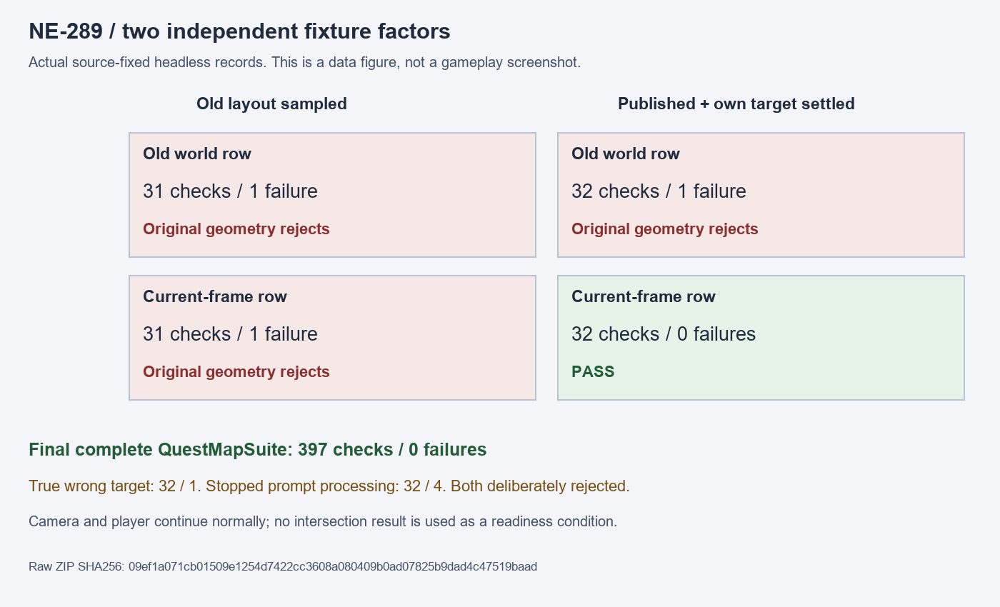

# NE-289：提示版面發布與同畫面座標

只修改測試前提、觀察階段與座標參照，不改任務真相、旗標、玩家、鏡頭或正式 UI 產品。最終單檔提案 SHA-256：`58b20d358282eb52effc2be4cc4ffbeafc91d4f3ac2f8e62981c0cef448771dd`；原測試檔為 `df0acf05d43adab2a3a66a441a9a9369ef3c12fe1fd153c0a961850f34926f59`。正式受影響驗證另記，原 77 組／96,434 檢查／1 新失敗的批次仍是失敗紀錄。

`controlled-raw.zip` 為十一回合的原始命令、來源、執行程式、完整記憶體觀察、退出收據與最終單檔提案。SHA-256：`09ef1a071cb01509e1254d7422cc3608a080409b0ad07825b9dad4c47519baad`，671,265 bytes。原 bytes 不轉換；僅排除隔離 APPDATA／LOCALAPPDATA 的機器快取。

## 兩個獨立缺口

1. 提示先在原點加入，首次正常版面已產生約 `(621.302, 248.777)` 的推回畫面位移。移動持有者後，測試只等 physics signal；原紅在 physics 42／process 9 判定，版面仍是 process 8 的結果。觀察當時 HUD 原本就已 yielding／alpha 0，不能把這個舊狀態當成對齊後更新完成。
2. 即使等待新 layout 及位移等於它自己的目標，原來保留的世界矩形仍會過期。HUD 固定在 viewport，相機正常移動後，這個 HUD 的世界矩形會改變。提示必須與同一次觀察的目標列比較，不能與較早鏡頭下的世界矩形比較。

| 控制 | 檢查／失敗 | 判定 |
| --- | --- | --- |
| 原前提、原座標 | 31／1，exit1 | 真重現位置斷言失敗 |
| 只等 layout 發布 | 31／1，exit1 | 舊世界列仍過期 |
| layout 發布＋位移收斂、保留舊列 | 32／1，exit1 | 即使自己的目標已收斂，舊座標仍失敗 |
| 只改當格列、保留舊版面前提 | 31／1，exit1 | 舊避讓位移仍失敗 |
| 初版兩因素修正 | 32／0，exit0 | 保留正常鏡頭，當格位置通過 |
| 最終 process 結束後觀察 | 32／0，exit0 | 零時 timer 保證本輪節點更新已結束 |
| 最終提案、整份任務地圖套件 | 397／0，exit0 | 包含原任務、地圖、輸入、語言、HUD 與狀態驗收 |
| 真錯誤目標 | 32／1，exit1 | `_nudge == _nudge_target`，原幾何斷言仍拒絕 |
| 停止提示處理 | 32／4，exit1 | 發布守門與原淡出、滑鼠穿透及位置斷言拒絕 |

早期兩因素提案也各做過一次真錯誤目標及停止處理控制，32／1、32／4 的原始結果保留。最終提案的負控制另跑，沒有拿早期綠替代最終來源。

## 獨立等待與幾何契約

`process_frame` 在 Node 更新前發出，因此提案在該信號後使用零時 process timer，等本輪 Node 更新完成再觀察。對齊後等待提示可處理、新版面與位移收斂到自己的目標，最多三秒；前提不成立會留下失敗。它不使用預期相交結果作等待條件，沒有凍結玩家或鏡頭，也沒有等待鏡頭永遠靜止。

淡出、滑鼠穿透及移除後恢復的原斷言保留。最終位置依同一次觀察取得 `guidance.row_world_rect()`，原 `intersects` 幾何條件保持；沒有縮小矩形或提高可接受重疊量。

最終控制在正常移動的相機下，提示放置矩形為約 `[416, 194.900, 146, 34]`，當格列為 `[478.982, 202.386, 184.375, 14.063]`，兩者相交。把當格列四個角獨立乘上當格 canvas transform，得到 `[143, 50, 354, 27]`，符合實際 HUD 矩形；120 份觀察最大誤差約 `0.000107` 螢幕像素。舊列約 `[605.611, 204.640, 191.334, 14.520]`，放到當格畫面已是另一個位置。完整套件的相機可能剛好較穩定、舊列也相交；讀取器只對確實記錄漂移的控制要求舊列不相交，不假設每次都必須失敗。

[SceneTree 更新信號與 timer](https://docs.godotengine.org/en/stable/classes/class_scenetree.html#class-scenetree-method-create-timer)、[canvas 到 viewport 的變換](https://docs.godotengine.org/en/stable/classes/class_canvasitem.html#class-canvasitem-method-get-canvas-transform)只提供 API 契約；相同來源的時序與實際矩形仍是本次因果主證。

## 重驗

執行 `python verify.py`，重算全部原始檔雜湊、九份來源前後一致、退出結果、原始兩因素、當格四角重投影、錯誤目標及停止處理控制，866 檢查／0 失敗。`python -m unittest discover -s . -p test_verify.py` 三項方法會拒絕錯誤變換與缺失觀察，另核對真相交／真錯位。

所有受控回合無 SCRIPT ERROR、引擎 ERROR 或退出洩漏訊息。時間僅作診斷；無頭資料不代稱原生視覺、實體手把、使用者操作或效能驗收。

## 結果圖表

下圖由原 log 的檢查／失敗總數產生，明示兩個獨立因素與故障負控制，不是遊戲截圖。重生工具與原檔／輸出雜湊見 `plot_results.py`、`plot-provenance.json`。

## 正式受影響測試（2026-11-12）

以已發布 `99dfc03b2f2c0e2ea597fc6826d8e4ba8f3b5a8c` 為隔離基底，只採用最終單檔測試修正，原始 `tools/run_tests_changed.sh` 自行選出 QuestMapSuite：397 檢查、0 新失敗、0 已知失敗、真 exit0。正式執行前後來源不變，無腳本錯誤、引擎錯誤或退出洩漏。沒有拿舊跨票 77 組結果改寫為綠。

`official-raw.zip` 保存原始完整 shard、選測輸出、命令、匯入、來源及退出收據；SHA-256 `6caa910b6ab981d645cdc7fe26932fd9d2b9f77c937d5525c24219e9899ab74a`，71426 bytes。執行 `python verify_official.py` 可獨立重驗；原十一回合控制與讀取器保持原 bytes。
