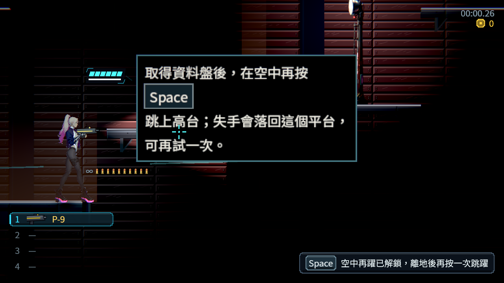
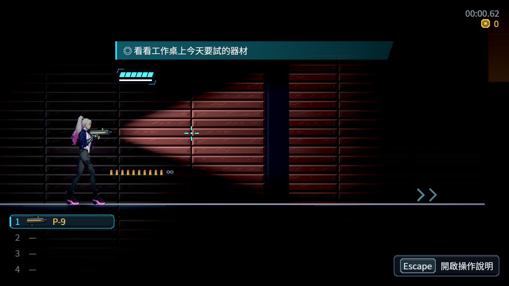
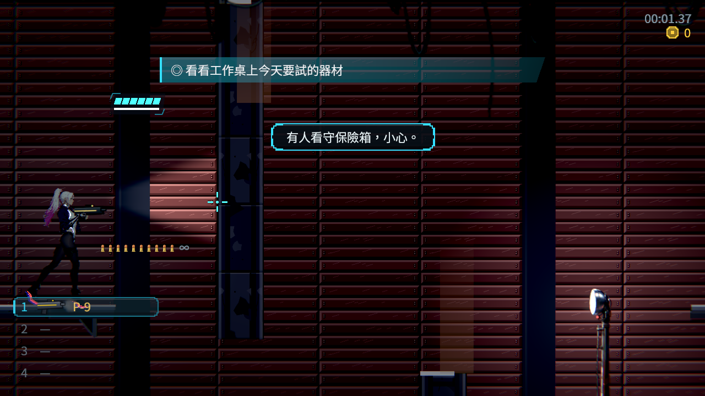

# NE-298 進度交付草稿（尚非完成票）

首章港區的主路線現在跨越街道上下層、倉庫貨運階梯及深處平台。取得資料盤後可走維修道回到街道與屋頂，並回訪先前看得見、跳不到的高處獎勵。深處提供失手可落回台階的能力練習位置，畫面會顯示空中再躍提示。

### 本次已記錄測試

| 項目 | 結果 |
|---|---|
| 原生 HIGH 真輸入／代表畫面 | 152 checks，0 failures，21 張原圖 |
| float→PNG 原精度重算 | 21 張、19,353,600 pixel 通過 |
| 前版雙套件聚焦 | 2399/0，保留原預期 warning；與 v8 來源分開 |
| 歷史失敗 | 所有原紅、原圖與來源 epoch 完整保留 |

### 原圖

