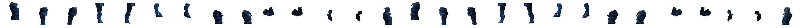

# NE-79 原生逐格接點診斷：未通過

正式來源 `5db3dfdd9fd253bd2858e06ee7df7ad0605fd2d5`，獨立 root 驗收 checkout。本次沒有改動角色或稽核工具，不把上次 CPU 契約通過當成零破圖。

## 實際擷取與結果

共享 GPU 鎖、Comfy 已停止；官方 Godot `4.7.2.stable.official.ed1daf0bf`、RTX 4070 SUPER、Forward+。沿用現有透明背景／不受光的相鄰零件檢查，武器、glow 及無關部件隱藏。這是局部接合診斷，不是完整角色受光或玩法驗收。

```powershell
D:/ComfyUI/.venv/Scripts/python.exe tools/comfyui/gpu_lock.py -- C:/Tools/Godot/Godot_v4.7.2-stable_win64_console.exe --audio-driver Dummy --path . res://tools/rig_joint_audit.tscn -- --chars=enforcer --frames=120 --out=<新的絕對資料夾>
D:/ComfyUI/.venv/Scripts/python.exe tools/check_joint_frames.py --self-check
D:/ComfyUI/.venv/Scripts/python.exe tools/check_joint_frames.py <同一絕對資料夾>
```

- 14 接點、左右面向、遊戲倍率 1／放大倍率 3.4，idle／run／aim_up／crouch／jump／block／stagger／dead，各 120 格，固定 60Hz。不是走路／跑步分開或全部操作組合的完整驗收。
- [capture.log](capture.log)：退出 0、無 ERROR；1,920 張原生 3584×128 PNG。
- 稽核 self-check 實跑：完整區通過，單像素孔洞與分離部件被拒絕。判定沿用原工具 alpha≥128、一像素也失敗，沒有改門檻。
- [check.log](check.log)及 [完整 report.json](report.json)：**1,287／53,760 接點樣本失敗，exit 1**。其中 1,281 帶封閉孔、6 個連通數異常，沒有中心覆蓋失敗。這些數量是工具標記，仍需逐案核對材質與預期開口；沒有因孔小或半透明而給過。
- 首要標記是 neck 在仰射、跳躍與倒下，倒下肘／腕，以及放大跑步／蹲入膝部。root 已查看仰射頸、跑步後膝與倒下前腕的原生 crop；頸部最壞樣本含 alpha=0 的孔，腕／膝亦有低 alpha 孔。沒有以「CPU 正常」或外輪廓抗鋸齒豁免。

## 原始證據與範圍

[frames.json](frames.json)保留每格時間、所有單元位置／方向／radius；[all-native-frame-sha256.json](all-native-frame-sha256.json)核對 1,920 張原始 PNG。全量 137,027,684 bytes 保留在 root 專用 checkout `.godot-transfer/joint-audit/`；repo 只保存 19 張代表性原生整列與原尺寸單元 crop，不宣稱附件包含全量畫面。

[selected.json](selected.json)列出每個方向為右的失敗類別代表、原始座標、孔的實際 alpha 值與 crop；`native-samples/` 的整列檔可重新用原 checker 量測，`crops/` 只有原生 128×128 裁切、沒有再縮放。整列左右 28 個接點依 frames 的 rect 對應，不能將長條圖縮圖當成看清一像素。

這次沒有驗證受光、全身解剖、所有裝甲階段或操作手感。NE-79 維持進行中；此報告用來定位後续來源／綁定修復，不能代替修後零失敗重拍。完整單元仍需核對所有標記的正常開口與材質；沒有勾選八動作驗收。




