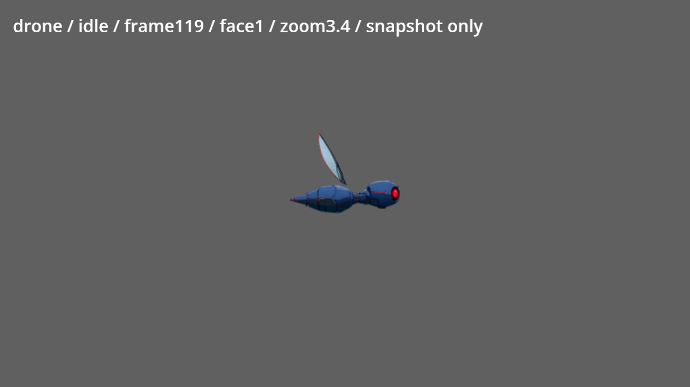
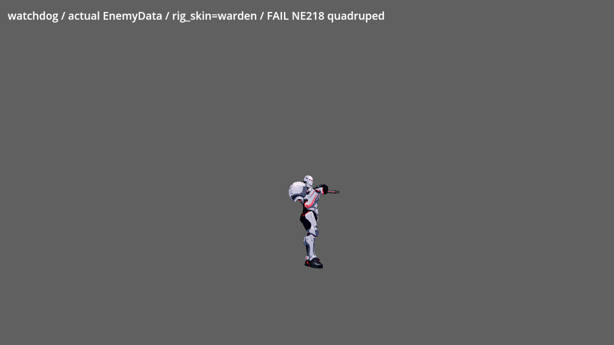
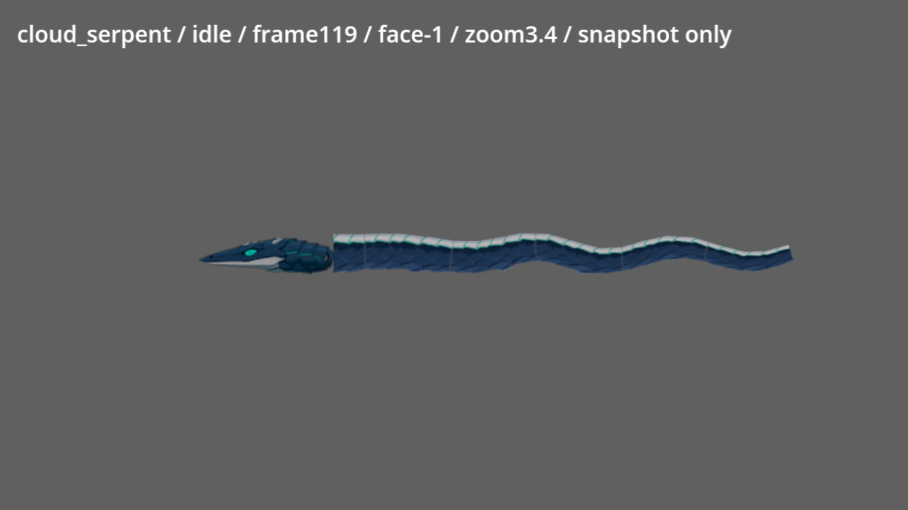
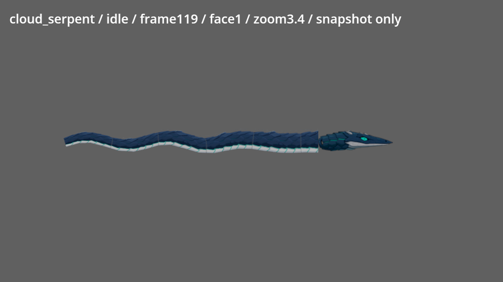

# NE-90 非人形角色本機複驗

2026-10-10，固定工作樹基準 `24bac9f1dc509a6c800ea09ae1c4e9f8b5d6ece7`。這是現有 NE-90／NE-218 的審查證據；不代表角色已修復或原票驗收完成。共享來源、遊戲程式、門檻、known_failures 與原票正文都沒有修改，修復由持有原票的工作接手。

## 範圍與已驗證項目

實際版本沒有 `EnemyLibrary` 類別。名單來自 `data/enemies/**/*.tres`、`EnemyData`、關卡資源與章節 roster：38 個敵人資源中，本組為16個正式非人形模型、共用模型的 buoy_worm_small，以及尚借人形外觀的 watchdog，共18個掛載項目。`test_creature` 只作 fixture。正式第一章包含 drone、watchdog；第二章與舊 Demo 的已存在模型也列入，第三章保留的模型沒有當作已出場角色。

| 檢查 | 結果與適用範圍 |
|---|---|
| 來源／資源相等 | 與已發布雲端帳本比較174項 SHA256（17 JSON、57來源PNG、62遊戲PNG、38 EnemyData），174相同、0變更；[逐檔對照](source-equivalence.json) |
| 依賴程式相等 | `game/creature`、`game/enemies`、`data/enemies`、`art/creatures`、`art_src/creatures` 在舊 capture 基準至本基準沒有 diff；舊故障沒有被新 main 修掉 |
| 來源／部件帳本 | 17 JSON逐件登記原生尺寸、alpha、父鏈、pivot、pos、z、狀態、gait及掛载來源；0父鏈順序或重複部件錯誤。[完整帳本](inventory.json) |
| 真實載入 | Godot 4.7.2：38 EnemyData、11種 PartCreature 的30個部件；[載入資料](runtime-metadata.json)、[原log](metadata.log) |
| 原生審查圖 | Intel Arc B580、Vulkan、Forward+、原生1280×720；16模型兩方向與watchdog真Enemy兩方向。採用專案HDR線性讀回轉sRGB工具，沒有resize原始截圖。這是中性灰背景審查圖，不是實際關卡光照／輸入／曝光驗收 |
| 既有雲端全量 | 沿用已發布的2160張隔離接點atlas與2230張PNG索引，沒有重下載重做；[已發布報告](../NE-90-cloud-creatures/REPORT.md)仍有138875個待來源回查旗標，不將旗標全部判定為素材失敗，也不算通過 |
| 本次局部測試選擇 | 固定base `24bac9f1`，只改pm私有審查工具／證據，selector沒有受影響遊戲套件；沒有宣稱新跑完整測試。舊686 checks屬已發布雲端結果 |

## 已確認仍存在的問題

| 項目 | 本次結果 | 最小修復定位／既有票 |
|---|---|---|
| watchdog | FAIL：真Enemy `dormant`、兩方向、`rig=true`／`PartCreature=false`，仍是拿槍的兩腳監管者 | NE-218：需要四足素材與步態；完成素材前不能套用空的掛載patch。清理rig優先載入、四feet、weapon/core caller及死亡驅動要求沿用[既有接口](../NE-90-cloud-creatures/NE218-interface.md) |
| shock_hound | FAIL：犬的四肢仍融合於body，只有body/tail、`gait.legs=[]`，prowl/circle沒有獨立四腳；growl/pounce拉伸整體 | NE-90／NE-100：依原source-space關節重分割四腿與隱藏底層，再綁固定上／下肢與足；原始來源仍可辨識犬體，先切件，不能為步態重画整隻或用人形替身 |
| wall_gecko | FAIL：腳爪與尾仍融合一張body，`gait.legs=[]`，crawl用sx/sy伸縮不能證明四腳交替 | NE-90／NE-99：分清四肢來源與近遠側遮擋、四腳接地／牆面接觸；四肢／尾的獨立運動不能由完整PNG拉伸代替 |
| drone | FAIL：idle/frame119、兩方向可見翼片與機身分離，Forward+重現 | NE-90／NE-91：核對source hinge、裁框和pivot/pos。舊pivot `(6,62)` 位於透明材質，來源候選 `(10,59)` 只作待實驗定位；必須隔離翼－機身逐格零裂縫及全彩通過後才接受，不能只改checker半徑 |
| cloud_serpent | FAIL：正確Camera2D倍率／真trail方向下，左向身體白腹在上，頭白腹在下；右向一致。頭－身帶另有硬直切口 | 源頭在Worm mesh normal隨方向改變，但UV的v=0/h固定，head單獨補償scale.y。需要一致的腹面手性與頭－身有效接合，不以鏡射整個世界mesh處理。NE-98已完成且曾稱「沒有接縫」，本次結果交root查未完成票與追修歸屬，不修改已結案票或重複開票 |









## 每模型的覆蓋與未驗

| 模型／掛載 | 本次可證明的項目 | 失敗／未驗 |
|---|---|---|
| bomber | 7件、6腿定義，idle兩方向原生審查 | 遠腿遮擋；Part gait沒有世界足鎖定，全部足材質接地／行走未驗 |
| buoy_worm | 6條足鏈、來源相等、兩方向模型審查、腳target數值 | 幾何tip與target、材質腳底和全動態接點仍分開判定 |
| buoy_worm_small | 真掛載倍率0.62的數值覆蓋 | 共用模型，不把1.0審查圖當0.62全狀態通過 |
| cloud_jelly | 6條觸鬚、idle兩方向來源／全彩審查 | 飛行，不要求步行；鐘罩－觸鬚根既有旗標仍待隔離回查 |
| cloud_serpent | source相等；專屬世界座標mesh與方向接口已回查，正確相機3.4倍率兩方向補拍 | FAIL腹面UV翻面；完整接點／實際掠過未驗 |
| drone | 3件、兩方向原生重現分離翼 | FAIL；完整拍翼狀態、死亡／受擊仍未驗 |
| mimic | closed/open两件及show狀態資料、closed兩方向審查 | 張嘴／撲咬完整切換未驗；空pivot band不是兩件裂縫 |
| rail_cannon | base/cannon兩件、idle兩方向審查 | 接點舊band零旗標只算該band；真後座、槍口與死亡未驗 |
| repair_drone | body和兩機械臂，idle兩方向審查 | 飛行／channel全彩及接點旗標未完成回查 |
| salvage_arm | 6條足鏈、真EnemyData倍率1.3，兩方向完整審查圖 | 舊雲端gait採1.0不能代驗真掛載；校正速度空間的新增數值分列下方；材質接地／觸手攻擊仍未驗 |
| searchlight_drone | body和兩推進器，idle兩方向審查 | 巡邏／照射／斷電／重啟全狀態未驗 |
| shaft_bat | body與兩翼、idle兩方向審查 | 飛行專屬招式及全部翼根旗標未完成回查 |
| shock_hound | 原始犬體來源、兩方向模型審查 | FAIL四腳分件／步態；無独立feet不能驗四足接地 |
| swarm_bee | 完整蜂一張body、fly兩方向審查 | 不要求走路；整圖飛行不能證獨立拍翼，stagger與接點覆蓋未驗 |
| tangle_wire | 5條牆附鏈、idle兩方向審查 | 固定附肢不要求步行；根／口／尖端既有旗標仍待source回查 |
| turret | base/head/barrel父鏈、idle兩方向審查 | 轉軸／底層既有旗標、實際槍口、死亡未驗 |
| watchdog | 真Enemy掛載、兩方向 | FAIL NE-218；四足素材、四腳步態與全動作尚未交付 |

沒有任何一個模型被宣告全部驗收通過。全動畫／全彩逐格、全物種材質腳掌接地、實際關卡／真輸入、發光材質及性能均不能由資料或單影格代驗。

## 正確掛載倍率與世界速度的48組腳target量測

每種掛載各16組：idle／half／full／turn、兩面向、1／3.4倍率，每組120frames，共5760frames。salvage真倍率1.3、buoy1.0、小蟲0.62。FootGait的2條原assertion通過；48組都非空，兩格同時踩地的world target slip=0、target地面誤差=0。[完整數值](gait.json)、[真log](gait.log)、[命令／RAM／共享鎖](command-gait.json)。

| 掛載 | idle最大tip-target偏差（原始frame0保留） | 正確world速度下turn最大偏差 | 腳掌材質接地 |
|---|---|---|---|
| salvage_arm（1.3） | 89.196846世界px，zoom3.4、frame0 | 51.969532世界px，zoom3.4、frame61 | 未驗 |
| buoy_worm（1.0） | 17.744675世界px，zoom3.4、frame0 | 32.436314世界px，zoom3.4、frame65 | 未驗 |
| buoy_worm_small（0.62） | 11.001698世界px，zoom3.4、frame0 | 15.740012世界px，zoom3.4、frame67 | 未驗 |

幾何tip並非材質腳掌，這些偏差只定位spawn／轉身／鏈幾何待查，不直接當作腳滑或踩地通過。先前速度空間不一致的turn數字不能與這份結果混用，也不能用較小數字宣稱遊戲已修復。

## 捕獲工具校正與重跑

首次移植舊capture使用線性HDR讀回直接存PNG，顏色偏暗。這批raw PNG僅保留在忽略的 `.godot/creature-subagent/raw-linear`，raw log另存；正式圖片改用目前專案 `tools/viewport_capture.gd` 的sRGB轉換，不改尺寸或來源。

WormCreature body為top_level世界座標mesh，原runner對根節點scale.x鏡射及wrapper放大會造成假缺尾／不同比例。已修私有runner改用真reset_trail方向與Camera2D倍率，不把工具失配開成角色缺陷。Chain gait原runner在local位置移動卻傳world velocity，wrapper3.4時速度不一致；私有runner改用global位置位移，並從EnemyData讀真倍率。舊錯配結果保存在 `gait-superseded-local-velocity.json`，不能當作真runtime修復基準。

`safe_run.py` 在取得既有跨worktree共享GPU鎖後檢查available RAM，低於4GiB不啟動Godot；各run結束立即釋放。不啟停ComfyUI、不生成、不接觸其他工作或App。兩次正式sRGB渲染開始前可用RAM13.99／14.04GiB，命令與共享鎖在command JSON，自己的渲染程序均已結束。

校正Worm方向／真salvage倍率的run開始前RAM14.23GiB，校正world速度gait前14.21GiB，最後兩張salvage補拍前12.70GiB。真倍率1.3使原y210舞台位置把頂端裁掉；最後補拍移至y250，保留完整機殼與全部可見觸手，沒有修改角色世界比例。這是私有審查舞台校正，不是遊戲修復。校正命令見 `command-native-capture-cloud_serpent-salvage_arm.json`、`command-native-capture-salvage_arm.json`，全部exit0。

[證據引用／SHA／原生尺寸檢查](evidence-validation.json)為16模型、38資源、174來源／資源hash、34原生PNG、0錯誤；不包含視覺驗收。私有Python工具語法檢查通過；`tools/run_tests_changed.sh 24bac9f1`實跑結果為沒有受影響套件，見[原log](changed-tests.log)。

```powershell
$env:PYTHONUTF8='1'
& C:/ComfyUI/venv/Scripts/python.exe pm/Nest-Egg/attachments/NE-90-creature-subagent/safe_run.py capture --godot C:/Tools/Godot/Godot_v4.7.2-stable_win64_console.exe --ids cloud_serpent,salvage_arm
& C:/ComfyUI/venv/Scripts/python.exe pm/Nest-Egg/attachments/NE-90-creature-subagent/safe_run.py gait --godot C:/Tools/Godot/Godot_v4.7.2-stable_win64_console.exe
```

圖片index保留原生PNG SHA與尺寸；review-sheet是原生像素裁切拼表，沒有resize，不代替完整PNG。全部件帳本與每個FAIL／未驗保留，NE-90保持進行中、NE-218不代勾或重開重複票。
