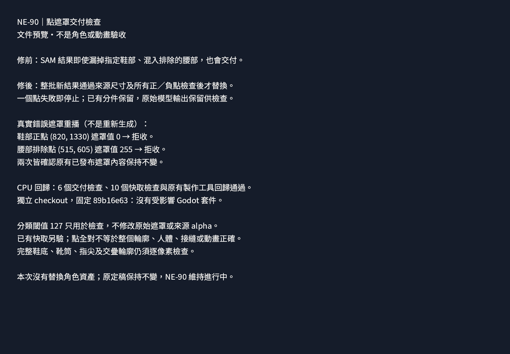

# NE-90：新點遮罩的交付檢查

本次交付只修製作工具，不替換任何角色資產，不代表 NE-90 的人體、接縫或動畫驗收通過。

原先模型結果會直接替換點遮罩，即使漏掉正點或吃到負點。現在先驗整批原生尺寸與正／負點，全部通過才写入交付目錄；不合格時保留舊分件與原始模型輸出。127 是檢查用分類界線，不會改寫遮罩或來源 alpha。既有快取仍須另驗完整輪廓，不能因正／負點正確就接受殘缺鞋底、少手指或多一條腿。

## 可重現驗證

固定基準 `89b16e63d39ca18a7385d930a744f09c28846d61`，獨立 checkout `D:/NestEggVerification/ne90-point-validation-89b16e63` 只有本票三份 Python 差異；未帶入主工作目錄中的其他人變更。

```powershell
D:/ComfyUI/.venv/Scripts/python.exe tools/comfyui/test_point_mask_validation.py
D:/ComfyUI/.venv/Scripts/python.exe tools/comfyui/test_point_mask_cache.py
D:/ComfyUI/.venv/Scripts/python.exe tools/comfyui/test_mask_delivery.py
D:/ComfyUI/.venv/Scripts/python.exe pm/Nest-Egg/attachments/NE-90-point-prompt-validation/replay_recorded.py
```

- 修前 4 個 tests、3 failures，原始 [red.log](logs/red.log) 保留。之後增加來源尺寸／軟遮罩回存驗證，修後共 6 個 tests 通過。
- [交付檢查](logs/validation.log)：6 tests 通過，包括批次順序、單像素漏選／錯收、尺寸、界外點、128／127 原始遮罩不變。
- [點提示快取](logs/cache.log)：10 tests 通過。
- [原有製作工具回歸](logs/delivery.log)：退出 0。
- Git Bash 執行 `tools/run_tests_changed.sh 89b16e63`，[結果](logs/changed-tests.log)正確選出 0 個 Godot 套件；本次是 Python 工具差異，沒有宣稱遊戲套件通過。

## 真實錯誤遮罩重播

[record.json](record.json) 是本次未採用的 SAM 第二次試作紀錄；這個附件只保留 `near_boot` 的實際輸出 [near_boot-rejected.png](near_boot-rejected.png)，其餘三個檔案未包含於本附件、未宣稱已採用。

輸入引用已交付的 `art_src/characters/rin_walk_source_ig01/sam/input-rgb.png`，SHA-256 `e0fc1cceb3adbc860cd639c689f2809848702080b47a051ad082d4a50b3a6242`；保留的靴子遮罩 SHA-256 `8bed6f50b4ef816c75fea78d66f2398746caf5bc55bc3f4ee62c2b5cedfe9409`。重播只 mock 模型返回，使用這份實際 PNG，不重新推理或啟動 GPU。

[重播結果](logs/recorded-mask.log)分開驗證兩條失敗路徑：正點 `(820,1330)` 值為 0、负點 `(515,605)` 值為 255，兩者均被拒收；舊交付內容保持不變。它證明交付防護能抓住實際錯誤，不能代替完整分件所有權或新模型實測。

## 原生文件截圖

Godot `4.7.2.stable.official.ed1daf0bf`、RTX 4070 SUPER、Forward+、明確開啟 SubViewport HDR 2D，1440×1000。匯入與 capture 均透過現有共享 GPU 鎖；ComfyUI 已停止。原始 [import.log](logs/import.log)、[capture.log](logs/capture.log) 保留，退出 0、無 ERROR。



`preview/` 保留實際文件、場景與 capture 腳本；字型及 `tools/viewport_capture.gd` 引用 repo 現有檔案。完整遊戲測試交 CI。
