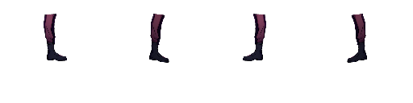
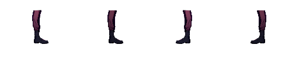
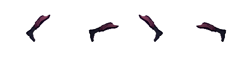
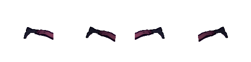
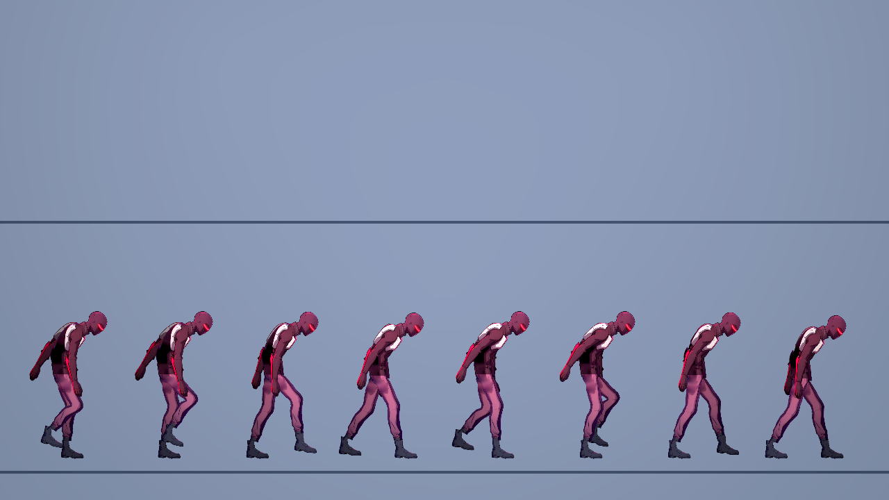

# NE-90 單靴來源與踝部逐格證據

本包記錄 Slasher（切割者）單靴來源遮罩與正式貼圖重建，以及受限範圍的 Forward+ 踝部逐格檢查。來源圖的 1:1 裁切、nearest-neighbor 標註圖與遊戲原生輸出分開標示；source sheet 不是 Godot 截圖。

## 結果範圍

CPU 來源重建使用 Slasher 原始 RGBA `832×1216`，SHA-256 `ba9af5139d225d492019c24c261bcd1ba9387d1bca7d10e7fd0fa3f5f1931bf3`，和近靴點遮罩 SHA-256 `f72640cc2736ce50335a8c719e4362e3bac6e0eecd9513c30e12e5e6ef709a85`。遮罩經既有 alpha≥40 與 8-連通面積≥30規則重播兩次，輸出逐像素相同並符合已註冊 override；一像素漏掉近靴鞋尖與誤收遠靴的負控制均被偵測。實際 `cut_layers.py` 重切結果與正式 `foot.png` 完全一致（155×130、pivot `[38.74,57.06]`）。同一單靴貼圖用於兩個分開的 front/back rig slot，不是雙靴圖集。完整輸入雜湊、owner ledger、來源座標、負控制與重建資料在 [`source/audit.json`](source/audit.json)。

原生端使用 Godot 4.7.2 Forward+。固定 8 種姿勢、兩個 facing、`1.0×` 和 `3.4×`，每組 120 幀；踝部 checker 實際執行 `7,680` 個樣本，`0` 失敗。原生輸出只有 ankle_front/ankle_back 的孤立透明 joint cells，不涵蓋其他身體接點。

下列四張是原生逐格輸出中的代表影格，均為 `3.4×`、RGBA 512×128；full-gait 另圖是原生 Forward+ 階段輸出：

| 姿勢 | 原生影格 |
|---|---|
| Idle |  |
| Run |  |
| Crouch |  |
| Dead |  |



## 來源圖檢視

| 圖 | 用途 |
|---|---|
| [原始來源 1:1 黑／灰／白底裁切](source/review/slasher-source-boot-context-native.png) | 顯示原圖可見靴子與 source 座標，不縮放 |
| [source owner 3× 最近鄰標註](source/review/slasher-foot-owner-source-3x.png) | 青色為選取近靴，紅色為未選像素；座標點和外靴負控制已標示 |
| [腿部零件灰底 2×](source/review/slasher-leg-parts-gray-2x.png) | 檢視 upper/lower/foot 部件素材 |
| [lower-leg 與靴口接縫原生區域 4×](source/review/slasher-leg-lower-to-boot-cuff-native4x.png) | 顯示 1,002 像素重疊及其中 76 個 RGBA 差異；不是通過判定 |
| [來源靴子 1:1](source/review/slasher-source-foot-native-1x.png) | 未放大的來源裁切 |

## 重現

從 repository root 以已安裝 Python 執行可攜 source audit；repo root 由此檔所在 packet 的 `parents[4]` 推導，輸出只寫入 `.godot/ne90-single-boot-review/`：

```powershell
D:/ComfyUI/.venv/Scripts/python.exe pm/Nest-Egg/attachments/NE-90-single-boot/audit.py
D:/ComfyUI/.venv/Scripts/python.exe pm/Nest-Egg/attachments/NE-90-single-boot/verify_packet.py
```

既有依賴為 Pillow、NumPy、OpenCV；不新增依賴。原始 source audit 執行記錄在 [`source-audit.log`](source-audit.log)，兩次輸出 PNG 保存在 [`source/replay`](source/replay)。

原生擷取與 checker 命令如下（實際輸出保留在 native logs、`frames.json`、`report.json`；完整 1,920 張 PNG 不複製進此包）：

```powershell
D:/ComfyUI/.venv/Scripts/python.exe tools/comfyui/gpu_lock.py -- C:/Tools/Godot/Godot_v4.7.2-stable_win64_console.exe --path . res://tools/rig_preview.tscn -- --chars=slasher --gait --speed=170 --run-speed=170 --bright --out=D:/NestEggVerification/ne90-single-foot-review/native/slasher-gait.png
D:/ComfyUI/.venv/Scripts/python.exe tools/comfyui/gpu_lock.py -- C:/Tools/Godot/Godot_v4.7.2-stable_win64_console.exe --path . res://tools/rig_joint_audit.tscn -- --chars=slasher --joints=ankle_front,ankle_back --frames=120 --out=D:/NestEggVerification/ne90-single-foot-review/native/ankle-120
D:/ComfyUI/.venv/Scripts/python.exe tools/check_joint_frames.py D:/NestEggVerification/ne90-single-foot-review/native/ankle-120
```

原始 1,920 張 128×128 RGBA frame 的 SHA-256 清單在 [`native/ankle-120/raw-frame-sha256.json`](native/ankle-120/raw-frame-sha256.json)，相對於原始 native scratch 目錄的路徑列出；native 組別索引與原始報告也一併保留。若本機仍有該 scratch，可用 `verify_packet.py --native-source D:/NestEggVerification/ne90-single-foot-review/native/ankle-120` 逐張重新核對雜湊。

## 未涵蓋項目

這份證據只支持來源 owner、正式 foot texture 來源重播、兩個踝部透明接點 checker 結果，以及所列原生畫面的局部檢視。下腿與靴口有來源重疊（1,002 source pixels，其中 76 pixels 的 RGBA 與原始圖不同），保留在 [`source/review/slasher-leg-lower-to-boot-cuff-native4x.png`](source/review/slasher-leg-lower-to-boot-cuff-native4x.png) 供檢視。此包不宣稱全身 anatomy、所有朝向/比例的人工視覺驗收、足底接觸、照明、戰鬥操作或整張 NE-90 通過。全序列像素/哈希資料不等於全身人工驗收。
